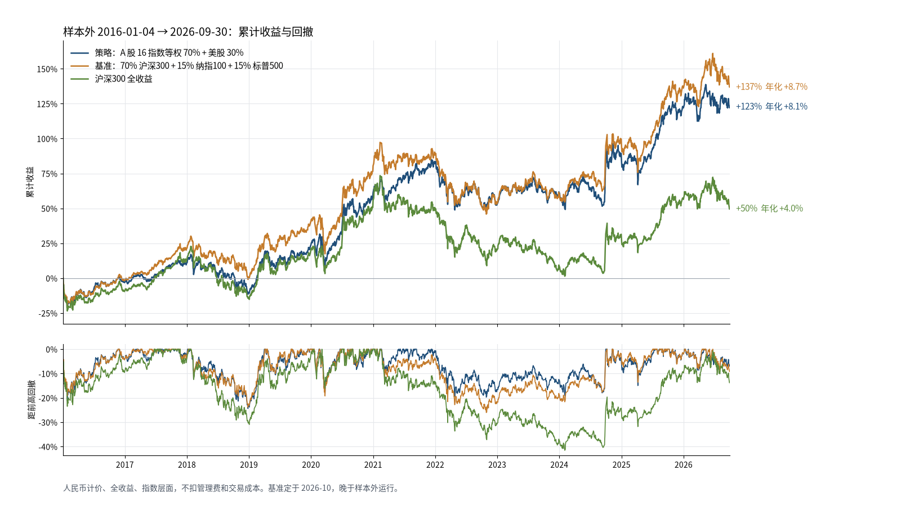
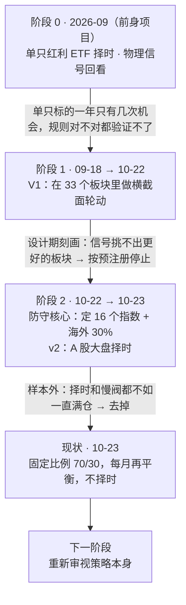
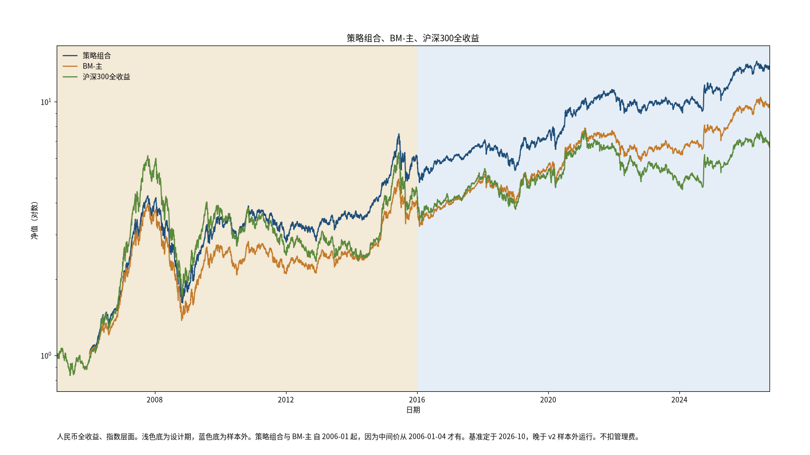
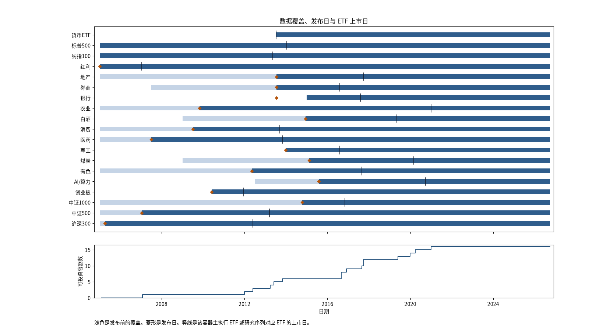

# ETF_Rotation_Quant

**这是一套个人账户用的 A 股 + 美股 ETF 配置系统，仓库里也保存了得出它的全部研究记录。**

项目起初要找一套能在样本外站住的 A 股板块轮动规则。我们先后试了三条主动路线：单只 ETF 择时、板块轮动、大盘择时。每条都先写预注册再检验，结果都没有站住。最后交付的是一个**不择时的固定比例组合**：A 股 16 个指数等权，合计占 70%；纳指 100 和标普 500 各占 15%；每月再平衡。

2016-01 到 2026-09 是只跑一次的样本外检验。这段时间里，组合年化 **+8.05%**，最大回撤 **−24.4%**。同期的基准年化 **+8.70%**，最大回撤 **−26.0%**，基准就是按同样比例直接持有沪深300 和两只美股指数。两者在统计上没有差别：**这套系统没有证明任何超额收益能力，它本质上是一个分散的被动配置。**

| 阶段 | 现行配置 | 实盘 | 样本外 2016–2026 | 下一步 |
|---|---|---|---|---|
| 第一阶段已收尾（2026-10-23） | [`config/portfolio.toml`](config/portfolio.toml) | 未开始 | 已用掉（2026-10-23，一次） | 重新审视策略本身（另开讨论） |

> *English summary.* A monthly-rebalanced, no-timing ETF allocation for a CNY retail account: 70% in 16 equal-weighted A-share indices and 30% split between Nasdaq-100 and S&P 500 (QDII ETFs). Three pre-registered active approaches failed: single-ETF timing, sector rotation, and market timing. Over the one-shot out-of-sample window (2016-01 → 2026-09), the portfolio returned +8.05% a year with a −24.4% max drawdown, versus +8.70% and −26.0% for a same-weight passive benchmark (CSI 300 TR + NDX TR + S&P 500 TR, all in CNY). The gap is not statistically meaningful.



**目录**：[1 一页结论](#1-一页结论) · [2 目标与边界](#2-目标与边界) · [3 路线图](#3-路线图我们是怎么走到这里的) · [4 现在的系统](#4-现在的系统) · [5 结果与基准](#5-结果与基准) · [6 为什么是这个结果](#6-为什么是这个结果) · [7 数据](#7-数据) · [8 证据强度与局限](#8-证据强度与局限) · [9 复现](#9-复现) · [10 仓库导航](#10-仓库导航)

---

## 1. 一页结论

1. **没有找到能验证的主动收益来源。** 单只 ETF 择时、板块横截面轮动、大盘趋势择时三条路线，都按事先写好的判据检验过，都不成立（§3、§6.1）。
2. **交付的是一个被动配置，表现和基准基本一样。** 样本外年化比基准少 0.64 个百分点，最大回撤浅 1.6 个百分点。跟踪误差 4.7%，信息比率 −0.14，对应约 −0.5 的 t 值，在统计上分不出高低（§5）。
3. **设计期 +20.5%，样本外只有 +8.05%。落差主要来自 A 股市场本身变差了，不是规则失效。** A 股 16 指数等权部分的年化少了 18.4 个百分点，其中 17.4 个百分点是全市场（中证全指）自己的下降。相对全市场的超额只从 +2.2 变为 +1.2 个百分点每年（§6.2）。
4. **样本外的收益主要靠美股。** 样本外里 30% 的美股部分贡献了约 62% 的收益（§6.3）。
5. **研究用的是指数，不是 ETF。** 样本外开始时，16 个 A 股指数里只有 6 个能买到对应的 ETF，到 2020 年底才 16 个全有。设计期里约 60% 的数据是指数发布前倒推出来的。这两点都让绝对收益偏乐观（§7）。

## 2. 目标与边界

**原来的问题**：在 A 股主题 ETF 上，能不能找到一套在样本外站得住的规则，靠选板块或择时获得超过持有不动的收益？

**约束**：
- 个人账户。只做场内 ETF，不加杠杆，不做空，不做日内。
- 月频或更慢的决策。由人手动下单。

**纪律**：每一次正式尝试都遵守以下规则，以防"看了结果再改规则"：
- 先写预注册，写明规则、判据、"什么结果对应什么动作"，然后才跑数据。
- 规则只用 2005–2015 年数据（设计期）定型。
- 2016-01 到 2026-09 这段数据（样本外）冻结，只允许跑一次，跑之前写锁文件。
- 失败就关闭这个方向，不换参数重跑。

## 3. 路线图：我们是怎么走到这里的



| 阶段 | 要验证的假设 | 怎么验证 | 结果 | 决定 |
|---|---|---|---|---|
| 0a 红利 ETF 择时（[预注册](docs/prereg/etf-dividend-enhancement-prereg.md)） | 用趋势或慢信号择时，510880 能跑赢持有不动 | 19 个配置，5 年设计、1 年检验，逐年滚动 | 每条规则的超额都来自 2008 年。剔除 2008，19 个配置全部为负；样本外十年超额 −57% | 关闭。择时买的是"躲 2008 型崩盘"的保险，其余年份每年付 3–10% 的保费 |
| 0b 物理信号回看（[记录](docs/research/etf-l1-retrospective.md)） | 台积电月营收这类物理信号，会先于资金流向出现 | 2026 年 44 个"相对强弱首次进前三"的时点 | 有物理信号的板块和没有的，看不出差别 | 不立项 |
| 1 V1 横截面轮动（[预注册](docs/prereg/etf-rotation-prereg-v1.md)） | 永远满仓，在 33 个板块里买"刚启动"的形态，用失效位止损、移动止盈，可以赚到选择带来的收益 | 先写预注册，再建数据层和指标层，冻结代码，第一步刻画信号 | 处在可买入状态的板块，随后 20 日平均超额 −0.255%，反而低于中性状态的 +0.040%（差值 95% 区间 [−0.75%, +0.19%]） | **在设计期就停止**，没有动用样本外 |
| 1′ 停止后的诊断（[记录](operations/reviews/2026-10-22-r2-diagnostics.md)） | 为什么轮动做不成 | 用同样的离场规则配随机入场做对照；算统计力 | V1 共 275 笔，期望 +0.64R；随机入场 200 次的中位数是 +0.68R。要证明 +0.3R 的优势需要约 560 笔，也就是 22 年 | 收益来自牛市和离场规则，不来自选择 |
| 2 防守核心（[D2、D5](operations/planning/2026-10-22-parallel-lanes.md)） | 以分散持有为主体，A 股加一个慢速保护阀 | 设计期比较；研究 QDII 溢价 | 确定 16 个 A 股指数、海外 30% 和 QDII 溢价规则 | 作为 v2 的检验对象 |
| 2′ v2 大盘择时（[预注册](docs/prereg/etf-timing-prereg-v2.md)） | 用均线信号（Qulla 10/20）切到货币基金，能用不超过 2 个百分点的年化代价换来至少 10 个百分点更浅的回撤 | 冻结样本外，只跑一次 | 回撤只浅了 7.1 个百分点，年化少了 3.2 个百分点，成本加倍后回撤反而更深。慢阀（跌 25% 离场、回升 10% 回来）的收益和回撤都比一直满仓差 | **不通过，按预注册 §6 去掉慢阀**（D7） |
| 3 收尾（2026-10-23，`milestone/phase1-closeout`） | — | 整理仓库；定基准；做归因和数据时间线（[证据包](operations/work_logs/2026-10-23-readme-evidence.md)） | 见 §5–§7 | 第一阶段结束 |

关键节点都打了标签：`milestone/v1-code-freeze`、`milestone/v1-r2-stop`、`milestone/v2-prereg-freeze`、`milestone/v2-oos-result`、`milestone/core-portfolio-live-config`、`milestone/phase1-closeout`（第一阶段收尾，[记录](operations/work_logs/2026-10-23-phase1-closeout.md)）。

## 4. 现在的系统

**持有什么**

| 部分 | 权重 | 内容 |
|---|---|---|
| A 股 | 70% | 16 个指数等权，每个约 4.4%，每个对应一只执行 ETF（清单见 §7.1） |
| 美股 | 30% | 纳指 100 占 15%：从 513100 / 159941 / 513300 中选；标普 500 占 15%：从 513500 / 159612 / 513650 中选 |
| 临时存放 | 0% 起 | 511880（货币 ETF），只在 QDII 溢价超过上限时使用 |

**每月做什么**
1. **决策日**是每月最后一个交易日，收盘后生成目标持仓，写明每只代码多少股，按 100 股取整：`python -m src.portfolio target`。
2. **A 股**：每月把 16 只调回等权。
3. **美股**：整体权重在 22.5%–37.5% 之间不动，超出才调回 30%。
4. **QDII 选哪只**：
   - 溢价 = 收盘价 ÷ 前两个交易日的单位净值 − 1。
   - 新买的时候，买同一指数里溢价最低的那只。
   - 如果最低的溢价也超过 10%，这个指数这次不买，钱放 511880。
   - 卖的时候，先卖溢价最高的。
5. **执行日**是下一个交易日，手动下单，不改目标里的数量。
6. **不做**：择时、板块轮动、选股、杠杆、做空。

**为什么是这个样子。** 轮动和择时都检验过、都没用之后，剩下能站住的只有"分散持有、定期再平衡"。16 个指数原本是轮动的候选池，这次是直接整个持有。这份清单本身没有经过独立检验，是下一阶段要重新讨论的问题（§8）。美股占 30%：A 股和美股的月度相关只有 0.31，设计期里 30%、40%、50% 三种比例的差别在噪声范围内（[研究](operations/reviews/2026-10-23-qdii-premium-and-weight.md)）。

**QDII 为什么会长期高溢价。** 外汇局按基金公司核定 QDII 额度，额度用完，基金就暂停或限制申购，"申购后在场内卖出"的套利也就断了。2026 年主力纳指和标普 ETF 的溢价中位数在 5–7%。溢价也可能突然塌缩：2025-04 关税暴跌时，159612 的净值跌了约 3%，场内价格跌了约 15%。

**最近一期目标**：决策日 2026-09-30，执行日 2026-10-08。
- A 股 16 只各约 4.4%。
- 标普买 513650，溢价 +7.4%。
- 纳指池里溢价最低的 513300 也有 +11.4%，超过上限，这 15% 暂时放在 511880。

详见 [`results/portfolio/target-2026-09-30.json`](results/portfolio/target-2026-09-30.json)。

## 5. 结果与基准

### 5.1 基准怎么定

按 GIPS 关于基准的指引（[Guidance Statement on Benchmarks](https://www.gipsstandards.org/wp-content/uploads/2023/08/gs_benchmarks_firms.pdf)）来定：基准要和策略的投资范围、配置比例一致，要用全收益口径，要能直接买到；混合基准要披露成分、权重和再平衡方式，并逐年列出收益。美股部分换算成人民币，这是国内 QDII 基金合同的惯例。例如 513100 的业绩比较基准是"纳斯达克100 指数收益率（经汇率调整后的总收益指数收益率）"。

| 名称 | 构成 | 作用 |
|---|---|---|
| **基准（BM-主）** | 70% 沪深300 全收益 + 15% 纳指100 全收益 + 15% 标普500 全收益（美股按人民币中间价换算），每月第一个交易日再平衡 | 回答"同样比例直接买 510300、513100、513500 放着，会怎样" |
| 全市场基准 | 同上，A 股部分换成中证全指全收益 | 回答"和整个 A 股市场比会怎样" |

基准是 2026-10 定的，晚于样本外运行。GIPS 允许事后定基准，但要写明，这里如实披露。所有数字都是指数层面，不扣管理费和交易成本。夏普比率的无风险利率用 511880 的真实收益，511880 上市前按年化 2% 计。

### 5.2 三个区间

**样本外 2016-01-04 → 2026-09-30**（主要看这一段）

| 序列 | 年化 | 波动 | 最大回撤 | 夏普 | 相对基准年化 | 跟踪误差 | 信息比率 |
|---|---|---|---|---|---|---|---|
| **策略组合** | **+8.05%** | 15.9% | **−24.4%** | 0.43 | −0.64pp | 4.7% | −0.14 |
| 基准（BM-主） | +8.70% | 15.5% | −26.0% | 0.47 | — | — | — |
| 全市场基准 | +7.18% | 16.5% | −25.1% | 0.37 | −1.52pp | 5.1% | −0.30 |
| 其中：A 股 16 指数等权 | +3.05% | 19.8% | −35.7% | 0.14 | | | |
| 沪深300 全收益 | +4.00% | 19.0% | −41.6% | 0.18 | | | |
| 中证全指 全收益 | +1.85% | 20.6% | −37.1% | 0.08 | | | |
| 标普500 全收益（人民币） | +15.93% | 17.6% | −32.9% | 0.80 | | | |
| 纳指100 全收益（人民币） | +21.41% | 22.2% | −29.5% | 0.89 | | | |

**设计期 2006-01-05 → 2015-12-31**（规则在这段定型，只作参考）

| 序列 | 年化 | 波动 | 最大回撤 | 夏普 | 相对基准年化 |
|---|---|---|---|---|---|
| **策略组合** | +20.54% | 23.9% | −62.2% | 0.80 | +5.09pp |
| 基准（BM-主） | +15.45% | 23.2% | −65.5% | 0.63 | — |
| 全市场基准 | +18.91% | 23.4% | −64.0% | 0.75 | +3.46pp |
| 其中：A 股 16 指数等权（2005 起） | +21.44% | 30.9% | −69.8% | 0.70 | |
| 沪深300 全收益（2005 起） | +15.10% | 29.8% | −72.0% | 0.54 | |
| 中证全指 全收益（2005 起） | +19.29% | 30.2% | −71.3% | 0.66 | |

全程（2006-01-05 → 2026-09-30）：策略 +13.90% / −62.2%，基准 +11.90% / −65.5%。设计期和全程的组合都从 2006-01-05 起算，因为人民币中间价从 2006-01-04 才有。



<details>
<summary><b>逐年收益</b>（GIPS 要求逐年列出基准收益；2026 年只到 9 月 30 日）</summary>

| 年 | 策略组合 | 基准 | 差 | A 股 16 指数 | 美股部分 | 沪深300 | 中证全指 |
|---|---|---|---|---|---|---|---|
| 2006 | +80.6% | +79.5% | +1.1% | +126.5% | +6.2% | +125.2% | +115.4% |
| 2007 | +122.0% | +103.8% | +18.2% | +194.8% | +5.5% | +163.3% | +172.4% |
| 2008 | −55.7% | −59.6% | +4.0% | −60.9% | −44.2% | −65.6% | −63.8% |
| 2009 | +96.3% | +83.4% | +12.9% | +119.4% | +42.9% | +98.6% | +108.1% |
| 2010 | +4.0% | −4.3% | +8.2% | −0.5% | +13.2% | −11.6% | −3.0% |
| 2011 | −20.4% | −17.8% | −2.6% | −27.8% | −1.9% | −24.0% | −27.3% |
| 2012 | +10.4% | +12.1% | −1.7% | +7.3% | +14.3% | +9.8% | +6.2% |
| 2013 | +12.7% | +5.2% | +7.5% | +4.5% | +32.4% | −5.3% | +7.1% |
| 2014 | +33.5% | +44.8% | −11.3% | +39.8% | +18.8% | +55.8% | +48.4% |
| 2015 | +26.1% | +9.7% | +16.4% | +30.4% | +12.0% | +7.2% | +33.8% |
| **2016** | −3.0% | −1.7% | −1.3% | −11.2% | +16.8% | −9.3% | −13.3% |
| 2017 | +14.0% | +23.0% | −9.0% | +11.4% | +19.7% | +24.3% | +3.7% |
| 2018 | −18.7% | −16.5% | −2.1% | −26.5% | +1.5% | −23.6% | −28.8% |
| 2019 | +37.6% | +39.2% | −1.6% | +36.6% | +38.3% | +39.2% | +33.4% |
| 2020 | +30.3% | +28.5% | +1.8% | +32.4% | +24.2% | +29.9% | +26.9% |
| 2021 | +13.8% | +5.1% | +8.7% | +8.3% | +26.5% | −3.5% | +7.7% |
| 2022 | −16.3% | −18.6% | +2.3% | −16.2% | −18.8% | −19.8% | −18.9% |
| 2023 | +5.4% | +4.6% | +0.8% | −8.1% | +42.7% | −9.1% | −5.3% |
| 2024 | +14.8% | +21.8% | −7.1% | +8.1% | +27.8% | +18.2% | +10.0% |
| 2025 | +19.5% | +20.1% | −0.6% | +20.1% | +17.0% | +21.0% | +27.0% |
| 2026（至 9/30） | +0.5% | +0.4% | +0.1% | −4.1% | +11.2% | −4.1% | −3.3% |

来源：[`results/report/annual.csv`](results/report/annual.csv)。2016 年起为样本外。

</details>

**和预注册里的数字有什么不同。** v2 预注册 §9 报的组合样本外是 +7.75% / −26.3%，当时美股部分按美元计，纳指用的是价格指数。这里统一成人民币全收益，所以变成 +8.05% / −24.4%。A 股部分没有变化，还是 +3.05% / −35.75%。两种口径的对账见[证据包工作记录](operations/work_logs/2026-10-23-readme-evidence.md)。

## 6. 为什么是这个结果

### 6.1 主动路线为什么都没站住

| 路线 | 根本原因 |
|---|---|
| 单只 ETF 择时 | 只有一个标的，二十年也只有二三十次机会。规则就算是对的，也验证不了；要让信息比率 0.2 的规则在统计上站住，需要约一百年 |
| 板块横截面轮动 | 板块层面的"好形态"没有区分度：近 52 周高点、波动收缩、1 月动量都不显著，波动收缩甚至显著为负。收益来自牛市和离场规则，随机入场也能做到 |
| 大盘趋势择时 | 本质是买保险：躲过 2008 那样的崩盘，其余年份付保费。样本外没有那个量级的崩盘，频繁切换（每年 29.6 次）又反复被来回打脸 |

### 6.2 设计期 → 样本外：落差从哪里来

A 股 16 指数等权和整个 A 股市场（中证全指全收益）走得几乎一样：月度相关系数，设计期 0.99，样本外 0.96；beta 0.93–1.01。所以它的落差应该先和市场本身比：

| | 设计期 | 样本外 | 变化 |
|---|---|---|---|
| A 股 16 指数等权，年化 | +21.44% | +3.05% | −18.39pp |
| 中证全指全收益，年化 | +19.29% | +1.85% | **−17.44pp（市场本身）** |
| 相对中证全指 | +2.15pp | +1.20pp | −0.95pp |
| 沪深300 全收益，年化 | +15.10% | +4.00% | −11.10pp |
| 中证全指相对沪深300 | +4.19pp | −2.15pp | −6.34pp（大盘股和中小盘股的风格切换） |

- **落差的绝大部分是 A 股市场本身变差了。** 2016 年以后，全市场年化只有 1.85%。
- **和沪深300 比**，设计期每年领先 6.3 个百分点，样本外反而落后 0.95 个百分点。这主要是风格切换：等权会偏向中小盘，2016–2024 年大盘股更强。
- **倒推数据**：只用指数发布后的数据重算设计期，年化低 1–1.5 个百分点，回撤基本不变（[核对](operations/reviews/2026-10-23-grok-pit-xcheck.md)）。
- 相对中证全指每年 +1.2 个百分点的超额，信息比率只有 0.22，对应约 0.7 的 t 值，**不能当作稳定的优势**。

### 6.3 相对基准的差距来自哪里

- **组合比基准每年少 0.64 个百分点**，几乎全部来自 A 股部分：16 指数等权比沪深300 每年少 0.95 个百分点，乘以 70% 的权重约等于 −0.67。美股部分和基准的构成相同。
- **样本外 16 个指数各自的年化**（[`attribution.csv`](results/report/attribution.csv)）：
  - 最好：红利 +6.9%、有色 +6.9%、消费 +6.5%、白酒 +4.8%、AI +4.7%。
  - 最差：地产 −10.5%、券商 −3.5%、中证1000 −2.6%、军工 −2.2%。
  - 沪深300 自己是 +4.0%，16 个里只有 6 个跑赢了它。
- **样本外收益主要靠美股。** 按月度贡献加总，A 股部分贡献年化约 3.4 个百分点，美股部分约 5.6 个百分点。美股只占 30% 的权重，却贡献了约 62% 的收益。同期纳指100 按人民币计年化 +21.4%，标普500 +15.9%。

## 7. 数据

### 7.1 清单：用了哪些指数，从什么时候开始

研究和回测用的都是**指数**；实盘买的是表中的 ETF。回测里每个指数从"数据起点"开始计入，数据还没开始的，就在已有数据的指数之间平分。

| 板块 | 研究序列 | 口径 | 数据起点 | 指数发布日 | 执行 ETF | ETF 上市 |
|---|---|---|---|---|---|---|
| 沪深300 | H00300 | 全收益 | 2005-01-04 | 2005-04-08 | 510300 | 2012-05-28 |
| 中证500 | H00905 | 全收益 | 2005-01-04 | 2007-01-15 | 510500 | 2013-03-15 |
| 中证1000 | H00852 | 全收益 | 2005-01-04 | 2014-10-17 | 512100 | 2016-11-04 |
| 创业板 | 399006 | 价格 | 2010-06-02 | 2010-06-01 | 159915 | 2011-12-09 |
| AI/算力 | H20713 | 全收益 | 2012-07-02 | 2015-07-31 | 159819 | 2020-09-23 |
| 有色 | H00819 | 全收益 | 2005-01-04 | 2012-05-09 | 512400 | 2017-09-01 |
| 煤炭 | 399998 | 价格 | 2009-01-05 | 2015-02-13 | 515220 | 2020-03-02 |
| 军工 | 399967 | 价格 | 2014-01-02 | 2013-12-26 | 512660 | 2016-08-08 |
| 医药 | H00913 | 全收益 | 2005-01-04 | 2007-07-02 | 512010 | 2013-10-28 |
| 消费 | H00932 | 全收益 | 2005-01-04 | 2009-07-03 | 159928 | 2013-09-16 |
| 白酒 | 399987 | 价格 | 2009-01-05 | 2014-12-10 | 512690 | 2019-05-06 |
| 农业 | H00949 | 全收益 | 2005-01-04 | 2009-10-28 | 159825 | 2020-12-29 |
| 银行 | 399986 | 价格 | 2014-12-30 | 2013-07-15 | 512800 | 2017-08-03 |
| 券商 | 399975 | 价格 | 2007-07-02 | 2013-07-15 | 512880 | 2016-08-08 |
| 地产 | 931775 | 价格 | 2005-01-04 | 2013-07-15 | 512200 | 2017-09-25 |
| 红利 | H00015 | 全收益 | 2005-01-04 | 2005-01-04 | 510880 | 2007-01-18 |
| 纳指100 | XNDX（人民币） | 全收益 | 2005-01-05 | — | 513100 等 | 2013-05-15 |
| 标普500 | ^SP500TR（人民币） | 全收益 | 2005-01-04 | — | 513500 等 | 2014-01-15 |
| 货币 | 511880 | 收盘价 + 分红 | 2013-07-12 | — | 511880 | 2013-07-12 |

来源：[`results/report/universe.csv`](results/report/universe.csv)。备选基金见 `config/portfolio.toml`。指数发布日来自中证官网和编制方案原件。



从时间线可以看出两件事：
- **设计期里很多数据是倒推的。** 浅色段是指数发布前、中证事后按成分股真实股价倒算出来的历史；设计期里约 60% 的"指数 × 月"属于这种情况。例如 AI 指数基日是 2012-06，正式发布在 2015-07。
- **很多板块当时买不到。** 2016-01 样本外开始时，16 个里只有 6 个有 ETF 可买；2018 年底有 12 个；2020 年底才 16 个全有（[`investable.csv`](results/report/investable.csv)）。所以样本外数字的意思是"按指数价格成交"，而不是"当时真的买得到"。

### 7.2 能不能代表 A 股市场

- **收益走势上，基本能代表。** 16 指数等权和中证全指的月度相关是 0.96–0.99，beta 接近 1（[`representativeness.json`](results/report/representativeness.json)）。
- **结构上偏。** 4 个宽基（沪深300、中证500、中证1000、创业板）只占 25%，另外 75% 平分给 12 个行业主题。半导体、新能源、汽车、通信、机械、化工、公用事业、交通运输等行业没有单独的指数，只能通过宽基间接持有。这 16 个是 2026 年的人挑出来的，带有事后的眼光，比如 AI 和白酒。
- **行业权重的定量对比没有做。** 中证全指的一级行业权重没有拿到（[`UNAVAILABLE.md`](results/report/UNAVAILABLE.md)）。

### 7.3 存放与来源

所有数据都在一个 SQLite 文件 `data/market.sqlite` 里，约 69 MB，纳入版本管理，SHA256 `eb81f47bd02daff97d649a3159a8617be96d8d0fda0e3241cf3defd6440fb906`。每次写库都登记 run_id 和写入前后的 SHA256（[`results/inventory/db-writes.txt`](results/inventory/db-writes.txt)）。第三方交付的原件放在 `incoming/`，附 MANIFEST 和哈希。完整清单见 [`docs/data/data-inventory.md`](docs/data/data-inventory.md)。

| 内容 | 来源 |
|---|---|
| A 股指数（全收益、价格） | 中证指数官网，部分来自腾讯，另有登记过的离线恢复批次 |
| 纳指100 全收益 XNDX | Nasdaq 官方历史导出 |
| 标普500 全收益 | Yahoo `^SP500TR` |
| 美元兑人民币中间价 | 中国外汇交易中心（2006-01-04 起） |
| ETF 日线、成交额 | 腾讯、搜狐 |
| QDII 单位净值 | 东方财富 f10（15 只） |
| 现金分红、指数发布日 | 交易所和巨潮公告原件 |

### 7.4 已知的数据陷阱

1. **主题指数倒推**，见 §7.1。
2. **7 个 A 股指数是价格指数**：创业板、煤炭、军工、白酒、银行、券商、地产，没有算分红，这部分收益偏低。对应 ETF 每年实际多 0.3–4 个百分点，银行最多，约 4.1。另外 9 个是全收益指数，ETF 扣掉费用后每年反而落后约 0.4–0.8 个百分点（[跟踪差](results/inventory/tracking-yearly-2026-09-30.csv)）。
3. **腾讯前复权反推出的分红是噪声**：41 只代码共 19,953 行已经删除并存档，只保留一手公告。
4. **份额折算造成的假跳空**：共 39 处，只做标记，不改价格。

## 8. 证据强度与局限

| 结论 | 证据 | 强度 |
|---|---|---|
| 不择时、长期持有 | v2 样本外两种择时都不如一直满仓；和旧项目红利择时的失败一致 | 中：只有一条 10.75 年的路径 |
| A 股用这 16 个指数等权 | 没有对照检验；样本外比沪深300 每年少 0.95 个百分点，比中证全指多 1.2 个百分点，都不显著 | 弱，下一阶段重审 |
| 美股占 30% | 设计期 30/40/50 的差别在噪声范围内 | 先验加弱数据 |
| QDII 溢价规则 | 机制清楚，溢价历史可以量化；但在指数层面没法回测 | 机制先验 |
| 预期表现 | 样本外年化约 +8%、最大回撤约 −24%；设计期同样的配置出现过 −62%（2008） | 只能当量级参考 |

**局限**：
- 样本外已经用掉，以后的新想法只能用 2026-10 之后的数据检验。
- 所有数字都是指数层面，没算 QDII 溢价、额度、ETF 跟踪差和真实成交价。
- 基准是事后定的。
- 36 只执行基金的分红记录未知。

## 9. 复现

环境：Python 3.11+，依赖见 [`requirements.txt`](requirements.txt)。

```bash
python3 -m venv .venv && .venv/bin/python -m pip install -r requirements.txt
mkdir -p outputs && .venv/bin/python -m unittest discover -s tests -t .     # 全量测试

# 研究面板（之后的命令都读它）
.venv/bin/python -m src.data package --end 2026-09-30
.venv/bin/python -m src.indicators build --package outputs/research-package-2026-09-30.sqlite \
  --out outputs/panel-2026-09-30.sqlite

# §5–§7 的全部数字和图 → results/report/、docs/assets/
.venv/bin/python -m src.report evidence

# 目标持仓（只读数据库，不需要网络）
.venv/bin/python -m src.portfolio target --panel outputs/panel-2026-09-30.sqlite --date 2026-09-30 \
  --equity 1000000 --nav-db data/market.sqlite --price-db data/market.sqlite --out outputs/target.json

# 设计期复现
.venv/bin/python -m src.portfolio replicate --panel outputs/panel-2026-09-30.sqlite --end 2015-12-31
.venv/bin/python -m src.research.prereg_v2.run --end 2015-12-31 --panel outputs/panel-2026-09-30.sqlite
```

v2 样本外已经锁定：带 `--oos` 运行会因为 `results/v2/oos/LOCK` 存在而拒绝执行，这是设计行为。已有结果在 [`results/v2/oos/summary.json`](results/v2/oos/summary.json)。更新数据见 [`docs/data/data-layer.md`](docs/data/data-layer.md)。

## 10. 仓库导航

```text
config/portfolio.toml      现行配置（标的、权重、海外池、带宽、溢价上限）
data/                      market.sqlite、universe.csv（容器与执行基金）
src/data/                  取数、校验、写库
src/indicators/            研究面板
src/portfolio/             现行配置：目标持仓、执行规则、设计期复现
src/report/                基准、归因、数据时间线（§5–§7）
src/research/prereg_v1/    第 1 次尝试（V1 轮动），保留用于复现
src/research/prereg_v2/    第 2 次尝试（v2 择时），含样本外锁
results/                   inventory · portfolio · report · prereg_v1 · v2
docs/prereg/               预注册（冻结后只追加结果）
docs/data/ docs/research/  数据说明、研究笔记
docs/PATHS.md              2026-10-23 整理前后的路径对照
operations/planning/       决定记录 D1–D8
operations/reviews/        每次合入前的评审和独立复核；diag/ 是诊断脚本
operations/work_logs/      每个任务的执行记录
incoming/                  第三方交付原件，只读
```

**协作**：Owner 定方向，批准配置、样本外运行和真钱投入。Orchestrator 切分任务、写预注册和评审，独立复核每次推送。Cloud Agent 在 `cursor/<任务>` 分支开发，评审通过后 `--ff-only` 合入。Pi 服务器负责执行作业，Grok 按需从一手来源取数。执行规则见 [`AGENTS.md`](AGENTS.md)。

---

**免责声明。** 本仓库是研究和个人执行记录，不构成投资建议。历史回测和样本外结果都不保证未来表现。QDII 溢价、额度和流动性风险可能让实际结果和指数明显不同。
