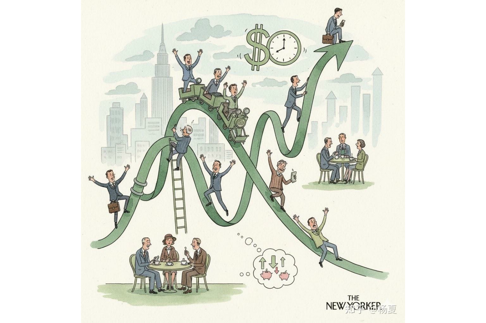
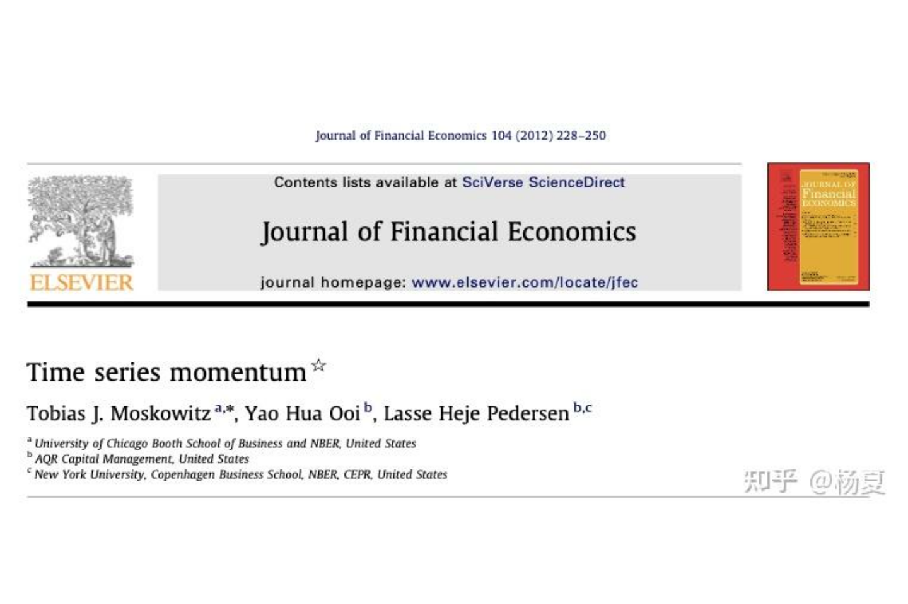
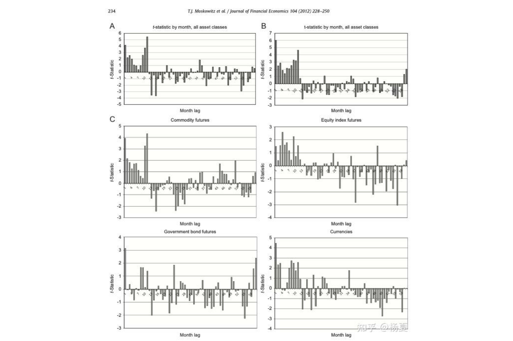
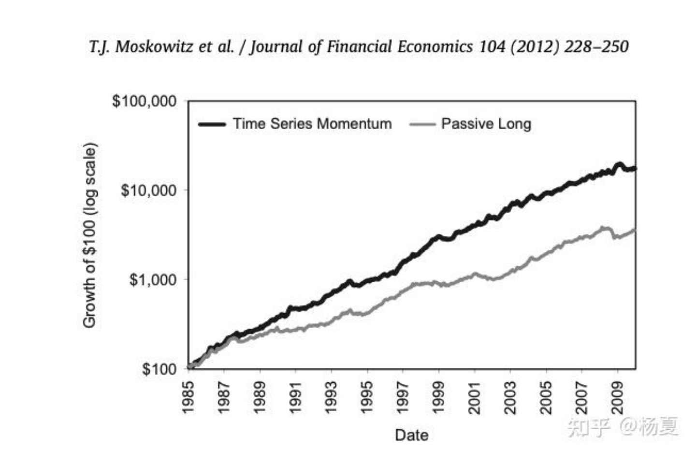
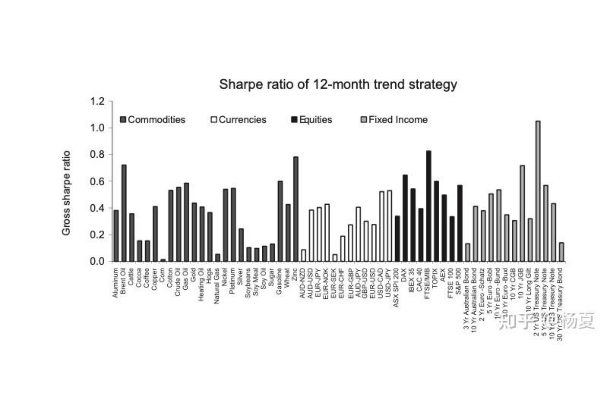
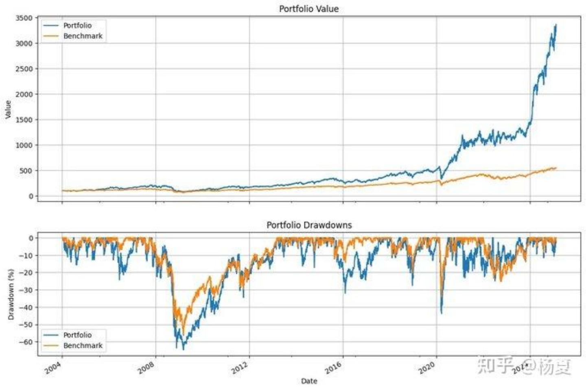

# 暴利，回报3500%的动量模型｜知乎文章整理

> 原文作者：杨夏（独立分析师）  
> 原文链接：[暴利，回报3500%的动量模型](https://zhuanlan.zhihu.com/p/1979834620246767269)  
> 发布日期：2025-12-04  
> ⚠️ **以下内容均不是投资建议。**

---

## 一、引言

作者研读量化策略文献，分享了2012年发表于 *Journal of Financial Economics* 的经典论文《Time Series Momentum》，作者为 Tobias J. Moskowitz、Yao Hua Ooi、Lasse Heje Pedersen。这篇论文提出了**时间序列动量（TSMOM）**概念，随后被众多对冲基金和CTA基金学习改造，风靡一时。[^1]



---

## 二、时间序列动量（TSMOM）

> **TSMOM 核心：**
> - 过去1~12个月**涨得好的资产，未来继续涨的概率大**
> - 跌得多的资产，**未来继续跌的概率也大**
> - 只看自己的历史趋势，不和其他资产比较（时间序列维度）

### 论文封面



*Time Series Momentum，Journal of Financial Economics 104 (2012) 228–250*

### 核心结论

**数据：** 1965–2009年，58个期货品种（股指、债券、商品、货币）[^1]

| 指标 | 结果 |
|---|---|
| 样本期间 | 1965–2009 |
| 品种数 | 58个期货（股指/债券/商品/货币） |
| t 值（1~12月持有期） | 普遍 **>3**（统计非常显著） |
| 年化收益率 | **10%~15%** |
| 夏普比率 | **约 1.0** |
| 对标准因子的暴露 | 几乎为零 |
| 表现最佳时机 | **极端市场（大涨或大跌）** |

**机制：** 投机者获利，对冲者付出代价——反映市场初期反应不足、随后过度反应。

### 各资产类别 t 统计量（论文原图）



*纵轴：t 统计量；横轴：月份 Lag。A/B 图为全资产类别，C 图依次为商品期货、股票指数期货、国债期货、货币。几乎所有1~12个月 lag 均显著为正（>1.96），远期呈反转。*

### TSMOM vs 被动持有（1985–2009）



*纵轴：$100 本金的增长（对数坐标）。TSMOM策略（黑线）长期显著跑赢被动持有（灰线）。*

### 极简交易模型

```
动量信号 = 当前价格 / 20天前价格 – 1
大于0 → 做多；小于0 → 做空
每月调仓
```

> ⚠️ 注意：论文实际使用期货，并做**波动率缩放（volatility scaling）**，确保各资产风险贡献相同。没有充分模拟检验，不要直接用真实资金测试。

---

## 三、各品种夏普比率（12个月趋势策略）



*横轴：58个具体品种；纵轴：毛夏普比率。货币类整体最强，部分品种 >1.0。*

| 资产类别 | 平均夏普比率 |
|---|---|
| 货币（Currencies） | 最高，部分 >1.0 |
| 股票指数（Equities） | ~0.5~0.8 |
| 大宗商品（Commodities） | 0.3~0.7，分化大 |
| 固定收益（Fixed Income） | 0.3~0.5 |

---

## 四、横截面动量（CSMOM）

> **横截面动量逻辑：**
> - 把所有资产放在一起**横向排名**
> - **买**过去表现最好的前 x%（Winner）
> - **卖**过去表现最差的后 x%（Loser）

### TSMOM vs CSMOM 对比

| 维度 | 时序动量（TSMOM） | 横截面动量（CSMOM） |
|---|---|---|
| 比较基准 | 自身历史 | 资产池中其他资产 |
| 信号来源 | 过去收益符号（正/负） | 相对排名（前/后 x%） |
| 主要风险 | 净多头暴露（市场整跌仍做多） | 反转风险 |
| 适用场景 | 趋势市场、CTA基金 | 横向轮动、股票多空 |

---

## 五、双重动量（Dual Momentum）

Gary Antonacci 在2014年著作《Dual Momentum Investing》中，将 TSMOM 与 CSMOM 结合：[^2]

> **两步筛选逻辑：**
>
> **第一步（CSMOM）：** 横向排名，选出过去表现最好的前20%子集（Winner）
>
> **第二步（TSMOM）：** 检查这些 Winner 的绝对趋势——
> - 过去收益率为正 → **做多**
> - 过去收益率为负 → **切换到现金/债券（防守）**
>
> **优势：** 避免纯TSMOM的净暴露风险 + 纯CSMOM的反转风险。

### 双重动量回测（1974–2013，40年）

| 指标 | 双重动量（GEM） | 标普500 |
|---|---|---|
| 年化收益率 | **15~20%** | ~10% |
| 夏普比率 | **1.0+** | ~0.4 |
| 最大回撤 | **<30%** | ~50% |

---

## 六、对冲基金改进版——回报 3500%

某对冲基金在 TSMOM 基础上修正后的美股回测：

| 指标 | 策略 | 标普500 |
|---|---|---|
| 回测区间 | 2004–2025（未扣交易成本） | 同期 |
| 累计回报 | **3500%** | **450%** |
| 全大类平均夏普 | **~1.1** | — |
| 夏普为负时间占比 | 仅 **8%** | — |
| 货币类最优夏普 | **1.1** | — |
| 参数 | 12个月回看，1个月持仓 | — |

### 策略净值曲线（2004–2025）



*上：组合净值（蓝）vs 标普500（橙）。策略2020年后加速拉升，最终约3500。下：回撤对比，最大回撤约-50%，但恢复速度快于基准。*

---

## 七、动量策略的 AI/ML 进化

| 策略 | 英文名 | 核心思路 |
|---|---|---|
| 时空动量 | Spatio-Temporal Momentum | 结合时间与空间（跨资产关联）的动量信号 |
| 层次动量 | Hierarchical Momentum | 多层级（板块→个股）逐层筛选 |
| 异常回报动量 | Anomaly Momentum | 基于因子异常收益的动量 |

大型量化基金（AQR、Two Sigma 等）动态混合上述模型，保持对市场的高度灵活捕捉。

---

## 八、引用论文原文摘录

### Time Series Momentum (2012) [^1]

**原文 Abstract：**

> We document significant "time series momentum" in equity index, currency, commodity, and bond futures for each of the 58 liquid instruments we consider. We find persistence in returns for 1 to 12 months that partially reverses over longer horizons, consistent with sentiment theories of initial under-reaction and delayed over-reaction. A diversified portfolio of time series momentum strategies across all asset classes delivers substantial abnormal returns with little exposure to standard asset pricing factors and performs best during extreme markets. Examining the trading activities of speculators and hedgers, we find that speculators profit from time series momentum at the expense of hedgers.

**中译：** 在所考察的58个流动性强的期货品种中，均发现了显著的时间序列动量现象。收益的持续性在1~12个月内存在，并在更长时间后部分反转，与初期**反应不足**、随后**延迟过度反应**的情绪理论相符。跨所有资产类别的分散化TSMOM策略能提供显著的超额收益，对标准资产定价因子几乎没有暴露，且在极端市场中表现最佳。研究发现，投机者从TSMOM中获利，对冲者为此付出代价。

**论文信息：**
- 期刊：Journal of Financial Economics 104 (2012) 228–250
- 作者：Tobias J. Moskowitz, Yao Hua Ooi, Lasse Heje Pedersen
- SSRN：https://ssrn.com/abstract=2089463
- 下载量：23,994次｜摘要浏览：101,807次｜被引：368次

### Dual Momentum Investing (2014) [^2]

**核心结论：**

> The book compares gross average annual return–annual volatility relationships for four strategies during 1974 through 2013 (40 years). The Global Equities Momentum (GEM) strategy significantly outperforms in both return and risk-adjusted terms compared to Buy & Hold S&P 500, US Momentum, and World ex-US Momentum.

**中译：** 该书比较了1974–2013年（40年）四种策略的年化收益率与波动率关系。GEM策略在收益和风险调整后表现上均显著优于买持标普500、美国动量策略及世界（除美）动量策略。

**书籍信息：**
- 作者：Gary Antonacci
- 出版年：2014年
- 核心贡献：将 TSMOM（绝对动量）与 CSMOM（相对动量）结合，提出 Global Equities Momentum（GEM）策略

---

## 九、核心要点

> **三句话总结：**
>
> 1. **动量效应真实存在：** 58个期货品种、44年数据，t>3，年化10~15%，夏普1.0
> 2. **双重动量更稳健：** 先相对排名选赢家，再绝对趋势过滤，规避单一策略核心缺陷
> 3. **别直接抄：** 回测未扣交易成本，论文用期货（可做空），国内ETF实盘环境差异大，需充分模拟检验

---

> ⚠️ **以上，均不是投资建议！**

*来源：知乎 @杨夏 · 整理：Notion AI*

---

[^1]: Moskowitz, T. J., Ooi, Y. H., & Pedersen, L. H. (2012). Time series momentum. *Journal of Financial Economics*, 104(2), 228–250. https://ssrn.com/abstract=2089463  
[^2]: CXO Advisory review of Antonacci, G. (2014). *Dual Momentum Investing*. https://www.cxoadvisory.com/momentum-investing/a-few-notes-on-dual-momentum-investing
