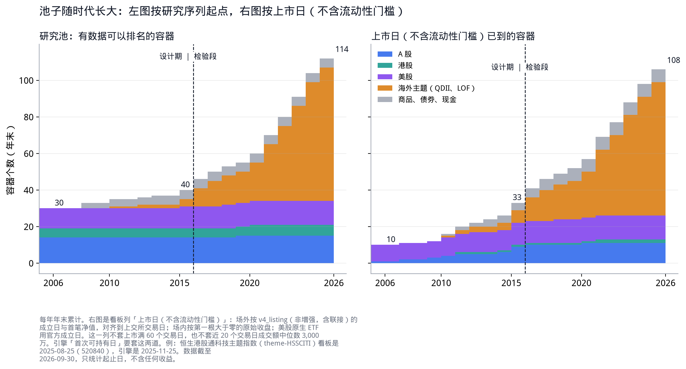

# ETF 轮动 · 数据与容器看板

## Metadata

- Project: ETF_Rotation_Quant
- Document type: owner（数据与容器看板，持续更新）
- Status: active
- Owner: L. Loric
- Maintainer: Orchestrator；数字由 `results/v4/diag/data-board/build_data_board.py` 生成
- 页面：Claude 页面“ETF 轮动数据看板”；本文件是仓库镜像

---

**这个看板管什么**　池子里有什么、每一样从哪年起有数据、哪年起能买到、数据靠不靠得住。策略好不好，看其他页面。

| 池子 | 数据健康 | 需要你 |
| --- | --- | --- |
| v5 用 **101** 个容器（另有现金），按 7 个大类排名。v4 试过的美股行业、港股分类 15 个不在 v5 池里。 | 场内 QDII、LOF 后复权和净值 **197/197** 全覆盖；2016 年以后的完整性清单必须修 **0** 条。 | **暂时不需要。** |

## 1. 池子随时代长大：设计期里能买的很少

> **2006 年有数据的 17 个，已上市的只有 **1** 个；到今天是 101 个和 96 个。**

- **设计期的结论主要靠“有数据的”这一边**：2015 年末有数据 29 个、已上市 22 个，2006–2012 年差得更远。
- **增长主要来自港股和美股的 QDII**：2015 年以后新上市的基金，大多投香港和美国。规则不知道哪个会强，能买到之后让趋势去选。

“有数据”= 有指数历史或基金自己的历史；“已上市”= 场内基金首个收盘日或场外基金成立日，与回测程序读同一份名单，不含 3,000 万成交额门槛。所以这里的数字比[《v4 体检报告》](v4-health-check.md)里“当年能参加排名”的略多（例如 2015 年 22 个对 17 个）。不含现金。

## 2. 七个大类：设计期里主要是 A 股、美股和防守资产

> **v5 先判断每个大类该不该持有；“其他海外”在设计期几乎没有可用的。**

| 大类 | 有数据起 | 能买起 | 2015 年末能买 | 今天能买 | 设计期里 |
| --- | --- | --- | --- | --- | --- |
| 风险大类：先判断该不该持有 | | | | | |
| **A股** | 2005 | **2005，仅 1 只** | 9 | 12 | 指数全，能买的少 |
| **港股** | 2000 | 2010 | 3 | 49 | 只有恒生指数 |
| **美股** | 2000 | 2010 | 6 | 18 | 2010 年后才陆续能买 |
| **其他海外** | 2014 | 2014 | **1** | 11 | 几乎没有 |
| **商品** | 2010 | 2010 | 1 | 3 | 只有 1 个 |
| 防守大类：风险大类都不持有时才用 | | | | | |
| **国债** | 2008 | 2013 | 1 | 2 | 有数据早、能买晚 |
| **黄金** | 2008 | 2011 | 1 | 1 | 有数据早、能买晚 |

“能买起”= 这一类里第一只基金上市或成立的年份。框出的两格：A 股 2005 年起就能买，但 2009 年以前只有沪深300 和红利两只，14 个指数里大多买不到；其他海外到 2015 年末才有 1 个能买。归类按跟踪指数或业绩比较基准机械划分（v5 预注册 §3.2），只看成分，不看收益。

A股（17 个）

| 容器 | 研究序列 | 有数据起 | 上市起 | 状态 |
| --- | --- | --- | --- | --- |
| **中证1000** | H00852 · 全收益 | 2005-01 | 2016-11 | 正常 |
| **中证500** | H00905 · 全收益 | 2005-01 | 2009-09 | 正常 |
| **中证全指主要消费** | H00990 · 全收益 | 2005-01 | — | 正常 |
| **中证全指信息技术** | H00993 · 全收益 | 2005-01 | 2015-01 | 正常 |
| **中证全指公用事业** | H00995 · 全收益 | 2005-01 | — | 正常 |
| **中证全指医药卫生** | H00991 · 全收益 | 2005-01 | 2015-05 | 正常 |
| **中证全指原材料** | H00987 · 全收益 | 2005-01 | 2015-07 | 正常 |
| **中证全指可选消费** | H00989 · 全收益 | 2005-01 | 2014-06 | 正常 |
| **中证全指工业** | H00988 · 全收益 | 2005-01 | — | 正常 |
| **中证全指能源** | H00986 · 全收益 | 2005-01 | — | 正常 |
| **中证全指通信服务** | H00994 · 全收益 | 2005-01 | — | 正常 |
| **中证全指金融地产** | H00992 · 全收益 | 2005-01 | 2010-04 | 正常 |
| **中证红利全收益** | H00922 · 全收益 | 2005-01 | 2007-01 | 正常 |
| **沪深300** | H00300 · 全收益 | 2005-01 | 2005-01 | 正常 |
| **创业板指** | — · 价格 | 2011-06 | 2011-06 | 没有研究序列，用基金自己的价格 |
| **科创50** | 000688 · 价格 | 2019-12 | 2020-11 | 正常 |
| **中证全球中国教育主题人民币指数** | 513360 · 基金净值 | 2021-06 | 2021-06 | 正常 |

港股（49 个）

| 容器 | 研究序列 | 有数据起 | 上市起 | 状态 |
| --- | --- | --- | --- | --- |
| **恒生指数** | HSI · 价格 | 2000-01 | 2011-11 | 正常 |
| **恒生中国企业指数** | 160717 · 基金净值 | 2010-09 | 2010-09 | 正常 |
| **中证海外中国互联网指数** | 164906 · 基金净值 | 2015-05 | 2015-05 | 正常 |
| **MSCI China Value Weighted Index** | 161229 · 基金净值 | 2016-01 | 2016-01 | 正常 |
| **恒生综合小型股指数** | 161124 · 基金净值 | 2016-11 | 2016-11 | 正常 |
| **中证海外中国互联网50人民币指数** | 513050 · 基金净值 | 2017-01 | 2017-01 | 正常 |
| **中华交易服务港股通精选100指数** | 513900 · 基金净值 | 2018-05 | 2018-05 | 正常 |
| **中证香港证券投资主题指数** | 513090 · 基金净值 | 2020-03 | 2020-03 | 正常 |
| **恒生科技** | HSTECH · 价格 | 2020-07 | 2021-05 | 正常 |
| **上证港股通指数** | 513990 · 基金净值 | 2020-08 | 2020-08 | 正常 |
| **标普中国新经济行业指数** | 159822 · 基金净值 | 2020-09 | 2020-10 | 正常 |
| **中证港股通50指数** | 513550 · 基金净值 | 2021-01 | 2021-01 | 正常 |
| **恒生互联网科技业指数** | 159688 · 基金净值 | 2021-02 | 2021-02 | 正常 |
| **恒生医疗保健指数** | 159303 · 基金净值 | 2021-03 | 2021-03 | 正常 |
| **恒生港股通高股息率指数** | 513690 · 基金净值 | 2021-05 | 2021-05 | 正常 |
| **中证港股通科技指数** | 513860 · 基金净值 | 2021-07 | 2021-07 | 正常 |
| **中证香港科技指数指数** | 159747 · 基金净值 | 2021-07 | 2021-07 | 正常 |
| **中证港股通医药卫生综合指数** | 513700 · 基金净值 | 2021-08 | 2021-08 | 正常 |
| **中证港股通消费主题指数** | 513590 · 基金净值 | 2021-08 | 2021-08 | 正常 |
| **恒生生物科技指数** | 159892 · 基金净值 | 2021-09 | 2021-10 | 正常 |
| **中证海外中国互联网30人民币指数** | 159605 · 基金净值 | 2021-11 | 2021-12 | 正常 |
| **恒生港股通中国科技指数** | 513160 · 基金净值 | 2022-02 | 2022-02 | 正常 |
| **中证港股通互联网指数** | 513770 · 基金净值 | 2022-02 | 2022-02 | 正常 |
| **恒生港股通新经济指数** | 513320 · 基金净值 | 2022-03 | 2022-03 | 正常 |
| **中证港股通高股息投资港元指数** | 513530 · 基金净值 | 2022-04 | 2022-04 | 正常 |
| **中证香港创新药港币指数** | 513120 · 基金净值 | 2022-07 | 2022-07 | 正常 |
| **中证全球中国互联网人民币指数** | 513220 · 基金净值 | 2022-07 | 2022-07 | 正常 |
| **中证港股通金融服务指数** | 513140 · 基金净值 | 2022-12 | 2023-01 | 正常 |
| **恒生港股通红利低波动指数** | 513950 · 基金净值 | 2023-04 | 2023-04 | 正常 |
| **恒生消费指数** | 159699 · 基金净值 | 2023-04 | 2023-04 | 正常 |
| **中证香港内地国有企业港元指数** | 159519 · 基金净值 | 2023-08 | 2023-08 | 正常 |
| **中证港股通内地金融指数** | 513190 · 基金净值 | 2023-10 | 2023-10 | 正常 |
| **中证港股通非银行金融主题指数** | 513750 · 基金净值 | 2023-11 | 2023-11 | 正常 |
| **标普港股通低波红利指数** | 513630 · 基金净值 | 2023-12 | 2023-12 | 正常 |
| **恒生港股通中国央企红利指数** | 513920 · 基金净值 | 2024-01 | 2024-01 | 正常 |
| **中证港股通央企红利指数** | 513910 · 基金净值 | 2024-03 | 2024-03 | 正常 |
| **恒生中国央企指数** | 513170 · 基金净值 | 2024-04 | 2024-04 | 正常 |
| **中证国新港股通央企红利指数** | 520660 · 基金净值 | 2024-07 | 2024-07 | 正常 |
| **中证港股通创新药指数** | 520700 · 基金净值 | 2024-10 | 2024-10 | 正常 |
| **恒生创新药指数** | 520500 · 基金净值 | 2024-12 | 2024-12 | 正常 |
| **中证港股通汽车产业主题指数** | 520600 · 基金净值 | 2024-12 | 2024-12 | 正常 |
| **恒指港股通指数** | 520940 · 基金净值 | 2025-06 | 2025-06 | 正常 |
| **恒生港股通创新药精选指数** | 520880 · 基金净值 | 2025-07 | 2025-07 | 正常 |
| **中证港股通医疗主题指数** | 520510 · 基金净值 | 2025-08 | 2025-08 | 正常 |
| **恒生港股通科技主题指数** | 520670 · 基金净值 | 2025-08 | 2025-08 | 正常 |
| **恒生中国（香港上市）30指数** | 520560 · 基金净值 | 2025-10 | 2025-10 | 正常 |
| **恒生港股通50指数** | 520950 · 基金净值 | 2025-11 | 2025-11 | 正常 |
| **中证港股通信息技术综合指数** | 526000 · 基金净值 | 2026-04 | 2026-04 | 正常 |
| **恒生港股通汽车主题指数** | 520730 · 基金净值 | 2026-05 | 2026-05 | 正常 |

美股（18 个）

| 容器 | 研究序列 | 有数据起 | 上市起 | 状态 |
| --- | --- | --- | --- | --- |
| **标普500全收益** | ^SP500TR · 全收益（美元） | 2000-01 | 2012-06 | 正常 |
| **纳指100全收益** | XNDX · 全收益（美元） | 2005-01 | 2010-04 | 正常 |
| **标普石油天然气勘探及生产精选行业指数** | 159518 · 基金净值 | 2011-09 | 2011-09 | 正常 |
| **标普全球石油指数** | 160416 · 基金净值 | 2012-03 | 2012-03 | 正常 |
| **S&P 500 Energy Sector Index(NTR)** | 163208 · 基金净值 | 2015-02 | 2015-02 | 正常 |
| **纳斯达克生物科技指数** | 513290 · 基金净值 | 2015-03 | 2015-03 | 正常 |
| **标普美国品质消费股票指数** | 162415 · 基金净值 | 2016-03 | 2016-04 | 正常 |
| **标普500医疗保健等权重指数** | 161126 · 基金净值 | 2016-11 | 2016-12 | 正常 |
| **标普500信息科技指数** | 161128 · 基金净值 | 2016-12 | 2016-12 | 正常 |
| **标普生物科技精选行业指数** | 161127 · 基金净值 | 2016-12 | 2016-12 | 正常 |
| **道琼斯美国石油开发与生产指数** | 162719 · 基金净值 | 2017-02 | 2017-03 | 正常 |
| **道琼斯美国精选REIT指数** | 160140 · 基金净值 | 2017-10 | 2017-11 | 正常 |
| **PHLX Semiconductor Sector Index** | 501225 · 基金净值 | 2023-03 | 2023-04 | 正常 |
| **纳斯达克科技市值加权指数** | 159509 · 基金净值 | 2023-07 | 2023-08 | 正常 |
| **新交所泛东南亚科技指数** | 513730 · 基金净值 | 2023-11 | 2023-12 | 正常 |
| **MSCI USA 50 Index** | 159577 · 基金净值 | 2023-11 | 2023-11 | 正常 |
| **道琼斯工业平均指数** | 513400 · 基金净值 | 2024-01 | 2024-02 | 正常 |
| **标普500消费精选指数** | 159529 · 基金净值 | 2024-01 | 2024-02 | 正常 |

其他海外（11 个）

| 容器 | 研究序列 | 有数据起 | 上市起 | 状态 |
| --- | --- | --- | --- | --- |
| **法兰克福DAX指数** | 159561 · 基金净值 | 2014-08 | 2014-08 | 正常 |
| **该基金无跟踪标的** | 501300 · 基金净值 | 2017-02 | 2017-02 | 正常 |
| **该基金无跟踪标的** | 164824 · 基金净值 | 2018-08 | 2018-08 | 正常 |
| **东证指数** | 513800 · 基金净值 | 2019-06 | 2019-06 | 正常 |
| **东京日经225指数** | 159866 · 基金净值 | 2019-06 | 2019-06 | 正常 |
| **法国CAC40指数** | 513080 · 基金净值 | 2020-05 | 2020-06 | 正常 |
| **中证韩交所中韩半导体指数** | 513310 · 基金净值 | 2022-11 | 2022-12 | 正常 |
| **富时亚太低碳精选指数** | 159687 · 基金净值 | 2022-12 | 2022-12 | 正常 |
| **富时沙特阿拉伯指数** | 159329 · 基金净值 | 2024-07 | 2024-07 | 正常 |
| **iEdge Emerging Asia Select 50 Index** | 520580 · 基金净值 | 2025-01 | 2025-02 | 正常 |
| **巴西IBOVESPA指数** | 520870 · 基金净值 | 2025-11 | 2025-11 | 正常 |

商品（3 个）

| 容器 | 研究序列 | 有数据起 | 上市起 | 状态 |
| --- | --- | --- | --- | --- |
| **跨境商品** | 161815 · 基金净值 | 2010-12 | 2010-12 | 正常 |
| **原油** | — · 超额收益 | 2016-06 | 2016-06 | 没有研究序列，用基金自己的价格 |
| **豆粕** | — · 超额收益 | 2019-12 | 2019-12 | 没有研究序列，用基金自己的价格 |

国债（2 个）

| 容器 | 研究序列 | 有数据起 | 上市起 | 状态 |
| --- | --- | --- | --- | --- |
| **10年国债** | CBA04501 · 财富指数 | 2008-01 | 2017-08 | 正常 |
| **5年国债** | CBA03101 · 财富指数 | 2008-01 | 2013-03 | 正常 |

黄金（1 个）

| 容器 | 研究序列 | 有数据起 | 上市起 | 状态 |
| --- | --- | --- | --- | --- |
| **黄金** | Au99.99 · 价格 | 2008-08 | 2011-11 | 研究序列不完整 |

## 3. 数据靠不靠得住：没有必须修的

> **后复权和净值全覆盖；剩下 6 个已知缺口，原因和处理办法都写明了。**

| 后复权从哪来 | 2016 年以后的完整性 | 数据库 |
| --- | --- | --- |
| 东财 189、东财（无分红拆分） 4、还原 2、腾讯 2（只）。东财优先，取不到时按分红记录自己还原。 | 共 2430 条：必须修 **0**，可以接受 2404，已定 15，待分类 11。 | 行情 1,039,735 行，复权和净值序列 593,481 行，基金净值 236,540 行。 |

| 已知缺口 | 影响 | 处理 |
| --- | --- | --- |
| 创业板指、豆粕、原油的指数历史取不到 | 只能用基金自己的价格，起点晚 | 按上市日纳入，不自己造历史 |
| 恒生指数在设计期只有价格指数 | 不含股息，港股收益偏低 | 报告里写明 |
| 通信设备指数 2019 年 1–2 月缺日线 | 那段时间退出排名 | 按原规则沿用 |
| 7 只基金代码表有、交易所名单没有 | 不进池子 | 没有上市日，不收录 |
| 526090 在 2026-10 才上市 | 不在数据截止日以内 | 下次更新时纳入 |
| 两个后复权来源有冲突的日子（160125 有 14 天、160644 有 2 天） | 个别日收益略有出入 | 统一用一条来源，只登记 |

标橙的是唯一会系统性影响结果的一条：设计期里港股收益偏低，v5 的港股大类因此吃亏。

期权还有三处免费来源已经试完，确认拿不到。见第 5 节。不进上面这 6 条，也不改池子。

## 4. 别的市场的数据：免费的够用

> **v5 设计期结果确定后，同一套规则放到美国上市的 ETF 上验一次（2003–2026），数据都免费。**

| 大类 | 用什么 | 最早 |
| --- | --- | --- |
| **美股** | SPY、QQQ、9 只行业 ETF | 1998-12 |
| **其他海外** | EFA、EEM、日本、英国、法国、欧元区、欧洲、巴西 ETF | 1996–2005 |
| **商品** | DBC | 2006-02 |
| **国债** | IEF、TLT | 2002-07 |
| **黄金** | GLD | 2004-11 |
| **现金** | 美国 3 个月国库券利率 | 1954 |

价格是分红调整后的收盘，不是官方全收益指数，报告里写明。官方行业全收益、MSCI 国家指数要付费，10-31 定了先不买。

参考：数据规矩、v4 试过的 15 个容器、怎么更新

### 数据规矩

1. **场内基金一律后复权**：分红、拆分、合并都要处理。
2. **东财优先**：取不到时按分红记录自己还原，写清来源和方法。
3. **场外基金只用来还原市场**：不考虑申赎费和到账天数。
4. **汇率缺了就补**：先找官方来源，找不到用最近数据往前补齐并标明。
5. **只新增、不覆盖**：每次改库都记录数据库指纹。
6. **池子随市场长大**：当年能买到才纳入，只看上市日，不看后来的表现。

全文：docs/manual/data-principles.md；历次数据决定 D14–D22 在 operations/planning/。

### v4 试过的 15 个容器

9–11 只美股行业 ETF（1998 年起）和恒生 4 个分类。v4 的 T4 把它们加进池子，没有过关，所以 v5 不用。数据仍在库里。

### 怎么更新

每轮数据工作合入后，Manager 运行 `results/v4/diag/data-board/build_data_board.py` 和 `results/v5/diag/data-board/pool_growth.py`；Orchestrator 重新发布本页并同步 docs/owner/data-board.md。数字只来自数据库和登记表，不手填。第 5 节是手写登记，脚本不生成。

## 5. 免费来源拿不到，不再追

> **深交所期权日线缺口、两所每日结算价、深交所历史持仓量：免费来源拿不到，不再追。**

**不用你做事。** 这三处不再用免费接口重试。

| 缺口 | 登记日 | 票据 | 状态 | 已试 |
| --- | --- | --- | --- | --- |
| **深交所期权日线** 2019-12 → 2022-12（159919 / 159915 / 159922） | 2026-11-03 | #201 C1 | `won't-pursue-free` | 新浪、深交所历史 K 线、东财、腾讯、网易 |
| **上交所、深交所期权每日结算价** | 2026-11-03 | #201 C2 | `won't-pursue-free` | 云行情结算字段全空；当日合约表不能回溯 |
| **深交所期权历史持仓量** | 2026-11-03 | #201 C2 | `won't-pursue-free` | 公开报表只有当日合约总持仓 |

窗口和每次尝试的结果见 [《免费来源缺口》](free-source-gaps.md)。证据在 PR #201 的 `data/options/raw/r2/SCOPE.txt`、`blocked-attempts.csv`、`session-coverage.csv`。`QC.md` 只统计日线重复行，不覆盖这三处。

## 更新记录

- **2026-11-03**：登记三处期权免费来源缺口，状态 `won't-pursue-free`（#201 C1、C2）。见第 5 节。
- **2026-11-01**：改按 v5 的七个大类组织；池子只算 v5 用的 101 个，数字和[《v4 体检报告》](v4-health-check.md)对得上；图重画；新增“别的市场的数据”。
- **2026-11-01**：“上市日”改为和回测程序同一份名单（场外联接基金算进来，13 个容器提前）。
- **2026-10-29**：首次发布。
