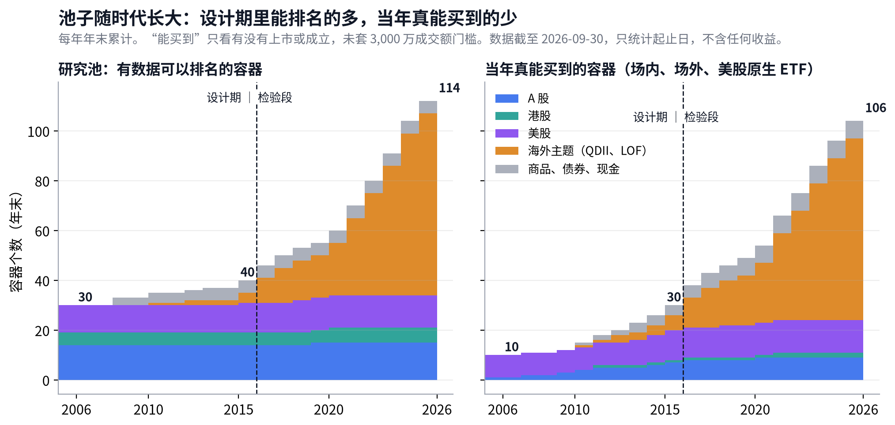

# ETF 轮动 · 数据与容器看板

## Metadata

- Project: ETF_Rotation_Quant
- Document type: owner（数据与容器看板，持续更新）
- Status: active
- Owner: L. Loric
- Maintainer: Orchestrator；数字由 `results/v4/diag/data-board/build_data_board.py` 生成
- 页面：Claude 页面“ETF 轮动数据看板”；本文件是仓库镜像

---

**这个看板管什么**　策略看板回答“策略怎么样”；这里回答“池子里有什么、每一样从哪年起能买到、数据靠不靠得住”。每一轮数据工作结束后更新。

| 池子 | 数据健康 | 需要你 |
| --- | --- | --- |
| **117** 个容器：v3 起就有的 102 个，v4 新池（美股行业、港股分类）15 个。交易所场内 QDII、LOF 197 只全部收录。 | 场内 QDII、LOF 后复权 **197/197**、净值 **197/197**。2016 年以后的完整性清单：必须修 **0** 条。 | **暂时不需要。**数据口径的问题由 Orchestrator 定，记在第 5 节。 |

## 1. 池子随时代长大

> **能拿来排名的容器从 2006 年的 **30** 个长到今天的 **114** 个；当年真能买到的，2006 年只有 **10** 个。**

- **设计期里，“能排名”和“能买到”差得很远**：2015 年末能排名的有 40 个，当年能买到的只有 30 个。设计期的结论主要靠指数池，可交易池只能当参考。
- **增长几乎全部来自海外主题**：场内 QDII、LOF 从 2015 年末的 6 个容器，长到今天的 75 个。这就是“市场在成长”：规则不知道哪个主题会强，只是在它能买到之后让动量去选。
- **美股行业从 1998 年就能直接买**：这是 v4 还原真实市场的依据（D12-8），所以右图 2006 年的 10 个里，大部分是美股原生 ETF。

“能买到”只看有没有上市或成立（场内 ETF、LOF，场外纯指数基金，美股原生 ETF），没有套 3,000 万成交额门槛；真正参加可交易池排名的会更少。只统计起止日，不含任何收益。

## 2. 容器清单

> **一个容器 = 一个底层指数（或一组同类基金）；同一指数的多只基金只算一个，交易时选当天成交最活跃的那只。**

| 大类 | 容器数 | 研究数据最早 | 当年最早能买到 | 有问题的 |
| --- | --- | --- | --- | --- |
| **A 股** | 16 | 2005-01 | 2003-08 | **1** |
| **港股** | 6 | 1992-04 | 2011-11 | 0 |
| **美股** | 13 | 1998-12 | 1998-12 | 0 |
| **海外主题（QDII、LOF）** | 75 | 2010-09 | 2010-10 | 0 |
| **商品、债券、现金** | 7 | 2008-01 | 2010-12 | **3** |

A 股（16 个）

| 容器 | 研究序列 | 研究数据起点 | 最早能买到 | 场内成员 | 状态 |
| --- | --- | --- | --- | --- | --- |
| **中证1000** | H00852 · 全收益 | 2005-01 | 2016-11 | 1 | 正常 |
| **中证500** | H00905 · 全收益 | 2005-01 | 2009-09 | 1（另有场外 5） | 正常 |
| **中证全指主要消费** | H00990 · 全收益 | 2005-01 | — | 0 | 正常 |
| **中证全指信息技术** | H00993 · 全收益 | 2005-01 | — | 0 | 正常 |
| **中证全指公用事业** | H00995 · 全收益 | 2005-01 | — | 0 | 正常 |
| **中证全指医药卫生** | H00991 · 全收益 | 2005-01 | — | 0 | 正常 |
| **中证全指原材料** | H00987 · 全收益 | 2005-01 | 2015-07 | 1 | 正常 |
| **中证全指可选消费** | H00989 · 全收益 | 2005-01 | 2014-06 | 1 | 正常 |
| **中证全指工业** | H00988 · 全收益 | 2005-01 | — | 0 | 正常 |
| **中证全指能源** | H00986 · 全收益 | 2005-01 | — | 0 | 正常 |
| **中证全指通信服务** | H00994 · 全收益 | 2005-01 | — | 0 | 正常 |
| **中证全指金融地产** | H00992 · 全收益 | 2005-01 | 2010-04 | 1（另有场外 1） | 正常 |
| **中证红利全收益** | H00922 · 全收益 | 2005-01 | 2007-01 | 2（另有场外 2） | 正常 |
| **沪深300** | H00300 · 全收益 | 2005-01 | 2003-08 | 1（另有场外 15） | 正常 |
| **科创50** | 000688 · 价格 | 2019-12 | 2020-11 | 1 | 正常 |
| **创业板指** | — · 价格 | — | 2011-12 | 1 | 没有研究序列，用基金自己的价格 |

港股（6 个）

| 容器 | 研究序列 | 研究数据起点 | 最早能买到 | 场内成员 | 状态 |
| --- | --- | --- | --- | --- | --- |
| **恒生公用事业分类指数** v4 新池 | HSU · 价格 | 1992-04 | — | 0 | 正常 |
| **恒生工商分类指数** v4 新池 | HSC · 价格 | 1992-04 | — | 0 | 正常 |
| **恒生金融分类指数** v4 新池 | HSF · 价格 | 1992-04 | — | 0 | 正常 |
| **恒生地产分类指数** v4 新池 | HSP · 价格 | 1993-01 | — | 0 | 正常 |
| **恒生指数** | HSI · 价格 | 2000-01 | 2011-11 | 7 | 正常 |
| **恒生科技** | HSTECH · 价格 | 2020-07 | 2021-05 | 14 | 正常 |

美股（13 个）

| 容器 | 研究序列 | 研究数据起点 | 最早能买到 | 场内成员 | 状态 |
| --- | --- | --- | --- | --- | --- |
| **Consumer Discretionary Select Sector SPDR** v4 新池 | XLY · 后复权 | 1998-12 | 1998-12 | 1 | 正常 |
| **Consumer Staples Select Sector SPDR** v4 新池 | XLP · 后复权 | 1998-12 | 1998-12 | 1 | 正常 |
| **Energy Select Sector SPDR** v4 新池 | XLE · 后复权 | 1998-12 | 1998-12 | 1 | 正常 |
| **Financial Select Sector SPDR** v4 新池 | XLF · 后复权 | 1998-12 | 1998-12 | 1 | 正常 |
| **Health Care Select Sector SPDR** v4 新池 | XLV · 后复权 | 1998-12 | 1998-12 | 1 | 正常 |
| **Industrial Select Sector SPDR** v4 新池 | XLI · 后复权 | 1998-12 | 1998-12 | 1 | 正常 |
| **Materials Select Sector SPDR** v4 新池 | XLB · 后复权 | 1998-12 | 1998-12 | 1 | 正常 |
| **Technology Select Sector SPDR** v4 新池 | XLK · 后复权 | 1998-12 | 1998-12 | 1 | 正常 |
| **Utilities Select Sector SPDR** v4 新池 | XLU · 后复权 | 1998-12 | 1998-12 | 1 | 正常 |
| **标普500全收益** | ^SP500TR · 全收益（美元） | 2000-01 | 2014-01 | 5 | 正常 |
| **纳指100全收益** | XNDX · 全收益（美元） | 2005-01 | 2013-05 | 14 | 正常 |
| **Real Estate Select Sector SPDR** v4 新池 | XLRE · 后复权 | 2015-10 | 2015-10 | 1 | 正常 |
| **Communication Services Select Sector SPDR** v4 新池 | XLC · 后复权 | 2018-06 | 2018-06 | 1 | 正常 |

海外主题（QDII、LOF）（75 个）

| 容器 | 研究序列 | 研究数据起点 | 最早能买到 | 场内成员 | 状态 |
| --- | --- | --- | --- | --- | --- |
| **恒生中国企业指数** | 160717 · 基金净值 | 2010-09 | 2010-10 | 4 | 正常 |
| **标普全球石油指数** | 160416 · 基金净值 | 2012-03 | 2012-05 | 1 | 正常 |
| **S&P 500 Energy Sector Index(NTR)** | 163208 · 基金净值 | 2015-02 | 2015-02 | 1 | 正常 |
| **中证海外中国互联网指数** | 164906 · 基金净值 | 2015-05 | 2015-07 | 2 | 正常 |
| **MSCI China Value Weighted Index** | 161229 · 基金净值 | 2016-01 | 2016-01 | 1 | 正常 |
| **标普美国品质消费股票指数** | 162415 · 基金净值 | 2016-03 | 2016-04 | 1 | 正常 |
| **恒生综合小型股指数** | 161124 · 基金净值 | 2016-11 | 2016-11 | 1 | 正常 |
| **标普500医疗保健等权重指数** | 161126 · 基金净值 | 2016-11 | 2016-12 | 1 | 正常 |
| **标普500信息科技指数** | 161128 · 基金净值 | 2016-12 | 2016-12 | 1 | 正常 |
| **标普生物科技精选行业指数** | 161127 · 基金净值 | 2016-12 | 2016-12 | 2 | 正常 |
| **中证海外中国互联网50人民币指数** | 513050 · 基金净值 | 2017-01 | 2017-01 | 1 | 正常 |
| **该基金无跟踪标的** | 501300 · 基金净值 | 2017-02 | 2017-02 | 1 | 正常 |
| **道琼斯美国石油开发与生产指数** | 162719 · 基金净值 | 2017-02 | 2017-03 | 1 | 正常 |
| **道琼斯美国精选REIT指数** | 160140 · 基金净值 | 2017-10 | 2017-11 | 2 | 正常 |
| **中华交易服务港股通精选100指数** | 513900 · 基金净值 | 2018-05 | 2018-05 | 1 | 正常 |
| **该基金无跟踪标的** | 164824 · 基金净值 | 2018-08 | 2018-08 | 1 | 正常 |
| **东证指数** | 513800 · 基金净值 | 2019-06 | 2019-06 | 1 | 正常 |
| **中证香港证券投资主题指数** | 513090 · 基金净值 | 2020-03 | 2020-03 | 1 | 正常 |
| **法国CAC40指数** | 513080 · 基金净值 | 2020-05 | 2020-06 | 1 | 正常 |
| **上证港股通指数** | 513990 · 基金净值 | 2020-08 | 2020-08 | 1 | 正常 |
| **标普中国新经济行业指数** | 159822 · 基金净值 | 2020-09 | 2020-10 | 1 | 正常 |
| **中证港股通50指数** | 513550 · 基金净值 | 2021-01 | 2021-01 | 1 | 正常 |
| **东京日经225指数** | 159866 · 基金净值 | 2021-03 | 2019-06 | 4 | 正常 |
| **恒生港股通高股息率指数** | 513690 · 基金净值 | 2021-05 | 2021-05 | 1 | 正常 |
| **中证全球中国教育主题人民币指数** | 513360 · 基金净值 | 2021-06 | 2021-06 | 1 | 正常 |
| **中证港股通科技指数** | 513860 · 基金净值 | 2021-07 | 2021-07 | 7 | 正常 |
| **中证香港科技指数指数** | 159747 · 基金净值 | 2021-07 | 2021-07 | 2 | 正常 |
| **中证港股通医药卫生综合指数** | 513700 · 基金净值 | 2021-08 | 2021-08 | 2 | 正常 |
| **中证港股通消费主题指数** | 513590 · 基金净值 | 2021-08 | 2021-08 | 3 | 正常 |
| **恒生生物科技指数** | 159892 · 基金净值 | 2021-09 | 2021-10 | 6 | 正常 |
| **中证海外中国互联网30人民币指数** | 159605 · 基金净值 | 2021-11 | 2021-12 | 2 | 正常 |
| **恒生港股通中国科技指数** | 513160 · 基金净值 | 2022-02 | 2022-02 | 2 | 正常 |
| **中证港股通互联网指数** | 513770 · 基金净值 | 2022-02 | 2022-02 | 8 | 正常 |
| **恒生港股通新经济指数** | 513320 · 基金净值 | 2022-03 | 2022-03 | 1 | 正常 |
| **中证港股通高股息投资港元指数** | 513530 · 基金净值 | 2022-04 | 2022-04 | 4 | 正常 |
| **中证香港创新药港币指数** | 513120 · 基金净值 | 2022-07 | 2022-07 | 1 | 正常 |
| **中证全球中国互联网人民币指数** | 513220 · 基金净值 | 2022-07 | 2022-07 | 1 | 正常 |
| **纳斯达克生物科技指数** | 513290 · 基金净值 | 2022-08 | 2022-08 | 1 | 正常 |
| **中证韩交所中韩半导体指数** | 513310 · 基金净值 | 2022-11 | 2022-12 | 1 | 正常 |
| **富时亚太低碳精选指数** | 159687 · 基金净值 | 2022-12 | 2022-12 | 1 | 正常 |
| **中证港股通金融服务指数** | 513140 · 基金净值 | 2022-12 | 2023-01 | 1 | 正常 |
| **恒生互联网科技业指数** | 159688 · 基金净值 | 2023-01 | 2021-02 | 3 | 正常 |
| **PHLX Semiconductor Sector Index** | 501225 · 基金净值 | 2023-03 | 2023-04 | 1 | 正常 |
| **恒生港股通红利低波动指数** | 513950 · 基金净值 | 2023-04 | 2023-04 | 3 | 正常 |
| **纳斯达克科技市值加权指数** | 159509 · 基金净值 | 2023-07 | 2023-08 | 1 | 正常 |
| **恒生消费指数** | 159699 · 基金净值 | 2023-08 | 2023-04 | 4 | 正常 |
| **中证香港内地国有企业港元指数** | 159519 · 基金净值 | 2023-08 | 2023-08 | 2 | 正常 |
| **中证港股通内地金融指数** | 513190 · 基金净值 | 2023-10 | 2023-10 | 2 | 正常 |
| **标普石油天然气勘探及生产精选行业指数** | 159518 · 基金净值 | 2023-11 | 2012-06 | 3 | 正常 |
| **新交所泛东南亚科技指数** | 513730 · 基金净值 | 2023-11 | 2023-12 | 1 | 正常 |
| **中证港股通非银行金融主题指数** | 513750 · 基金净值 | 2023-11 | 2023-11 | 1 | 正常 |
| **标普港股通低波红利指数** | 513630 · 基金净值 | 2023-12 | 2023-12 | 2 | 正常 |
| **恒生港股通中国央企红利指数** | 513920 · 基金净值 | 2024-01 | 2024-01 | 1 | 正常 |
| **道琼斯工业平均指数** | 513400 · 基金净值 | 2024-01 | 2024-02 | 1 | 正常 |
| **标普500消费精选指数** | 159529 · 基金净值 | 2024-01 | 2024-02 | 1 | 正常 |
| **MSCI USA 50 Index** | 159577 · 基金净值 | 2024-02 | 2023-11 | 2 | 正常 |
| **中证港股通央企红利指数** | 513910 · 基金净值 | 2024-03 | 2024-03 | 1 | 正常 |
| **法兰克福DAX指数** | 159561 · 基金净值 | 2024-04 | 2014-09 | 2 | 正常 |
| **恒生中国央企指数** | 513170 · 基金净值 | 2024-04 | 2024-04 | 1 | 正常 |
| **恒生医疗保健指数** | 159303 · 基金净值 | 2024-06 | 2021-03 | 3 | 正常 |
| **富时沙特阿拉伯指数** | 159329 · 基金净值 | 2024-07 | 2024-07 | 2 | 正常 |
| **中证国新港股通央企红利指数** | 520660 · 基金净值 | 2024-07 | 2024-07 | 3 | 正常 |
| **中证港股通创新药指数** | 520700 · 基金净值 | 2024-10 | 2024-10 | 3 | 正常 |
| **恒生创新药指数** | 520500 · 基金净值 | 2024-12 | 2024-12 | 1 | 正常 |
| **中证港股通汽车产业主题指数** | 520600 · 基金净值 | 2024-12 | 2024-12 | 4 | 正常 |
| **iEdge Emerging Asia Select 50 Index** | 520580 · 基金净值 | 2025-01 | 2025-02 | 1 | 正常 |
| **恒指港股通指数** | 520940 · 基金净值 | 2025-06 | 2025-06 | 5 | 正常 |
| **恒生港股通创新药精选指数** | 520880 · 基金净值 | 2025-07 | 2025-07 | 2 | 正常 |
| **中证港股通医疗主题指数** | 520510 · 基金净值 | 2025-08 | 2025-08 | 4 | 正常 |
| **恒生港股通科技主题指数** | 520670 · 基金净值 | 2025-08 | 2025-08 | 2 | 正常 |
| **恒生中国（香港上市）30指数** | 520560 · 基金净值 | 2025-10 | 2025-10 | 1 | 正常 |
| **巴西IBOVESPA指数** | 520870 · 基金净值 | 2025-11 | 2025-11 | 2 | 正常 |
| **恒生港股通50指数** | 520950 · 基金净值 | 2025-11 | 2025-11 | 1 | 正常 |
| **中证港股通信息技术综合指数** | 526000 · 基金净值 | 2026-04 | 2026-04 | 7 | 正常 |
| **恒生港股通汽车主题指数** | 520730 · 基金净值 | 2026-05 | 2026-05 | 1 | 正常 |

商品、债券、现金（7 个）

| 容器 | 研究序列 | 研究数据起点 | 最早能买到 | 场内成员 | 状态 |
| --- | --- | --- | --- | --- | --- |
| **10年国债** | CBA04501 · 财富指数 | 2008-01 | 2017-08 | 1 | 正常 |
| **5年国债** | CBA03101 · 财富指数 | 2008-01 | 2013-03 | 1 | 正常 |
| **黄金** | Au99.99 · 价格 | 2008-08 | 2011-11 | 4 | 研究序列不完整 |
| **跨境商品** | 161815 · 基金净值 | 2010-12 | 2010-12 | 3 | 正常 |
| **现金** | 511880 · 规则 | 2013-07 | 2013-07 | 1 | 正常 |
| **原油** | — · 超额收益 | — | 2016-06 | 3 | 没有研究序列，用基金自己的价格 |
| **豆粕** | — · 超额收益 | — | 2019-12 | 1 | 没有研究序列，用基金自己的价格 |

全表（含每个容器的场内成员代码）：results/v4/diag/data-board/out/containers.csv。

## 3. 数据健康

> **该有的都有了；剩下的缺口都写明了原因和处理办法。**

| 后复权从哪来 | 2016 年以后的完整性 | 数据库 |
| --- | --- | --- |
| 东财 189、东财（无分红拆分） 4、还原 2、腾讯 2（只）。东财优先，取不到时按分红记录自己还原（D21）。 | 共 2430 条：必须修 **0**，可以接受 2404，已由 Orchestrator 定 15，待分类 11。 | 行情 1,039,735 行，复权和净值序列 **593,480** 行，基金净值 236,540 行。库指纹 `550c1aee17a099dfc206876503ef436456bc5e87441db6947692abd3d6868c6c`（D25 插入之后，298,328,064 字节）。 |

### 3.1 已知缺口

| 缺口 | 影响 | 怎么处理 |
| --- | --- | --- |
| 创业板指、豆粕、原油的研究序列取不到；黄金只有部分 | 这几个容器只能靠场内基金自己的价格，起点较晚 | 按基金上市日纳入；不自己造历史 |
| 恒生综合 12 个行业没有公开日线 | 港股只用 4 个分类，比 A 股、美股粗 | D14-4：先用 4 个分类，预注册写明偏离 |
| 港股 4 个分类在设计期只有价格指数 | 不含股息，港股收益偏低 | 报告里写明 |
| 通信设备指数 2019 年 1–2 月缺日线 | 那段时间退出排名 | D16-3：官网也查不到，按原规则沿用 |
| 7 只基金代码表有、交易所名单没有 | 不进池子 | D19：没有上市日，不收录 |
| 526090 在 2026-10 才上市 | 不在数据截止日以内 | 下一次更新时纳入 |

## 4. 数据规矩

> **还原当年真实的市场：能用今天的知识，不能用今天的数据。**

1. **场内基金一律后复权**：分红、拆分、合并都要处理。这是项目的基石。
2. **东财优先**：取不到时按分红记录自己还原，写清来源和方法。
3. **场外基金只用来还原市场**：不考虑申赎费和到账天数。
4. **汇率缺了就补**：先找官方来源，找不到用最近数据往前补齐并标明。
5. **只新增、不覆盖**：每次改库都记录数据库指纹（SHA256）。
6. **池子随市场长大**：当年能买到才纳入，只看上市日，不看后来的表现。

全文：docs/manual/data-principles.md。

## 5. 数据决定

> **每一条数据口径都有记录，可以追溯。**

| 编号 | 定了什么 |
| --- | --- |
| **D14** | 场外行业指数基金进入可交易池；美股自己还原全收益；港股先用 4 个分类、换成人民币；数据原则成文 |
| **D15** | 相近替身（161211、510880）；增强型不作载体；2016 年以后数据完整性只查数据、不算收益 |
| **D16** | 成交额不够 3,000 万就往下一档找；联接基金算场外纯指数；个别缺日按原规则沿用 |
| **D17** | 补齐 23 只 QDII 的净值；按英文正式名称核对误排除的 8 只 |
| **D18** | 港股用决策日当天收盘，美股用前一天收盘；“市场是成长的”写进预注册 |
| **D19** | 场内 QDII、LOF 一律纳入（含主动基金）；同一指数只算一个；同类选流动性最好的；东财优先 |
| **D21** | 东财取不到的后复权按分红记录还原 |
| **D22** | 每只基金只用一条后复权，统一读取入口。冲突日不自动换源，清单交给 Orchestrator（见下） |

### 5.1 交给 Orchestrator 的数据项（不阻塞设计期简报）

设计期策略读数不写在这个看板里。简报：`operations/reports/v4-r5-design-period-brief.md`（R5c / D25 两个池的现行数字）。交接：`operations/planning/2026-10-30-v4-r5c-orchestrator-handoff.md`。

| 项 | 在哪里 | 现状 |
| --- | --- | --- |
| D22-2 冲突日 | `results/v4/inventory/r5/hfq-return-conflicts.csv`（SHA256 `eff7f0ea783cfc8a99bb217d850599b8be9924b41a6b965ff87c9365859a94a1`） | 160125 有 14 天，160644 有 2 天。入口仍用腾讯。清单是两条后复权的单日差，不是组合收益。政策由 Orchestrator 定 |
| 创业板指第 2 档 | `v4_listing` 已有 050021、110026、161022、160637、001592、001593 | **D25-3 已入库。** 看板的「能买到」仍读容器登记表：创业板指最早能买到仍是 159915 的 2011-12-09。这六只不在登记表里，所以年末容器个数没有加 1。净值行进了 `v4_series`，见更新记录 |
| 050002 的两条净值 | `results/v4/inventory/r5c/050002-exdiv.csv` | D25-4：序列未改。约 1.7 个百分点的差在 2015-12-28，是单位净值与累计净值的百分比口径，不是 2015-12-29 的除息 |

## 6. 怎么更新

1. 每一轮数据工作合入后，Manager 运行 `python results/v4/diag/data-board/build_data_board.py`，更新数字、图和容器清单。
2. Orchestrator 重新发布这个页面，并同步 docs/owner/data-board.md。
3. 数字只来自数据库和登记表，不手填；页面只统计起止日、覆盖和状态，不算任何收益。
4. 设计期的组合读数写在 `operations/reports/v4-r5-design-period-brief.md`，不写进本页的容器表。

## 更新记录

- **2026-10-30**：D25 合入后重跑 `build_data_board.py`。库指纹改为 `550c1aee17a099dfc206876503ef436456bc5e87441db6947692abd3d6868c6c`（298,328,064 字节）。复权和净值序列从 590,427 行增到 **593,480** 行（+3,053，即六只创业板指第 2 档的 `otc_nav`：1099+1016+559+139+120+120）。容器仍是 117 个。2015 年末可排名 40 / 可买 30、2006 年可买 10、后复权 197/197、净值 197/197、完整性分类、`buy_by_year` 都没有变。可买日仍来自容器登记表的上市或成立日，不读只写在 `v4_listing` 里的场外基金，也未套 3,000 万成交额。因此创业板指的「最早能买到」仍是 2011-12，不是 050021 的 2011-06-10。本页没有组合收益。
- **2026-10-29（三）**：D24 合入后重跑 `build_data_board.py`。库指纹改为 `79ae5a47e1a6eb0977a18f13efb21211d24b48e393ad567f615130d89c8f00cd`。复权和净值序列从 565,739 行增到 590,427 行（插入场外 `otc_nav`）。容器 117 个、2015 年末可排名 40 / 可买 30、后复权 197/197、净值 197/197、完整性分类都没有变。可买个数仍只看登记表里的上市或成立日，未套 3,000 万成交额，也没有把只写进 `v4_listing`、尚未进入容器登记表的场外基金算进去。本页没有组合收益。
- **2026-10-29（二）**：加上设计期简报指针和 D22-2 冲突日清单。容器个数、覆盖和状态表没有重跑，没有写入组合收益。
- **2026-10-29**：首次发布。117 个容器，交易所场内 QDII、LOF 197 只（截至 2026-09-30 已上市）全部收录，后复权和净值全覆盖。
