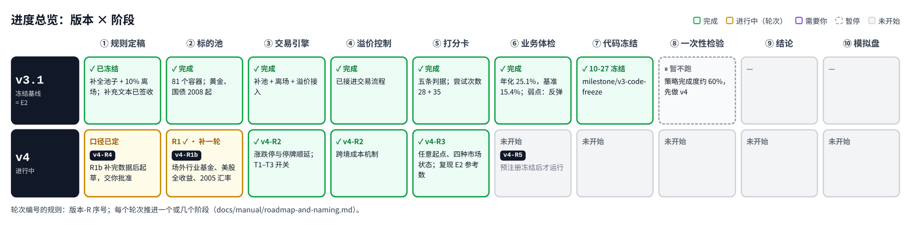
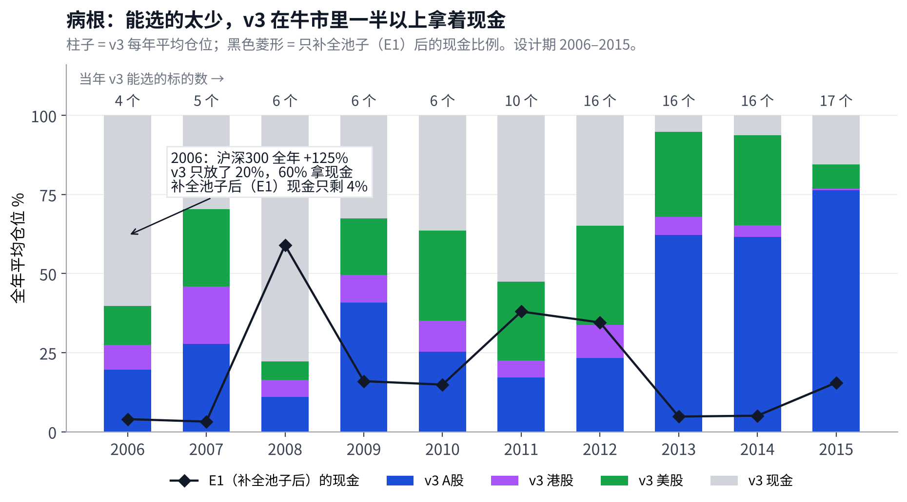
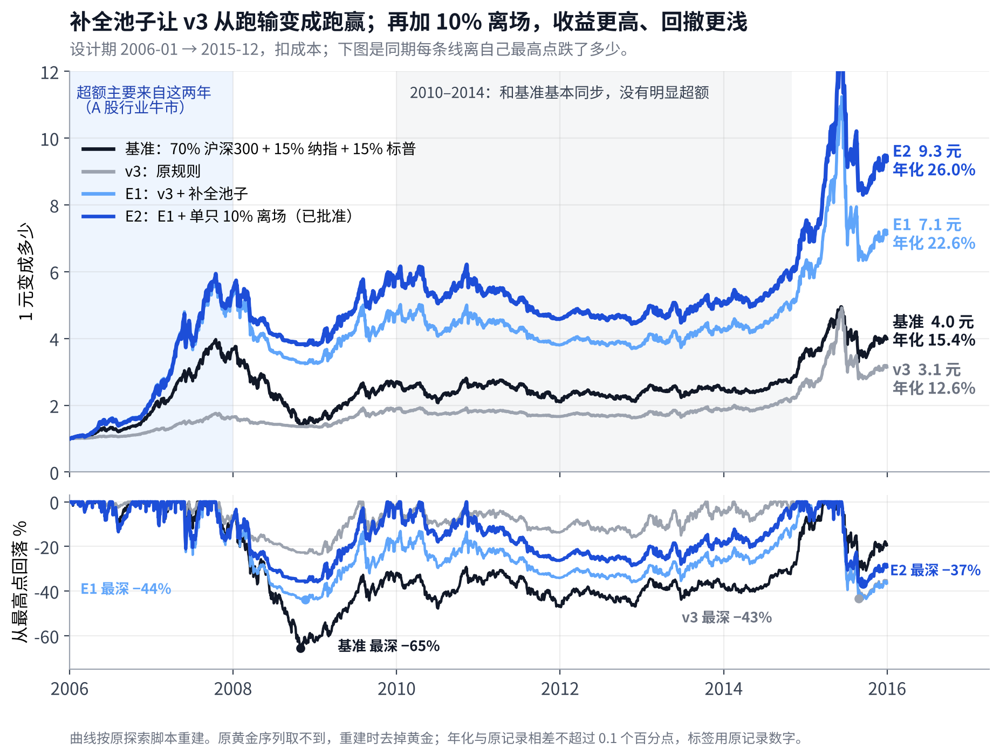
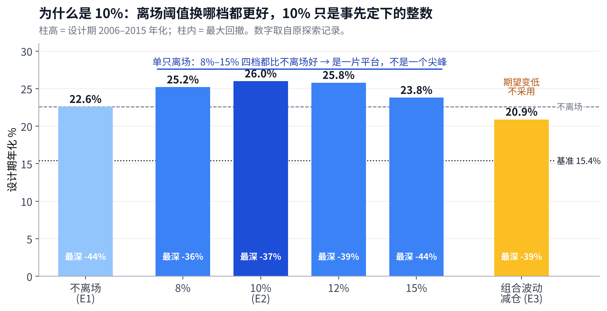
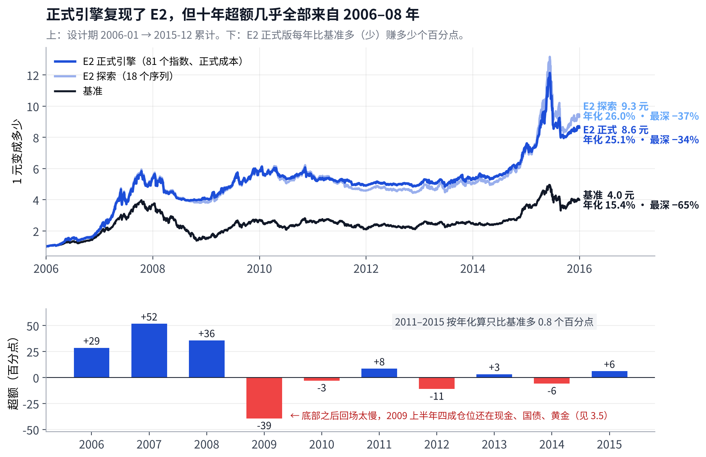
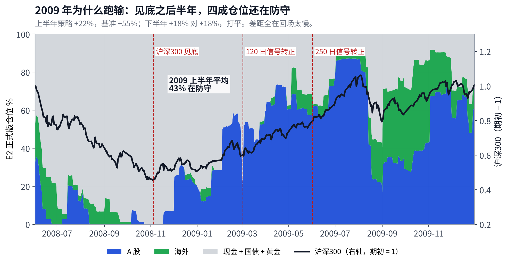
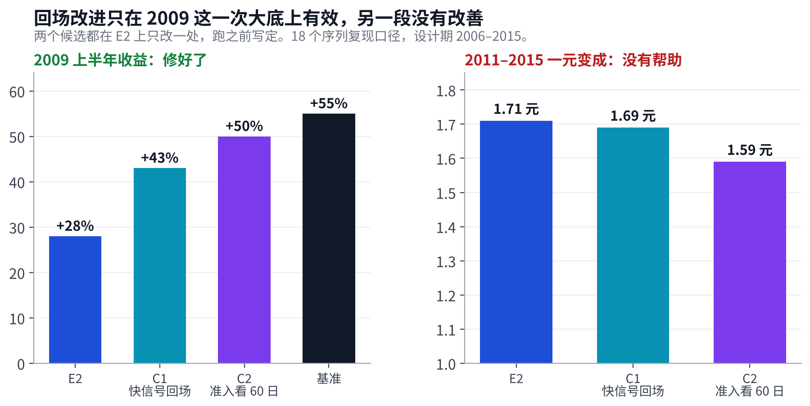
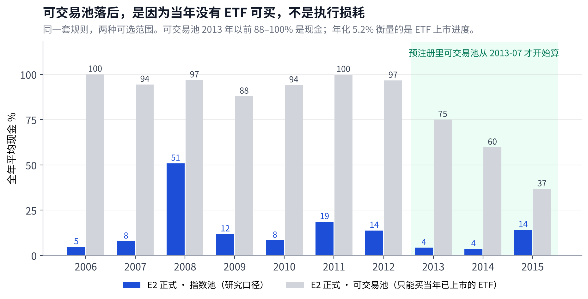
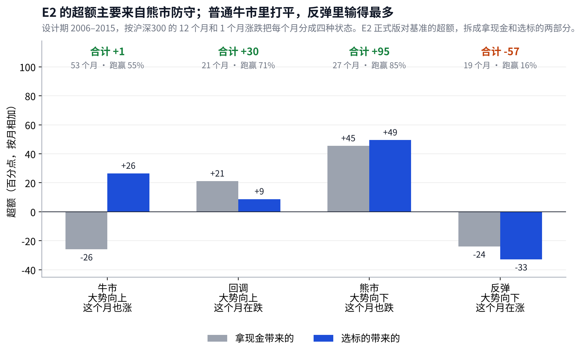

# ETF 轮动 · 第二阶段 Owner 看板

## Metadata

- Project: ETF_Rotation_Quant
- Document type: reference（Owner 看板）
- Status: active
- Owner: L. Loric
- Maintainer: Orchestrator
- Last updated: 2026-10-28
- 现行版本：本文件与同内容的 Claude 页面。Owner 2026-10-27 决定看板改在仓库维护，Notion 页面不再同步。
- 群内工程进度：`operations/planning/phase2-board.md`

---

**项目愿景**　在动态周期内，从多类资产里选出 Top N 强势 ETF 轮动持有，获得超额收益、稳定跑赢被动基准，同时把回撤控制住。

| 工程进度 | 业务结论 | 需要你 |
| --- | --- | --- |
| **v4 预注册第 2 版已交复审**：第 1 版有条件通过，5 处要改的已改完。引擎已接上新池和 T1–T3（v4-R2b），124 只 ETF 已补后复权，2016 年以后的数据已查完（v4-R1c）。 | E2 设计期年化 **25.1%**，基准 **15.4%**。但超额主要来自熊市防守；普通牛市打平，反弹里输得最多。v4 要补的就是这一块（3.7、第 4 节）。 | **暂时不需要。**Reviewer 复核完 v4 预注册后，请你批准（1.3 是要点）。 |

## 1. 进度总览

> **离在设计期运行 v4 还差两步：预注册第 2 版签收并由你批准，引擎和数据收尾。**

每个版本都走同样的 10 个阶段。格子里的 v4-R1 等是推进这个阶段的开发轮次；命名规则见 docs/manual/roadmap-and-naming.md。

### 1.1 这一轮完成了什么（v4-R4、R2b、R1c）

| 预注册第 1 版：有条件通过 | 引擎接上新池 | 2016 年以后的数据查完 |
| --- | --- | --- |
| Reviewer 挑出 5 处写得不够死的地方，比如“前后两段”的起止日、过关怎么算、尝试次数怎么数。都已在第 2 版改掉。 | 新池、载体、汇率、T1–T3 都做成了开关。全部关闭时，v3.1 的结果逐日不变。 | 2,389 条问题里，**12** 条必须修的已修好（多是 2024 年 9 月底的涨停日，核实是真行情）；**15** 条交我定，已定（D16）；其余可以接受。 |

载体表显示：2015 年末，14 个 A 股容器里只有 4 个当年能买到（2 个场内、1 个场外、1 个相近替身），其余 10 个当年买不到。可交易池在设计期仍然很薄。

### 1.2 数据口径：已定（D14）

> **场内 ETF 一律用后复权；场外基金只拿来还原市场，不算费用；汇率缺了就补。**

| 问题 | 你的选择 | 具体做法 |
| --- | --- | --- |
| **美股行业 ETF 的分红** | A：自己还原 | 和所有场内 ETF 一样，按**后复权**处理：分红、拆分、合并都要处理，不买官方数据 |
| **港股粒度** | A：先用 4 个分类 | 金融、公用、地产、工商；预注册写明这是偏离 |
| **港股汇率** | A：换算成人民币 | 2005 年缺的汇率，先让团队上网页找；找不到就用最近的数据往前平滑补齐，并标明是补的 |
| **场外行业指数基金** | 加入（D14-1） | 只用来还原 2006–2011 年能买到的市场；申赎费、到账天数**不考虑**，按净值当作普通序列 |

数据原则写进了 docs/manual/data-principles.md，团队以后取数都按它执行。标签按你的要求清理，**milestone/phase1-archive 不动**。

### 1.3 v4 预注册草案：要点

> **先单独检验 T1–T4，各自过关的才合进最终版；不在组合里挑最好的。**

- **池子**：A 股原有容器，加美股 9–11 个行业 ETF（后复权）、港股 4 个分类；宽基和行业一起排名。可交易池按“场内 ETF → 场外指数基金 → 相近替身”的顺序选当年能买的载体。
- **先立一把新尺子：E2 新口径**。E2 的规则一条不改，只换成 v4 的真实交易条件（涨跌停和停牌买卖不了就顺延、港股美股的收盘时点、后复权和补齐的数据），池子里加上补收的场内 QDII 和 LOF。原来的 25.1% 是在旧条件下算的，拿候选和它比，分不清好处来自候选还是来自条件变了。
- **候选**：在 E2 新口径上，T1、T2、T3 各开一个开关；T4 再加上美股行业和港股分类。规则都写成了可以测试的条文（备忘 4.5、4.6）。
- **怎么算过关**（设计期，都和 E2 新口径比）：前后两段都更好；该改善的那种行情确实改善；熊市少赚不超过 10 个百分点。
- **新判据 ⑥ 顺应市场**：牛市和反弹两种行情的累计超额都不能为负。
- **稳健性**：换三组邻近的回看期（例如 2 周、2 个月、4.5 个月、9 个月），只报告；结果敏感就降级。

全文：docs/prereg/etf-multiasset-rotation-prereg-v4.md。Reviewer 复核后，我会把要改的地方和需要你拍板的选择整理好再交你。

## 2. 策略是什么

> **每隔一段时间，从候选池里挑出最近最强、而且跑赢现金的几只，平均持有；挑不满就拿现金。**

### 策略：4 步（所有版本都一样）

1. **看 4 种时间长度**：分别看过去 1、3、6、12 个月（20、60、120、250 个交易日）的表现，每种管 **1/4** 的钱。
2. **先过门槛**：在这段时间里**跑赢现金**的，才有资格入选。
3. **再挑最强的**：按“涨幅 ÷ 波动”排名，取前 N 名，每只占 1/N。合格的不够 N 只，**空位拿现金**。
4. **分散着做**：N 取 3、5、8，按周和按月各调一次仓，共 6 组持仓取平均。

第 3 步的“空位拿现金”和第 1 步的“慢的两组”，就是后面 3.1 和 3.5 两个问题的来源。v4 里这四种时间长度不变，变的是怎么用它们（第 4 节）。

### 版本：每一版只比上一版多改一处

| 版本 | 改了什么 | 年化 | 最深回撤 | 评价 |
| --- | --- | --- | --- | --- |
| **v3 · 原规则** | 特点：指数要到**官方发布日之后**才能选 | **12.6%** | **−43%** | 跑输基准。10 个行业指数 2011 年才发布，之前能选的太少 |
| **E1 · 补全池子** | 改一处：行业指数改用**2005 年起的官方回溯数据** | **22.6%** | **−44%** | 跑赢基准。证明病根在池子，不在“选强势” |
| **E2 · 补全池子 + 10% 离场** | 改一处：任何一只**从高点跌 10% 就卖**，下个调仓日再参与排名 | **26.0%** | **−37%** | 收益更高、回撤更浅。正式引擎复跑：**25.1%** / **−34%** |

- **基准**　70% 沪深300 + 15% 纳指100 + 15% 标普500，含分红，美股换算成人民币，每月调回比例，始终满仓。代表“什么都不做，买三只指数放着”。年化 **15.4%**，最深 **−65%**。
- **E3 · 组合减仓**　E1 + 组合波动太大就整体减仓。年化 **20.9%**，比 E1 还低，不采用（3.3）。
- **C1 · 快信号回场 / C2 · 门槛看 60 日**　为修 2009 年回场慢而测的两个候选，还没采用（3.5）。

## 3. 策略体检：设计期 2006–2015

> **一句话**　v3 跑输，病根是可选的太少，“选强势”这个想法没错。补全池子再加 10% 离场（E2），年化从 **12.6%** 提高到 **25%**，基准是 **15%**。要看清的是：超额集中在 2006–08 年；2009 年回场太慢，少赚 39 个百分点。

### 3.1 病根：能选的太少，牛市里拿着现金

> **2006 年沪深300 涨了 **125%**，v3 有 **60%** 的钱拿着现金。**

- **左边是 v3 原规则**：2011 年以前每年只能选 **4–6** 只，却要填 3、5、8 个名额，加上“跑不赢现金不能选”的门槛，空出来的名额只能拿现金。
- **右边是 E1 补全池子**：每年都能选 **17** 只，2006–07 年现金只剩 **4%** 和 **3%**。
- **2008 年两边都大量拿现金**：所有标的都跑不赢现金，门槛在起作用，这正是我们想要的。

责任与教训

发布日这条规则是 Orchestrator 写的，本意是防止指数公司事后挑方法回算。冻结之前没有检查“每年实际能选几个”，这是设计缺陷。以后冻结任何规则之前，先出这张表。

### 3.2 补池子、加离场：从跑输变成跑赢

> **十年 1 元：v3 原规则 **3.1** 元 → E1 补全池子 **7.1** 元 → E2 加离场 **9.3** 元。基准 **4.0** 元。**

| 补池子贡献最大 | 加离场锦上添花 | 差距在哪几年拉开 |
| --- | --- | --- |
| 年化 **12.6%** → **22.6%**，多了 **10** 个百分点。 | 年化再多 **3.4** 个百分点，最深回撤 **−44%** → **−37%**。 | 主要在浅蓝底的 2006–07 年。2010–14 年几条线基本平行。 |

### 3.3 为什么是 10%

> **8%、10%、12%、15% 都比不离场好。10% 不是挑出来的。**

- **为什么有效**：强势结束往往很突然。每天检查，跌 10% 就卖，不用等到下一个调仓日。
- **前后两段都成立**：2006–10 年，不离场是 1 元变 **4.4** 元，四档离场都在 **5.2–5.4** 元；2011–15 年，不离场是 **1.6** 元，四档都在 **1.7** 元上下。

E3 组合减仓为什么不采用

E3 看整个组合的波动，波动一高就整体减仓。它对 2015 年那种两三周的急跌有效，对 2008 年持续 10 个月的阴跌没有反应，所以长期收益反而更低。我们追求的是长期收益最大，不是某一段回撤好看。

### 3.4 正式引擎复现了 E2，超额集中在前三年

> **正式版 **25.1%** 对基准 **15.4%**。但 2011–15 年只多 **0.8** 个百分点。**

- **复现成立**：正式引擎用 81 个指数和正式成本，探索版只用 18 个序列，两条线十年里几乎重合。Reviewer 已独立核对数字。
- **超额从哪来**：10 年里有 6 年跑赢，但三个大数 **+29**、**+52**、**+36** 都在 2006–08 年。
- **最大的一次失手**：2009 年少赚 **39** 个百分点，原因见下一节。

### 3.5 2009 年的失手：钱回来得太慢

> **2009 年少赚的 **39** 个百分点全在上半年：见底之后半年，平均还有 **43%** 的钱放在现金、国债和黄金里。**

| 为什么慢 | 总账 | 能不能改 |
| --- | --- | --- |
| 四组里 6 个月和 12 个月那两组，要等过去半年、一年的涨幅转正才能买。见底后它们分别等了 **4** 个月和 **7** 个月。 | 同样的慢信号，让 2008 年少亏了 **36** 个百分点。2008–09 两年合计，E2 **+10%**，基准 **−26%**。 | 能。两个改进方案都把 2009 上半年从 **+28%** 提到 **+43–50%**，但另一段没有改善。现在作为影子方案留着，v4 的 T1 转折点换挡接着做。 |

两个改进方案的细节（C1、C2）

#### C1 · 快信号回场

| 项目 | 内容 |
| --- | --- |
| 改的是 | \*\*6 个月和 12 个月那两组\*\*的入选门槛 |
| 原规则 | ~~只看本组时间段是否跑赢现金~~ |
| 新规则 | 本组跑赢现金，\*\*或者 1 个月和 3 个月都跑赢现金\*\*，都可以入选 |

#### C2 · 门槛看 60 日

| 项目 | 内容 |
| --- | --- |
| 改的是 | \*\*全部 4 组\*\*的入选门槛 |
| 原规则 | ~~每组看各自的时间段是否跑赢现金~~ |
| 新规则 | \*\*统一看 3 个月（60 日）\*\*是否跑赢现金 |

C1 在 2011–15 年和 E2 持平，C2 更差。项目要求规则在前后两段都成立，设计期里只有 2008–09 这一个大底，证据不够，所以都没有采用。C1 作为影子方案，一次性检验时一起报告（D11）。

做空、期权、股指期货能不能解决

- **做空不能。**这次是涨的时候没跟上，跌的时候已经躲开了；V 形反弹里拿着空头只会亏得更多。
- **防守工具没有问题。**2008 年就是现金 ETF 把回撤控制住的，问题在什么时候回来，这是信号问题。
- **唯一对得上的是认购期权**：拿现金时买一点认购期权，反弹时能跟上。但 50ETF 期权 2015 年、300ETF 期权 2019 年底才上市，设计期没法检验，而且超出了“只做 ETF、不加杠杆”的边界。

### 3.6 可交易池：同一套规则，只能买当年真有的 ETF

> **E2 补全的是**指数数据**，不是 ETF。2012 年以前，跟踪这些指数的 ETF 每年只有 0–1 只，所以可交易池只能拿现金。**

|  | 指数池（前面所有的数字） | 可交易池 |
| --- | --- | --- |
| **能选什么** | 用指数的历史数据，假设每个指数当年都能买 | 只能买当年已经上市、并且跟踪同一指数的 ETF |
| **2006–2011 年** | 每年 **17–20** 个 | 每年 **0–1** 个（只有红利 ETF） |
| **2015 年** | 22 个 | 14 个 |
| **E2 设计期年化** | **25.1%** | **5.2%**：2013 年以前 88–100% 的时间是现金 |

- **所以 5% 说明不了策略的好坏**：它衡量的是 ETF 的上市进度。沪深300 ETF 2012 年才上市，行业 ETF 更晚。
- **这和 v4 的“还原真实可投资市场”是同一个问题**：当年境内没有对应的 ETF，并不等于投资者买不到。美股可以直接买美国的行业 ETF（v4-R1 已在取数）；A 股在 2006–2011 年也可以通过场外的行业指数基金买到类似的仓位，已定加入 v4 的可交易池（D14-1）。
- **对检验的影响**：2016 年以后大部分 ETF 已经上市，可交易池到那时才有意义。预注册写明：可交易池明显不成立，结论降一级。

### 3.7 换两个角度再看：E2 是顺应了市场，还是被市场选中

> **E2 靠**少跌**赢，不靠**多涨**赢：涨的月份只跟上基准的 **86%**，跌的月份只跟跌 **52%**。**

| 换个月份买入 | 按行情拆开 | 所以 v4 改了检验方式 |
| --- | --- | --- |
| 每个月都当作买入点，持有 1–5 年，跑赢基准的只有 **62–64%**，跑赢纳指100 的只有 **32–45%**。十年 25% 的年化主要靠 2006–07 年起步。 | 熊市 **+95**、回调 **+30**、牛市 **+1**、反弹 **−57**（百分点）。牛市里选得好，却被没满仓抵消；反弹里两头都亏。 | 以任意起点为主（D12-2）；四种行情分别报告，牛市和反弹的超额都不能为负（D13-2）。 |

怎么分行情：看沪深300 过去 12 个月和这个月的涨跌。大势涨、本月涨 = 牛市；大势涨、本月跌 = 回调；大势跌、本月跌 = 熊市；大势跌、本月涨 = 反弹。逐年数字、任意起点的两张图见[《v4 研究备忘》](v4-research-memo.md)第 2、3 节。

## 4. v4 要补什么：时间长度不变，“谁能买”和“各多大”跟着市场变

> **四组还是看 1、3、6、12 个月。v4 改的是慢的两组能买谁（T1）、四组各分多少钱（T2）、空位多快补上（T3），再把美股的选择面放开（T4）。**

| 候选 | 改一处 | 补哪种行情 | 不能伤到 |
| --- | --- | --- | --- |
| **T1 转折点换挡** | 6、12 个月那两组：一只标的过去 1、3 个月都已跑赢现金，也可以买它；都已跑输现金，就不再拿它。例：2009 年 1 月底就能回场，E2 要等到 6 月 | 反弹（现在 **−57**） | 熊市 +95 |
| **T2 按状态分配速度** | 四组不再固定各 1/4：市场单边时快的两组变大，震荡时慢的两组变大。例：2012 年 6 月横盘，慢的两组合计 74% | 平稳、震荡（2010–2013 年） | 急变年份 |
| **T3 空位当天补** | 离场后的下一个交易日就补位，不等调仓日 | 牛市（现金拖累 **−26**） | 回调 +30 |
| **T4 海外行业池** | 美股从 2 个宽基改成全部 GICS 行业，整组纳入，不挑 | 牛市选择面；美股仓位上限 **44%** | 熊市 +95 |

- **为什么不让“看多长”本身变**：“最近哪个长度好就用哪个”在设计期接近抛硬币（下个月接着成立的只有 51–58%），而且每多一个可调的长度就多一个自由度。四个长度固定，改的是“谁能买”和“各多大”。IC 检验显示单个长度都不稳，四个平均和事后最好的差不多（备忘 4.2）。
- **市场状态怎么判断**：每个月末只用当时已有的数据，量两样东西：方向（过去 12 个月和 1 个月的涨跌）和单边程度（走得直不直）。不会事后说“08 年是熊”，代价是总会晚几个月（备忘 4.5c）。
- **同时改的两件事**：回测里涨跌停、停牌一律顺延（D12-1）；美股、港股按行业还原当年真实能买到的市场（D12-8）。
- **怎么防止自己骗自己**：四个候选的规则、参数和“该改善哪种行情”的预测，先写进预注册（v4-R4）再跑。

T1、T2 用 2009 年和 2012 年真实数据走一遍的例子，以及证据、文献和还原规则，见[《v4 研究备忘》](v4-research-memo.md)第 4、5 节。

## 5. 已经做的决定

> **10-27 到 10-28 一共三份决定，全部按建议执行。**

| 决定 | 内容 |
| --- | --- |
| **D11** | 休市日卖法写明（后在 D12 更正）；C1 快信号回场作为影子方案；v3.1 进入代码冻结；一次性检验暂不跑；看板改在仓库维护 |
| **D12** | 涨跌停、停牌一律顺延；以任意起点为主要检验；v4 研究 T1–T4；诊断计数 35；Orchestrator 按角色定义 |
| **D13** | 美股行业数据以美国本土 ETF 为主；“顺应市场”写进判据（牛市、反弹超额不为负）；新的分工；统一路线图与命名；v4 进入开发；v3.1 收尾 |

决定原文：operations/planning/2026-10-27-d11-owner-decisions.md、2026-10-27-d12-owner-decisions.md、2026-10-28-d13-owner-decisions.md。

## 6. 影响结论的风险

| 风险 | 对愿景意味着什么 | 怎么处理 |
| --- | --- | --- |
| 超额集中在 2006–08 年 | 2016 年以后如果没有类似的行业行情，可能跑不赢基准 | 判据 ③ 按四个年代分别判定，不只看全期 |
| 大底之后回场慢 | V 形反弹会少赚 | C1 快信号回场作为影子方案（D11）；v4 的 T1 转折点换挡专门针对反弹 |
| 规则是看过设计期之后改的 | 设计期数字偏乐观 | 全部诊断计入试过的次数，判据 ⑤ 会打折扣 |
| 研究用的是指数，不是 ETF | 指数收益不等于实际能拿到的收益 | 可交易池同时报告；它明显不成立，结论降一级 |
| 指数没有涨跌停 | 急跌离场时回测偏乐观：2015 年可交易池 173 次离场里有 22 次碰上收盘跌停 | v4 起涨跌停、停牌一律顺延（D12-1） |
| 2016–2026 年不是干净的样本外 | 第一阶段已经用过这段数据 | 不称样本外；干净的证据只来自 2026-10 以后的数据和模拟盘 |
| 2006–07 年没有黄金和债券 | 早期少了防御资产 | 已登记，不阻塞 |

## 7. 接下来

1. **团队**：Reviewer 复审预注册第 2 版；引擎跟上第 2 版并实现过关判定（v4-R2c）；补个别缺日和上市日（v4-R1d）。
2. **Orchestrator**：第 2 版签收后，把要点整理好交你批准。
3. **你**：批准 v4 预注册。之后团队在设计期运行 v4（v4-R5），体检报告交你阅读。

你之前问过的四个问题

1. **躲过 2008 有没有意义？**单独看没有，要和同期赚了多少放在一起看。E2 在 2008–09 两年是 +10%，基准是 −26%（见 3.5）。
2. **仓位不足是不是设计缺陷？**是，见 3.1。补全池子以后，“空位拿现金”反而有用：强制填满空位，年化更低、回撤更深。
3. **“选强势”为什么 2006–08 跑不赢沪深300？**因为没得选。补全池子后，2006、2007 年分别是 +114% 和 +147%，跑赢了基准的 +80% 和 +104%。
4. **基准在 2006–08 年靠什么？**几乎全靠 A 股，那几年美股的贡献只有个位数百分点。

证据与原始文件

- 规则：docs/prereg/etf-multiasset-rotation-prereg-v3.1.md；批准记录：operations/planning/2026-10-25-d10-v3.1-approval.md
- 探索记录（v3、E1、E2、E3，29 个诊断）：operations/work\_logs/2026-10-25-orchestrator-design-period-diagnosis.md
- 2009 诊断与 C1、C2：operations/work\_logs/2026-10-27-orchestrator-2009-reentry-diagnosis.md
- 正式设计期报告：PR #44；Reviewer 数字核对：PR #45
- 图表脚本：results/v3/diag/2026-10-27-owner-board/。3.1–3.3、3.5 的探索曲线按原脚本重建；原黄金序列取不到，重建时去掉了黄金，年化与原记录相差不超过 0.1 个百分点。3.4、3.6 和 2009 仓位图用正式复跑的产物。所有数字只到 2015-12-31。

## 更新记录

- **10-29**：场内 QDII、LOF 一律纳入（含全球芯片这类主动基金），同一指数只取一个、同类商品选流动性最好的（D19）；对照基线命名为“E2 新口径”。
- **10-28（六）**：预注册第 1 版有条件通过，第 2 版已改完交复审；引擎和 2016 年以后的数据检查完成；载体和数据的 9 个口径定了（D16）。
- **10-28（五）**：v4-R1b 完成；8 个口径问题定了（D15）；v4 预注册草案已写，交 Reviewer 复核；新增 2016 年以后的数据完整性检查。
- **10-28（四）**：3 条数据口径按你的选择定了，加上你的数据原则；第 4 节说明怎么只用当时的数据判断市场状态（备忘 4.5c）。
- **10-28（三）**：v4-R1–R3 完成；新增“需要你：3 条数据口径”；第 4 节说明 IC 检验和 T1、T2 怎么组合（详见备忘 4.2、4.6）。
- **10-28（二）**：3.5、3.6 重写；[《v4 研究备忘》](v4-research-memo.md)的结论并入看板：新增 3.7（任意起点、四种市场状态）和第 4 节（v4 四个候选各补哪一块）。证据和文献仍在备忘里。
- **10-28**：v3.1 已代码冻结；v4 进入开发，按轮次推进；进度总览改成“版本 × 阶段”，和开发轮次一一对应（D13）。
- **10-27（四）**：你的 3 个选择都按建议定了（D11）；v3.1 进入代码冻结，一次性检验暂不跑；v4 研究方向见[《v4 研究备忘》](v4-research-memo.md)。
- **10-27（三）**：第 1 节每件事讲清来龙去脉，休市日卖法列为你的选择；第 2 节先讲选法、再讲版本，每个版本标明改了哪一处和好坏；关键数字按好坏上色。
- **10-27（二）**：查明 2009 年跑输的原因，测试了两个改进方案；决定点改为先定失手怎么处理，再定冻结。
- **10-27**：看板重写，改在仓库维护；正式引擎复现了 E2；查明可交易池的 5% 是因为当年没有 ETF 可买。
- **10-25**：你批准 v3.1 = E2，规则冻结；查明病根是可选池太小；E3 不采用。
