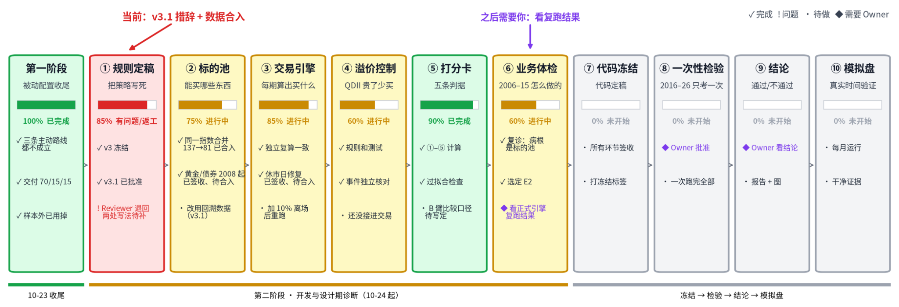
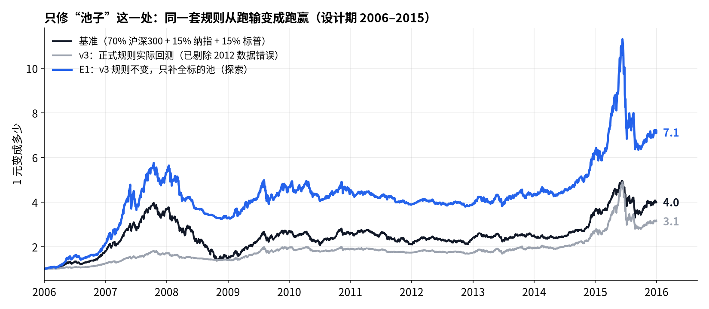

# ETF 轮动 · 第二阶段 Owner 看板（仓库镜像）

## Metadata

- Project: ETF_Rotation_Quant
- Document type: reference（Owner 看板镜像）
- Status: active
- Owner: L. Loric
- Maintainer: Orchestrator（Notion AI）
- Last updated: 2026-10-25
- Source of truth: [ETF 轮动 · 第二阶段 Owner 看板](https://app.notion.com/p/850ec881bd2483418c45017aa6f835cf)
- Source contentLastEditedAt: 1792930499492
- Sync: 按 Owner 授权，从上述 Notion 页面同步当前正文和三张图片；本次仅更新镜像，不代表批准 2.6、修改预注册或授权合入 main。
- 图片：原页为 PNG；仓库用内嵌原始 PNG 的自包含 SVG 无损保存，无外部临时链接。原有矢量 SVG 保留不动。
- 群内工程进度看 `operations/planning/phase2-board.md`

---

**项目愿景**：在多类资产之间做**强势资产轮动**，同时把**回撤控制住**，为个人账户找到一套可以验证、能稳定跑赢被动基准的 ETF 规则。

**工程进度**

约 70%。同一指数合并已合入；黄金、债券、休市修复已签收，待合入；v3.1 待开发。

**业务结论**

跑输的原因已找到并验证：**标的池规则**。加上“及时离场”后，期望收益进一步提高。

**需要你**

**现在**：确认 v3.1 的两处写法（见 2.6）。 之后：看正式引擎的设计期复跑结果。

## 1. 进度总览

从左到右是完整路线。红框是当前的卡点，紫色是需要你拍板的节点。更新于 2026-10-25 深夜，已纳入 Dev 和 Reviewer 的最新推送（PR #25–#33）。

每个环节在做什么、做到哪一步（展开）

| 环节 | 对愿景的意义 | 已完成 | 还差什么 |
| --- | --- | --- | --- |
| ① 规则定稿 | 防止看了结果再改规则，保证结论可信 | v3 冻结；v3.1 已批准（D10），文本在 PR #32 | Reviewer 退回两处写法（PR #33，见 2.6），补完复审后合入并打标签 |
| ② 标的池 | 决定“能在哪些资产之间轮动” | 同一指数合并为一个：137 → 81 个，已合入（PR #25/#26）。黄金自 2008-08、10 年和 5 年国债自 2008-01 已入库，Reviewer 已签收（PR #29/#31），待合入 | 改用官方回溯数据（v3.1）；2006–07 年仍没有黄金和债券；创业板指缺发布日原件；国债总指数 CBA00601 名称对不上，暂不进池 |
| ③ 交易引擎 | 把规则变成每期的持仓 | 两套独立实现一致；2012-10-30 休市日已修，海外数据全部审计无同类问题，已签收（PR #29/#31），待合入 | 加单只 10% 离场；重跑设计期 |
| ④ 溢价控制 | 避免高溢价买入 QDII | 规则、测试、事件核对完成 | 还没接进交易流程 |
| ⑤ 打分卡 | 用五条判据判断“算不算好” | ①–⑤ 计算、过拟合检查 | B 臂与 A 臂的比较口径要在检验前写定 |
| ⑥ 业务体检 | 在设计期看清怎么赚钱、怎么亏钱 | 复诊完成（第 2 节），选定 E2 | 正式引擎复跑，与 E2 的 26.0% 对照；Dev 的体检报告排在数据修复之后 |
| ⑦–⑩ | 冻结 → 一次性检验 → 结论 → 模拟盘 | — | 依次进行 |

## 2. 到底哪里出了问题

**一句话：问题不在“选强势”，而在一条标的池规则。它让策略在 2006–2011 年几乎无标的可选，只能大半时间拿现金。**

只修这一处、其他规则一个字不改，设计期年化从 **12.6%** 变成 **22.6%**，基准是 15.4%。

### 2.1 病根：策略在牛市里只有一半的钱在场

柱子是 v3 实际回测每年的平均仓位；顶部数字是当年能选的标的数；虚线是基准的 A 股比例。

- **规则是怎么卡住的**：v3 写了“指数在官方发布日之前的数据不能用”。中证一级行业指数 2011-08 才发布，所以 2011 年以前只能在沪深300、中证500、恒指、纳指、标普这 4–6 个里选。但这些行业指数的官方回溯数据其实从 2005 年就有。
- **为什么会变成现金**：v3 每次选前 N 个（N = 3、5、8 三组平均），每个给 1/N；跑不赢现金的不能选，空出来的名额放现金。只有 4 个可选、还要过“跑赢现金”这一关，就注定半仓。2006 年沪深300 涨了 125%，策略里沪深300 平均只有 19%，52% 是现金。
- **这是设计缺陷，责任在我**：发布日规则是我写的，本意是防止指数公司事后回算、挑对自己有利的方法。但冻结规则前，我没有检查“每一年实际能选几个标的”，Reviewer 也没有查。以后任何规则冻结前，都要先出这张表。

### 2.2 验证：只修池子，同一套规则就跑赢基准

蓝线就是 E1：规则和 v3 完全一样，唯一的区别是可选标的更多。三条线都从 2006 年初的 1 元开始，扣除成本。E2、E3 是在 E1 上再加刹车，见 2.3；版本定义见第 3 节。

- **先确认复现是准的**：用独立脚本按 v3 原文重算，在原来的池子上得到 12.6% / −43.3%，和正式引擎一致，多数年份的差距在 3 个百分点以内。然后只把池子补全（行业指数用 2005 年起的官方回溯数据，另加黄金），其他规则不变。
- **结果**：年化 22.6%，基准 15.4%；任取 3 年，68% 的时候跑赢基准。
- **要说清楚的两点**：① 超额大多来自 2006–07 年的行业牛市；2010–2014 年基本走平，并不是每年都赢。② 黄金不是原因，去掉黄金结果几乎一样，起作用的是行业指数。

### 2.3 回撤：是手段，不是目标

**原则**：我们追求的是长期期望收益最大，不是好看的回撤数字。回撤只在两种情况下才重要：它拖累了复利，或者它说明策略失灵了。预注册判据 ④ 本来就是相对标准（最大回撤不比基准深 5 个百分点以上），不需要再定一个绝对数。上一版让你给一个 −30% 的目标，是先射箭后画靶，我收回。

**一条离场规则能不能加，只看两点**：① 有没有说得通的机制；② 期望收益是不是稳定提高，而不是只在某一个参数上好看。

| 做法 | 机制 | 年化 | 结论 |
| --- | --- | --- | --- |
| E1 不加离场 | — | 22.6% | 对照 |
| E2 单只从高点跌 10% 就卖 | 强势结束往往很突然。按天离场，不必等回看期和调仓日：截断亏损，让赢家继续跑 | 26.0% | ✅ 建议采用 |
| E3 组合波动高就减仓 | 只对“跌得快”有反应，对“慢慢跌”没反应 | 20.9% | ❌ 不采用，期望变低 |

- **E2 为什么可信**：没有挑参数。8%、10%、12%、15% 四档分别是 25.2%、26.0%、25.8%、23.8%，都比不加好，是一片平台，不是一个尖峰；2006–10 和 2011–15 两段也都比 E1 好。10% 是交易员常用的整数，事先定死，以后不再调。
- **E3 的最大回撤为什么跑到了 2008**：2015 年是两三周的急跌，波动飙升，刹车起了作用；2008 年是持续 10 个月的阴跌，波动不算极端，刹车一直没完全踩下去。结果从 2008-01 到 2014-11，水下将近 7 年。它控制的是“速度”，不是“方向”。
- E2 的最大回撤仍有 −37%（2015 年）。它比基准的 −65% 浅得多，又是期望更高的代价，可以接受。

### 2.4 你上次问的四个问题

展开

1. **躲过 2008 有没有意义？**单独看没有。2006 年初到 2009 年底，v3 是 1 元变 1.96 元，基准是 1 元变 2.71 元。回撤小是因为 2008 年平均 77% 是现金，钱根本不在场，不是因为择时好。所以以后不再单独看最大回撤，要和“同期赚了多少”放在一起看。
2. **仓位不足是不是设计缺陷？**是，见 2.1。补全池子后，“空位放现金”反而有用：我试过把空位强制填满，结果年化更低、回撤更深。
3. **“选强势”为什么 2006–08 跑不赢沪深300？**因为根本没得选。4 个标的、5 个名额，就等于全都拿着，相当于把沪深300和港股、美股平均持有。池子补全后，2006、2007 年分别是 +114% 和 +147%，明显跑赢基准（+80%、+104%）。
4. **基准在 2006–08 年靠什么？**几乎全靠 A 股。按比例粗算，2006 年基准 +80%：沪深300 贡献约 +88 个百分点，美股约 +2；2007 年 +104%：A 股约 +114，美股约 +2；2008 年 −60%：A 股约 −46，美股约 −13。那几年美股基本没涨。

### 2.5 决定：已批准（D10，2026-10-25）

**✅ 已批准 v3.1 = E2：补全标的池 + 单只 10% 离场。**

- 改什么：① §3.3：中证、恒生这类官方指数，有官方回溯数据就可以用，所有标的一视同仁；两种口径都报告。② 新增一条：单只从买入后的高点跌 10%，下一交易日卖出，下个调仓日再参与排名。
- 不改什么：打分、选几个、空位放现金、五条判据，一律不变。参数事先定死，不再按设计期结果调。
- 为什么必须在一次性检验之前改：否则设计期测不出这套想法，B 臂“每年用此前数据选参数”也会被早期的小池子带偏。
- 代价：这是看过设计期结果之后改的规则，必须如实登记，第 ⑤ 条过拟合检查要把这次修改和29 个诊断变体都算进尝试次数。2016 年以后的数据仍然一眼没看。

规则全文：仓库 `docs/prereg/etf-multiasset-rotation-prereg-v3.1.md`；决定记录：`operations/planning/2026-10-25-d10-v3.1-approval.md`。

### 2.6 需要你确认：Reviewer 退回了 v3.1 的两处写法

Reviewer 核对后结论是“退回”（[PR #33](https://github.com/Entropy-Reduction-AI/ETF_Rotation_Quant/pull/33)）。方向没有问题，问题是两处写得不够死，Dev 照字面可能做出和 E2 不一样的东西。这是我写漏了，Reviewer 抓得对。

| 问题 | 不写清会怎样 | 建议写法 |
| --- | --- | --- |
| B1 回溯数据只用来算涨幅，还是也决定“从哪天起能选” | v3 另有一句“指数从发布日起才进池”。只改涨幅计算，2011 年以前照样没得选，等于没修 | 主口径：有官方序列的那天起就能参与排名和持有；发布日只用于对照口径。这就是 E1 的做法，只是把本意写明 |
| B2 离场按“六组各自算”还是“合成一个组合再算” | v3 把 6 组（N = 3/5/8 × 周/月）的权重平均成一套持仓。离场如果在合成后的组合上做，和 E2 的算法不同，结果对不上 | 六组各自持仓、各自离场，收益取六组平均。E2 的 26.0% 就是这样算的，不用新增试验；实盘把六组的持仓加起来就是账户持仓 |

另外三处小问题我会一并写清：B 臂只对当年选中的那一组用离场规则；QDII 的离场用和收益相同的序列；离场卖出不走溢价规则，只扣成本。

## 3. 定义（常驻，每次改版都更新）

**基准（BM-主）**：70% 沪深300 + 15% 纳指100 + 15% 标普500，都是含分红的全收益，美股换算成人民币。每月末调回这个比例，始终满仓。它代表“什么都不做，买三只指数放着”。新策略必须跑赢它才有意义。

**策略版本**

| 版本 | 状态 | 能选什么 | 怎么选、怎么持有 | 设计期年化 / 最大回撤 |
| --- | --- | --- | --- | --- |
| v3 | 正式规则，已冻结 | 137 个标的；指数在官方发布日之后才能用 | 看过去约 1、3、6、12 个月的涨幅除以波动，排名；必须跑赢现金才有资格；选前 N 个，每个 1/N，不够就放现金；N = 3、5、8，每周和每月调仓，共 6 组取平均 | 12.6% / −43%（已剔除 2012 数据错误） |
| E1 | 探索 | 18 个指数：宽基、10 个行业（用 2005 年起的回溯数据）、红利、恒指、纳指、标普、黄金 | 和 v3 完全相同 | 22.6% / −44% |
| E2 | 探索 | 同 E1 | E1 + 单只从买入后的高点跌 10% 就卖，下个调仓日再选 | 26.0% / −37% |
| E3 | 探索 | 同 E1 | E1 + 组合近 20 日波动超过年化 20% 时按比例减仓，减下来的放现金 | 20.9% / −39% |
| 基准 | 对照 | 3 只指数 | 见上 | 15.4% / −65% |

E 系列只用 2006–2015 年的数据，由我（Orchestrator）独立计算，还没有进入正式引擎。设计期共试了 29 个变体（保守口径），全部登记在仓库 `operations/work_logs/2026-10-25-orchestrator-design-period-diagnosis.md`，计入判据 ⑤ 的尝试次数。

## 4. 问题清单

| 问题 | 影响 | 处理 | 状态 |
| --- | --- | --- | --- |
| 发布日规则砍掉设计期标的池 | 设计期跑输的主因 | v3.1 | ✅ 已批准，待实现 |
| 离场太慢（E1 回撤 −44%） | 期望收益被拖累 | v3.1 单只 10% 离场 | ✅ 已批准，待实现 |
| v3.1 两处写法不清（B1/B2） | Dev 可能实现成和 E2 不同的版本 | 按 2.6 补写，Reviewer 复审 | 🟣 待你确认 |
| 2012-10-30 纳指被当成归零 | 当年少 16.5 个百分点 | 删除错误收盘，审计全部海外数据 | 🟢 已签收，待合入（PR #29） |
| 同一指数被拆成多个标的 | 重复持有纳指、标普 | 按底层指数合并，137 → 81 | ✅ 已合入 |
| 设计期缺黄金、债券 | 2006–07 年无防御资产可选 | 2008 年起已补；更早的数据源里没有 | 🟢 已签收，待合入；2006–07 仍缺 |
| 国债总指数 CBA00601 是否进池 | 名称对不上规则里的两只国债，Dev 未放入 | 它能补上 2006–07 年的债券，但要再改一次规则。那两年是股票大牛市，债券基本不会被选中，建议不加 | ⚪ 不阻塞 |
| 溢价控制没接进交易 | 可交易池的检验不完整 | 接入执行链 | 🟡 已派给 Dev |

## 5. 接下来

1. 你确认 2.6 → 我补写 v3.1 → Reviewer 复审 → Manager 合入并打 `milestone/v3.1-prereg-freeze`。同时 Manager 可先合入 PR #29（数据修复，与 v3.1 无冲突）。
2. Dev 改池子、加离场规则、修数据、接溢价控制 → Reviewer 签收 → 正式引擎重跑设计期。
3. 正式引擎的结果和我的复现对上之后，冻结 v3.1，进入一次性检验。

## 更新记录

- 2026-10-25（深夜，二）：进度总览按最新推送重画。同一指数合并已合入；黄金、债券、休市修复已签收待合入；Reviewer 退回 v3.1 两处写法，新增 2.6。
- 2026-10-25（深夜）：Owner 批准 v3.1（D10）。补测 8%、12% 两档，确认离场参数是平台；诊断变体计 29 个。看板镜像、愿景与原则文档、v3.1 规则以及交易员笔记，已推到仓库 [PR #32](https://github.com/Entropy-Reduction-AI/ETF_Rotation_Quant/pull/32)，待 Reviewer 核对、Manager 合入。
- 2026-10-25（夜）：回撤改为“手段而不是目标”；不再设绝对回撤目标；v3.1 建议改为 E2；E3 不采用。
- 2026-10-25（晚）：重写第 2 节，只讲一个结论：跑输来自标的池规则，已用复现验证。新增“定义”一节，按版本列出基准和各个策略。图改为普通刻度，从三张减到两张。
- 2026-10-25（下午）：加入进度总览图和设计期初诊。
- 2026-10-25：建立看板。
