# ETF 轮动 · 第二阶段 Owner 看板

## Metadata

- Project: ETF_Rotation_Quant
- Document type: reference（Owner 看板）
- Status: active
- Owner: L. Loric
- Maintainer: Orchestrator
- Last updated: 2026-11-01（版本进化图、每一版摘要）
- 现行版本：本文件与同内容的 Claude 页面。Owner 2026-10-27 决定看板改在仓库维护，Notion 页面不再同步。
- 群内工程进度：`operations/planning/phase2-board.md`

---

**项目愿景**　在动态周期内，从多类资产里选出 Top N 强势 ETF 轮动持有，获得超额收益、稳定跑赢被动基准，同时把回撤控制住。

| 工程进度 | 业务结论 | 需要你 |
| --- | --- | --- |
| **v5 设计期跑完**：最终版 = 起点 + 10% 离场，没有入围。待 Reviewer 复算和别的市场检验，然后封板（D27）。 | v5 指数池年化 **12.7%**，低于 E2 新口径的 **24.9%** 和基准的 **15.6%**；可交易池 17.4%，好于 E2 的 8.7%。入围一次性检验的只有 E2 新口径。 | **一件要你选**：要不要把“跑前五问”写进项目规矩（见《v5 研究备忘》第 10 节）。期望线和以哪个池子为准，封板前定。 |

## 1. 现在在哪：v5 是封板前最后一个版本

> **v5 设计期已跑完、没有入围；别的市场验完就封板，封板后 E2 新口径做一次性检验。**

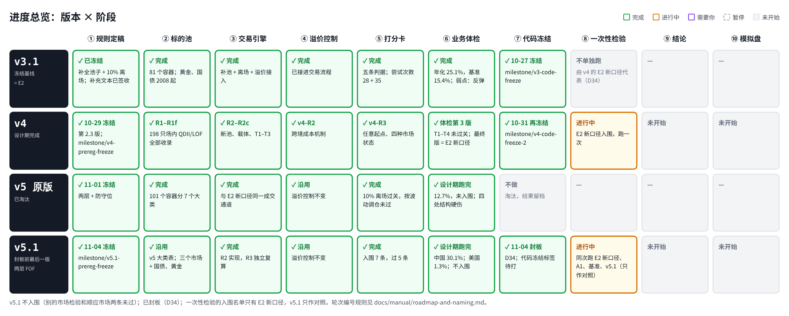

| 页面 | 回答什么 |
| --- | --- |
| [**v5 研究备忘**](v5-research-memo.md) | v5 是什么、为什么输（四处结构硬伤）、跑前五问 |
| [**v4 体检报告**](v4-health-check.md) | v4 的最终结论：四个改进为什么都没过，E2 新口径的性格 |
| [**v4 研究备忘**](v4-research-memo.md) | v4 当初为什么试 T1–T4（留档） |
| [**数据看板**](data-board.md) | 池子里有什么、每样哪年起能买、数据靠不靠得住 |

## 2. 每一版的结论

> **“选强势、跑赢现金才买”这条路是对的；E2 新口径仍是最好的一版，v4 的微调和 v5 的换架构都没有赢过它。**

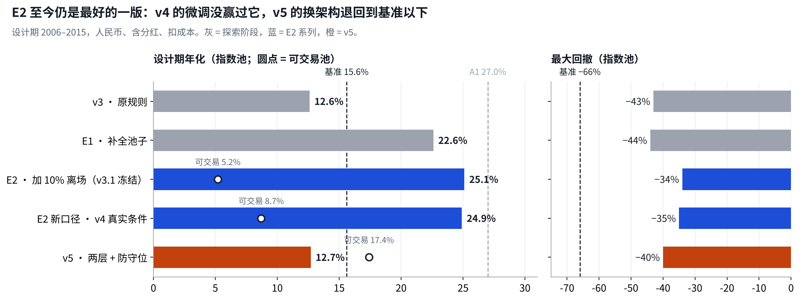

| 版本 | 策略详情 | 设计期年化 | 最大回撤 | 结论 |
| --- | --- | --- | --- | --- |
| **v3 · 原规则** | 一张排名表：看 1、3、6、12 个月，跑赢现金才有资格，按“涨幅 ÷ 波动”取前 N 名（N = 3、5、8），每只 1/N，不够 N 只空位拿现金；周、月各调一次，6 组取平均。池子只用当年已发布的指数 | 12.6% | −43% | **跑输基准** 早年能选的只有 4–6 只，牛市拿着现金 |
| **E1 · 补全池子** | 规则同上，改一处：池子补全为当年已有数据的指数 | 22.6% | −44% | **变好** 病根确认是池子太小 |
| **E2 · 加 10% 离场** | 同 E1，再改一处：单只从持有期高点回落 10% 就卖，钱拿现金到下一个调仓日 | 25.1% | −34% | **冻结** v3.1 的最终规则；超额集中在 2006–08 年 |
| **v4 · E2 新口径（真实条件）** | E2 规则不变，换成真实交易条件：涨跌停、收盘时点和汇率、海外基金溢价；另算“当年真能买到”的可交易池。在它上面试 T1–T4 四个微调 | 24.9% 可交易 8.7% | −35% | **四个微调都没过** v4 最终版 = E2 新口径，**现在的唯一候选** |
| **v5 · 两层 + 防守位** | 先分 5 个风险大类，类里任一只跑赢现金这类就开，开着的类平分、每类买最强的一只；全部关掉才放国债、黄金；加 10% 离场 | 12.7% 可交易 17.4% | −40% | **没入围** 按类别分钱、不按强弱分钱，违背“优中选优” |

表里每一行就是上图的一根柱子。年化和回撤都是指数池（能排名的池子）；基准 = 70% 沪深300 + 15% 纳指100 + 15% 标普500，人民币全收益，设计期年化 15.6%、最大回撤 −66%。设计期 = 2006–2015；2016 年以后留给一次性检验。v1、v2（A 股主题轮动、A 股择时）样本外不成立，已关闭，不在图表里。

### 每一版的摘要（留档，最新的在上）

v5 · 两层 + 防守位（10-31～11-01）：没有入围

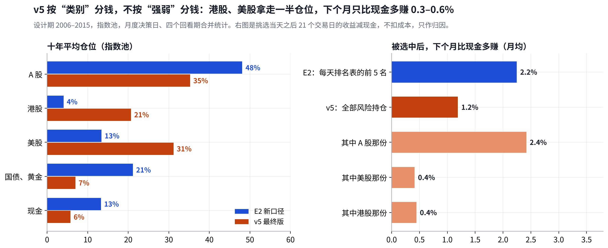

- **想法**：v4 证明“该不该持有”有信号、“挑哪一只”几乎没有，于是先按大类判断，再在跑赢现金的大类之间平分，弱市放国债、黄金。
- **结果**：指数池年化 12.7%，E2 新口径 24.9%；扣掉“押得少”，年化 ÷ 回撤和随机挑选差不多。
- **为什么输**：四处结构硬伤，根子是按类别分钱、不按强弱分钱：港股、美股拿走一半仓位，下个月只比现金多赚 0.4%；防守要等风险大类全部关掉才打开，十年只有 10% 的时间。

完整故事、四处硬伤和“跑前五问”见[《v5 研究备忘》](v5-research-memo.md)。

v4 · E2 新口径（真实条件）+ 四个微调（10-27～10-31）：四个都没过

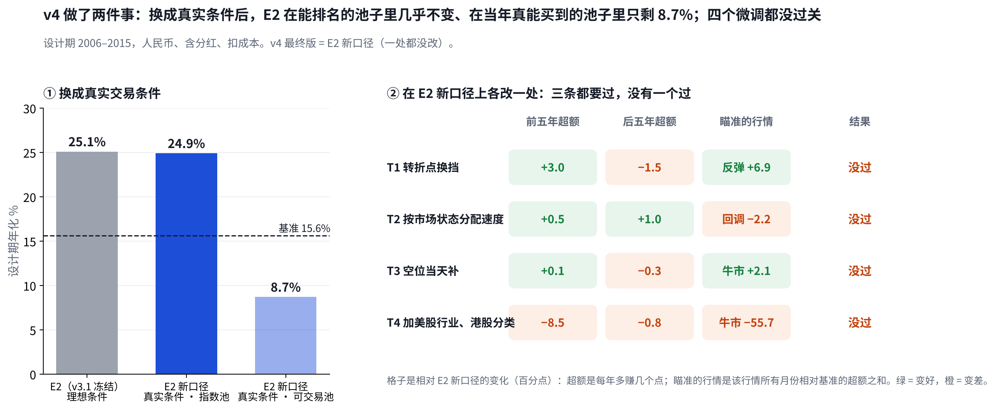

- **第一件事**：把回测换成真实交易条件。E2 在能排名的池子里 25.1% → 24.9%，几乎不变；换成当年真能买到的基金，只剩 8.7%，跑输基准。
- **第二件事**：在 E2 新口径上各改一处，试四个微调。过关要三条全过：前五年、后五年都更好，瞄准的行情确实变好。四个都没过，所以 v4 最终版就是 E2 新口径，一处没改。
- **留下的问题**：池子小的时候“每只 1/N、空位拿现金”代价大，这成了 v5 的出发点。

完整结论见[[《v4 体检报告》](v4-health-check.md)](v4-health-check.md)。

v3 → E2 · 多资产强势轮动（10-25～10-28）：E2 的规则和当时的体检

### E2 的规则（4 步）

> **表里 v3、E1、E2 三行用的是同一套四步；E1 补全了池子，E2 再加 10% 离场。v4、v5 都从这里出发。**

1. **看 4 种时间长度**：分别看过去 1、3、6、12 个月（20、60、120、250 个交易日）的表现，每种管 **1/4** 的钱。
2. **先过门槛**：在这段时间里**跑赢现金**的，才有资格入选。
3. **再挑最强的**：按“涨幅 ÷ 波动”排名，取前 N 名，每只占 1/N。合格的不够 N 只，**空位拿现金**。
4. **分散着做**：N 取 3、5、8，按周和按月各调一次仓，共 6 组持仓取平均。

### 当时的体检（已被[《v4 体检报告》](v4-health-check.md)取代，留档）

> **一句话**　v3 跑输，病根是可选的太少，“选强势”这个想法没错。补全池子再加 10% 离场（E2），年化从 **12.6%** 提高到 **25%**，基准是 **15%**。要看清的是：超额集中在 2006–08 年；2009 年回场太慢，少赚 39 个百分点。

### 3.1病根：能选的太少，牛市里拿着现金

> **2006 年沪深300 涨了 **125%**，v3 有 **60%** 的钱拿着现金。**

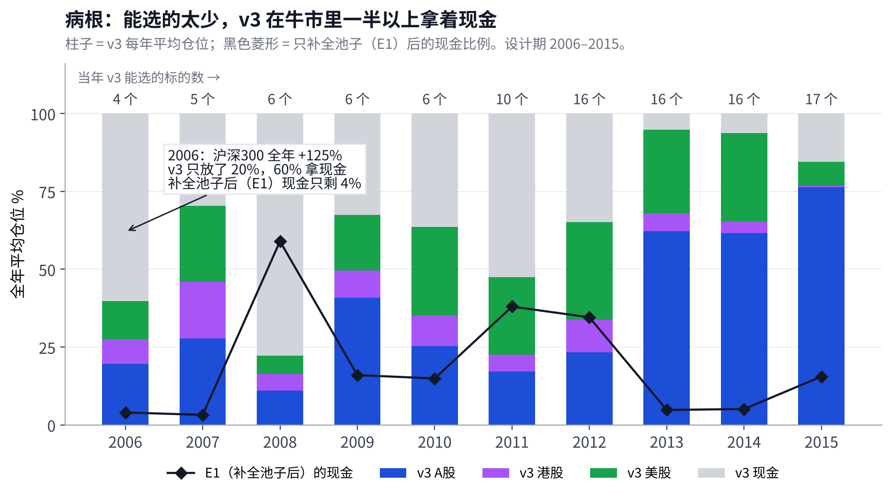

- **左边是 v3 原规则**：2011 年以前每年只能选 **4–6** 只，却要填 3、5、8 个名额，加上“跑不赢现金不能选”的门槛，空出来的名额只能拿现金。
- **右边是 E1 补全池子**：每年都能选 **17** 只，2006–07 年现金只剩 **4%** 和 **3%**。
- **2008 年两边都大量拿现金**：所有标的都跑不赢现金，门槛在起作用，这正是我们想要的。

▶责任与教训

发布日这条规则是 Orchestrator 写的，本意是防止指数公司事后挑方法回算。冻结之前没有检查“每年实际能选几个”，这是设计缺陷。以后冻结任何规则之前，先出这张表。

### 3.2补池子、加离场：从跑输变成跑赢

> **十年 1 元：v3 原规则 **3.1** 元 → E1 补全池子 **7.1** 元 → E2 加离场 **9.3** 元。基准 **4.0** 元。**

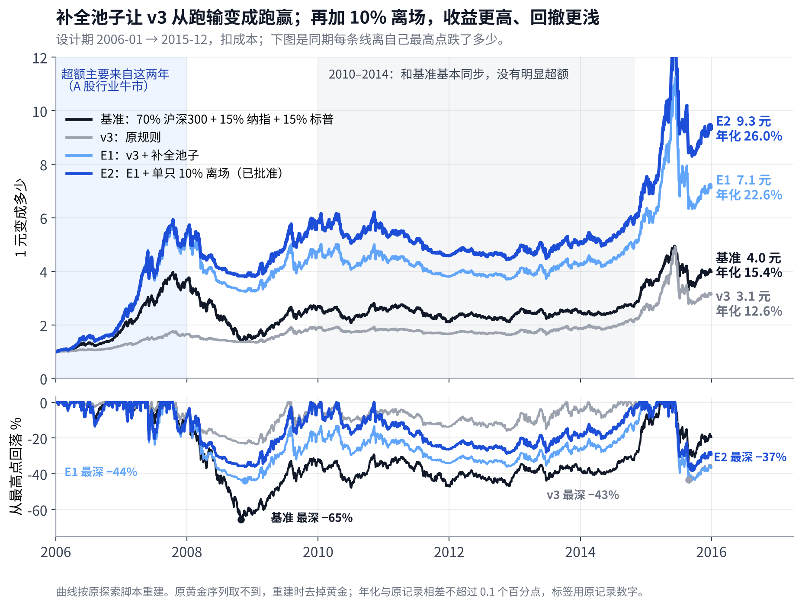

| 补池子贡献最大 | 加离场锦上添花 | 差距在哪几年拉开 |
| --- | --- | --- |
| 年化 **12.6%** → **22.6%**，多了 **10** 个百分点。 | 年化再多 **3.4** 个百分点，最深回撤 **−44%** → **−37%**。 | 主要在浅蓝底的 2006–07 年。2010–14 年几条线基本平行。 |

### 3.3为什么是 10%

> **8%、10%、12%、15% 都比不离场好。10% 不是挑出来的。**

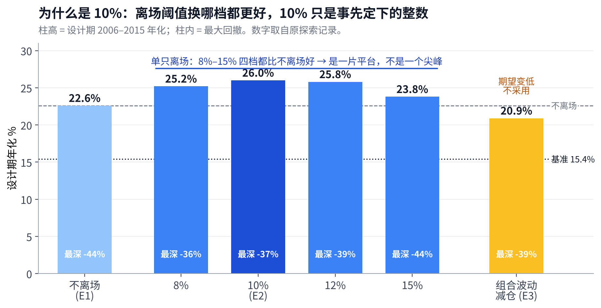

- **为什么有效**：强势结束往往很突然。每天检查，跌 10% 就卖，不用等到下一个调仓日。
- **前后两段都成立**：2006–10 年，不离场是 1 元变 **4.4** 元，四档离场都在 **5.2–5.4** 元；2011–15 年，不离场是 **1.6** 元，四档都在 **1.7** 元上下。

▶E3 组合减仓为什么不采用

E3 看整个组合的波动，波动一高就整体减仓。它对 2015 年那种两三周的急跌有效，对 2008 年持续 10 个月的阴跌没有反应，所以长期收益反而更低。我们追求的是长期收益最大，不是某一段回撤好看。

### 3.4正式引擎复现了 E2，超额集中在前三年

> **正式版 **25.1%** 对基准 **15.4%**。但 2011–15 年只多 **0.8** 个百分点。**

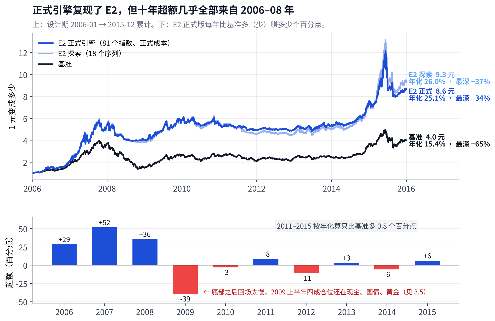

- **复现成立**：正式引擎用 81 个指数和正式成本，探索版只用 18 个序列，两条线十年里几乎重合。Reviewer 已独立核对数字。
- **超额从哪来**：10 年里有 6 年跑赢，但三个大数 **+29**、**+52**、**+36** 都在 2006–08 年。
- **最大的一次失手**：2009 年少赚 **39** 个百分点，原因见下一节。

### 3.52009 年的失手：钱回来得太慢

> **2009 年少赚的 **39** 个百分点全在上半年：见底之后半年，平均还有 **43%** 的钱放在现金、国债和黄金里。**

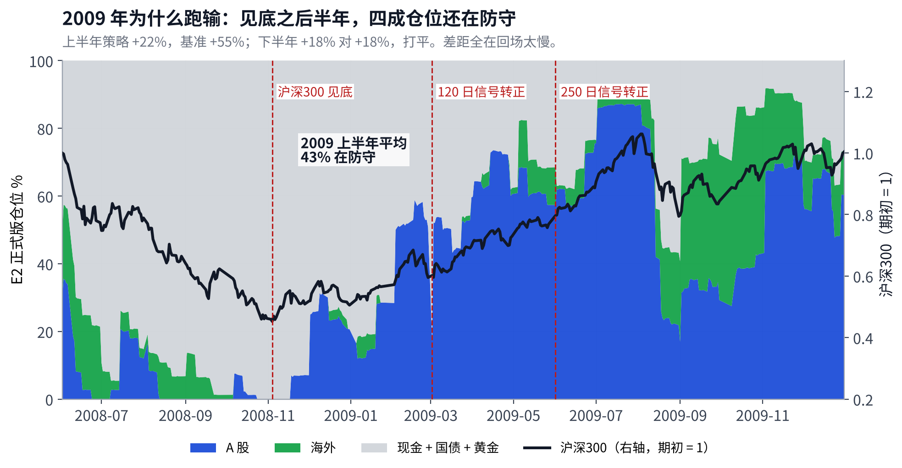

| 为什么慢 | 总账 | 能不能改 |
| --- | --- | --- |
| 四组里 6 个月和 12 个月那两组，要等过去半年、一年的涨幅转正才能买。见底后它们分别等了 **4** 个月和 **7** 个月。 | 同样的慢信号，让 2008 年少亏了 **36** 个百分点。2008–09 两年合计，E2 **+10%**，基准 **−26%**。 | 能。两个改进方案都把 2009 上半年从 **+28%** 提到 **+43–50%**，但另一段没有改善。现在作为影子方案留着，v4 的 T1 转折点换挡接着做。 |

▶两个改进方案的细节（C1、C2）

#### C1 · 快信号回场

| 项目 | 内容 |
| --- | --- |
| 改的是 | **6 个月和 12 个月那两组**的入选门槛 |
| 原规则 | ~~只看本组时间段是否跑赢现金~~ |
| 新规则 | 本组跑赢现金，**或者 1 个月和 3 个月都跑赢现金**，都可以入选 |

#### C2 · 门槛看 60 日

| 项目 | 内容 |
| --- | --- |
| 改的是 | **全部 4 组**的入选门槛 |
| 原规则 | ~~每组看各自的时间段是否跑赢现金~~ |
| 新规则 | **统一看 3 个月（60 日）**是否跑赢现金 |

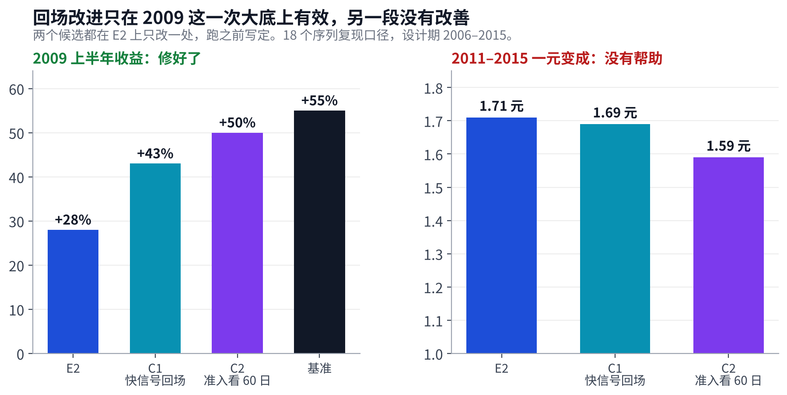

C1 在 2011–15 年和 E2 持平，C2 更差。项目要求规则在前后两段都成立，设计期里只有 2008–09 这一个大底，证据不够，所以都没有采用。C1 作为影子方案，一次性检验时一起报告（D11）。

▶做空、期权、股指期货能不能解决

- **做空不能。**这次是涨的时候没跟上，跌的时候已经躲开了；V 形反弹里拿着空头只会亏得更多。
- **防守工具没有问题。**2008 年就是现金 ETF 把回撤控制住的，问题在什么时候回来，这是信号问题。
- **唯一对得上的是认购期权**：拿现金时买一点认购期权，反弹时能跟上。但 50ETF 期权 2015 年、300ETF 期权 2019 年底才上市，设计期没法检验，而且超出了“只做 ETF、不加杠杆”的边界。

### 3.6可交易池：同一套规则，只能买当年真有的 ETF

> **E2 补全的是**指数数据**，不是 ETF。2012 年以前，跟踪这些指数的 ETF 每年只有 0–1 只，所以可交易池只能拿现金。**

|  | 指数池（前面所有的数字） | 可交易池 |
| --- | --- | --- |
| **能选什么** | 用指数的历史数据，假设每个指数当年都能买 | 只能买当年已经上市、并且跟踪同一指数的 ETF |
| **2006–2011 年** | 每年 **17–20** 个 | 每年 **0–1** 个（只有红利 ETF） |
| **2015 年** | 22 个 | 14 个 |
| **E2 设计期年化** | **25.1%** | **5.2%**：2013 年以前 88–100% 的时间是现金 |

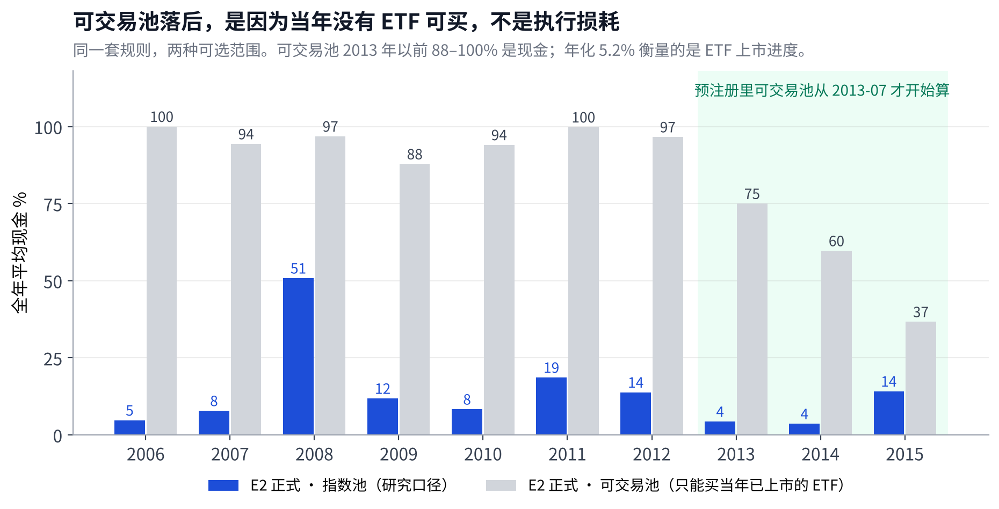

- **所以 5% 说明不了策略的好坏**：它衡量的是 ETF 的上市进度。沪深300 ETF 2012 年才上市，行业 ETF 更晚。
- **这和 v4 的“还原真实可投资市场”是同一个问题**：当年境内没有对应的 ETF，并不等于投资者买不到。美股可以直接买美国的行业 ETF（v4-R1 已在取数）；A 股在 2006–2011 年也可以通过场外的行业指数基金买到类似的仓位，已定加入 v4 的可交易池（D14-1）。
- **对检验的影响**：2016 年以后大部分 ETF 已经上市，可交易池到那时才有意义。预注册写明：可交易池明显不成立，结论降一级。

### 3.7换两个角度再看：E2 是顺应了市场，还是被市场选中

> **E2 靠**少跌**赢，不靠**多涨**赢：涨的月份只跟上基准的 **86%**，跌的月份只跟跌 **52%**。**

| 换个月份买入 | 按行情拆开 | 所以 v4 改了检验方式 |
| --- | --- | --- |
| 每个月都当作买入点，持有 1–5 年，跑赢基准的只有 **62–64%**，跑赢纳指100 的只有 **32–45%**。十年 25% 的年化主要靠 2006–07 年起步。 | 熊市 **+95**、回调 **+30**、牛市 **+1**、反弹 **−57**（百分点）。牛市里选得好，却被没满仓抵消；反弹里两头都亏。 | 以任意起点为主（D12-2）；四种行情分别报告，牛市和反弹的超额都不能为负（D13-2）。 |

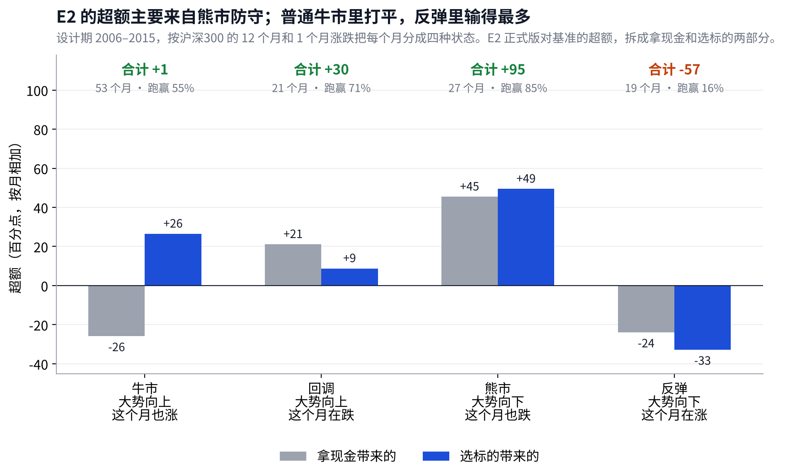

怎么分行情：看沪深300 过去 12 个月和这个月的涨跌。大势涨、本月涨 = 牛市；大势涨、本月跌 = 回调；大势跌、本月跌 = 熊市；大势跌、本月涨 = 反弹。逐年数字、任意起点的两张图见《v4 研究备忘》第 2、3 节。

## 3. 已定的大事

> **研究怎么收尾已经定了：v5 做完封板，一次性检验只跑一次，模拟盘只上一个。**

| 决定 | 内容 |
| --- | --- |
| **D27 封板条件** | v5 是最后一个研究版本，做完就封板，不论结果；封板后的新想法记作 v6，当“挑战者” |
| **D26 v5 换架构** | 先判断该不该冒险，再在少数大类里挑；不冒险时放国债、黄金 |
| **D20 检验和模拟盘** | 一次性检验推迟到封板；模拟盘只上一个，12 个月不切换；选性格，不只看收益 |
| **D12–D14 真实条件** | 涨跌停、停牌顺延；后复权；当年买不到 ETF 时用场外指数基金还原；以任意起点为主要检验 |

全部决定记录在仓库 operations/planning/ 下（D11–D27）。

## 4. 风险：两条最要紧

> **好看的十年主要靠 2006–07 年；当年真能买到的池子跑输基准。**

| 风险 | 意味着什么 | 怎么处理 |
| --- | --- | --- |
| **超额集中在 2006–08 年** | **持有 5 年跑赢基准的起点只有 65%** | 四个年代分别报告；期望线按分布写 |
| **可交易池跑输基准** | **8.7% 对 15.6%** | 早年能买的太少；2016 年后池子变大会减轻；v5 能买的少时集中 |
| 试的次数多 | 设计期数字偏乐观 | 按累计尝试次数打折扣 |
| 急跌和 V 形反弹 | 趋势规则的本性，躲不开 | 期权单独一条线；反弹落后写进期望线 |
| 2016–2026 不是干净的样本外 | 第一阶段用过这段数据 | 不称样本外；干净证据只来自模拟盘 |

## 5. 接下来

1. **团队**：Reviewer 复算 v5 设计期 → Dev 跑别的市场检验（美国上市 ETF，只跑一次）。
2. **Orchestrator**：别的市场结果出来后写 v5 体检报告；一页期权研究备忘。
3. **你**：封板前定期望线和以哪个池子为准。
4. **封板后待办**：做一个数据资产 index（每条序列一行、可筛选，从数据库自动生成），数据看板放链接。

## 更新记录

- **11-01**：v5 归因：四处结构硬伤，根子是按类别分钱、不按强弱分钱；扣掉“押得少”和随机挑选没有区别。第 2 节版本表加“策略详情”，行与图一一对应；v4 摘要换成能看出四个微调没过的图。
- **11-01**：《v5 研究备忘》第 10 版重写成完整故事（结论、过程、过关、哪里赢输、为什么输、学到什么），五张图；看板新增版本进化图和每一版的摘要。
- **11-01**：v5 设计期跑完：按波动调仓没过关，10% 离场过关；最终版指数池 12.7%，没有入围。
- **11-01**：你批准了 v5 预注册的 4 处选择（D29）；核心价值写进 AGENTS.md（D28）。
- **11-01**：看板改成索引：只留现状、每一版的结论、已定的大事、风险和接下来；v3 阶段的体检收进折叠区。
- **10-31**：v5 预注册草案第 1 版：起点 = 跑赢现金的大类等分、都不跑赢时放国债或黄金；之后逐个加按波动调仓、10% 离场；小仓试错不进 v5。
- **10-31（六）**：你同意封板条件（D27）：v5 是最后一个研究版本，做完就封板，不论结果；一次性检验只跑一次；封板后的新想法记作 v6，可用全部历史设计、和在跑的策略逐项比，上线前过别的市场和 6 个月并行模拟，小资金起步。见《v5 研究备忘》第 8 节。
- **10-31**：你同意 v5 换架构（D26）：先判断该不该持有，再在少数大类里挑，空位放防守资产；部件逐个加。依据见《v5 研究备忘》第 5 版。红利 ETF 错价已修，可交易池 8.7%。
- **10-31**：R5c 完成：U-指数池能买国债、黄金、创业板后，E2 新口径年化 24.9%，过关结果不变；代码第二次冻结。发布[《v4 体检报告》](v4-health-check.md)第 3 版（含两个池子的介绍、2008 与 2015 两次大跌的拆解）。

更早的记录

- **10-30**：可交易池修好（10.5%，十年没跑过基准）；v4 代码冻结。复查又发现 U-指数池买不进国债、黄金、创业板，同行的可交易池判断口径不对，安排 R5c（D25）。[《v4 体检报告》](v4-health-check.md)第 2 版改了版式、加上可交易池。
- **10-29（四）**：v4 设计期跑完。T1–T4 都没过关，最终版 = E2 新口径；公开的 A1 双动量跑得更好；可交易池发现程序问题，修复重跑（D24）。发布[《v4 体检报告》](v4-health-check.md)第 1 版。
- **10-29（三）**：你批准了 v4 预注册；新建《数据与容器看板》（docs/owner/data-board.md），池子、数据来源和缺口都在那里。
- **10-29（二）**：准备全部完成：198 只场内 QDII、LOF 收录，8 只缺的后复权按分红记录还原（D21）；预注册第 2.3 版签收，待你批准；一次性检验推迟到研究封板（D20）。
- **10-29**：场内 QDII、LOF 一律纳入（含全球芯片这类主动基金），同一指数只取一个、同类商品选流动性最好的（D19）；对照基线命名为“E2 新口径”。
- **10-28（六）**：预注册第 1 版有条件通过，第 2 版已改完交复审；引擎和 2016 年以后的数据检查完成；载体和数据的 9 个口径定了（D16）。
- **10-28（五）**：v4-R1b 完成；8 个口径问题定了（D15）；v4 预注册草案已写，交 Reviewer 复核；新增 2016 年以后的数据完整性检查。
- **10-28（四）**：3 条数据口径按你的选择定了，加上你的数据原则；第 4 节说明怎么只用当时的数据判断市场状态（备忘 4.5c）。
- **10-28（三）**：v4-R1–R3 完成；新增“需要你：3 条数据口径”；第 4 节说明 IC 检验和 T1、T2 怎么组合（详见备忘 4.2、4.6）。
- **10-28（二）**：3.5、3.6 重写；《v4 研究备忘》的结论并入看板：新增 3.7（任意起点、四种市场状态）和第 4 节（v4 四个候选各补哪一块）。证据和文献仍在备忘里。
- **10-28**：v3.1 已代码冻结；v4 进入开发，按轮次推进；进度总览改成“版本 × 阶段”，和开发轮次一一对应（D13）。
- **10-27（四）**：你的 3 个选择都按建议定了（D11）；v3.1 进入代码冻结，一次性检验暂不跑；v4 研究方向见《v4 研究备忘》。
- **10-27（三）**：第 1 节每件事讲清来龙去脉，休市日卖法列为你的选择；第 2 节先讲选法、再讲版本，每个版本标明改了哪一处和好坏；关键数字按好坏上色。
- **10-27（二）**：查明 2009 年跑输的原因，测试了两个改进方案；决定点改为先定失手怎么处理，再定冻结。
- **10-27**：看板重写，改在仓库维护；正式引擎复现了 E2；查明可交易池的 5% 是因为当年没有 ETF 可买。
- **10-25**：你批准 v3.1 = E2，规则冻结；查明病根是可选池太小；E3 不采用。

