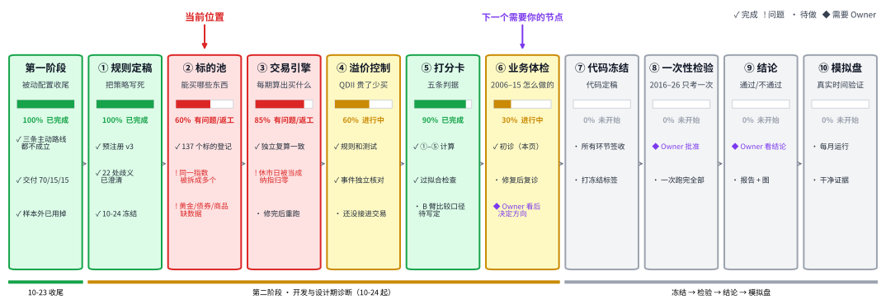
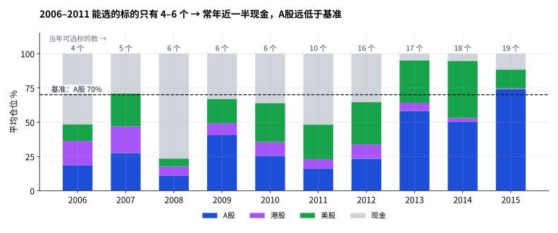
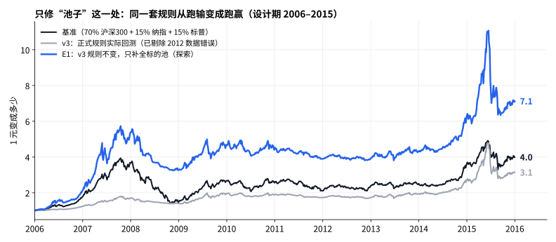

# ETF 轮动 · 第二阶段 Owner 看板（仓库镜像）

## Metadata

- Project: ETF_Rotation_Quant
- Document type: reference（Owner 看板镜像）
- Status: active
- Owner: L. Loric
- Maintainer: Orchestrator（Notion AI）
- Last updated: 2026-10-25
- Source of truth: Notion 上的“ETF 轮动 · 第二阶段 Owner 看板”；本文件在每次重大更新后同步
- 群内工程进度看 `operations/planning/phase2-board.md`

> **项目愿景**：在多类资产之间做**强势资产轮动**，同时把**回撤控制住**，为个人账户找到一套可以验证、能稳定跑赢被动基准的 ETF 规则。

| 工程进度 | 业务结论 | 需要 Owner |
| --- | --- | --- |
| 🟡 约 65%。引擎和打分卡已完成；标的池返工中 | 🟢 跑输原因已找到并验证：标的池规则。加上“及时离场”后，期望收益更高 | ✅ v3.1 已批准（D10）。下一次：看正式引擎复跑结果 |

## 1. 进度总览

| 环节 | 对愿景的意义 | 已完成 | 还差什么 |
| --- | --- | --- | --- |
| ① 规则定稿 | 防止看了结果再改规则 | v3 冻结；v3.1 已批准 | Reviewer 核对后冻结 v3.1 |
| ② 标的池 | 决定“能在哪些资产之间轮动” | 137 个标的；同一指数已合并 | 设计期使用官方回溯数据 |
| ③ 交易引擎 | 把规则变成每期的持仓 | 两套独立实现一致 | 修 2012-10-30 休市日；加单只离场 |
| ④ 溢价控制 | 避免高溢价买入 QDII | 规则、测试完成 | 接进交易流程 |
| ⑤ 打分卡 | 判断“算不算好” | 五条判据 | — |
| ⑥ 业务体检 | 看清怎么赚钱、怎么亏钱 | 复诊完成 | 正式引擎复跑后再看一次 |
| ⑦–⑩ | 冻结 → 一次性检验 → 结论 → 模拟盘 | — | 依次进行 |

## 2. 到底哪里出了问题

**一句话：问题不在“选强势”，而在一条标的池规则。它让策略在 2006–2011 年几乎无标的可选，只能大半时间拿现金。** 只修这一处、其他规则一个字不改，设计期年化从 12.6% 变成 22.6%，基准是 15.4%。

### 2.1 病根：策略在牛市里只有一半的钱在场

- **规则怎么卡住的**：v3 规定“指数在官方发布日之前的数据不能用”。中证一级行业指数 2011-08 才发布，所以 2011 年以前只能在 4–6 个宽基里选。其实这些指数的官方回溯数据从 2005 年就有。
- **为什么变成现金**：v3 选前 N 个、每个 1/N，跑不赢现金的不能选，空位放现金。只有 4 个可选时就注定半仓。2006 年沪深300 涨 125%，策略里沪深300 平均只有 19%，52% 是现金。
- **这是设计缺陷，责任在 Orchestrator**：冻结规则前没有检查“每年能选几个标的”。

### 2.2 验证：只修池子，同一套规则就跑赢基准

- 蓝线是 E1：规则和 v3 完全一样，唯一的区别是可选标的更多。
- 先确认复现准确：独立脚本按 v3 原文、在原池子上得到 12.6%，与正式引擎一致。
- E1 年化 22.6%；任取 3 年，68% 的时候跑赢基准。超额大多来自 2006–07 年，2010–2014 年基本走平。起作用的是行业指数，不是黄金。

### 2.3 回撤：是手段，不是目标

**原则**：追求长期期望最大，不追求好看的回撤数字；不设绝对回撤目标。判据 ④ 本来就是相对标准（不比基准深 5 个百分点以上）。

| 做法 | 机制 | 年化 | 结论 |
| --- | --- | --- | --- |
| E1 不加离场 | — | 22.6% | 对照 |
| E2 单只从高点跌 10% 就卖 | 强势结束往往很突然；按天离场，截断亏损，让赢家继续跑 | 26.0% | ✅ 采用（= v3.1） |
| E3 组合波动高就减仓 | 只对“跌得快”有反应，对“慢慢跌”没反应 | 20.9% | ❌ 期望变低 |

- E2 不是挑出来的参数：8%、10%、12%、15% 分别是 25.2%、26.0%、25.8%、23.8%，都高于 E1；2006–10、2011–15 两段也都更好。
- E3 的最大回撤出现在 2008 年：那是持续 10 个月的慢跌，波动刹车没有完全踩下去，水下将近 7 年。

### 2.4 Owner 的四个问题

1. **躲过 2008 有没有意义？** 单独看没有。2006–2009 年合计，v3 是 1 元变 1.96 元，基准是 1 元变 2.71 元；回撤小是因为 77% 是现金。
2. **仓位不足是不是设计缺陷？** 是。池子补全后，“空位放现金”反而有用。
3. **“选强势”为什么 2006–08 跑不赢沪深300？** 没得选：4 个标的、5 个名额，等于全部持有。补全后，2006、2007 年分别是 +114%、+147%，基准是 +80%、+104%。
4. **基准在 2006–08 靠什么？** 几乎全靠 A 股：2006 年 A 股约贡献 +88 个百分点、美股约 +2；2007 年 +114 对 +2；2008 年 −46 对 −13。

### 2.5 决定（已批准，D10）

v3.1 = E2：补全标的池（官方回溯数据可用，所有标的一视同仁，发布日口径只作对照）+ 单只 10% 离场（事先定死）。其他规则不变。尝试次数另加 29 个诊断变体。规则见 `docs/prereg/etf-multiasset-rotation-prereg-v3.1.md`。

## 3. 定义（常驻）

**基准（BM-主）**：70% 沪深300 + 15% 纳指100 + 15% 标普500，均为全收益，人民币计，每月调回比例，始终满仓。

| 版本 | 状态 | 能选什么 | 怎么选、怎么持有 | 设计期年化 / 最大回撤 |
| --- | --- | --- | --- | --- |
| v3 | 已冻结 | 137 个标的；发布日后才能用 | 看约 1、3、6、12 个月的涨幅除以波动排名；必须跑赢现金；选前 N 个，每个 1/N，不够放现金；N=3、5、8 × 周/月，共 6 组取平均 | 12.6% / −43% |
| E1 | 探索 | 18 个指数（行业用 2005 年起回溯数据，含黄金） | 同 v3 | 22.6% / −44% |
| E2 = v3.1 | 已批准 | v3 的池子 + 官方回溯数据 | E1 + 单只从高点跌 10% 下一交易日卖出，下个调仓日再选 | 26.0% / −37%（探索口径） |
| E3 | 不采用 | 同 E1 | E1 + 组合 20 日波动超过 20% 时按比例减仓 | 20.9% / −39% |
| 基准 | 对照 | 3 只指数 | 见上 | 15.4% / −65% |

E 系列只用 2006–2015 年的数据，由 Orchestrator 独立计算，详见 `operations/work_logs/2026-10-25-orchestrator-design-period-diagnosis.md`。

## 4. 问题清单

| 问题 | 处理 | 状态 |
| --- | --- | --- |
| 发布日规则砍掉设计期池子 | v3.1 | ✅ 已批准，待实现 |
| 离场太慢 | v3.1 单只 10% 离场 | ✅ 已批准，待实现 |
| 2012-10-30 纳指被当成归零 | 数据层修正 | 🟡 Dev |
| 同一指数拆成多个标的 | 已合并 | ✅ 已合入 |
| 溢价控制没接进交易 | 接入执行链 | 🟡 Dev |

## 5. 接下来

1. Reviewer 核对 v3.1 → Manager 合入、打 `milestone/v3.1-prereg-freeze`。
2. Dev 实现回溯数据池、单只离场、数据修正、溢价接入 → Reviewer 签收。
3. 正式引擎重跑设计期，与 Orchestrator 复现对照 → Owner 看过 → 代码冻结 → 一次性检验。
