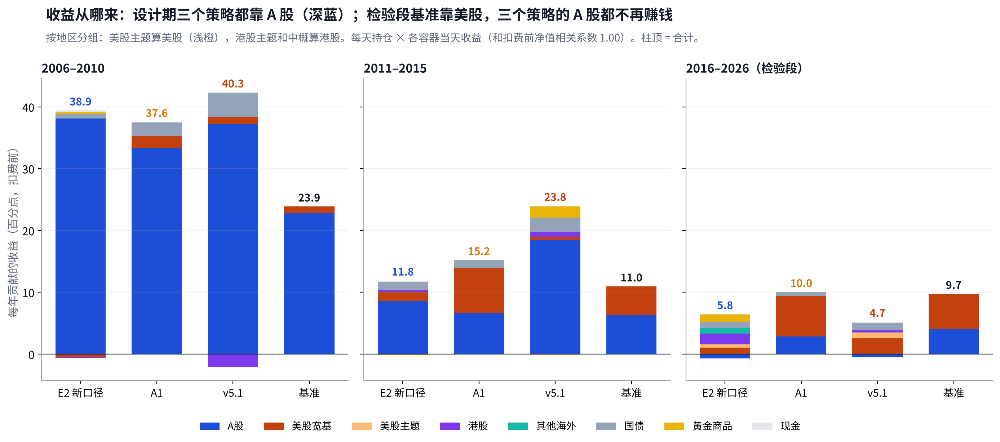
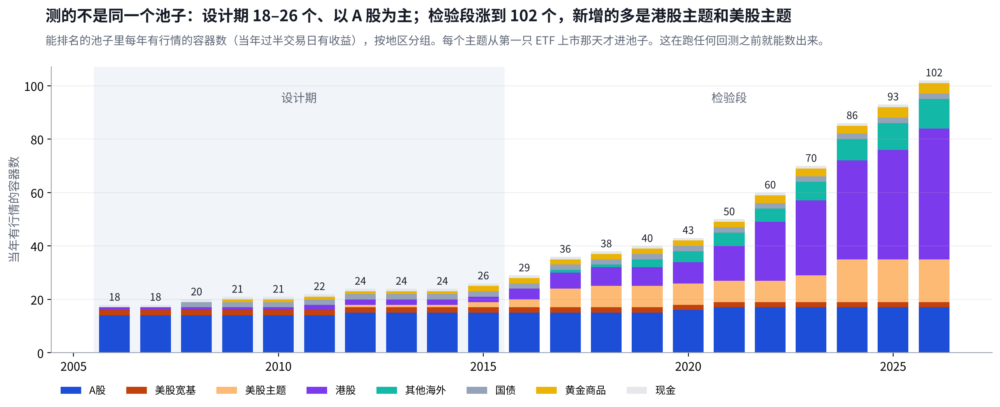
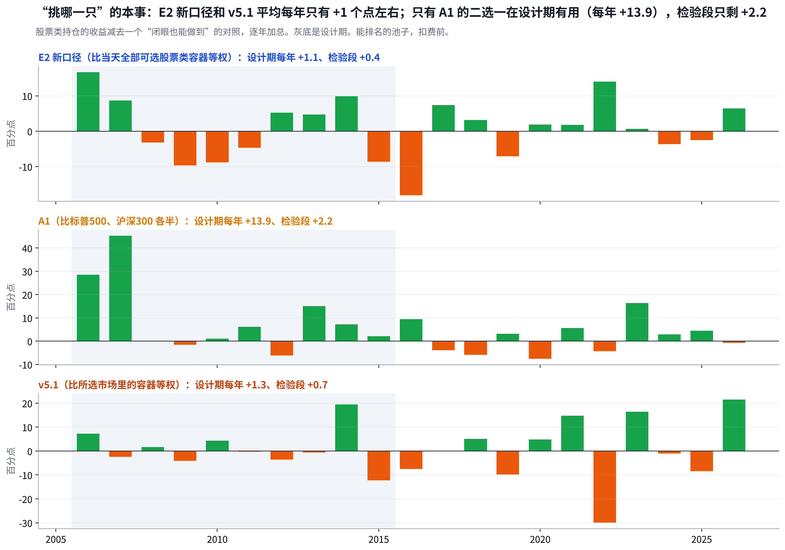

# 第二阶段复盘：设计期的超额来自 A 股大行情，不是来自“选强”；检验段换了池子、换了行情，就没了

## Metadata

- Project: ETF_Rotation_Quant
- Document type: owner（第二阶段复盘）
- Status: active（第 4 版：按地区重算、新增 v5.1 失效专节、重写第 5–10 节；四件事待 Owner 决定）
- Owner: L. Loric
- Maintainer: Orchestrator
- Date: 2026-11-05
- 依据：`results/v5/oneshot/`、`results/v4/r5/design/`、`results/v5.1/design/`（均已签收）；`results/v5/report/attribution_all.py`、`region_attr.py`、`retro4_charts.py`；D18、D27、D34、D35
- 页面：Claude 页面“第二阶段复盘”；本文件是仓库镜像

---

**项目愿景**　在动态周期内，从多类资产里选出 Top N 强势 ETF 轮动持有，获得超额收益、稳定跑赢被动基准，同时把回撤控制住。

| 进度 | 结论 | 需要你 |
| --- | --- | --- |
| 设计期和一次性检验都已签收；场外净值补齐。能买到的池子改用场内口径登记重算（D35），等 Grok 跑。 | 设计期三个策略都靠 A 股赢。检验段美股都没少拿，每年比基准：E2 新口径 **−6.1**（A 股和美股主题）、A1 **0.0**、v5.1 **−11.7**（成本 6.6 + 进出时点 4.3）。 | **四件事**：关闭；场内口径门槛；先要“跑赢”还是“控回撤”；v6 方向。见第 11 节。 |

## 1. 参赛者：四个策略押了四种东西，只有 A2 的押注两段都兑现了

> **E2 新口径押“选强”，A1 押“美股和 A 股二选一”，A2 押“分散、各自躲下跌”，v5.1 押“快进快出”。到检验段，只有 A2 的低回撤（−13% → −10%）还在。**

| 参赛者 | 押的是什么 | 怎么做 | 年化：设计期 → 检验段 | 押注兑现了吗 |
| --- | --- | --- | --- | --- |
| 基准 | **被动拿住中美股票** | 沪深300 70% + 纳指100 15% + 标普500 15%，每月再平衡 | **15.6%**→**8.7%** | **靶子** |
| E2 新口径 | **选强**：谁涨得稳就买谁 | 按“涨幅 ÷ 波动”排名，取前几名平均分；跌 10% 就卖 | **24.9%**→**3.0%** | **没兑现** 唯一入围 |
| A1 双动量 | **二选一**：美股、A 股谁强拿谁 | 美股跑输现金就全拿国债；一次只拿一样 | **27.0%**→**8.6%** | **打平基准** 回撤 −40% |
| A2 五腿均线 | **分散 + 各自躲下跌** | 五样各 1/5，跌破 10 个月均线的那样换现金 | **8.9%**→**7.2%** | **兑现** 回撤 −13% → −10% |
| v5.1 | **快进快出**：读 28 把尺子 | 先选市场、再选 3 只，仓位每天可减 | **30.1%**→**−3.3%** | **没兑现** 换手 69 倍 |

能排名的池子，扣费后。设计期 2006–2015，检验段 2016-01 → 2026-09。

代码和冻结点（工程用）、前两次尝试

- **基准**：`src/v3/engine/benchmark.py`（`WEIGHTS`）、`src/v4/r5/design.py` 的 `benchmark_returns`。
- **E2 新口径**：`src/v3/engine/arms.py` 的 `execute`（A 臂）+ `src/v4/r5/design.py` 的 `Job(case='B0')`；预注册 v4 第 2.3 版；`milestone/v4-code-freeze-2`。
- **A1、A2**：`config/v4/peers.toml`、`src/v4/peers/signals.py`（`dual_momentum`、`ten_month_average`）；Antonacci 2014、Faber 2007。
- **v5.1**：`src/v51/`；`milestone/v5.1-prereg-freeze`；一次性检验 `milestone/v5-code-freeze`。
- **前两次尝试**：第 1 次 V1 A 股主题轮动，设计期不成立；第 2 次 v2 A 股择时，2016–2026 不通过。第二阶段是第 3 次，累计尝试 115 次。

## 2. 设计期：三个策略的超额都来自“A 股里拿什么、什么时候拿”，后五年就弱下来了

> **2006–2015 年，E2 新口径、A1、v5.1 每年分别比基准多 6.7、8.8、11.3 个点，其中“A 股里拿什么、什么时候拿”分别贡献 13.3、13.6、21.2。**

| 参赛者 | 前五年比基准 2006–10 | 后五年比基准 2011–15 | A 股里拿什么、 什么时候拿（每年） | 钱从哪来 | 结论 |
| --- | --- | --- | --- | --- | --- |
| E2 新口径 | **+19.6** | **+0.5** | **+13.3** | A 股行业 25 + 宽基 13 个点；2008 年只有 32% 仓位 | **靠一段行情** |
| A1 双动量 | **+19.8** | **+4.0** | **+13.6** | 2006–07 满仓沪深300，2008 年换国债；之后多半在标普 | **两段都赢** |
| v5.1 | **+18.1** | **+11.2** | **+21.2** | A 股快进快出；2008 年八成在国债；成本每年 3.4 个点 | **两段都赢** 别的市场不成立 |
| A2 五腿均线 | **-7.8** | **-5.9** | **+2.2** | 六成在债券、黄金、现金，牛市只有 1/5 在 A 股 | **两段都输** 回撤 −13% |

前两列 = 该段年化减基准年化（基准两段 22.3%、9.4%）；第三列来自下一节的差距拆解（每年算术贡献）。框出的是最该警惕的一格。

- **同一个来源，三种拿法**：E2 新口径分散持有很多 A 股行业，A1 一次只拿沪深300 或标普，v5.1 只在一个市场里拿 3 只、快进快出。设计期这三种拿法都从 A 股大行情里赚到了钱。
- **基准自己也在变**：前五年 95% 的收益来自沪深300，后五年美股占四成，检验段占六成。

## 3. 检验段：美股仓位都不缺，输在进出时点和 A 股；v5.1 再被成本吃掉 6.6

> **按地区算（美股主题算美股），每年比基准：E2 新口径 −6.1、A1 0.0、v5.1 −11.7。美股仓位三个都不少（26%、57%、45%，基准 30%）；最大的坑是美股进出时点（A1 −3.1、v5.1 −4.3）和 v5.1 的成本 −6.6。**

| 每年比基准多（少）赚，百分点 | E2 新口径 | A1 | v5.1 | 读法 |
| --- | --- | --- | --- | --- |
| 美股基准拿 30%，这十年美股每年 19.1% | | | | |
| ①拿了多少 仓位 26% / 57% / 45% | **−0.7** | **+5.1** | **+2.8** | **都不少拿** |
| ②拿的是什么 主题、标普 vs 指数 | **−1.8** | **−1.1** | **−0.8** | **主题不如宽基** 能源、石油拖累 |
| ③什么时候进出 | **−1.6** | **−3.1** | **−4.3** | **最大的坑** 涨时不在、跌时在 |
| A 股基准拿 70%，这十年沪深300 每年只有 5.7% | | | | |
| ④拿了多少 仓位 18% / 31% / 18% | **−3.0** | **−2.2** | **−3.0** | **少拿** 腾出的钱算在别的行 |
| ⑤拿什么、何时拿 | **−1.7** | **+1.1** | **−1.6** | **选强没用** A1 只拿沪深300 |
| 其他 | | | | |
| ⑥港股、其他海外 | **+2.6** | 不持有 | **+0.3** | **E2 补回** 中韩半导体累计 +5.0 |
| ⑦债券、黄金、现金 | **+2.3** | **+0.6** | **+1.4** | **都补回一点** |
| ⑧成本 | **−2.2** | **−0.3** | **−6.6** | **v5.1 最大一块** 见第 4 节 |
| 合计 年化 | **−6.1** 3.0% | **0.0** 8.6% | **−11.7** −3.3% | **只有 A1 打平** |

每年算术贡献，和年化略有差别。“拿了多少”= 比基准多拿或少拿 × 该地区指数收益；“拿的是什么”= 持有的容器比指数（标普、纳指各半）多赚或少赚；“什么时候进出”= 仓位高低和当天涨跌是否同向。A2：美股 −3.4、A 股 −3.4，债券黄金补回 +4.0、港股 +0.5，成本 0.2，合计 −2.6。

- **你问“为什么海外主题和美股分开算”——分开是错的**：上一版把美股主题和港股主题一起算成“海外主题”，看起来像 E2 新口径少拿美股（−4.1）。按地区合起来它的美股是 26%，只少 0.7；问题在拿的主题、进出时点和 A 股。
- **A1 和 v5.1 输法相同、程度不同**：都在美股里进进出出，丢在时点上；A1 一年换 2.6 次，v5.1 一年动 61 次，所以多了一块成本。

| 十年累计贡献 | 赚得最多 | 亏得最多 | 结论 |
| --- | --- | --- | --- |
| E2 新口径 | 黄金 **+7.2**、5 年国债 +5.8、纳指100 +5.5 | 全指 IT **−4.8**、中证1000 −4.1、标普全球石油 −3.3 | **赚钱的是防守资产** |
| A1 | 标普500 **+68.5**、沪深300 +29.5 | — 输在什么时候换 | **资产对，时点错** |
| v5.1 | 纳指100 **+17.3**、国债 +12.5、香港创新药 +12.5 | 全指能源 **−11.2**、港股通科技 −6.8、港股通50 −6.5 | **挑对的被成本吃掉** |

和同期拿美股指数比，石油、能源类主题拖累最大（十年累计）：E2 新口径的标普全球石油少赚 8.5；v5.1 的标普能源、美国石油开发、标普全球石油合计少赚 18.2，半导体、REIT 补回 12.1。

### 你问到的芯片和科技 ETF：上市晚，进池子时行情已走了一半

| 主题（场内基金） | 哪天能买 | 之后每年涨 | E2 新口径拿了 | v5.1 拿了 | 结论 |
| --- | --- | --- | --- | --- | --- |
| 纳指科技 159509 | 2023-08 | 2024 +38、2025 +28、2026 +26 | 0.4–2.6%，累计 **+1.9** | 只在 2026 年 3.9%，**−1.2** | **上市晚、仓位小** |
| 全球芯片 LOF 501225，跟 PHLX 半导体 | 2023-04 | 2024 +24、2025 +37、2026 +57 | 2026 年 6.3%，累计 **+1.7** | 2026 年 **10.2%**，**+5.4** | **今年拿了** v5.1 今年第二大 |
| 中韩半导体 513310 | 2022-11 | 2025 +77、2026 +75 | 2025 年 3.2%、2026 年 7.6%，**+5.0** | **从不持有** | **v5.1 规则拿不到** |
| 标普信息科技 2016-12 起 | 2016-12 | 十年里多数年份领涨 | 0.4–4%，累计 **+2.0** | 最多 12.8%，累计 **+12.3** | **v5.1 第 4 大** |

- **池子从第一只 ETF 上市那天才收这个主题**：不往前接海外指数，避免“回测里买了当时买不到的东西”。所以纳指科技、全球芯片 2023 年以后才出现，十年累计贡献自然小。
- **中韩半导体 v5.1 永远拿不到**：v5.1 第一层只在 A 股、港股、美股三个市场里选，中韩半导体属于“其他海外”。E2 新口径不分市场，所以拿到了。A1 只在标普和沪深300 之间选，这几只都不持有。

## 4. v5.1 为什么失效：市场大体选对了，输在动得太勤——进出时点丢 4.3、成本丢 6.6

> **A1 拿标普的那些天，v5.1 有 64% 也在美股。它比基准每年少的 11.7 里，成本 6.6 + 美股进出时点 4.3，占了九成。**

### ① 选市场：和 A1 大体一致

**A1 拿标普的日子里，v5.1 在哪**（检验段，按天数）：

美股满仓 **46%** ｜ 美股半仓 18% ｜ A 股 12% ｜ 港股 8% ｜ 全空（国债、现金）15%

| 一年动几次 | 换市场 | 调仓位 | 换人 | 每年成本 | 结论 |
| --- | --- | --- | --- | --- | --- |
| A1 | **2.6** | 0 | 0 | **0.26** | **看 12 个月，慢** |
| v5.1 | **1.9** | **28** | **27** | **6.63** | **每周换人、每天可减仓** |

- **你说得对：一直选强，A1 拿美股时 v5.1 也该拿美股——它确实拿了**：换市场的频率两者差不多（一年 2.6 次对 1.9 次）。差别在市场里面：v5.1 一年调 28 次仓位（满仓↔半仓↔全空）、换 27 次人。
- **动得勤，时点反而更差**：短期强弱噪音大，常常刚减仓就反弹、刚追进就回落。美股进出时点每年丢 4.3 个点，比 A1 的 3.1 还多。

### ② 成本：一年换手 69 倍，六成花在“换人”和“进出”上

| 钱花在哪 | 是什么 | 一年几次 | 双边换手 | 每年成本（百分点） | 结论 |
| --- | --- | --- | --- | --- | --- |
| 每周换人 | 同一市场里，掉出前 3 的换掉 | 21 | 20.2 倍 | **2.36** | **最大一块** |
| 整体进出 | 全空 ↔ 持有 | 13 | 18.8 倍 | **1.60** | **来回打脸** |
| 仓位档位 | 满仓 ↔ 半仓 | 15 | 17.6 倍 | **1.58** | **来回打脸** |
| 换市场 | A 股、港股、美股之间换 | 2 | 3.9 倍 | **0.41** | **不多** |
| 单只走弱或跌 10% | 个别持仓离场 | 6 | 3.7 倍 | **0.38** | **不多** |
| 防守换品种 | 国债、黄金、现金之间换 | 4 | 4.2 倍 | **0.24** | **不多** |
| 合计 | 含少量其他 | 61 | **68.9 倍** | **6.63** | **预注册估 1–2** |

按冻结费率，每 1 倍双边换手（全仓买一遍、卖一遍）约 0.1 个点。按每 252 个交易日算一年；按日历年是 66 倍、6.4 个点（一次性检验报告用的口径）。成交在信号次日，归类时已对齐。设计期成本每年 3.4 个点，检验段池子更大、主题更多，换得更勤。

### ③ 逐段看：v5.1 赢的都是下跌或震荡年；A1 赢、v5.1 输的四年，两者都在美股

| 年份 | v5.1 / A1 / 基准 | v5.1 拿的 | A1 拿的 | 差在哪 | 结论 |
| --- | --- | --- | --- | --- | --- |
| v5.1 赢基准（4 年）都是下跌或震荡年：国债护住，或短期强势刚好兑现 | | | | | |
| 2016 | **1.6** / 6.6 / −1.7 | 标普纳指 33%、石油能源 25%、国债 19% | 标普 84% | 跌时有国债；一直拿标普更好 | **赢** |
| 2018 | **−10.4** / −16.9 / −16.5 | 国债 35%、美股 52% | 标普 51%、沪深300 42% | 国债多，少亏 6 个点 | **少亏** |
| 2022 | **−17.2** / −15.0 / −18.6 | 国债 42% | 标普 49%、国债 51% | 少亏 1.4 个点，A1 更好 | **少亏** |
| 2026（到 9 月） | **18.7** / 0.4 / 0.4 | 半导体 10%、生物科技 16%、A 股 IT | 沪深300 89% | A 股 IT +7.3、半导体 +5.9 | **赢** 短期强势兑现 |
| A 股大涨（3 年）两个都输，v5.1 输得更多：A 股里拿的不是大盘 | | | | | |
| 2017 | **1.2** / 14.7 / 23.0 | 美股 44%、现金 18%、A 股 33% | 标普 66%、沪深300 34% | 能源相关合计 −3.7；成本 5.0 | **输** |
| 2019–2020 | **−7.8** / 20.6 / 78.9 | A 股行业 32–45%：通信、IT、消费 | 标普、沪深300 各一半 | 2019 通信 −6.7、IT −3.3；成本 6.3、5.5 | **输** |
| A1 赢、v5.1 输（4 年）同样在美股，A1 拿住标普，v5.1 拿主题、进进出出 | | | | | |
| 2021 | **−11.8** / 16.6 / 5.1 | 美股 71%：石油、REIT、品质消费 | 标普 60% | 同在美股的日子：标普 **+20.5**，v5.1 **−1.9** | **拿错** |
| 2023 | **4.3** / 23.1 / 4.6 | 美股 52%：纳指、信息科技；国债 25% | 标普 67% | 只有 65% 在场；黄金 −4.1 | **在场太少** |
| 2024 | **−2.6** / 27.1 / 21.8 | 美股 63%；4–5 月去港股，10–11 月追 A 股 | 标普 100% | 一年换市场 10 次，进出时点 **−12.5** | **进出错** |
| 2025 | **−5.8** / 23.5 / 20.1 | 港股 62%：创新药、生物科技 | 标普、沪深300 各半 | 创新药 +12.8，港股通科技 −6.8；成本 8.7 | **成本吃掉** |

每年收益，扣费后，能排名的池子。多年合并的一行是累计收益。“同在美股的日子”= v5.1 第一层选美股、且美股仓位超过 5% 的交易日；比的是这些天里 v5.1 美股部分的收益和标普的收益（都扣费前）。

> **理念好，为什么失效**　“一直选强”在**慢节奏、宽基**上有效：A1 看 12 个月、只在标普和沪深300 之间选，一年换 2.6 次。v5.1 把同一个想法做到**周、日的节奏**，再落到几十个主题上：短期的“最强”经常是快要回落的那个（2021 年的石油、REIT，2025 年的港股科技），每次纠错都要付钱。结果是方向大体对，时点和成本把收益全部吃掉。

## 5. 本该更早发现的：九件事里五件看见了没行动，四件根本没去查

> **九件里有 6 件在跑任何回测之前就能发现。最致命的 a 和 f 都不需要看检验段：一件靠拆设计期的持仓，一件靠数容器。**

| 问题 | 证据 | 本该得出的结论 | 最早能在 |
| --- | --- | --- | --- |
| a–e 看见了，没行动证据摆在设计期报告里，但没推到“E2 新口径通不过” | | | |
| a“挑哪一只”没有本事 | 比等权每年只多 1 个点左右 | **超额不是选出来的** | **设计期** |
| b债券靠“稳”排在股票前面 | 债券仓位 16–34% | **牛市里注定跟不满** | **设计前** |
| c优势集中在一段行情 | 后五年超额只有 +0.5 | **后半段已经没有超额** | **设计期** |
| d十年里大行情只有十来次 | 真有本事也只有 40% 机会四格全赢 | **设计期 25% 不能当证据** | **设计前** |
| e来回切换的成本 | v5.1 设计期成本每年 3.4 | **平缓市场里一直在付钱** | **设计前** |
| f–i 没去查不需要任何回测，查一下就知道 | | | |
| f池子在检验段完全变样 | 26 → 102 个容器 | **测的不是同一个池子** | **设计前** |
| g基准越来越靠美股 | 检验段 60% 收益来自美股 | **美股怎么拿决定输赢** | **设计前** |
| h能买到的池子混进场外基金 | 场外是 第 2 档，你只买场内 | **和你的真实交易对不上** | **设计前** |
| i数据没覆盖到检验终点 | 57 只场外基金停在 2015 年 | **能买到的池子算不准** | **检验前** |

- **“3000 万门槛”是什么**：只用在“能买到的池子”。一只场内 ETF 某天要算“能买”，它最近 20 个交易日**每天成交额的中位数要 ≥ 3000 万元**，并且上市满 60 个交易日。不是看单日，也不是看基金规模。目的是保证真实下单时买得进、卖得出。
- **本页的收益和拆解都用“能排名的池子”**，不受这道门槛影响；门槛只影响“能买到的池子”那一组数字（D35 正在按场内口径重算）。

## 6. 我漏了什么：看见的没推成结论，该查的没去查，精力花在了把 v5.1 做复杂

> **九件里 5 件我写过却没下判断，4 件没去查；这一轮复盘里，我还把美股主题单独算，得出过“E2 新口径少拿美股”的错结论，是你问了才改。**
> **那句没说出口的话**　“按 abcd，E2 新口径的一次性检验大概率不会通过；它只是规则上唯一的入围者。”这句话本该在你批准封板之前写进报告。

看见了，没下判断 · a–e

5 件

每件都写过。缺的是同一步：**把证据合起来，写事前预判和把握有多大**；以及把 v5.1 的触发次数**换算成每年的钱**（是 3–6 个点，不是 1–2）。

期望线也该在看结果前由你签字，而不是事后补。

没去查 · f–i

4 件

都不用回测：**数池子、拆基准、核对场内场外、查数据到哪天**。我只要求了“复算代码一致”，没要求“数据覆盖到终点”。

结果是上一版报告把能买到的池子说错了。

精力放错 · v5.1

37 个探索

v5、v5.1 做了 37 个探索、28 把尺子。本该先用持仓拆解回答**“选强到底有没有用、在哪一层有用”**，再决定要不要做两层、每周换人。

归因也要按地区算：主题跟着它所在的市场走。

> **做对的、要保留的**　先预注册再跑、检验段只跑一次、别的市场检验挡下 v5.1、按时封板、每步独立复算、结果照实报告。没有这些，我们现在会拿着设计期 30% 的 v5.1 去上模拟盘。

## 7. 哪些能直接修：数据和口径的错现在修，规则的硬伤只能放进 v6

> **现在修 4 件（已完成 1 件），放进 v6 7 件。2016–2026 已经用掉，改了规则再在这段上跑，只能算“设计证据”。**

| 问题 | 怎么修 | 状态 |
| --- | --- | --- |
| 现在修修的是错，修完可以直接重算 | | |
| i场外净值只到 2015 年 | **补齐 63 只**，Reviewer 签收 | **已修** |
| h能买到的池子混进场外 | **只用场内 ETF、LOF**，只报告、不改判 | **D35 重算中** |
| 载体没价格还能被选中 | **近 5 日要有价格**，否则不进排名 | **待修程序** |
| 尝试次数少记 30 行 | **v5、v5.1 账本并入** | **待补记** |
| 放进 v6改的是规则：设计证据 → 别的市场 → 至少 6 个月模拟盘 | | |
| b跨资产用“涨幅 ÷ 波动”排名 | **大类先分预算**，同类里再比强弱 | **v6** |
| f池子暴涨、主题占大头 | **固定分层**，主题只在所属市场里竞争、设上限 | **v6** |
| a“挑哪一只”没有本事 | **先证明能选**；证明不了就不靠选 | **v6 先验证** |
| g和基准的美股差 | **核心贴基准**，美股核心用标普、纳指 | **v6** |
| ev5.1 动得太勤 | **减仓线、加仓线分开**；换人改月度并留缓冲 | **v6** |
| v5.1 拿不到“其他海外” | **按资产选，不按市场挡**（如中韩半导体） | **v6** |
| A1 一次全换 | **分批切换**，不一次全换 | **v6** |

## 8. 三次尝试说明了什么：“挑哪一只”很难赚钱，“该不该在场”有用但要慢

> **稳定做到的只有“跌的时候少亏”：检验段回撤 E2 新口径 −15%、A2 −10%，基准 −26%；做得太快的 v5.1 是 −54%。**

同一类里挑哪一只

不成立

比等权每年：E2 新口径 **+1.1**（检验段 0.4），v5.1 在所选市场里 **+1.3**（0.7）。

第 1 次的 A 股主题轮动同样失败；不少研究发现 A 股横截面动量弱、短期反转明显。

大类二选一（A1）

设计期有用，检验段弱

设计期每年 **+13.9**，检验段 **+2.2**；拿对了美股（+5.1），却在进出时点丢了 **3.1**。

只有两样资产、一次只拿一样：换错一次就是 −40% 的回撤。

自己是不是在涨（趋势）

成立，但要慢

A2 按月看 10 个月均线，检验段只衰减 **1.7** 个点。v5.1 把同一想法做到周和日：成本 **6.6** + 时点 **4.3**。

多资产趋势跟随是文献里最稳健的结论之一（Moskowitz 等 2012；Faber 2007）。

**两点注意**：你最初的判断“强势有连续性”，在“大类该不该拿、按月看”这一层成立，在“同类里挑哪一只、按周看”这一层不成立。A2 回撤最浅是看过检验段之后才看到的，只算线索，要先过别的市场检验和至少 6 个月模拟盘。

## 9. 对愿景的含义：“跑赢”和“控回撤”这十年只能先选一个

> **这十年做得到的是“收益接近基准、回撤小一半”：A2 年化 7.2% 对 8.7%，回撤 −10% 对 −26%。**

靶子 ① 稳定跑赢基准

三次都没做到

E2 新口径 **3.0%**、v5.1 **−3.3%**；A1 多拿美股才打平（8.6%），回撤 −40%。

靶子 ② 收益接近、回撤更小

年化 ÷ 回撤 0.74

基准只有 **0.33**。符合“先为不可胜”，也是唯一被数据支持的。

靶子 ③ 核心贴基准、卫星争超额

还没测过

核心拿住基准（或你认可的美股比例），**卫星只用一小部分**去争。

- **你的美股直觉，这十年是对的**：标普500 年化 15.9%、纳指100 21.4%、沪深300 4.0%，基准六成收益来自那 30% 美股。但要“拿住”宽基才赚得到；这只是一段十年，不能直接当成规律。

## 10. 流程马上改什么：七条改动，堵住第 5 节九件里的八件

> **剩下的 b 是规则硬伤，只能放进 v6。这七条从下一次任务就生效，不等 v6。**

| 改动 | 堵住 | 生效 |
| --- | --- | --- |
| 冻结前做收益来源拆解：仓位、拿什么、进出时点 | ac | **下一次** |
| 检验前写事前预判，期望线由你签字 | d | **下一次** |
| 跑前把触发次数换算成每年换手和成本 | e | **下一次** |
| 冻结前数检验段的池子，按地区 | f | **下一次** |
| 冻结前拆基准，按地区写清暴露差 | g | **下一次** |
| 能买到的池子和你的真实交易一致 | h | **已按 D35 改** |
| 数据覆盖门 + 持有零收益报警 | i | **下一次** |

写进策略设计评审（跑前五问加三问）和 Reviewer 的签收模板，你确认后生效。Orchestrator 写，Reviewer 核。

## 11. 需要你定的四件事：我的建议是关闭、沿用门槛、先要控回撤、做核心 + 卫星

> **四件事里，1 和 2 决定 D35 重算能不能开跑，3 和 4 决定 v6 从哪里开始。**
#### 1：确认第二阶段轮动研究按“不成立”关闭（第 3 次尝试）

| 选项 | 说明 |  |
| --- | --- | --- |
| 关闭 **建议** | 不通过不是擦边；复盘也说明原因在结构（第 3 节），不在运气。 | ⭐ 建议 |

影响：关闭后不再改 E2 新口径；核心配置照常执行。
#### 2：场内口径重算（D35）的成交额门槛

| 选项 | 说明 |  |
| --- | --- | --- |
| 这次沿用 3000 万 **建议** | 只换载体档位，结果才可比；按资金规模定门槛放到 v6。 | ⭐ 建议 |
| 现在就按资金规模改 | 需要你给计划投入的规模；改动不止一处，结果更难解读。 |  |

影响：门槛越低，早年能买到的容器越多，可交易池越接近能排名的池子。
#### 3：愿景里先要哪个靶子（第 9 节）

| 选项 | 说明 |  |
| --- | --- | --- |
| 收益接近基准、回撤明显更小 **建议** | 符合“先为不可胜”，这十年唯一做得到的；“跑赢”交给卫星。 | ⭐ 建议 |
| 仍以跑赢基准为主 | 先回答超额从哪来：这十年选强不行，只能靠更多美股或更好的择时。 |  |

影响：决定 v6 的过关条件，必须在看任何新结果之前定。
#### 4：v6 往哪走

| 选项 | 说明 |  |
| --- | --- | --- |
| 核心 + 卫星，卫星用大类趋势 **建议** | 不靠同类里挑哪一只。证据：设计证据（按尝试次数打折）→ 别的市场 → 至少 6 个月模拟盘 → 小资金。 | ⭐ 建议 |
| 先停轮动，转做期权 | 期权研究备忘提前。 |  |

影响：决定接下来几周的研究方向和证据路径。

数据来源和方法

- **表现**：设计期引用已签收的 `results/v4/r5/design`、`results/v5.1/design`；检验段引用 `results/v5/oneshot`。
- **收益来源拆解**：`results/v5/report/attribution_all.py`（设计期）、`region_attr.py`（检验段按地区，地区取 `config/v5/classes.csv`）、`timing.json`（进出时点）、`v51_years.json`（v5.1 逐年）。持仓 × 各容器当日收益（行情数据，不是新的组合收益），和扣费前净值相关系数 1.00。设计期 E2 新口径持仓用冻结规则在 ≤2015 复跑，净值与签收结果最大差 5×10⁻¹⁴。
- **图**：`results/v5/report/retro4_charts.py`（r1、r2、o3）、`retro3_charts.py`（r3）。本页只用能排名的池子。

