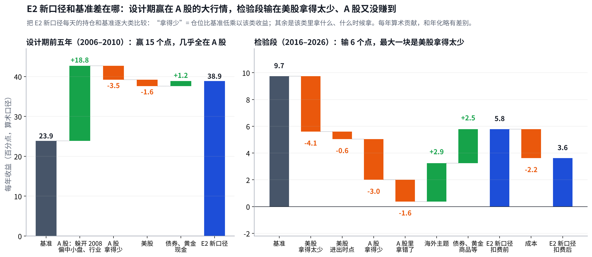

# 第二阶段复盘：设计期的超额来自 A 股大行情，不是来自“选强”；检验段换了池子、换了行情，就没了

## Metadata

- Project: ETF_Rotation_Quant
- Document type: owner（第二阶段复盘）
- Status: active（第 2 版：按叙事和表格硬规则重写；四件事待 Owner 决定）
- Owner: L. Loric
- Maintainer: Orchestrator
- Date: 2026-11-05
- 依据：`results/v5/oneshot/`、`results/v4/r5/design/`、`results/v5.1/design/`（均已签收）；`results/v5/report/attribution.py`、`retro_charts.py`；D18、D27、D34、D35
- 页面：Claude 页面“第二阶段复盘”；本文件是仓库镜像

---

**项目愿景**　在动态周期内，从多类资产里选出 Top N 强势 ETF 轮动持有，获得超额收益、稳定跑赢被动基准，同时把回撤控制住。

| 进度 | 结论 | 需要你 |
| --- | --- | --- |
| 设计期和一次性检验都已签收；场外净值补齐。能买到的池子改用场内口径登记重算（D35），等 Grok 跑。 | “挑哪一只”的本事每年只有 **+1.1** 个点。E2 新口径设计期的超额几乎全来自 2006–10 年 A 股；检验段它每年比基准少 **6** 个点，最大一块是美股拿得太少。 | **四件事**：关闭；场内口径门槛；先要“跑赢”还是“控回撤”；v6 方向。见第 10 节。 |

## 1. 参赛者：四个策略押了四种东西，只有 A2 的押注两段都兑现了

> **E2 新口径押“选强”，A1 押“美股和 A 股二选一”，A2 押“分散、各自躲下跌”，v5.1 押“快进快出”。到检验段，只有 A2 的低回撤（−13% → −10%）还在。**

| 参赛者 | 押的是什么 | 怎么做 | 年化：设计期 → 检验段 | 押注兑现了吗 |
| --- | --- | --- | --- | --- |
| 基准 | **被动拿住中美股票** | 沪深300 70% + 纳指100 15% + 标普500 15%，每月再平衡 | **15.6%**→**8.7%** | **靶子** |
| E2 新口径 | **选强**：谁涨得稳就买谁 | 按“涨幅 ÷ 波动”排名，取前几名平均分；跌 10% 就卖 | **24.9%**→**3.0%** | **没兑现** 唯一入围 |
| A1 双动量 | **二选一**：美股、A 股谁强拿谁 | 美股跑输现金就全拿国债；一次只拿一样 | **27.0%**→**8.6%** | **打平基准** 回撤 −40% |
| A2 五腿均线 | **分散 + 各自躲下跌** | 五样各 1/5，跌破 10 个月均线的那样换现金 | **8.9%**→**7.2%** | **兑现** 回撤 −13% → −10% |
| v5.1 | **快进快出**：读 28 把尺子 | 先选市场、再选 3 只，仓位每天可减 | **30.1%**→**−3.3%** | **没兑现** 换手 66 倍 |

能排名的池子，扣费后。设计期 2006–2015，检验段 2016-01 → 2026-09。

代码和冻结点（工程用）、前两次尝试

- **基准**：`src/v3/engine/benchmark.py`（`WEIGHTS`）、`src/v4/r5/design.py` 的 `benchmark_returns`。
- **E2 新口径**：`src/v3/engine/arms.py` 的 `execute`（A 臂）+ `src/v4/r5/design.py` 的 `Job(case='B0')`；预注册 v4 第 2.3 版；`milestone/v4-code-freeze-2`。
- **A1、A2**：`config/v4/peers.toml`、`src/v4/peers/signals.py`（`dual_momentum`、`ten_month_average`）；Antonacci 2014、Faber 2007。
- **v5.1**：`src/v51/`；`milestone/v5.1-prereg-freeze`；一次性检验 `milestone/v5-code-freeze`。
- **前两次尝试**：第 1 次 V1 A 股主题轮动，设计期不成立；第 2 次 v2 A 股择时，2016–2026 不通过。第二阶段是第 3 次，累计尝试 115 次。

## 2. 设计期：超额几乎全在前五年的 A 股大行情里，后五年就只剩一点

> **E2 新口径前五年每年比基准多 19.6 个点，后五年只多 0.5。前五年它每年 39 个点的收益里，38 个来自 A 股。**

| 参赛者 | 前五年比基准 2006–10 | 后五年比基准 2011–15 | 钱从哪来 | 结论 |
| --- | --- | --- | --- | --- |
| E2 新口径 | **+19.6** | **+0.5** | A 股行业 25 + 宽基 13 个点；2008 年只有 32% 仓位 | **靠一段行情** |
| A1 双动量 | **+19.8** | **+4.0** | 2006–07 满仓沪深300；2008 年换国债 | **两段都赢** |
| A2 五腿均线 | **−7.8** | **−5.9** | 五样分散，牛市只有 1/5 在 A 股 | **两段都输** 但回撤 −13% |
| v5.1 | **+18.1** | **+11.2** | A 股约 28 个点 + 国债 3 个点；快速减仓 | **两段都赢** 但别的市场不成立 |

每格 = 该段年化减基准年化（基准两段 22.3%、9.4%）。能排名的池子，扣费后。框出的是最该警惕的一格。

- **基准自己也在变**：前五年 95% 的收益来自沪深300，后五年美股占四成，检验段占六成。
- **拆得准**：每天持仓 × 各容器当天收益，按大类加总，和扣费前净值的相关系数 1.00。

## 3. 检验段：E2 新口径每年少 6 个点，最大一块是美股拿得太少

> **美股少拿 −4.7、A 股少拿又拿错 −4.6，海外主题和债券黄金只补回 +5.4，成本再扣 −2.2。**

| E2 新口径输在哪 | 每年影响 | 为什么 | 代表标的（十年累计贡献） |
| --- | --- | --- | --- |
| ①美股拿得太少 | **−4.7** | 美股宽基平均只有 **8%**，基准 30% | 纳指100 +5.5、标普500 +5.3（拿得少） |
| ②A 股少拿又拿错 | **−4.6** | A 股只有 **17%**（基准 70%），拿的还跑输沪深300 | 全指 IT −4.8、中证1000 −4.1、科创50 −3.0 |
| ③海外主题补回一点 | **+2.9** | 平均 **35%** 仓位，每年只赚 8%（美股宽基 19%） | 中韩半导体 +5.0；标普全球石油 −3.3 |
| ④债券、黄金、商品 | **+2.5** | “涨幅 ÷ 波动”把它们排在前面，平均 **40%** | 黄金 +7.2、5 年国债 +5.8、商品 +5.5 |
| ⑤成本 | **−2.2** | 每年双边换手约 20 倍 | — |

每年算术贡献（百分点），和年化略有差别。①含美股进出时点 −0.6；②里少拿 −3.0、拿错 −1.6。

| 其他三个 | 检验段年化 · 回撤 | 为什么 | 结论 |
| --- | --- | --- | --- |
| A1 双动量 | 8.6% · **−40%** | 2018–19 年在美股和 A 股之间来回换，2020 年 3 月拿着标普撞上疫情 | **收益打平，回撤更深** |
| A2 五腿均线 | 7.2% · **−10%** | 结构没变：不靠 A 股大行情，所以衰减最少（−1.7 个点） | **少赚一点，回撤小一半** |
| v5.1 | **−3.3%** · −54% | 每年换手 66 倍、成本 6.4 个点；扣费前只有 3.2% | **平缓市场里一直付成本** |

## 4. 本该更早发现的：八件事里四件看见了没行动，四件根本没去查

> **八件里有 5 件在跑任何回测之前就能发现。最致命的 ab 都不需要看检验段：一件靠数容器，一件靠拆设计期的持仓。**

| 问题 | 一个数字 | 最早能在 | 本该得出的结论 |
| --- | --- | --- | --- |
| 看见了，没行动证据摆在设计期报告里，但没有推到“E2 新口径通不过” | | | |
| b“挑哪一只”没有本事 | +1.1 个点/年 | **设计期** | **超额不是选出来的** |
| c债券靠“稳”排在股票前面 | 16–34% 债券仓位 | **设计前** | **牛市里注定跟不满** |
| d优势集中在一段行情 | +0.5 后五年超额 | **设计期** | **后半段已经没有超额** |
| f十年里大行情只有十来次 | 40% 真有本事也难四格全赢 | **设计前** | **设计期 25% 不能当证据** |
| 没去查不需要任何回测，查一下就知道 | | | |
| a池子在检验段完全变样 | 26 → 102 个容器 | **设计前** | **测的不是同一个池子** |
| e基准越来越靠美股 | 60% 检验段收益来自美股 | **设计前** | **美股暴露决定输赢** |
| g可交易池用场外基金 | 2 档 场外 + 3000 万门槛 | **设计前** | **和你的真实交易对不上** |
| h数据覆盖不到检验终点 | 57 只场外基金停在 2015 年 | **检验前** | **能买到的池子不可用** |

下面两张图分别是 a 和 b 的证据。

## 5. 我漏了什么：最大的一处，是没把看见的问题推成“大概率不通过”

> **第 4 节“看见了”的四件，每一件我都写过；缺的都是同一步：把证据合起来下判断。另外四件我没去查，还有一块精力放错了地方。**
> **那句没说出口的话**　“按 bcdf，E2 新口径的一次性检验大概率不会通过；它只是规则上唯一的入围者。”这句话本该在你批准封板之前写进报告。

| 我做到的 | 缺的那一步 | 走完这一步会得出 |
| --- | --- | --- |
| 看见了，没推到结论 | | |
| 五步法指出 c，算了 b 的可信度倍数 | 合起来写事前预判和置信度 | **一次性检验大概率不过** |
| 体检报告写了 d“后五年刚好打平” | 据此调低预期 | **E2 新口径不该被当成有把握的候选** |
| v5 立项时算了 f | 用在 E2 新口径的设计期结果上 | **25% 里运气的成分很大** |
| 提醒过期望线要先定 | 坚持看结果前由你签字 | **期望线先于 LOCK** |
| 没去查 | | |
| 研究了 QDII、LOF 的上市 | 数检验段的池子 a | **在 20 个上设计，在 100 个上检验** |
| 每个结果都和基准并列 | 拆基准的收益来源 e | **跑赢它主要考美股暴露** |
| 要求复算代码一致 | 要求查数据覆盖 h | **上一版报告把可交易池说错了** |
| 精力放错 | | |
| v5、v5.1 做了 **37** 个探索、28 把尺子 | 先用持仓拆解验证“选强有没有用” | **v5.1 不该做这么复杂** |
| 疼痛表估了成本 | 把触发次数换算成钱 | **成本是 3–6 个点，不是 1–2** |

> **做对的、要保留的**　先预注册再跑、检验段只跑一次、别的市场检验挡下 v5.1、按时封板、每步独立复算、结果照实报告。没有这些，我们现在会拿着设计期 30% 的 v5.1 去上模拟盘。

## 6. 哪些能直接修：数据和口径的错现在修，规则的硬伤只能放进 v6

> **现在修 4 件（已完成 1 件），放进 v6 5 件。2016–2026 已经用掉，改了规则再在这段上跑，只能算“设计证据”。**

| 问题 | 状态 | 怎么修 |
| --- | --- | --- |
| 现在修修的是错，修完可以直接重算 | | |
| h场外净值只到 2015 年 | **已修** | 补齐 63 只，Reviewer 签收 |
| g可交易池用场外基金 | **D35 重算中** | 只用场内 ETF、LOF，只报告、不改判 |
| 载体没价格还能被选中 | **待修程序** | 要求近 5 日有价格，否则不进排名 |
| 尝试次数少记 30 行 | **待补记** | v5、v5.1 账本并入 |
| 放进 v6改的是规则：设计证据 → 别的市场 → 至少 6 个月模拟盘 | | |
| c跨资产用“涨幅 ÷ 波动”排名 | **v6** | **大类先分预算**，同类里再比强弱 |
| a池子暴涨、海外主题占七成 | **v6** | **固定分层**，主题只在大类里竞争、设上限 |
| b“挑哪一只”没有本事 | **v6 先验证** | **先证明能选**；证明不了就不靠选 |
| e和基准的美股暴露差 | **v6** | **核心贴基准**，卫星做趋势 |
| 换手太高（v5.1） | **v6** | **减仓线、加仓线分开**；少换人 |

## 7. 三次尝试说明了什么：“挑哪一只”很难赚钱，“该不该在场”有用

> **三次都想用 A 股为主的信号跑赢被动组合，三次都输了。稳定做到的只有“跌的时候少亏”：检验段 E2 新口径回撤 −15%、A2 −10%，基准 −26%。**

横截面选强（今天谁比谁强）

不成立

股票类持仓比闭眼等权每年只多 **1.1** 个点（设计期）、**0.4** 个点（检验段）。

第 1 次尝试的 A 股主题轮动同样失败。不少研究发现 A 股横截面动量很弱、短期反转更明显。

时间序列趋势（自己是不是在涨）

成立

躲开了 2008、2018、2022 年的下跌；A2 检验段只衰减 **1.7** 个点。

多资产趋势跟随是文献里最稳健的结论之一（Moskowitz、Ooi、Pedersen 2012；Faber 2007）。

你最初的判断“强势有连续性”

一半成立

在“大类该不该持有”这一层成立；在“同一大类里挑哪一只”这一层，证据不支持。

愿景里“选出 Top N 强势 ETF”，要么换一种选法，要么不把超额押在选上。

**A2 不能直接拿来用**：它回撤最浅，是看过检验段之后才看到的。按纪律它只算线索，要先过别的市场检验和至少 6 个月模拟盘。

## 8. 对愿景的含义：“跑赢”和“控回撤”这十年只能先选一个

> **这十年做得到的组合是“收益接近基准、回撤小一半”：A2 年化 7.2% 对 8.7%，回撤 −10% 对 −26%。**

靶子 ① 稳定跑赢基准

三次都没做到

要跑赢，这十年主要得多拿美股，而不是选得更准。

靶子 ② 收益接近、回撤更小

年化 ÷ 回撤 0.74

基准只有 0.33。符合“先为不可胜”，也是唯一被数据支持的。

靶子 ③ 核心贴基准、卫星争超额

还没测过

核心拿住基准（或你认可的美股比例），卫星只用一小部分去争。

- **你的美股直觉，这十年是对的**：标普500 年化 15.9%、纳指100 21.4%、沪深300 4.0%，基准六成收益来自那 30% 美股。但这只是一段十年，不能直接当成规律。

## 9. 流程马上改什么：六条改动，堵住第 4 节八件里的七件

> **剩下的 c 是规则硬伤，只能放进 v6。这六条从下一次任务就生效，不等 v6。**

| 改动 | 堵住 | 谁执行 | 生效 |
| --- | --- | --- | --- |
| 冻结前数检验段的池子 | a | Orchestrator 写，Reviewer 核 | **下一次** |
| 冻结前做收益来源拆解：择时、暴露、选强 | bd | Orchestrator | **下一次** |
| 冻结前拆基准，写清暴露差 | e | Orchestrator | **下一次** |
| 检验前写事前预判，期望线由你签字 | f | Orchestrator 写，你签 | **下一次** |
| 可交易池口径和你的真实交易一致 | g | 已按 D35 改 | **已生效** |
| 数据覆盖门 + 持有零收益报警 | h | Reviewer 签收必附 | **下一次** |

写进 `docs/reference/strategy-design-review.md`（跑前五问加三问）和 Reviewer 的签收模板，你确认后生效。

## 10. 需要你定的四件事：我的建议是关闭、沿用门槛、先要控回撤、做核心 + 卫星

> **四件事里，1 和 2 决定 D35 重算能不能开跑，3 和 4 决定 v6 从哪里开始。**
#### 1：确认第二阶段轮动研究按“不成立”关闭（第 3 次尝试）

| 选项 | 说明 |  |
| --- | --- | --- |
| 关闭 **建议** | 不通过不是擦边；复盘也说明原因在结构（第 3 节），不在运气。 | ⭐ 建议 |

影响：关闭后不再改 E2 新口径；核心配置照常执行。
#### 2：场内口径重算（D35）的成交额门槛

| 选项 | 说明 |  |
| --- | --- | --- |
| 这次沿用 3000 万 **建议** | 只换载体档位，结果才可比；按资金规模定门槛放到 v6。 | ⭐ 建议 |
| 现在就按资金规模改 | 需要你给计划投入的规模；改动不止一处，结果更难解读。 |  |

影响：门槛越低，早年能买到的容器越多，可交易池越接近能排名的池子。
#### 3：愿景里先要哪个靶子（第 8 节）

| 选项 | 说明 |  |
| --- | --- | --- |
| 收益接近基准、回撤明显更小 **建议** | 符合“先为不可胜”，这十年唯一做得到的；“跑赢”交给卫星。 | ⭐ 建议 |
| 仍以跑赢基准为主 | 先回答超额从哪来：这十年选强不行，只能靠更多美股或更好的择时。 |  |

影响：决定 v6 的过关条件，必须在看任何新结果之前定。
#### 4：v6 往哪走

| 选项 | 说明 |  |
| --- | --- | --- |
| 核心 + 卫星，卫星用大类趋势 **建议** | 不靠同类里挑哪一只。证据：设计证据（按尝试次数打折）→ 别的市场 → 至少 6 个月模拟盘 → 小资金。 | ⭐ 建议 |
| 先停轮动，转做期权 | 期权研究备忘提前。 |  |

影响：决定接下来几周的研究方向和证据路径。

数据来源和方法

- **表现**：设计期引用已签收的 `results/v4/r5/design`、`results/v5.1/design`；检验段引用 `results/v5/oneshot`。
- **收益来源拆解**：`results/v5/report/attribution.py`、`waterfall.py`。持仓 × 各容器当日收益（行情数据，不是新的组合收益），和扣费前净值相关系数 1.00。设计期 E2 新口径持仓用冻结规则在 ≤2015 复跑，净值与签收结果最大差 5×10⁻¹⁴。
- **图**：`results/v5/report/retro_charts.py`、`waterfall.py`。本页只用能排名的池子。

