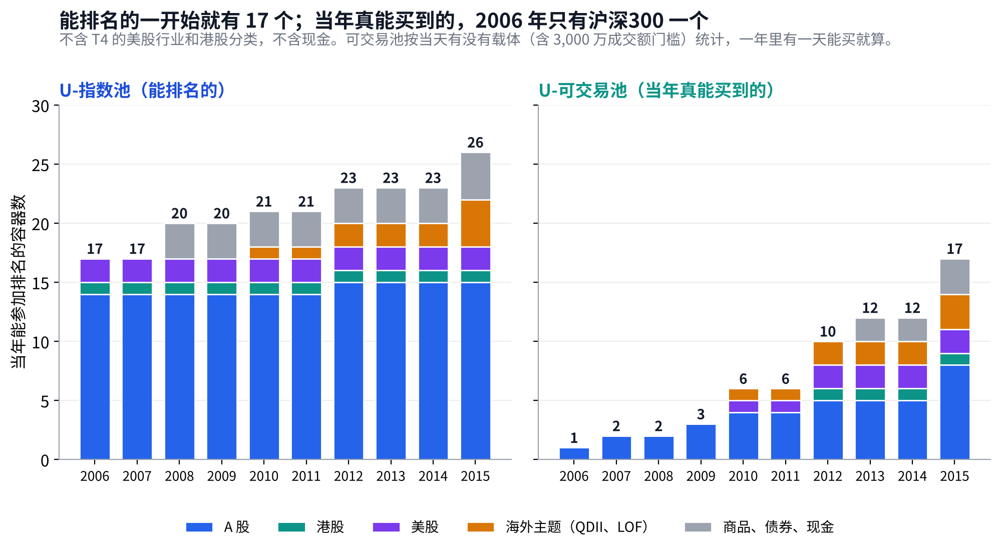
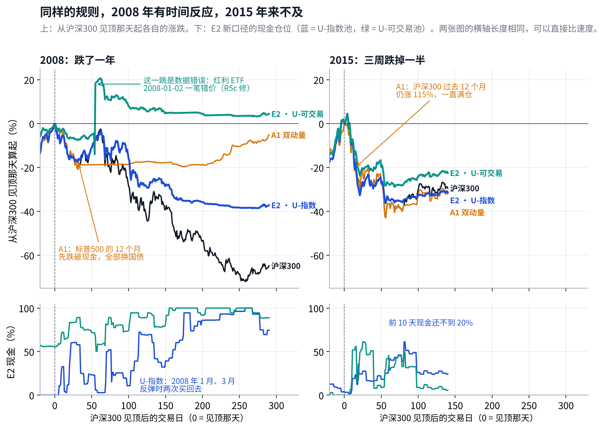
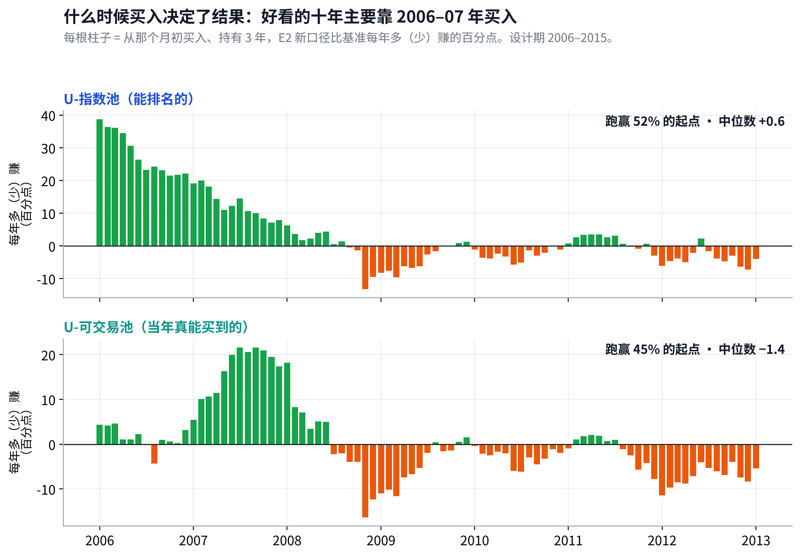
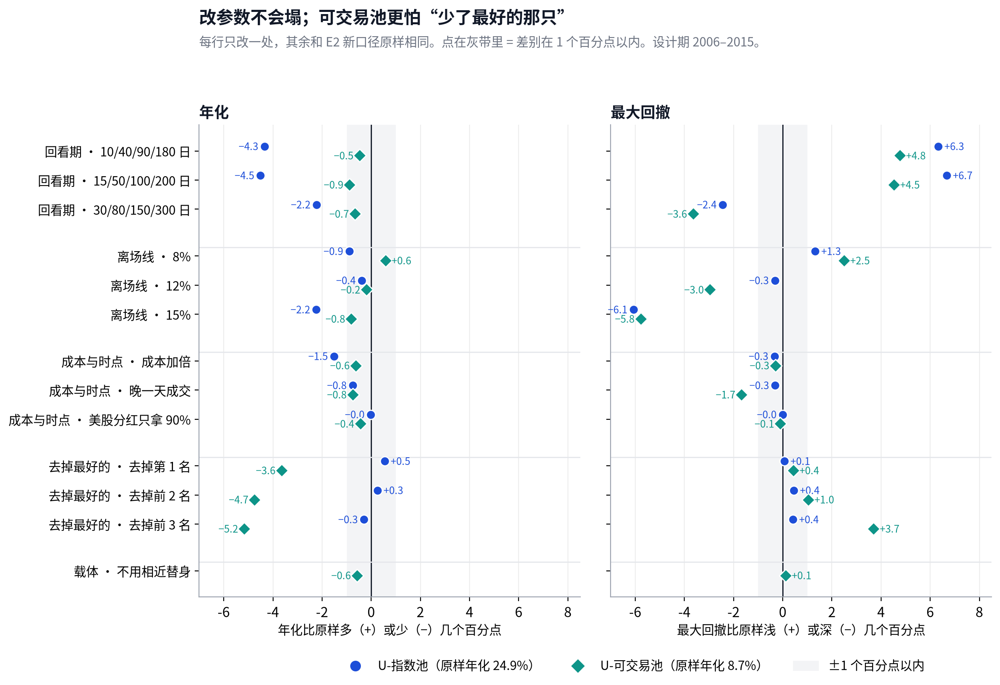

# v4 体检报告：赢在大行情，输在反弹和震荡；简单的同行跑得更好

## Metadata

- Project: ETF_Rotation_Quant
- Document type: owner（v4 设计期体检）
- Status: active（第 2.1 版；两个池子（含介绍）；U-指数池与同行数字待 v4-R5c 修复后刷新）
- Owner: L. Loric
- Maintainer: Orchestrator
- Date: 2026-10-30
- 依据：`operations/reports/v4-r5-design-period-brief.md`；`operations/reviews/2026-10-29-v4-r5-design-gate-signoff.md`；D24、D25
- 页面：Claude 页面“v4 体检报告”；本文件是仓库镜像。图：`results/v4/diag/health/charts.py`

---

**项目愿景**　在动态周期内，从多类资产里选出 Top N 强势 ETF 轮动持有，获得超额收益、稳定跑赢被动基准，同时把回撤控制住。

| 进度 | 结论 | 需要你 |
| --- | --- | --- |
| 可交易池已修好重跑，代码已冻结。复查时又发现两处实现问题和一笔错价（第 0 节），正在修（v4-R5c），修完本页数字整体刷新。 | 能排名的池子里年化 **21.1%**，基准 **15.6%**；换成当年真能买到的，只有 **10.5%**（扣掉一笔错价约 8.7%）。回撤一直比基准浅：**−32%** 对 **−66%**。 | **暂时不需要。**R5c 之后出第 3 版，那时请你定期望线（第 8 节）。 |

## 先认识这几个名字

| 问题 | 回答 |
| --- | --- |
| **E2 新口径** | E2 的规则一点不改：看 1、3、6、12 个月（20/60/120/250 日）四个回看期，只买跑赢现金的，每组取前 N 名、每名 1/N 仓位，单只从高点跌 10% 就卖，周、月 × N=3/5/8 六路平均。 “新口径”是数据和交易更真实：涨跌停买卖不了、港美股按决策时真能看到的收盘和汇率、场内基金一律后复权、池子按 117 个容器的新名单。 |
| **T1–T4** | 在 E2 新口径上各改一处的四个候选。**T1 转折点换挡**：短期两个都转正，长期组也提前给资格。**T2 按市场状态分配速度**：单边市多信快的，震荡市多信慢的。**T3 空位当天补**：离场卖出后第二天就补上下一名。**T4 加美股行业、港股分类**。 |
| **基准** | 70% 沪深300 + 15% 纳指100 + 15% 标普500，全收益、人民币，每月再平衡。**它决定过不过**。 |
| **A1 双动量** | 公开同行。每月末：标普500 过去 12 个月跑赢现金，就在标普500 和沪深300 里拿 12 个月更强的那个，100% 仓位；否则拿 10 年国债。一次只拿一样。 |
| **A2 五腿均线** | 公开同行。沪深300、标普500、恒生、10 年国债、黄金各 1/5；每一腿在 10 个月均线之上就拿，之下就换成现金。 |
| **两个池子** | **U-指数池**：有数据就能参加排名。**U-可交易池**：只排当年真能买到的。下一节细讲。 |

年化、回撤都从 2006-01-01 算到 2015-12-31（程序从 2005 年开始跑，前一年只用来攒历史）。前五年 = 2006–2010，后五年 = 2011–2015。2016 年以后的收益一律没有算。

## 两个池子：有什么、差在哪、为什么要两个

> **U-指数池回答“这套选法好不好”，U-可交易池回答“当年真能赚到多少”。2006 年两者差 16 个容器，到今天几乎一样多。**

|  | U-指数池 | U-可交易池 |
| --- | --- | --- |
| **回答的问题** | 选法本身好不好：假设每个市场当年都能买 | 一个境内投资者当年实际能赚多少 |
| **谁能参加排名** | 有指数历史的容器，从数据起点就参加（没有指数的主题，用对应基金自己的历史） | 当天有能买的基金才参加，按顺序找：场内 ETF、LOF（近 20 日成交额中位数 ≥ 3,000 万）→ 场外指数基金（含联接）→ 两只登记过的相近替身；都没有，这天就不参加 |
| **收益按什么算** | 指数的全收益（含分红），换成人民币 | 实际买的那只基金的后复权价格或净值，含跟踪误差和费用；QDII 按净值滞后 |
| **涨跌停、停牌** | 按指数自己的涨跌判断 | 按基金自己的价格判断 |
| **用来做什么** | 过关判定（预注册写死）、研究信号 | 看真实能赚多少；以后的模拟盘就是它 |
| **2015 年有什么** | 26 个：A 股 15（沪深300、中证500、中证1000、创业板、红利、10 个全指行业）、美股 2（标普500、纳指100）、港股 1（恒生）、海外主题 4、商品和债券 4（黄金、5 年国债、10 年国债、跨境商品） | 17 个：少了中证1000、6 个全指行业（主要消费、公用事业、原材料、工业、能源、通信）、10 年国债、美股能源。这些当年没有够活跃的场内基金，也没有场外指数基金 |
| **2006 年有什么** | 17 个：A 股 14、标普500、纳指100、恒生 | 1 个：沪深300（场外指数基金；沪深300 ETF 到 2012 年才上市） |

- **为什么不只用可交易池**：2006–2011 年能买的只有 1–6 个，选法再好也没得选，结论会被“当年没有产品”主导，看不出规则本身的好坏。
- **为什么不只用指数池**：它会高估当年能赚到的。2006 年境内投资者买不到美股、港股和行业指数，指数池却当作能买。
- **差距会随时代收窄**：按数据看板，今天能排名的 114 个、能买到的 106 个（含美股行业）。以后的模拟盘用的就是可交易池，那时两个池子几乎一样；设计期里的大差距，主要是“市场还在长大”。

## 0. 程序和数据问题：一个修好了，三个刚发现

> **修好的那个让可交易池从 5.2% 变成 10.5%；新发现的三个，U-指数池估计会升到约 24.6%，可交易池扣掉一笔错价后约 8.7%。**

#### 【已修好】可交易池漏接了场外基金和海外 ETF（第 1 版发现，R5b 修复）

修好后，每年能买到的容器数和数据看板对上了：2006 年 1 个（只有沪深300 的场外基金），2010 年 6 个，2015 年 17 个。可交易池年化 5.2% → **10.5%**，最大回撤 −32%。U-指数池的 20 条结果逐日没变，过关表没变。代码冻结标签已打。

#### 【不用你做事】U-指数池里，债券、黄金、创业板“买不进”

| 发生了什么 | 影响有多大 |
| --- | --- |
| v4 加了“当天没有价格就不能成交”的规则。程序给 A 股宽基和行业用指数价格成交，但债券、黄金、创业板用的是场内 ETF 的价格。结果这些容器有指数、能排上名，却要等 ETF 上市才买得进： 5 年国债、黄金要到 2013 年；10 年国债和创业板在设计期里**一次都没买过**。v3.1 的池子写明国债、黄金 2008 年起就有，这是程序和规则不一致。 | 我只改这四个容器的成交价、其他不动，复跑了一次（诊断，不算正式结果）：E2 新口径 U-指数池年化 21.1% → **约 24.6%**，最大回撤 −39% → **约 −35%**。2008 年平均拿了 16% 的国债，当年 −32% → −23%。 T1–T4 和过关表都要按冻结的公式重算，结果可能变。规则不改，结果是什么就是什么。 **不用你做事。**当程序错误修复、全部重跑（v4-R5c）。 |

#### 【不用你做事】A1、A2 的可交易池，连“看谁更强”都换成了基金价格

| 发生了什么 | 影响有多大 |
| --- | --- |
| 同行的规则是按指数判断、按能买到的基金持有。R5b 把判断也换成了基金价格：2012 年以前标普500 没有能买的基金，A1 就“看不到”标普500，2005–2011 年全拿现金，尽管沪深300 一直能买。这是我上一轮计划没写清楚。 | A1、A2 的可交易池数字现在不能用，本页先不放；U-指数池的同行数字不受影响（但会随上一条一起重跑）。 **不用你做事。**一起在 R5c 修。 |

#### 【不用你做事】可交易池里有一笔错价：红利 ETF 2008-01-02

| 发生了什么 | 影响有多大 |
| --- | --- |
| 红利 ETF（510880）2008-01-02 的收盘在数据源里是 1.467，前后两天都在 4.6–4.8，两个来源都错。这一天它跌 68%、第二天涨 227%。那天正好是月初调仓日，程序按错价补足了仓位，第二天“赚”了一大笔。 | 可交易池凭空多出约 24%：2008 年 +8.4% 实际约 **−7.8%**，十年年化 10.5% 实际约 **8.7%**（我的估算）。最大回撤不变。U-指数池用的是指数，不受影响。 **不用你做事。**补进 R5c：用净值核对后补一条正确的价格，并把“单日大跌又大涨”加进完整性检查。本页可交易池的数字先照公布的写，并在用到的地方注明。 |

三次都是逐日看持仓、和数据看板对照才发现的。以后每次运行，Reviewer 都要列出两个池子每年持有了哪些资产、现金多少，有数据却全年没买过的逐条说明。

## 1. 过关：四个改进都没过，v4 最终版就是 E2 新口径

> **四个都没过。最接近的 T2 两段都略好，但它要改善的回调行情反而差了。**

过关要同时满足三条（预注册写死，跑之前定的）：前五年、后五年的年化超额**都**比 E2 新口径高；它瞄准的那种行情（表里带 ◎ 的格子）确实变好；熊市不比 E2 新口径差 10 个百分点以上。

| 版本 | 改的一处 | 前五年 年化超额 | 后五年 年化超额 | 牛市 | 回调 | 熊市 | 反弹 | 结果 |
| --- | --- | --- | --- | --- | --- | --- | --- | --- |
| **E2 新口径** | （参照） | +14.8 | −2.4 | −10.8 | +12.6 | +91.2 | −55.0 | 参照 |
| **T1** | 转折点换挡 | +19.1 | −3.7 | −12.0 | +19.0 | +86.6 | ◎ −47.0 | 没过：后五年变差 |
| **T2** | 按市场状态分配速度 | +15.0 | −1.6 | −1.6 | ◎ +9.7 | +92.6 | −58.3 | 没过：回调没变好 |
| **T3** | 空位当天补 | +15.0 | −2.6 | ◎ −9.4 | +11.2 | +91.2 | −55.0 | 没过：后五年变差 |
| **T4** | 加美股行业、港股分类 | +10.7 | −3.1 | ◎ −66.5 | +26.5 | +121.9 | −65.9 | 没过：三处都差 |
| 公开同行：同一张表的算法，只做对照，不参加过关 | | | | | | | | |
| **A1 双动量** | 三选一 | +19.8 | +4.1 | −62.2 | +59.3 | +147.2 | −57.7 | 两段都更好 |
| **A2 五腿均线** | 各 1/5，跌破均线拿现金 | −7.8 | −5.9 | −231.2 | +96.0 | +132.7 | −78.8 | 两段都更差 |

U-指数池。年化超额 = 相对基准每年多赚几个百分点；四种行情 = 该行情所有月份相对基准的超额相加（百分点），越大越好。绿 = 比 E2 新口径好，橙 = 更差，只给关键格子上色。Reviewer 用独立程序复算，逐列一致。

- **T1 全期年化最高**（**22.2%** 对 **21.1%**），2009 年多赚 23 个百分点，正是它要修的反弹。但 2011、2014 年来回换挡，后五年更差。规则要求两段都更好，就是为了挡住“一段大赢、盖住另一段变差”的版本。
- **T4 把仓位分到了美股**，错过 A 股大牛市（2006 年 +79% 对 +106%），牛市少赚 56 个百分点，换来熊市多躲 31 个。
- **A1 两段都比我们好**，赢在回调和熊市（拿国债）；它的牛市比我们差得多（−62），因为它一次只拿一样、换得慢。第 5 节细看。

## 2. 性格：跟着大趋势走，但池子小的时候大半仓位在现金

> **能排名时年化 21.1%；当年真能买到的只有 10.5%，十年没跑过基准的 15.6%。差距主要在 2006–07 年。**

|  | U-指数池 | U-可交易池 | 基准 |
| --- | --- | --- | --- |
| 年化 | 21.1% | 10.5% | 15.6% |
| 最大回撤 | −39% | −32% | −66% |
| 上涨月份跟到 | 84% | 41% | 100% |
| 下跌月份只跟 | 60% | 29% | 100% |
| 每年换手 | 约 14 次 | 约 7 次 | — |

> **为什么差这么多**　E2 每个回看组取前 N 名、每名 1/N。2006 年能买的只有沪深300 一样（场外指数基金），N = 3、5、8 平均下来，一只最多放约 **22%**，其余全是现金。所以 2006 年沪深300 涨了一倍多，可交易池只赚 **19%**，全年平均 80% 是现金。这是规则本身的设计：它假设总有好几个强者可以分。

- **回撤一直浅**：两个池子的最大回撤都只有基准的一半到六成，都发生在 2015 年 6–8 月的股灾，到年底还没回到高点。
- **2009 年反弹落后**：基准 +83%，U-指数池只有 +38%。大跌之后，6 个月、12 个月两组要很久才重新跑赢现金，这期间一半的回看组没有可买的。

### 2.1 为什么 2008 年控制住了回撤，2015 年没有

> **2008 年沪深300 用 258 个交易日跌掉 72%；2015 年 56 天跌掉 43%，小盘和科技 20 天就跌了 40%。趋势规则看的是过去，跌得越快越来不及。**

A1：2008 年躲开，靠的是美国先出事

2007 年底沪深300 过去 12 个月还涨 180%，A1 看沪深300 根本不会走。触发它的是标普500：12 个月收益先跌破现金（美国次贷危机先爆发），A1 的总开关关上，全部换成国债。2015 年标普500 过去 12 个月仍 +6%、沪深300 +115%，开关没动，A1 满仓扛完整个股灾，回撤和沪深300 一模一样（**−43%**）。它 2008 年的好成绩，很大一部分是时机碰巧。

E2 · U-指数：2008 年是慢慢磨的，2015 年是一下砸的

2008 年的 **−39%** 其实也没控制好，只是比基准 −66% 好：2007 年 11 月先亏 16%，2008 年 1 月、3 月小盘反弹时又几乎满仓买回去，各亏一轮，到 7 月才基本全撤，此后沪深300 又跌了一半它没事。  
2015 年见顶时 96% 仓位在涨得最猛的中证1000、全指信息、通信（动量规则天然选涨得最快、也是波动最大的）。这几只 20 天跌 40%，E2 前 10 个交易日就亏了 24%，现金还不到 20%，“单只跌 10% 才卖”来不及；7 月反弹又买回，8 月第二波跌到 −39%。

E2 · U-可交易：2008 年好看，是因为本来就没什么可买

2008 年能买的只有沪深300 和红利两样，每样最多约 22%，大半仓位天然在现金，回撤只有 −15%，不是躲得好。2015 年能买的多了、满仓，回撤就到了 −32%。2008 年 1 月图上那一下跳升是数据错误（第 0 节）。

> **能不能修**　两种跌法要两种工具。阴跌靠“跌 10% 就卖”和长回看期，已经有；急跌要在价格还没跌多少时就减仓，只能看**波动**：2015 年 5 月底、股灾之前，中证1000 近 20 天的波动已是过去 250 天的 1.7 倍，按 v5 方向 ③ 的公式（仓位 × 250 天波动 ÷ 20 天波动）仓位会先降到约 60%，在大跌前段就减下来。以前试过的 E3（按整个组合的波动减仓）对 2015 年有效、对 2008 年没反应，正好印证这一点。反弹时“又满仓买回去”的代价，可以用 v5 的方向 ②“小仓试错”减半。这些都要在 v5 里先写死再检验，现在不改 v4。

## 3. 四种行情：熊市大赢，牛市和反弹输在同一笔现金上

> **熊市里两个池子都多赚约 100 个百分点；牛市里可交易池少赚 179 个，只有 13% 的月份跑赢。**

四种行情按沪深300 全收益在每个月末只用当时的数据划分：过去 12 个月涨、这个月也涨 = **牛市**；12 个月涨、这个月跌 = **回调**；12 个月跌、这个月也跌 = **熊市**；12 个月跌、这个月涨 = **反弹**。

| 行情 | 月数 | U-指数池 合计 · 跑赢月份 | U-可交易池 合计 · 跑赢月份 | 读法 |
| --- | --- | --- | --- | --- |
| **牛市** | 53 | −10 · 51% | −179 · 13% | 指数池选得其实很好（+45），被现金拖累抵掉（−55）。可交易池能买的太少，钱大多在现金里。 |
| **回调** | 21 | +13 · 57% | +82 · 57% | 拿现金和 10% 离场在起作用；指数池拿着的强者回调时比基准跌得多（−16）。 |
| **熊市** | 27 | +91 · 85% | +112 · 85% | 两个池子都靠拿现金大赢，绝大多数月份跑赢。 |
| **反弹** | 19 | −55 · 16% | −72 · 11% | 大跌之后慢的组还没转正，钱还在现金里；选标的本身不差，几乎全是现金拖累。 |

合计 = 该行情所有月份相对基准的超额相加（百分点）。拿现金 = 因为没满仓而少赚或少亏的部分；选标的 = 持有的那几只和基准相比的差。数字来自 Reviewer 签收和设计期简报。

## 4. 任意起点：什么时候买入决定了结果

> **好看的十年主要靠 2006–07 年买入；2008 年底以后买入，两个池子都和基准有输有赢，可交易池输的多。**

图上的比例和中位数是我按签收同一方法算的。U-指数池与签收一致；可交易池和简报差不到 1 个百分点（起点日期取法不同）。

| 持有 5 年（60 个起点），对照 | U-指数池 跑赢的起点 · 中位数 · 最差 | U-可交易池 跑赢的起点 · 中位数 · 最差 |
| --- | --- | --- |
| **基准** | 53% · +1.6 · −7.8 | 33% · −2.9 · −10.9 |
| 沪深300 | 88% · +6.0 · −4.9 | 53% · +1.3 · −14.5 |
| 标普500 | 35% · −2.8 · −16.4 | 43% · −2.6 · −19.0 |
| 纳指100 | 27% · −7.3 · −21.6 | 38% · −7.4 · −24.4 |

中位数和最差 = 持有期内每年比对照多（少）赚的百分点。最差的起点大多是 2008 年 11 月，正好错过 2009 年的大反弹。

- **比沪深300 好，比美股差**：这十年美股是慢牛，A 股大起大落，E2 主要在 A 股的大起大落里赚钱。
- **可交易池持有 5 年只有三分之一的起点跑赢基准**。要注意，基准本身里那 30% 美股在 2012 年以前也买不到，所以这个比较对可交易池偏严。

## 5. 和公开同行比：复杂的规则没有跑过三选一

> **U-指数池里，A1 双动量十年年化 27.0%，我们 21.1%；持有 5 年，95% 的起点 A1 更好。**

| U-指数池，持有 5 年对基准 | E2 新口径 | A1 双动量 | A2 五腿均线 |
| --- | --- | --- | --- |
| 十年年化 | 21.1% | 27.0% | 8.9% |
| 最大回撤 | −39% | −43% | −13% |
| 跑赢的起点 | 53% | 90% | 43% |
| 中位数（每年多赚） | +1.6 | +7.2 | −1.0 |
| 下跌月份只跟 | 60% | 31% | 17% |

A1、A2 的格子是我按签收同一方法补算的。绿、橙相对 E2 新口径。可交易池的同行数字待 R5c 修正（第 0 节）。

### A1 为什么更好，以及其中有多少是我们自己的问题

防守拿国债，不拿现金

2008 年 A1 **+16%**，E2 新口径 **−32%**，一年拉开 48 个百分点。但这里有一部分是第 0 节的程序问题：E2 在 2013 年以前根本买不进国债。修好后的诊断里，E2 2008 年拿了 16% 国债，亏损收窄到 −23%。

一次只拿一样，吃得满

2013 年 A1 改拿美股，**+30%** 对 **+8%**。E2 分到 3–8 只再平均六路，加上第 2 节说的“每只最多 1/N”，趋势明确时仓位不够集中。

A1 也有短处

2009 年反弹比基准少赚 83 个百分点，比我们还慢；牛市合计 −62，比我们差得多；最大回撤 −43% 更深。

- **同行只用来诊断，不决定过不过**（三层对照的第二层）。它说明：在这十年里，**多出来的复杂度还没有换来更好的结果**。
- **要谨慎**：A1 是一条出名的规则，我们挑它当同行时就知道它出名；一个市场、一段十年的胜出，不代表以后也胜出。它在 2016 年以后怎样，要等封板后的一次性检验。

不用你做事把“防守拿国债”和“趋势明确时更集中”写进 v5 的候选方向

**发生了什么**

你提议把国债加进 v5 的容器，并问国债逆回购能不能当国债。**国债已经在池子里**（5 年、10 年两个容器），问题是程序没让它买进去（第 0 节），R5c 修。

**逆回购不能当国债用**：它是以国债作抵押、把钱借出去几天，收益和货币基金是一类，利率下降时不会像国债那样涨价。A1 在 2008 年赚的正是国债涨价。所以逆回购在项目里归入**现金**，实盘可以用它当现金的载体。

**影响有多大**

v5 方向 ④ 改为“空出来的仓位优先放进跑赢现金的国债，而不是现金”；方向 ⑤ 改为“能买的不足 N 只时，在能买的里面分，不留给现金”。⑤ 以前在 U-指数池试过类似的“填满空位”，结果更差，所以要两个池子都检验，按 v5 预注册先写死再跑。

**你要做什么**

**不用你做事。**已写进 v5 备忘，你不同意可以随时划掉。

## 6. 两个年代：前五年是主场，后五年两个池子都没跑过基准

> **后五年 U-指数池年化 7.0%、可交易池 6.6%，基准 9.4%。**

| 年代 | E2 · U-指数池 | E2 · U-可交易池 | 基准 | A1（U-指数） | A2（U-指数） |
| --- | --- | --- | --- | --- | --- |
| **2006–2010** | 37.1% | 14.5% | 22.3% | 42.1% | 14.5% |
| **2011–2015** | 7.0% | 6.6% | 9.4% | 13.4% | 3.5% |
| 2016–2020 | 留空：封板后的一次性检验才看 | | | | |
| 2021–2026 | 留空：同上 | | | | |

- **前五年是趋势策略的主场**：2006–07 年大牛、2008 年大熊，都是一口气走到底的单边市。但这时能买的几乎只有沪深300，可交易池吃不到。
- **后五年能买的多了，趋势却短了**：2010–13 年横盘，2014–15 年快牛快熊。池子变大的好处，被行情的变化抵掉了。
- **适应性**：结果跟年代和池子大小走。2016 年以后池子会更大（数据看板：当年能买到的容器从 30 个长到 106 个，多是海外主题），这十年的结论不能直接外推。

## 7. 改参数会不会塌：不会，但可交易池更依赖少数几只

> **U-指数池里每一项改动都在 ±1.6 个百分点以内；可交易池去掉最好的一只就少 3.8 个百分点。**

回看期、离场线

稳

换成邻近的回看期或 8%、12%、15% 离场线，年化变化都在 1.6 个百分点以内。现在这组偏好一点，但不是孤峰。

成本、分红

稳

成本加倍每年少 0.6–1.4 个百分点；美股分红只拿 90% 几乎没影响。

晚一天成交

可交易池 −2.9

U-指数池只少 0.5 个点，但回撤深 3 个点；可交易池少 2.9 个点。实盘要尽量当天执行。

去掉最好的容器

可交易池 −3.8 到 −4.9

U-指数池去掉全指医药反而略高，不靠明星。可交易池能买的少，去掉沪深300 就少 3.8 个点，靠的是少数几只。

每项只改一处，其余和 E2 新口径原样相同。数字是相对原样的变化，自 2006 年算。

## 8. 对照期望备忘：三条草稿线，两个池子都只过了一条

> **两个池子都没达到“持有 5 年多数时候跑赢”和“最差的 5 年不太差”；回撤这一条都达到了。**

| 期望（草稿） | 线 | U-指数池 | U-可交易池 |
| --- | --- | --- | --- |
| 任意起点持有 5 年，跑赢基准的比例 | ≥ 60% | 53%　没达到 | 33%　没达到 |
| 最差的 5 年，每年比基准少赚 | 不超过 3 个百分点 | 7.8　没达到 | 10.9　没达到 |
| 最大回撤不超过基准的 | 0.6 倍 | 0.60 倍　刚好达到 | 0.48 倍　达到 |

- 这三条是草稿，按约定等设计期结果出来后校准、封板前由你定稿。现在先如实对照，不改线去迁就结果。
- 如果最后线不变，v4 这一版不会是上模拟盘的那一条。这不是现在要做的决定。

## 9. 下一步

1. **Grok 修第 0 节的两个问题并重跑**（v4-R5c）：U-指数池按指数价格成交；同行按指数判断、按基金持有；过关表按冻结的公式重算；签收后打新的代码冻结标签（旧标签不动）。
2. **我出第 3 版**：本页的图都由一个脚本从结果文件生成，重跑后一键刷新；同时补上同行的可交易池。
3. **那时请你定两件事**：期望备忘的三条线；v5 从哪几条方向开始（原有三条 + 第 5 节的 ④⑤）。

数据来源和顺带处理的几件小事

- 数字来自 Dev 的设计期运行、Reviewer 的两次独立复算签收、Manager 的设计期简报。我另外逐日复跑了 E2 新口径，用来查第 0 节的问题；那次诊断复跑没有写进正式结果，也不算尝试次数。
- 账本 41 行，全部只到 2015-12-31；没有写封板锁，没有算 2016 年以后的收益，没有移动标签。
- 创业板指的场外联接基金按规则也算第 2 档载体，R5c 一起补上。
- 沪深300 场外基金 050002 两条净值路径在 2015-12-29 差约 1.7 个百分点：维持现有序列，只登记，顺带查当天有没有分红。
- 后复权两个来源有冲突的日子（160125 有 14 天、160644 有 2 天）：维持统一入口的选择，只登记。

