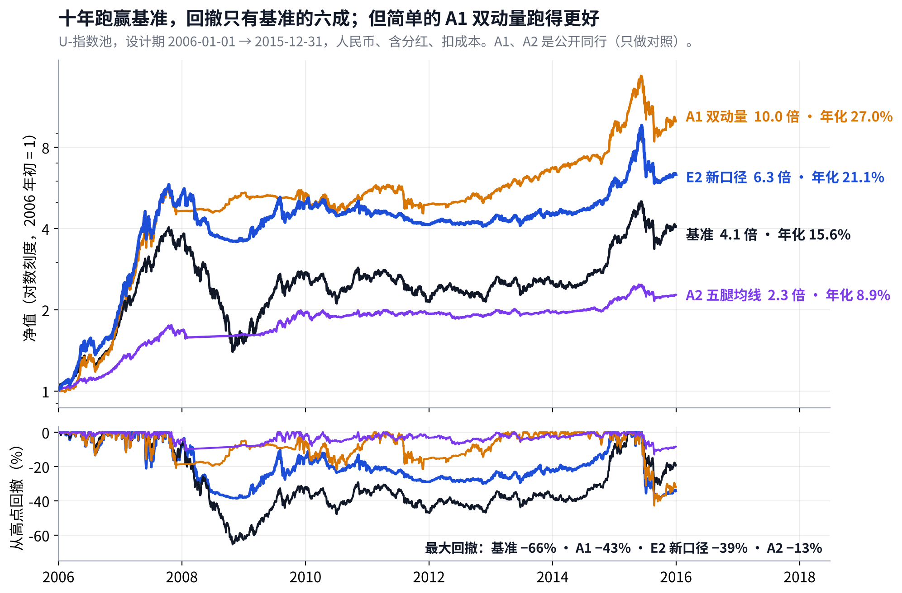
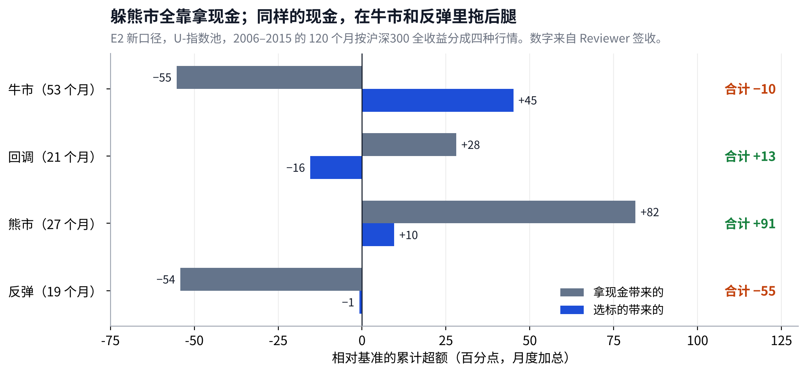
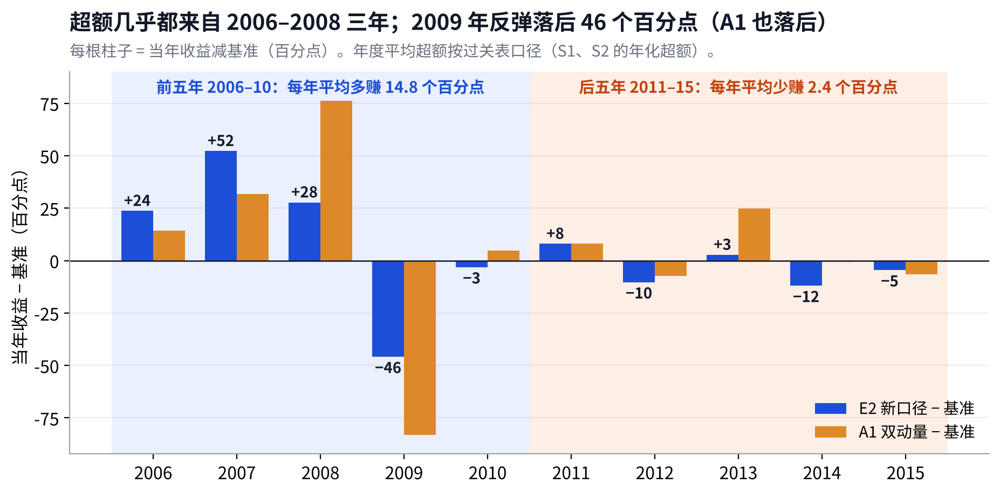

# v4 体检报告：赢在大行情，输在反弹和震荡；简单的同行跑得更好

## Metadata

- Project: ETF_Rotation_Quant
- Document type: owner（v4 设计期体检）
- Status: active（第 1 版；只有 U-指数池，可交易池待 v4-R5b 修复重跑后补）
- Owner: L. Loric
- Maintainer: Orchestrator
- Date: 2026-10-29
- 依据：`operations/reports/v4-r5-design-period-brief.md`；`operations/reviews/2026-10-29-v4-r5-design-gate-signoff.md`；D24
- 页面：Claude 页面“v4 体检报告”；本文件是仓库镜像。图：`results/v4/diag/health/charts.py`

---

**项目愿景**　在动态周期内，从多类资产里选出 Top N 强势 ETF 轮动持有，获得超额收益、稳定跑赢被动基准，同时把回撤控制住。

| 进度 | 结论 | 需要你 |
| --- | --- | --- |
| 设计期跑完。四个改进 T1–T4 **都没过关**，v4 最终版就是 E2 新口径。可交易池的数字有程序问题，正在修（第 0 节）。 | 十年年化 **21.1%**，基准 **15.6%**；最大回撤 **−39%**，基准 **−66%**。但超额集中在 2006–08 三年；公开的 A1 双动量年化 **27.0%**，比我们更好。 | **暂时不需要。**可交易池重跑后我出完整版，那时请你定期望线（第 8 节）。 |

## 先认识这几个名字

| 问题 | 回答 |
| --- | --- |
| **E2 新口径** | E2 的规则一点不改：看 1、3、6、12 个月（20/60/120/250 日）四个回看期，只买跑赢现金的，每组取前 N 名，单只从高点跌 10% 就卖，周、月 × N=3/5/8 六路平均。 “新口径”是数据和交易更真实：涨跌停买卖不了、港美股按决策时真能看到的收盘和汇率、场内基金一律后复权、池子按 117 个容器的新名单。 |
| **T1–T4** | 在 E2 新口径上各改一处的四个候选。**T1 转折点换挡**：短期两个都转正，长期组也提前给资格。**T2 按市场状态分配速度**：单边市多信快的，震荡市多信慢的。**T3 空位当天补**：离场卖出后第二天就补上下一名。**T4 加美股行业、港股分类**。 |
| **基准** | 70% 沪深300 + 15% 纳指100 + 15% 标普500，全收益、人民币，每月再平衡。**它决定过不过**。 |
| **A1 双动量** | 公开同行。每月末：标普500 过去 12 个月跑赢现金，就在标普500 和沪深300 里拿 12 个月更强的那个，100% 仓位；否则拿 10 年国债。一次只拿一样。 |
| **A2 五腿均线** | 公开同行。沪深300、标普500、恒生、10 年国债、黄金各 1/5；每一腿在 10 个月均线之上就拿，之下就换成现金。 |
| **两个池子** | **U-指数池**：有数据就能参加排名，用指数研究。**U-可交易池**：只排当年真能买到的（场内 ETF，太冷或没有就用场外指数基金），收益按真买的那只基金算。过关看 U-指数池，可交易池用来看“当年真的能赚到多少”。 |

年化、回撤都从 2006-01-01 算到 2015-12-31（程序从 2005 年开始跑，前一年只用来攒历史）。前五年 = 2006–2010，后五年 = 2011–2015。2016 年以后的收益一律没有算。

## 0. 先说一个问题：可交易池的数字现在不能用

> **程序里，可交易池在十年里只“能买到”过 4 个容器，2006 年全年拿着现金。这是程序没接上，不是策略的结论。**

**不用你做事**　**可交易池漏接了场外基金和海外 ETF，要修好重跑**

**发生了什么**

可交易池应该按“当年能买到什么”来排名：场内 ETF 太冷或还没上市时，用场外指数基金。程序里有两处没接上：

① **场外指数基金没有接进来。**沪深300 早在 2003 年就有场外指数基金（博时裕富沪深300），程序却要到 2012 年 8 月沪深300 ETF 够活跃才算能买。

② **载体表只建了 16 个 A 股容器。**纳指100、标普500、恒生、黄金、国债等都没有载体，2013 年以后它们已经有场内 ETF，仍然进不了排名。

我逐日看了持仓：整个设计期，可交易池只出现过红利、创业板、沪深300、中证500 这 4 个容器；2006 年和 2011 年全年 100% 现金。按数据看板，到 2015 年底能买到的（不含现金和美股行业）有 19 个。

**影响有多大**

可交易池年化 **5.2%** 这个数**作废**，第 7 节的稳健性因此也只列了 U-指数池。

**过关结果和第 1–6 节不受影响**：过关只看 U-指数池，它的排名用指数，不依赖载体表。修好以后要逐日核对 U-指数池的收益和现在完全一样。

真实可交易的版本会比 U-指数池低：2006–07 年当年能买的几乎只有沪深300 和红利，具体低多少要重跑才知道。

**你要做什么**

**不用你做事。**按程序错误处理：Dev 修、全部重跑，在原来那一行登记原因，不算新的尝试，不改任何规则。Reviewer 这次签收没发现，以后每次运行都加一条必查：**每年可交易的容器数要和数据看板对得上**。

这正是数据看板该起的作用：它写着“哪年能买到什么”，程序的结果和它对不上，就说明哪里漏了。

## 1. 过关：四个改进都没过，v4 最终版就是 E2 新口径

> **四个都没过。最接近的 T2 两段都略好，但没有改善它本来要改善的回调行情。**

过关要同时满足三条（预注册写死，跑之前定的）：前五年、后五年的年化超额**都**比 E2 新口径高；它瞄准的那种行情确实变好；熊市里不比 E2 新口径差 10 个百分点以上。

| 版本 | 改的一处 | 前五年年化超额 | 后五年年化超额 | 瞄准的行情 | 熊市 | 结果 |
| --- | --- | --- | --- | --- | --- | --- |
| **E2 新口径** | （参照） | +14.8 | −2.4 | — | +91.2 | 参照 |
| **T1** | 转折点换挡 | +19.1 | −3.7 | 反弹 −47.0（原 −55.0） | +86.6 ✓ | 没过：后五年变差 |
| **T2** | 按市场状态分配速度 | +15.0 | −1.6 | 回调 +9.7（原 +12.6） | +92.6 ✓ | 没过：回调没变好 |
| **T3** | 空位当天补 | +15.0 | −2.6 | 牛市 −9.4（原 −10.8） | +91.2 ✓ | 没过：后五年变差 |
| **T4** | 加美股行业、港股分类 | +10.7 | −3.1 | 牛市 −66.5（原 −10.8） | +121.9 ✓ | 没过：三处都差 |

年化超额 = 相对基准，每年多赚几个百分点。行情一列是该行情所有月份相对基准的累计超额（百分点），越大越好。绿 = 比 E2 新口径好，橙 = 更差。Reviewer 用独立程序复算，逐列一致。

- **T1 全期年化最高**（**22.2%** 对 **21.1%**），2009 年多赚 23 个百分点，正是它要修的反弹。但 2011、2014 年来回换挡，后五年反而更差。规则要求两段都更好，就是为了挡住“一段大赢、盖住另一段变差”的版本。
- **T2 差一点**：两段都略好，但它要改善的回调行情反而少赚 3 个百分点。按冻结的规则就是没过，不能事后放宽。
- **T4 把仓位分到了美股**，错过 A 股大牛市（2006 年 +79% 对 +106%），牛市少赚 56 个百分点，换来熊市多躲 31 个。

> **这意味着**　这一轮试的四个改进，没有一个在两个年代都站得住。好的一面是规则起了作用：T1 这种全期看起来更好的版本，没能混进来。

## 2. 性格：跟着大趋势走的策略

> **大行情里吃到大部分，崩盘时躲掉一半；代价是反弹回来得慢，横盘里来回小亏。**

| 收益 | 回撤 | 涨跌跟随 |
| --- | --- | --- |
| 年化 **21.1%**，基准 **15.6%**。十年 6.3 倍，基准 4.1 倍。 | 最大 **−39%**，基准 **−66%**。发生在 2015 年 6–8 月，75 个交易日，到 2015 年底还没回到高点。 | 基准上涨的月份跟到 **84%**，下跌的月份只跟 **60%**。年化波动 20.0%，基准 23.2%。每年约换手 14 次。 |

- 2008 年基准 **−60%**，E2 新口径 **−32%**：全年平均有六成多仓位在现金，躲掉了一半的跌幅。
- 2009 年基准 **+83%**，E2 新口径只有 **+38%**：大跌之后，6 个月、12 个月两组要很久才重新跑赢现金，这期间一半的回看期组没有可买的，钱放在现金里。

## 3. 四种行情：熊市大赢，反弹大输

> **熊市里多赚 91 个百分点，反弹里少赚 55 个，牛市里少赚 10 个，回调里多赚 13 个。**

四种行情按沪深300 全收益在每个月末只用当时的数据划分：过去 12 个月涨、这个月也涨 = **牛市**；12 个月涨、这个月跌 = **回调**；12 个月跌、这个月也跌 = **熊市**；12 个月跌、这个月涨 = **反弹**。

- **怎么拆**：“拿现金”= 因为没有满仓而少赚或少亏的部分；“选标的”= 持有的那几只和基准相比的差。
- **牛市里选得其实很好**（+45），但一部分仓位在现金，抵掉了（−55）。这是 E2 的设计：每个回看期只买跑赢现金的，新牛市初期慢的组还没转正。
- **反弹的损失几乎全是现金**（−54），选标的不差。T1 就是冲着这个去的，修回来 8 个百分点，但在后五年付出了更多。

## 4. 任意起点：持有 5 年，跑赢基准的机会只有一半多

> **任意一个月买入、持有 5 年，跑赢基准的起点占 53%；最差的一次，5 年里每年少赚 7.8 个百分点。**

| 持有 | 对照 | 跑赢的起点 | 中位数（每年多赚） | 最差的一次 | 最差的起点 |
| --- | --- | --- | --- | --- | --- |
| **5 年**（60 个起点） | **基准** | 53% | +1.6 | −7.8 | 2008-11 |
| 沪深300 | 88% | +6.0 | −4.9 | 2008-11 |
| 标普500 | 35% | −2.8 | −16.4 | 2009-08 |
| 纳指100 | 27% | −7.3 | −21.6 | 2009-03 |
| **3 年**（84 个） | **基准** | 52% | +0.6 | −13.6 | 2008-11 |
| 沪深300 | 75% | +6.6 | −14.4 | 2008-11 |
| **1 年**（108 个） | **基准** | 56% | +2.1 | −51.2 | 2008-11 |
| 沪深300 | 53% | +2.3 | −80.3 | 2008-11 |

单位是每年多赚的百分点。数字来自 Reviewer 签收。最差的起点几乎都是 2008 年 11 月：正好赶上 2009 年的大反弹。

- **比沪深300 好得多，比美股差**：这十年美股是慢牛，A 股大起大落。E2 新口径主要在 A 股的大起大落里赚钱。
- **持有越久越稳，但稳在“一半一半”**：5 年的中位数只多赚 1.6 个百分点。

## 5. 和公开同行比：复杂的规则没有跑过三选一

> **A1 双动量十年年化 27.0%，我们 21.1%；任意起点持有 5 年，95% 的时候 A1 更好。**

| 持有 5 年，对基准 | E2 新口径 | A1 双动量 | A2 五腿均线 |
| --- | --- | --- | --- |
| 十年年化 | 21.1% | 27.0% | 8.9% |
| 最大回撤 | −39% | −43% | −13% |
| 跑赢的起点 | 53% | 90% | 43% |
| 中位数（每年多赚） | +1.6 | +7.2 | −1.0 |
| 最差的一次 | −7.8 | −7.6 | −11.0 |
| 下跌月份跟随 | 60% | 31% | 17% |

A1、A2 这几格是我按签收同样的方法补算的（同一方法下 E2 新口径为 53%、+1.6、−7.6，最差一格和签收差 0.2）。绿、橙相对 E2 新口径。

### A1 为什么更好：三处差别，有数字支撑的

- **防守拿的是国债，不是现金**：没有趋势时 A1 拿 10 年国债。2008 年 A1 **+16%**，E2 新口径 **−32%**。这一年就拉开 48 个百分点。
- **一次只拿一样，吃得满**：A 股大涨时 A1 是 100% 沪深300；2013 年改拿美股，**+30%** 对 **+8%**。E2 新口径分到 3–8 只再平均六路，加上第 3 节说的现金拖累，牛市吃不满。
- **A1 也有短处**：2009 年它比基准少赚 83 个百分点，比我们还慢；最大回撤 −43% 更深；只看 12 个月，一旦方向判断错要一个月以后才改。

- **同行只用来诊断，不决定过不过**（三层对照的第二层）。它告诉我们：在这十年里，**多出来的复杂度没有换来更好的结果**。
- **要谨慎**：A1 是一条出名的规则，我们挑它当同行时就知道它出名；一个市场、一段十年的胜出，不代表以后也胜出。A1 在 2016 年以后怎样，和我们一样要等封板后的一次性检验才看。

**不用你做事**　**把 A1 的两处优点写进 v5 研究备忘，当作待检验的方向**

**发生了什么**

A1 赢在两处：没有趋势时拿债券而不是现金；趋势明确时集中而不是分散。这两处 E2 都没有。

**影响有多大**

只看 2008 年一年，防守资产的差别就是 48 个百分点。集中的好处在牛市（第 3 节，现金拖累 −55）。是否真能改善，要按 v5 的预注册先写死再检验，会计入尝试次数。

**你要做什么**

**不用你做事。**我把它们加进 v5 备忘的候选方向里；你不同意可以随时划掉。

## 6. 两个年代：前五年是主场，后五年连基准都没跑过

> **前五年年化 37.1%，后五年 7.0%；后五年基准是 9.4%。**

| 年代 | E2 新口径 | 基准 | A1 双动量 | A2 五腿均线 | E2 新口径最大回撤 |
| --- | --- | --- | --- | --- | --- |
| **2006–2010** | 37.1% | 22.3% | 42.1% | 14.5% | −38.6% |
| **2011–2015** | 7.0% | 9.4% | 13.4% | 3.5% | −39.1% |
| 2016–2020 | 留空：封板后的一次性检验才看 | | | | |
| 2021–2026 | 留空：同上 | | | | |

- **前五年是趋势策略的主场**：2006–07 年大牛、2008 年大熊，都是一口气走到底的单边市。
- **后五年趋势短、转得快**：2010–13 年横盘，2014–15 年快牛快熊。E2 新口径在 2012、2014 年各少赚 10、12 个百分点。
- **适应性**：结果跟年代走，不跟规则走。2016 年以后池子变了样（数据看板：当年能买到的容器从 30 个长到 106 个，新增的大多是海外主题），这十年的结论不能直接外推到以后。

## 7. 改参数会不会塌：不会

> **换回看期、离场线、成本、晚一天成交，年化都在 19.5%–21.7% 之间，全都高于基准的 15.6%。**

| 只改这一处 | 年化 | 最大回撤 | 读法 |
| --- | --- | --- | --- |
| **E2 新口径**（原样） | 21.1% | −39.1% | 参照 |
| 回看期 10/40/90/180 日 | 19.6% | −32.4% | 换任何一组都低 1.5 个点左右：现在这组偏好，但不是孤峰 |
| 回看期 15/50/100/200 日 | 19.5% | −32.1% |
| 回看期 30/80/150/300 日 | 19.5% | −41.6% |
| 离场线 8% | 20.6% | −38.8% | 离场线放宽或收紧，差别在 1 个点以内 |
| 离场线 12% | 20.9% | −40.3% |
| 离场线 15% | 20.2% | −40.8% |
| 成本加倍 | 19.7% | −39.4% | 每年少 1.4 个点 |
| 晚一天成交 | 20.6% | −42.3% | 收益差不多，回撤深 3 个点 |
| 美股分红只拿 90% | 21.1% | −39.1% | 几乎没影响 |
| 去掉最好的 1 个容器（全指医药） | 21.7% | −39.0% | 去掉最好的反而略高：不是靠某一只明星 |
| 去掉最好的 2 个（加中证1000） | 21.1% | −39.6% |
| 去掉最好的 3 个（加全指消费） | 20.6% | −39.7% |

U-指数池，自 2006 年算。可交易池的这一列等第 0 节修好后补。

## 8. 对照期望备忘：三条草稿线，过了一条

> **按草稿线，E2 新口径在设计期就有两条没达到；而这还是偏乐观的 U-指数池。**

| 期望（草稿） | 线 | E2 新口径 | 结果 |
| --- | --- | --- | --- |
| 任意起点持有 5 年，跑赢基准的比例 | ≥ 60% | 53% | 没达到 |
| 最差的 5 年，每年比基准少赚 | 不超过 3 个百分点 | 7.8 个百分点 | 没达到 |
| 最大回撤不超过基准的 | 0.6 倍 | 0.60 倍（−39% / −66%） | 刚好达到 |

- 这三条是草稿，按约定要等设计期结果出来后校准、封板前由你定稿。现在先如实对照，不改线去迁就结果。
- 如果最后线不变，v4 这一版不会是上模拟盘的那一条。这不是现在要做的决定。

## 9. 下一步

1. **Grok 修可交易池并重跑**（v4-R5b）：接上场外基金和全部容器的载体，全部重跑；U-指数池逐日不变；每年可交易容器数对上数据看板。
2. **我补完整版**：第 0、7 节和可交易池的数字；可交易池也做一遍四种行情和任意起点。
3. **那时请你看两件事**：期望备忘的三条线定不定；v4 代码冻结以后，v5 从哪几条方向开始（第 5 节的两处 + v5 备忘原有的三条）。

数据来源和顺带处理的两件小事

- 数字来自 Dev 的设计期运行、Reviewer 的独立复算签收（过关表逐列一致；E2 新口径日收益复跑差 5×10⁻¹⁴）、Manager 的设计期简报。我另外逐日复跑了 E2 新口径两个池子，用来查可交易池的问题。
- 账本 41 行，全部只到 2015-12-31；没有写封板锁，没有算 2016 年以后的收益，没有动标签。
- 后复权两个来源有冲突的日子（160125 有 14 天、最大差 2.9 个百分点；160644 有 2 天）：维持统一入口的选择（东财 → 腾讯 → 自己还原），只登记，不换源。
- 冻结的预注册正文里还写着“待 Owner 批准”。冻结后的正文不改，以 10-29 的批准记录为准。

