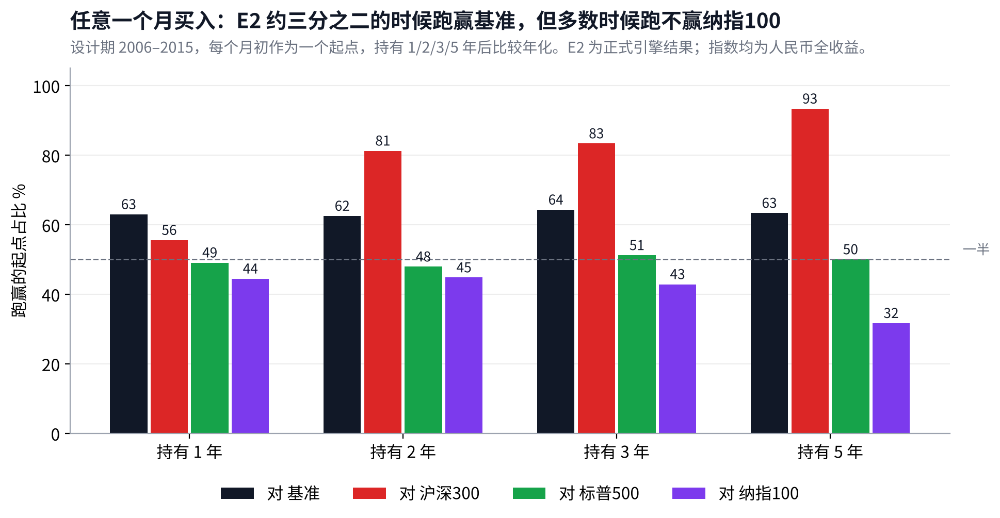
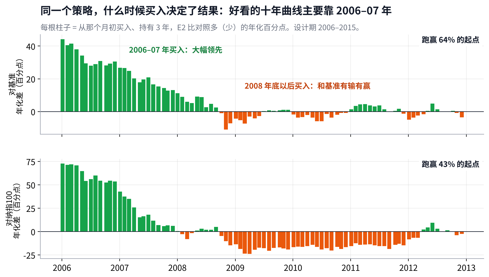
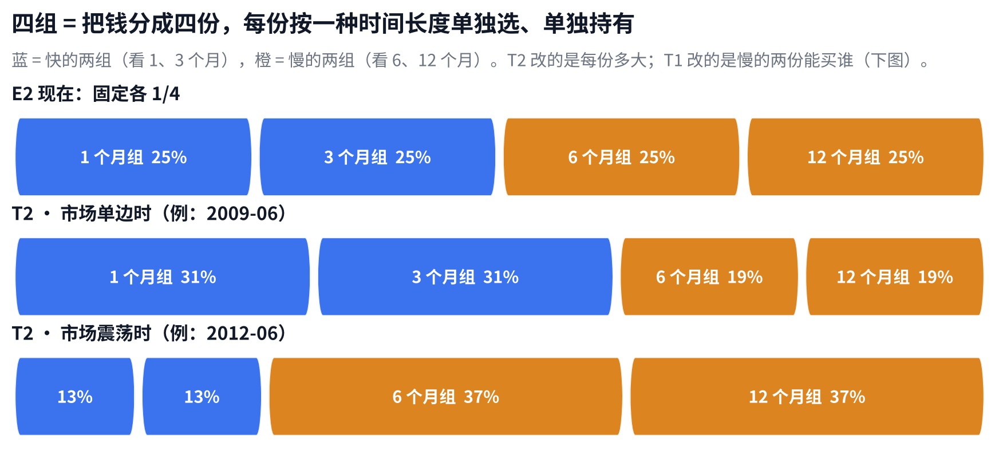
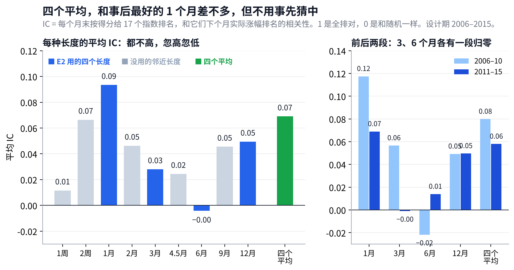
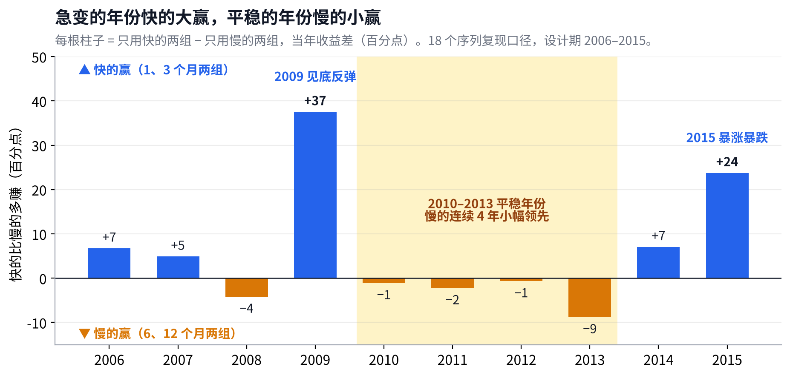
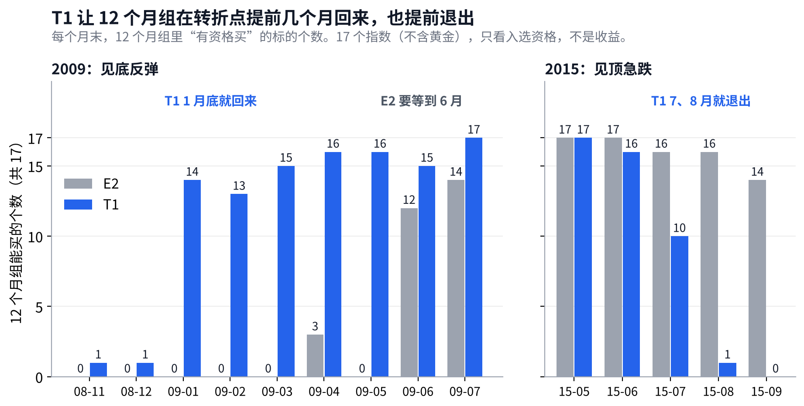
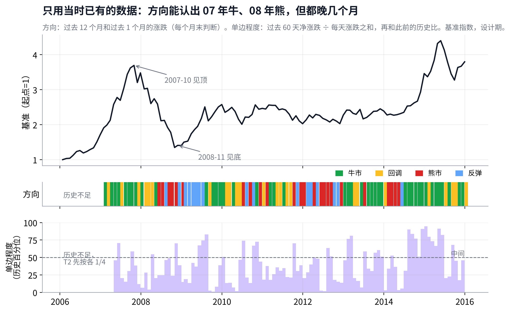
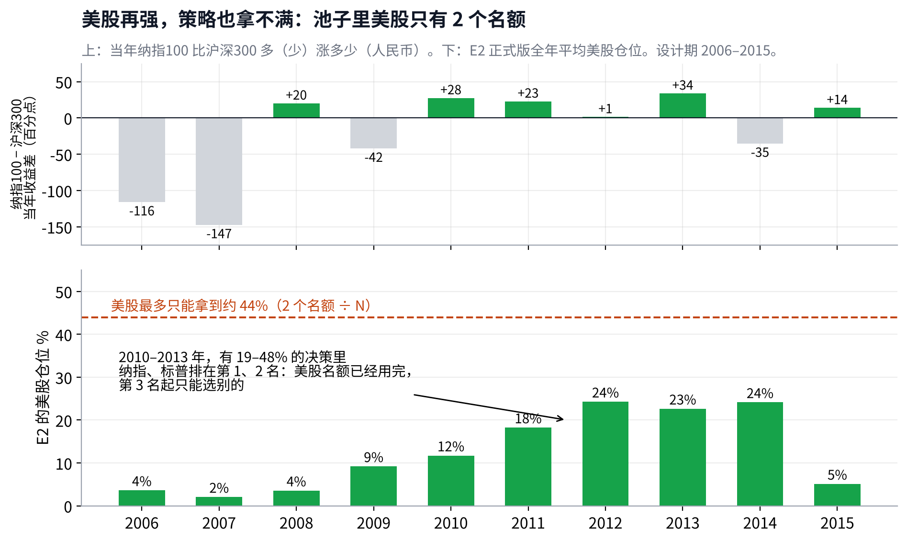

# v4 研究备忘：动态周期、真实可投资市场与检验方式

## Metadata

- Project: ETF_Rotation_Quant
- Document type: research
- Status: active（第 6 版；6 个选择均已定，见 D12、D13）
- Owner: L. Loric
- Maintainer: Orchestrator
- Date: 2026-10-28（第 4 版：4.1 用“四组”讲清 v4 改什么，4.2 换图，4.4a、4.4b 用真实数据走一遍 T1、T2）
- 数据段：≤ 2015-12-31，没有计算 2016 年以后的组合收益
- 记录：`operations/work_logs/2026-10-27-orchestrator-v4-research-diagnostics.md`、`operations/work_logs/2026-10-27-orchestrator-market-state-and-pool.md`；决定：D11、D12

---

**项目愿景**　在动态周期内，从多类资产里选出 Top N 强势 ETF 轮动持有，获得超额收益、稳定跑赢被动基准，同时把回撤控制住。

| 现状 | 最重要的发现 | 需要你 |
| --- | --- | --- |
| v3.1（即 E2）进入代码冻结，作为基线留档。一次性检验**不跑**。下一步做 v4 研究。 | E2 的超额主要来自**熊市防守**：涨的月份只拿到基准涨幅的 **86%**，跌的月份只跟跌 **52%**。普通牛市里和基准打平，反弹里输得最多。它还没有做到“顺应市场”。 | **定 3 条数据口径**（见看板 1.2）。v4-R1–R3 已完成；口径定了我就起草预注册 v4-R4，交你批准。 |

## 1. 涨跌停和停牌：买不进、卖不出怎么算

> **卖出同样会受影响：2015 年股灾时，**13%** 的离场卖单碰上了收盘跌停。**

#### 【已定：选 A（D12-1）】收盘涨停、收盘跌停、临时停牌的那天，回测还按收盘价成交吗

| 发生了什么 | 影响有多大 |
| --- | --- |
| 回测假设每笔交易都按当天收盘价成交。但 ETF 也有涨跌停（多数 ±10%，跟踪创业板、科创板的 ETF 是 ±20%），封板时实际买不进或卖不出。QDII 溢价太高时，交易所会临时停牌，比如你提到的今年纳指 ETF 停牌一天、全球芯片 LOF 停牌到 10:30。 你说卖出不受影响，但数据显示也会受影响。设计期 23 只有行情的 ETF 收盘涨停 **48** 次、跌停 **52** 次，集中在 2015 年 4–9 月。可交易池的 173 次离场信号里，有 **22** 次的计划卖出日该 ETF 收盘跌停，例如 2015-08-24 沪深300、中证500、创业板、红利 ETF 同日跌停。 | 设计期的主结论都用指数池，指数没有涨跌停，所以这些天被当成正常成交，**回测偏乐观**，而且偏在最要紧的时候（急跌时离场）。2016 年以后有 2016 年初熔断、2024 年 9 月底的急涨等，影响只会更明显。 停牌那天通常没有价格，已按你上一轮的选择处理：等下一个有效价再卖。买入方向，溢价控制本来就会挡住高溢价买入。 |

| 选项 | 说明 |  |
| --- | --- | --- |
| **A　收盘涨停的买单、收盘跌停的卖单、停牌，一律当作“当天成交不了”，顺延到下一个能成交的交易日** | 和上一轮“休市等下一个有效价”是同一条规则，回测更接近真实账户。指数池也按对应 ETF 的涨跌停来判断。 | ⭐ 建议 |
| **B　维持现状，按收盘价成交** | 简单，但急涨急跌时回测比实际好看。 |  |

## 2. 换一种检验方式：任意时点买入，都要比基准好

> **每个月都当作一个买入点：E2 跑赢基准的起点约占 **63%**，跑赢纳指100 的只有 **32–45%**。**

- **你的担心是对的**：十年年化 25% 对 15%，是从 2006 年 1 月这一个起点算的。换到任何一个月买入，持有 1–5 年，跑赢基准的起点都只有 **62–64%**。
- **对沪深300 很强，对美股不强**：持有 5 年，**93%** 的起点跑赢沪深300；对标普500 是 **50%**，对纳指100 只有 **32%**。

- **起点决定结果**：2006–07 年买入大幅领先；2008 年底以后买入，对基准有输有赢，对纳指100 几乎一直落后。
- **巴菲特那句话在这里也要看起点**：按人民币算，设计期里一直拿着标普500 年化只有 **5.1%**（2008 年大跌加上人民币升值），拿纳指100 是 **9.6%**，拿沪深300 是 **17.0%**。所以要比的不是某一条曲线，而是**所有起点的分布**。

> **建议**　v4 把“任意起点”作为主要的检验方式：报告持有 1/3/5 年时，跑赢基准和各单一指数的起点占比、中位差、最差的一次，并单独标出策略在哪些起点会输（即策略的边界）。现行判据 ① 已经有 3 年和 5 年的版本，v4 加上单一指数对照，再把“最差的一次”写进判据。

## 3. 市场状态：是顺应了市场，还是被市场选中

> **牛市里人人都是股神。策略要有竞争力，得在各种市场里都站得住，而不是只被某一段行情选中。**

### 3.1 先看一个基金经理常用的指标：涨的时候跟多少、跌的时候跟多少

| 涨的月份 | 跌的月份 | 这说明什么 |
| --- | --- | --- |
| 基准上涨的月份，E2 平均只拿到基准涨幅的 **86%**。 | 基准下跌的月份，E2 平均只跟跌 **52%**。 | 超额来自**少跌**，不是来自**多涨**。这是一个防守型策略的特征，和“选出最强、跟上市场”的愿景还有距离。 |

### 3.2 按四种市场状态拆开：钱在哪里赚、在哪里亏

> **熊市 **+95**、回调 **+30**、牛市 **+1**、反弹 **−57**（百分点）。**

怎么分：看沪深300 过去 12 个月和这个月的涨跌。大势向上、这个月也涨 = 牛市；大势向上、这个月在跌 = 回调；大势向下、这个月也跌 = 熊市；大势向下、这个月在涨 = 反弹（就是 Goulding 等人论文里的四种状态）。超额再拆成两部分：**拿现金带来的**（因为没满仓而多赚或少赚的），和**选标的带来的**（满仓的那部分选得好不好）。

| 状态 | 月数 | 跑赢月份 | 拿现金 | 选标的 | 合计 | 读法 |
| --- | --- | --- | --- | --- | --- | --- |
| **牛市** | 53 | 55% | −26 | +26 | +1 | 选标的其实有效，但没满仓的拖累把它抵消了 |
| **回调** | 21 | 71% | +21 | +9 | +30 | 及时离场在起作用 |
| **熊市** | 27 | 85% | +45 | +49 | +95 | 拿现金加上换到国债、黄金、美股，两头都赚 |
| **反弹** | 19 | 16% | −24 | −33 | −57 | 回场慢，还拿着熊市里的“赢家”，两头都亏 |

- **你的判断方向是对的，细节更具体**：E2 并不是“靠牛市赚钱”，在 53 个牛市月里它和基准几乎打平。它靠的是熊市少亏，以及 2006–07 年那一次行业分化很大的牛市：那两年“选标的”分别贡献 **+19** 和 **+25** 个百分点；到了 2014–15 年的牛市，选标的只有 **−4** 和 **+1**。
- **所以“被市场选中”有两层**：一是起点（第 2 节），二是行情的类型。它赢在下跌和行业分化大的年份，输在反弹，普通上涨时没有优势。
- **“顺应市场”在数据上的意思**：四种状态都不输。尤其牛市里选标的的收益不能被现金拖累吃掉，反弹里不能两头都亏。

### 3.3 v4 按状态要补的地方

| 状态 | E2 现在 | v4 的目标 | 对应的候选（第 4、5 节） |
| --- | --- | --- | --- |
| **牛市** | 选标的 +26，被现金 −26 抵消 | 超额为正：空位尽快补上，选择面更宽 | T3 空位当天补；T4 海外行业池 |
| **反弹** | −57，跑赢月份只有 16% | 不再两头都亏 | T1 转折点换挡 |
| **震荡与回调** | 回调 +30，横盘年份快信号吃亏 | 保持防守，减少来回打脸 | T2 按市场状态分配速度 |
| **熊市** | +95 | 别丢掉：任何改动都不能明显削弱这一块 | 所有候选都要报告这一格 |

这些是写进预注册的**预测**：每个候选事先说明它该改善哪种状态、不该伤害哪种状态，跑完再对照。数字是 E2 正式版，按日超额相加，所以是近似拆分；记录见 operations/work\_logs/2026-10-27-orchestrator-market-state-and-pool.md。

## 4. 动态周期：交易系统的核心

> **四个时间长度不变；v4 改的是慢的两份“能买谁”（T1）和四份“各多大”（T2），都跟着市场变。**

### 4.1 先看钱是怎么分的：四组，各自独立

E2 把钱分成四份。每一份是一个独立的小策略：只看一种时间长度（1、3、6、12 个月），用它判断谁跑赢了现金、谁最强，然后买前 N 名。四份的结果加起来就是整个组合。

所谓“动态周期”，不是让 1、3、6、12 个月这四个数字变来变去，而是改两件事：

| 候选 | 改什么 | E2 现在 | v4 | 例子 |
| --- | --- | --- | --- | --- |
| **T1** | 慢的两份**能买谁** | 只看自己那段时间是否跑赢现金 | 快的两段时间都转正了，也可以买；都转负了，就不能再拿 | 2009 年 1 月底就能回场，E2 要等到 6 月（4.5a） |
| **T2** | 四份**各多大** | 固定各 25% | 市场单边时快的两份变大，震荡时慢的两份变大 | 2012 年 6 月震荡：快的两份合计 26%，慢的两份 74%（4.5b） |

另外两个周期：**多久调一次**，v4 的 T3 让离场后的空位第二天就补，不等调仓日；**什么时候走**，10% 离场本来就是每天检查，v4 只加上“跌停、停牌卖不出就顺延”（D12-1）。

> **为什么不直接让“看多长”本身变**　比如今天看 37 天、明天看 85 天。两个原因：一是 4.3 证明“最近哪个长度好就用哪个”接近抛硬币；二是每多一个可调的长度就多一个自由度，设计期只有一个大底，很容易调出好看的回测。所以 v4 的做法是：**四个长度固定，改的是“谁能买”和“各多大”**。这也是 Goulding 等人论文的做法（4.4）。

### 4.2 基线合不合理：为什么是 1、3、6、12 个月，各 1/4

> **四个平均，和事后最好的那个长度差不多，但不需要事先猜中是哪一个。**

**它从哪来**：1、3、6、12 个月是动量研究和实盘里最常用的一组长度（从 Jegadeesh、Titman 的 3–12 个月，到 Moskowitz 等人的 12 个月时间序列动量），各 1/4 是“不知道哪个更好，就平均”。它不是用我们的数据调出来的，这是它的优点。

**用 IC 检验**：IC 是因子研究里的常用尺子。每个月末，按某个长度的得分给 17 个指数排名，再看下个月实际涨幅的排名，两者的相关性就是这个月的 IC。1 是全部排对，0 是和随机一样，负数是排反了。

- **单个长度都不强，而且忽高忽低**：平均 IC 在 **0–0.09** 之间。1 个月最好（**0.09**），6 个月几乎为 0。3 个月和 6 个月在前后两段里各有一段归零。
- **四个平均是 0.07，前后两段都为正**（0.08、0.06）。它比事后最好的 1 个月低一点，但差距在统计上分不出来；而“1 个月最好”是看完十年数据才知道的，事先选它就是在挑结果。
- **“跑赢现金”这道门槛同样如此**：过了门槛的标的，下个月平均比没过的多涨约 0.5 个百分点，各个长度差不多，哪个都不显著。
- **今年好的明年未必好**：各长度逐年 IC 的前后相关接近 0。所以也不能“按最近 IC 高低给长度加减权重”，这和 4.3 的结论一致。

> **回答“一直不变合不合适”**　不变的是**长度**，不是**用法**。分三层： ① **策略里自动调**：T1、T2 按市场状态改变“谁能买”和“各多大”，有上下限。 ② **运行中盯着，不自动改**：上线后每月记录四个长度和四个平均的滚动 3 年 IC。四个平均连续 12 个月为负，就触发一次版本复查。 ③ **要改长度，就开新版本**：写预注册，在设计期和新数据上都检验，和 v3 到 v3.1 一样。

**v4 还要补一项检验：证明 1、3、6、12 不是挑出来的**。和“为什么是 10%”（8–15% 都差不多）同样的思路：预注册里事先写好 3 组邻近的长度（例如 2 周、2 个月、4.5 个月、9 个月），只报告、不择优。如果结果对这组数字很敏感，结论就要降级。

IC 只看指数自己的价格，没有计算任何组合收益。17 个指数相互高度相关，样本小，数字只能看方向。新池有 34 个名字。新池复算已合入（PR #75，`operations/work_logs/2026-10-28-v4-r1b-exploration.md`）。口径跟进留给 Orchestrator，不在本备忘里下结论。

### 4.3 证据：没有一种时间长度一直最好

> **急变的年份，快的大赢；平稳的年份，慢的小赢。**

- **快的赢在急变**：2009 年见底反弹，1 个月、3 个月两组比 6 个月、12 个月两组多赚 **37** 个百分点；2015 年暴涨暴跌，多 **24** 个。
- **慢的赢在平稳**：2010–2013 年连续 4 年慢的领先，但幅度只有 **1–9** 个百分点。所以 v4 的重点是**急变时别被慢的拖住**（T1），平稳时的调整是次要的（T2）。
- **“上个月谁好就用谁”没用**：月度快慢优势的方向，下个月接着成立的只有 **51–58%**，接近抛硬币。所以要靠**市场状态**来切换，不能靠最近表现。

### 4.4 能借鉴什么

| 来源 | 说了什么 | 对我们有什么用 |
| --- | --- | --- |
| **Goulding、Harvey、Mazzoleni（2023）** 《动量的转折点》 | 用快、慢两种动量把市场分成牛市、回调、熊市、反弹四种状态。快慢方向相反的时候就是转折点；把快慢两种混合起来，比单用一种好。 | 直接对应 2009 年：慢的说“还在熊市”，快的说“已经反弹”。按状态切换速度，是本备忘的主线（T1、T2）。 |
| **Daniel、Moskowitz（2016）** 《动量崩溃》 | 动量在熊市之后的急速反弹里最容易大亏，因为它还拿着熊市里的“赢家”。 | 解释了 2009 年正式版买国债、黄金的现象；回场规则要专门处理反弹期。 |
| **Moskowitz、Ooi、Pedersen（2012）** 《时间序列动量》 | 每个资产跟自己的过去比，跑赢就持有，跑输就离开。 | 就是我们“先过门槛：跑赢现金才入选”那一步，已在用。 |
| **Kaufman 的“趋势效率”** | 一段时间的净涨跌 ÷ 每天涨跌绝对值之和。接近 1 是单边，接近 0 是来回震荡。自适应均线就是按它调速度。 | 可以作为判断“单边还是震荡”的状态变量，只有 1 个参数（T2）。 |
| **Qullamaggie**（交易员笔记） | 按 1、3、6 个月涨幅分别排名，只要最强的前 1–2%。 | 就是我们的“多种时间长度”。他用纳指 10/20 日线决定做不做，这一条的 A 股版本已经检验失败，不能重做。 |
| **Martin Luk**（交易员笔记） | “环境比形态重要”：大盘刚从大跌里出来时先少拿，走稳后多拿；按自己最近的战绩调整出手。 | 支持“按市场状态调速度”，不支持“按最近表现挑速度”（4.3 已证明无效）。 |
| **Alpha101**（Kakushadze 2016） | 101 个个股量价公式，平均持有 **0.6–6.4 天**，多数是短期反转。 | 周期对不上（我们持有数周到数月），截面太窄（几十只 ETF），而且项目禁止多因子合成。最多借一个“放量确认”或“刚暴涨先不追”作为单一过滤，不建议整套搬。 |

### 4.5 v4 候选：每个只改一处

上一版叫 D1–D4，为了不和决定记录的 D 编号混淆，改名 T1–T4（D13-4）。

#### T1 · 转折点换挡

| 项目 | 内容 |
| --- | --- |
| 改的是 | **6 个月、12 个月那两份**能买谁 |
| 原规则 | ~~四组各看各的，慢的两组在反弹初期只能拿现金~~ |
| 新规则 | 一只标的过去 1 个月、3 个月**都已跑赢现金**，慢的两份也可以买它；**都已跑输现金**，慢的两份就不再拿它 |
| 说明 | 管转折点：见底后早回来，见顶后早离开。是 C1 的推广。新参数 0 个。例子见 4.5a。 |

#### T2 · 按市场状态分配速度

| 项目 | 内容 |
| --- | --- |
| 改的是 | **四组之间的资金分配** |
| 原规则 | ~~四组固定各 1/4~~ |
| 新规则 | 市场**单边**（趋势效率高）时快的两组多拿，**震荡**时慢的两组多拿 |
| 说明 | 管平稳年份：震荡时让慢的多拿（4.3 里 2010–2013 年）。事先定死 3 个选择：看 60 天、上下限 25–75%、按直线换算。例子见 4.5b，理由见 4.6。 |

#### T3 · 空位当天补

| 项目 | 内容 |
| --- | --- |
| 改的是 | **离场后空出来的位置**什么时候补 |
| 原规则 | ~~等到下一个周/月调仓日~~ |
| 新规则 | 离场后的**下一个交易日**，就按当天排名补进下一名合格的标的 |
| 说明 | 回场慢的第二个来源。参数 0 个；换手会增加，按正式成本算。 |

#### T4 · 海外行业池

| 项目 | 内容 |
| --- | --- |
| 改的是 | **美股能选什么**（见第 5 节） |
| 原规则 | ~~美股只有纳指100、标普500 两个宽基~~ |
| 新规则 | 加入**美股全部 GICS 行业**，按固定分类整组纳入，不挑 |
| 说明 | 让策略能跟上“时代风格”。参数 0 个；需要先取数。 |

#### 4.5a　T1 怎么做：拿 2009 年 3 月底的沪深300 走一遍

1. **那天的数**：沪深300 过去 1 个月 **+17%**，3 个月 **+35%**，6 个月 **+12%**，12 个月 **−37%**。同期现金只有 0.2–2%。
2. **E2 怎么判**：1、3、6 个月那三份都可以买它。12 个月那一份只看 12 个月，−37% 跑输现金，**不能买**。那天 17 个指数里，12 个月那一份**一个都不能买**，这 25% 的钱只能拿现金（正式版里是国债和黄金）。
3. **T1 怎么判**：12 个月那一份多问一句：过去 1 个月和 3 个月是不是**都**跑赢了现金？是，所以也可以买。那天 17 个里有 **15** 个有资格。谁排前面，仍按 12 个月的“涨幅 ÷ 波动”排。
4. **反过来也一样**：2015 年 7 月底，沪深300 过去 1 个月 −1%、3 个月 −14%，但 12 个月 +74%。E2 的 12 个月那一份还会买它；T1 下 1、3 个月都跑输现金，这一份就不再拿它，在调仓日卖出。

- **整个过程**：2009 年见底后，E2 的 12 个月那一份要到 6 月才有东西可买；T1 1 月底就回来了。2015 年见顶后，E2 这一份到 8 月底还有 16 个可买；T1 7 月底降到 10 个，8 月底只剩 1 个。6 个月那一份同理。
- **会不会被假反弹骗**：2008 年 11、12 月熊市中途的反弹里，T1 只多放进 1 个，因为要 1 个月和 3 个月**同时**转正才算。真买错了，还有 10% 离场兜底。

| 慢的两份（6、12 个月）怎么判 | 过去 1 个月和 3 个月 | 自己那段时间 | E2 | T1 |
| --- | --- | --- | --- | --- |
| **见底回升** | 都跑赢现金 | 跑输现金 | 不能买 | 能买 |
| **见顶回落** | 都跑输现金 | 跑赢现金 | 能买 | 不能买，已有的卖出 |
| **其他** | 一个赢一个输，或者和自己那段同向 | — | 看自己那段 | 和 E2 一样 |

#### 4.5b　T2 怎么做：每个调仓日量一次“市场有多单边”

1. **量单边程度**：基准过去 60 天的净涨跌 ÷ 每天涨跌幅度之和。一路涨或一路跌接近 1，来回震荡接近 0。设计期里多数在 0.1–0.3。
2. **跟它自己的历史比**：今天的值在过去所有日子里排在百分之几。只用当天以前的数据。
3. **换算成大小**：快的两份合计 = 25% + 50% × 这个百分位。排在中间时 50%，就是 E2 现在的样子。

| 日子 | 市场 | 单边程度 | 排在历史第几 | 快的两份合计 | 慢的两份合计 |
| --- | --- | --- | --- | --- | --- |
| 2012-06 | 横盘震荡 | 0.01 | 2% | **26%** | **74%** |
| 2011-06 | 阴跌 | 0.13 | 35% | 42% | 58% |
| 2009-03 | 刚开始反弹 | 0.20 | 42% | 46% | 54% |
| 2009-06 | 单边上涨 | 0.36 | 74% | **62%** | **38%** |

> **T1 和 T2 分工不同**　2009 年 3 月反弹刚开始，过去 60 天先跌后涨，单边程度只在中间，T2 几乎不动。所以**修回场靠 T1**；T2 管的是 2010–2013 年那种平稳年份，让慢的两份多拿。两个都测，组合起来是否更好，按 4.7 第 4 条判断。

以上两个例子只用了指数价格和“有资格买”的个数，没有计算任何组合收益。“60 天”、上下限和换算公式会原样写进 v4 预注册，不试别的值（理由见 4.6）。

不建议的方向：“按最近表现挑速度”（4.3 证明无效）；整套 Alpha101 或多因子合成（项目纪律禁止）；A 股大盘均线择时（已关闭）。

#### 4.5c　怎么判断当下的市场状态：只用当时已有的数据

> **不是看完十年再说“08 年是熊、14–15 年是牛”，而是每个月末只拿当时手里的数据判断一次。代价是总会晚几个月。**

**三条规矩**：

1. **只往回看**：每个判断只用决策日以前的价格，窗口是“过去 N 天”，不碰之后的任何数据。
2. **高低跟自己的过去比**：“单边程度高不高”看它在此前历史里排第几，不用拿十年数据定一条门槛。2008 年的判断只知道 2008 年以前。
3. **历史不够就不判断**：开头几个月数据不够时，T2 回到 E2 的各 1/4。预注册里用 2005 年起的指数历史，让设计期开头就有足够的数据。

**两把尺子**，量的是两件不同的事：

| 尺子 | 怎么量 | 分成什么 | 谁在用 |
| --- | --- | --- | --- |
| **方向** | 过去 12 个月涨还是跌（大势），过去 1 个月涨还是跌（眼前） | 牛市（都涨）、回调（大势涨、眼前跌）、熊市（都跌）、反弹（大势跌、眼前涨） | T1（逐只标的，用 1、3 个月对 6、12 个月）；打分卡 |
| **单边程度** | 过去 60 天净涨跌 ÷ 每天涨跌之和，和此前的历史比 | 单边（一路走）还是震荡（来回走），不分涨跌 | T2 |

你说的几种市场，就是两把尺子的组合：

| 你说的 | 方向 | 单边程度 |
| --- | --- | --- |
| **单边牛市、慢牛** | 牛市 | 高 |
| **大涨大跌的疯牛** | 牛市 | 低 |
| **单边熊市、阴跌（慢熊）** | 熊市 | 高 |
| **暴跌和反弹交替** | 熊市、反弹交替 | 低 |
| **震荡市** | 回调、反弹交替 | 低 |
| **转折点** | 回调或反弹（大势和眼前不一致） | — |

- **方向能认出来，但晚几个月**：2007-10 见顶后，11 月就显示“回调”，之后在回调和牛市之间反复，到 2008 年 5 月才确认“熊市”，因为过去 12 个月的涨幅还没跌完。2008-11 见底后，当月底闪过一次“反弹”，2009 年 1 月起连续显示反弹，7 月才确认“牛市”。这种滞后无法消除，所以 T1 用 1、3 个月的快信号抓转折，10% 离场处理急跌。
- **两把尺子不能互相替代**：按单边程度，2007 年的大牛和 2008 年的大熊大多在中间以下，因为 A 股大牛大熊每天涨跌都很大，走得并不“直”。2014 年下半年到 2015 年上半年才明显偏单边。所以“牛熊”看方向，“单边还是震荡”看单边程度。
- **打分卡的四种状态不能拿来交易**：打分卡事后给每个月打标签，用的是“这个月”的涨跌，只用来评估。交易用的判断一律只看过去。

这张图只用了基准指数的价格，没有计算任何组合收益。T2 的定义没有因为看到这张图而修改，是否有效交给 v4-R5 体检。

### 4.6 T1、T2 怎么一起用，各占多少

> **先用 T2 定每组多大，再用 T1 定慢的两组能买谁，最后每组照旧买前 N 名。**

每个调仓日按这个顺序做三步：

1. **T2 定大小**：量市场有多单边，算出快的两组合计多少，四组各分多少钱。
2. **T1 定名单**：1 个月、3 个月两组照旧；6 个月、12 个月两组按 4.5a 判断谁有资格。
3. **每组照旧选**：在有资格的里面按得分取前 N 名，每只分到“本组大小 ÷ N”。不够 N 只，空位拿现金。四组加起来就是当天的目标持仓。

拿 2009-03-31、N = 5 走一遍（只算当天的目标持仓，不算收益）：

| 版本 | 四组大小（1、3、6、12 个月） | 12 个月组买了什么 | 现金 | 最大的三个持仓 |
| --- | --- | --- | --- | --- |
| **E2** | 25 / 25 / 25 / 25 | 没有，全部空位 | 25% | 信息技术 15%、中证1000 15%、中证500 10% |
| **只开 T1** | 25 / 25 / 25 / 25 | 医药、通信、公用事业、中证1000、中证500 | 0% | 中证1000 20%、中证500 15%、信息技术 15% |
| **只开 T2** | 23 / 23 / 27 / 27 | 没有，全部空位 | 27% | 信息技术 15%、中证1000 15%、中证500 10% |
| **T1 + T2** | 23 / 23 / 27 / 27 | 同“只开 T1” | 0% | 中证1000 20%、中证500 15%、信息技术 15% |

这一天起作用的是 T1：它把 12 个月组的 25% 从现金放回了市场。T2 只把大小挪了 2 个百分点。到 2012 年 6 月那种横盘，T2 起主要作用，把慢的两组放大到合计 74%。T1 在横盘时也会触发，但只是在慢的两组里换掉一两只（那天 6 个月组把纳指100 换成了医药）。横盘里来回换，是 T1 的主要风险，所以体检时要单独看它在回调和震荡里有没有变差。

#### 各占多少，为什么

| 设定 | 数值 | 为什么这样定 |
| --- | --- | --- |
| **E2 的四组** | 各 25% | 不知道哪个长度更好，就平均（4.2） |
| **T2 的中点** | 快的两组合计 50% | 市场不偏单边也不偏震荡时，和 E2 完全一样 |
| **T2 的上下限** | 快的两组合计 25%–75%，即每组 12.5%–37.5% | 判断市场状态的信号本身有噪声，所以只偏、不押：任何一组最少留一半（12.5%），最多一倍半（37.5%） |
| **T2 的换算** | 直线：25% + 50% × 百分位 | 没有门槛就没有“刚好过线”的跳变，也不多一个要定的数 |
| **T2 看多长** | 60 天 | 与 3 个月组同长，不新造一个长度 |
| **T1** | 不改大小 | 只改慢的两组的名单，所以和 T2 不冲突 |

这些数都是事先按道理定的，不是用数据调出来的，写进预注册后不再改。它们算作新增的自由度：T2 共 3 个，T1、T3、T4 各 0 个，合计 3 个，在 4.7 第 1 条的 4 个以内。

> **候选之间怎么组合：逐个过关，再合在一起**　T1–T4 先各自单独跑。每个都要做到：改善它预测的那种行情，前后两段都成立，熊市那一块不明显变差。过关的合在一起，作为 v4 的最终版本再跑一次，并单独报告。没过关的不进最终版本。这样一共是 4 + 1 = 5 个配置，不在各种组合里挑最好的。

### 4.7 怎么检验，才不会自己骗自己

1. **先写死再跑**：v4 预注册写明 T1–T4 的规则和参数，新增自由度合计不超过 4 个。
2. **只用设计期**：2006–2015 年，前后两段（2006–10、2011–15）都要成立。
3. **按第 2 节的方式判**：任意起点跑赢基准的占比、最差的一次、对单一指数的胜率。
4. **组合不挑**：按 4.6“逐个过关，再合在一起”，并报告回测过拟合概率。
5. **全部计数**：每个候选都计入尝试次数；2016 年以后仍然只跑一次。

## 5. 重建真实可投资市场：设计期可以带知识，不能带数据

> **那个年代境内只有 2 只美股宽基 ETF，这是事实；但那时的投资者可以直接去美国买行业 ETF。所以要还原的是“当时能买到什么”，而不是“当时境内上市了什么”。**

### 5.1 这和我们已经做过的改进是同一件事

| 节点 | 内容 |
| --- | --- |
| **v3** | 指数要到发布日之后才能选，2011 年以前每年只有 4–6 个可选，没能反映当时的 A 股市场 |
| **E1** | 用官方回溯的行业指数补全 A 股：可选从 4–6 个变成 17 个，跑赢了基准 |
| **v4 · T4** | 同样的道理用到美股：当年境内只有 2 只美股宽基，用行业指数还原当时真实可买的美股市场 |

这也回答了你之前的问题：跑不赢基准，原因不是没有做空工具，而是池子没有反映真实的市场。

### 5.2 证据：池子的构成，等于给每个市场设了仓位上限

- **上限从哪来**：设计期里 A 股有 14 个可选，美股只有 2 个。每次选前 N 名，美股最多占 2 个名额：N = 3 时最多 67%，N = 5 时 40%，N = 8 时 25%，六组平均最多约 **44%**。
- **上限真的在起作用**：2010–2013 年，有 **19–48%** 的调仓决策里，纳指和标普已经排在第 1、2 名，美股名额用完，第 3 名起只能选别的。那几年 E2 的美股仓位只有 12–24%。
- **这也解释了第 2 节**：2009 年以后买入，E2 大多跑不赢纳指100。

### 5.3 还原规则：五条

1. **市场范围**：当时的投资者能用合理方式买到的市场：A 股、港股、美股。
2. **同样的粒度**：每个市场按同一套行业分类拆分。A 股用中证一级 10 个行业，美股用当时的 **GICS 10 个行业**，港股用恒生行业指数。这样池子的构成就不会替某个市场设上限。
3. **整组纳入**：按分类**整组放进来**，不挑后来表现好的行业，也不按“后来有没有 ETF”去挑。
4. **时点正确，成本如实**：行业分类用当时的版本（房地产 2016 年、通信服务 2018 年才独立）。跨境的换汇、佣金、分红预扣税都按当时计入。

第 5 条：**可交易池同步扩充**。2006–2015 年境内没有对应的 QDII，可交易池就用美国本土的行业 ETF 来代表“直接去美股买”；2016 年以后境内有了的，优先用境内 QDII，并照常计算溢价。

### 5.4 “带知识、不带数据”的边界

- **可以用的知识** * 当时市场上真实存在的东西：美国 9 只行业 ETF 1998 年 12 月就已上市；GICS 行业分类 1999 年发布，标普把历史回推到 1989 年。 * 不依赖具体收益数字的机制：跨境交易怎么做、成本有哪些、分类怎么定。
- **不能用的数据** * 因为知道后来科技、AI、芯片涨得好，就单独加进这些行业或主题。 * 按“后来哪些主题有了 ETF”来挑指数。基金公司往往在主题最热时才发行。 * 用 2016 年以后的表现来调参数。

按这条边界，美股的科技行业会作为 GICS 的一个行业**自然出现在池子里**，它能不能被选中，交给排名决定。这样，你观察到的时代风格就有机会被策略抓住，又不是事后挑出来的。

### 5.5 要写进预注册的预测

- 美股强的年份，美股仓位应该能超过 44% 的旧上限。
- 任意起点对纳指100 的胜率应该高于现在的 **32–45%**。
- 牛市里“选标的”的贡献应该更大。风险是行业更细，来回切换也可能更多，所以回调和震荡状态也要单独报告。

这一节的数据：美股名额用满的比例是 18 个序列复现口径；美股仓位来自 E2 正式版。美股行业数据目前不在数据库里，需要先取数（v4-R1）。

## 6. 路线：v4 按轮次推进

> **轮次对应进度总览的阶段 ①–⑩，不写时间，用完成判据管理（D13-4、D13-5）。**

| 轮次 | 推进阶段 | 做什么 | 主要负责 |
| --- | --- | --- | --- |
| **v4-R1** | ② 标的池 | 美股行业 ETF、标普500 行业指数、港股行业指数、汇率取数登记；数据探索报告 | Dev 取数，Manager 探索，Reviewer 抽查 |
| **v4-R2** | ③ 交易引擎、④ 溢价控制 | 涨跌停、停牌、无价顺延；跨境成本；T1–T3 的规则开关（只写代码和测试） | Dev，Reviewer |
| **v4-R3** | ⑤ 打分卡 | 任意起点检验、四种市场状态拆解；用 E2 的参考数字验收 | Dev，Reviewer |
| **v4-R4** | ① 规则定稿 | v4 预注册：T1–T4、每个候选的状态预测、判据（含“顺应市场”）、成本参数 | Orchestrator 起草，Reviewer 复核，你批准 |
| **v4-R5** | ⑥ 业务体检 | 按预注册在设计期运行，出体检报告 | Dev 运行，Manager 初读，Reviewer 复算，Orchestrator 解读 |

R1–R3 是基础建设，可以并行；预注册冻结之前，不运行任何候选看收益。任务清单：operations/planning/2026-10-28-v4-dev-plan.md。

## 7. 你的决定

> **6 个选择都已按建议定下（D12、D13）。**
- ✅ **已定**选择 1：涨跌停、停牌一律当作当天成交不了，顺延（第 1 节）
- ✅ **已定**选择 2：以任意起点为主要检验方式（第 2 节）
- ✅ **已定**选择 3：T1–T4 四个方向都做，每个只改一处（第 4、5 节）
- ✅ **已定**选择 4：4 个分解诊断计入，诊断计数 35
- ✅ **已定**选择 5：美股行业数据以美国本土行业 ETF 为主，标普500 行业指数作核对（D13-1）
- ✅ **已定**选择 6：“顺应市场”写进判据，牛市和反弹的超额都不能为负（D13-2）

数据口径与来源

- E2 任意起点检验用正式引擎结果（PR #44 的 P1），基准与单一指数为人民币全收益。只用 2006-01 至 2015-12。
- 四种时间长度的分解用 18 个序列复现口径（不含黄金），登记为诊断 #32–#35。
- 涨跌停统计来自数据库中 23 只 ETF 的日行情（≤2015）；可交易池离场记录来自 P6。
- 市场状态：按沪深300 全收益指数（2005 年起）的 12 个月与 1 个月涨跌划分；超额按日相加后汇总，拆成“现金比例 ×（现金收益 − 基准）”和其余部分，是近似拆分。
- 美股名额用满的比例：18 个序列复现口径，月末、四个回看期分别统计。美国行业 ETF 的上市时间与 GICS 的历史，见 State Street 与标普道琼斯指数公司的公开资料。
- 记录：operations/work\_logs/2026-10-27-orchestrator-v4-research-diagnostics.md、operations/work\_logs/2026-10-27-orchestrator-market-state-and-pool.md；决定记录：operations/planning/2026-10-27-d11-owner-decisions.md、operations/planning/2026-10-27-d12-owner-decisions.md。
- 文献：Goulding, Harvey & Mazzoleni (2023), Momentum turning points, Journal of Financial Economics；Daniel & Moskowitz (2016), Momentum crashes, JFE；Moskowitz, Ooi & Pedersen (2012), Time series momentum, JFE；Kakushadze (2016), 101 Formulaic Alphas, arXiv:1601.00991。

