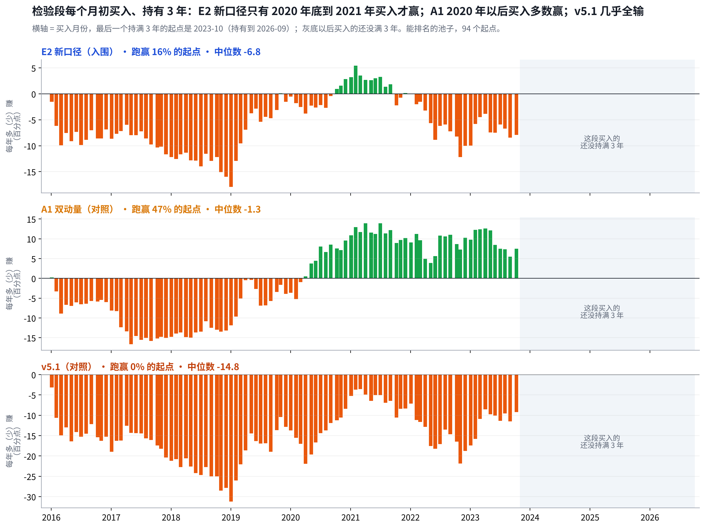

# 一次性检验报告：E2 新口径没有通过，2016 年以后十年没跑赢基准

## Metadata

- Project: ETF_Rotation_Quant
- Document type: owner（v5 一次性检验结论）
- Status: active（第 1.4 版：每节都带上 A1 和 v5.1；能买到的池子不可用；Reviewer 签收；三件事待 Owner 决定）
- Owner: L. Loric
- Maintainer: Orchestrator
- Date: 2026-11-04
- 依据：`results/v5/oneshot/`；`results/v5/LOCK`；`operations/reviews/2026-11-04-v5-oneshot-signoff.md`；D27、D34；图 `results/v5/report/charts.py`
- 页面：Claude 页面“一次性检验报告”；本文件是仓库镜像

---

**项目愿景**　在动态周期内，从多类资产里选出 Top N 强势 ETF 轮动持有，获得超额收益、稳定跑赢被动基准，同时把回撤控制住。

| 进度 | 结论 | 需要你 |
| --- | --- | --- |
| 一次性检验跑完一次，Reviewer 独立复算签收。冻结代码的设计期结果逐位复现，判据表 12 行全部一致。 | E2 新口径 **3.0%**、A1 **8.6%**、v5.1 **−3.3%**，基准 **8.7%**。E2 新口径持有 5 年 **0 / 70** 个起点赢，判据 ① ⑥ 不通过，没有可以上模拟盘的策略。 | **补数据已完成。**“关闭”和“下一步”并入《第二阶段复盘》第 10 节一起定。 |

先认识这几个名字：E2 新口径、A1、A2、v5.1、基准、两个池子

| 问题 | 回答 |
| --- | --- |
| **E2 新口径** | 唯一入围的策略（v4 最终版）。看 1、3、6、12 个月四个回看期，只买跑赢现金的，按“涨幅 ÷ 波动”取前 N 名、各 1/N，单只跌 10% 就卖；周、月 × N = 3/5/8 六路平均。 |
| **A1 双动量** | 公开同行。每月末标普500 跑赢现金，就在标普500 和沪深300 里拿更强的一个，全仓；否则拿 10 年国债。 |
| **A2 五腿均线** | 公开同行。沪深300、标普500、恒生、10 年国债、黄金各 1/5，跌破 10 个月均线的那腿换成现金。 |
| **v5.1** | v5 最后一版，设计期没入围（别的市场检验没过）。这次只作对照，结果再好也不能入围。 |
| **基准** | 70% 沪深300 + 15% 纳指100 + 15% 标普500，全收益、人民币，每月再平衡。 |
| **两个池子** | **能排名的池子**：有指数数据就能参加，**过关判定只看它**。**能买到的池子**：只排当年真有基金能买的。 |

全部扣费后。检验段 2016-01-01 → 2026-09-30 是已污染检验段（v2 用过），只能跑一次，不能称为样本外。

## 1. 结论：入围的 E2 新口径没通过，四个策略都没跑赢基准

> **E2 新口径回撤最浅（−15%），但十年只赚了 35%，基准赚了 137%。四个策略全部跑输基准；最接近的是 A1，和基准几乎一样，回撤却深得多。**

| 能排名的池子，2016–2026 | 年化 | 最大回撤 | 年化 ÷ 回撤 | 判定 |
| --- | --- | --- | --- | --- |
| **基准** | **8.7%** | −26% | 0.33 | **靶子** |
| **E2 新口径**（入围） | **3.0%** | **−15%** | 0.20 | **不通过** |
| 对照：不参加判定 | | | | |
| A1 双动量 | 8.6% | −40% | 0.22 | **和基准打平** |
| A2 五腿均线 | 7.2% | **−10%** | **0.74** | **少赚，回撤最浅** |
| v5.1 | **−3.3%** | **−54%** | — | **亏钱** |
| 沪深300 · 标普500 · 纳指100 | 4.0% · **15.9%** · **21.4%** | −42% · −33% · −29% | — | **美股是主力** |

能买到的池子的数字这里不列：57 只场外基金的净值只取到 2015 年底，四个策略的可交易结果都不可用（第 7 节）。

## 2. 过关：E2 新口径的 ① 和 ⑥ 都没过；拿同一把尺子量，A1 接近及格，v5.1 差得最远

> **持有 5 年，E2 新口径 0 / 70 个起点赢基准，A1 47%，v5.1 0%。过关只判 E2 新口径；A1、v5.1 用同一把尺子量，只作对照。**

| 判据 | 要求 | E2 新口径（判定） | A1（对照） | v5.1（对照） | 结论 |
| --- | --- | --- | --- | --- | --- |
| ① 持有 3 年 | 年化超额中位数 > 0 | **−6.8** | **−1.3** | **−14.8** | **E2 不通过** |
| ① 持有 5 年 | 中位数 > 0，多数起点为正 | **−4.8** · **0 / 70** | **−3.6** · 47% | **−15.1** · 0% | **E2 不通过** |
| ⑥ 牛市 | 累计超额 ≥ 0（51 个月） | **−78** | **−30** | **−132** | **E2 不通过** |
| ⑥ 反弹 | 月超额 t 值 ≥ −2（23 个月） | **−3.25** | **−2.52** | **−4.78** | **E2 不通过** |
| ⑤ 尝试次数 | 按次数打折扣报告 | **115** 次 | — | — | **① 没过，不再打折** |

A1、v5.1 不参加判定；数字来自同一次运行的判据表（Reviewer 复算一致）。能排名的池子。

| 四种行情（相对基准累计超额） | 月数 | E2 新口径 | A1 | v5.1 | A2 | 读法 |
| --- | --- | --- | --- | --- | --- | --- |
| 牛市 | 51 | **−78** | **−30** | **−132** | −101 | **全都输** A1 美股多，输得最少 |
| 回调 | 25 | +7 | 0 | −1 | **+35** | **只有 A2 有用** |
| 熊市 | 30 | **+66** | **+87** | **+90** | +98 | **全都赢** 靠国债和现金 |
| 反弹 | 23 | **−56** | **−53** | **−77** | −56 | **全都输** 趋势天生落后 |

行情按沪深300 过去 12 个月和这个月的涨跌划分。合计 = 该行情所有日子相对基准的日超额之和（百分点）。

## 3. 逐年：E2 新口径只赢下跌年，A1 赢了 6 年，v5.1 在大涨年输得最多

> **2019、2020 两个大涨年，基准涨 39%、28%：E2 新口径少赚 31、19 个点，A1 少赚 19、29，v5.1 少赚 47、29。**

| 年份 | 基准 | E2 新口径比基准 | A1 比基准 | v5.1 比基准 | 结论 |
| --- | --- | --- | --- | --- | --- |
| 2016 | -1.7% | **-6.5** | **+8.3** | **+3.2** | **A1、v5.1 赢** |
| 2017 | 23.0% | **-7.4** | **-8.3** | **-21.8** | **都输** |
| 2018 | -16.5% | **+7.5** | **-0.4** | **+6.1** | **E2、v5.1 赢** |
| 2019 | 39.2% | **-31.4** | **-18.6** | **-46.7** | **都输** |
| 2020 | 28.5% | **-18.6** | **-28.5** | **-28.8** | **都输** |
| 2021 | 5.1% | **-4.1** | **+11.5** | **-16.9** | **A1 赢** |
| 2022 | -18.6% | **+16.2** | **+3.6** | **+1.4** | **E2、A1、v5.1 赢** |
| 2023 | 4.6% | **-4.8** | **+18.5** | **-0.3** | **A1 赢** |
| 2024 | 21.8% | **-15.1** | **+5.2** | **-24.5** | **A1 赢** |
| 2025 | 20.1% | **-9.4** | **+3.4** | **-25.9** | **A1 赢** |
| 2026（到 9 月） | 0.4% | **+1.3** | **+0.0** | **+18.3** | **E2、v5.1 赢** |

能排名的池子，扣费后，百分点。框出的是差距特别大的年份。

## 4. 为什么输：三个策略输法不同——E2 新口径少拿美股，v5.1 输给成本，A1 输在进出时点

> **美股宽基平均仓位：E2 新口径 8%、v5.1 17%、A1 57%（基准 30%）。只有 A1 拿到了美股，但它每年在来回换里丢了 4.2 个点。**

E2 新口径：国债挤掉股票，钱分得太散

“涨幅 ÷ 波动”让国债排在股票前面，2019 年 42% 在债券；剩下的钱分在约 20 个容器上，七成候选是海外主题。扣费前年化只有 5.2%，成本每年 2.2 个点。

A1：拿对了美股，进出时点错

一大半时间拿标普500，方向对了（每年 +5.1）；但 2018–19 年在美股和 A 股之间来回换，2020 年 3 月拿着标普撞上疫情，回撤 −40%。

v5.1：同样的判断，做得太频繁

每年双边换手 66 倍，成本每年 6.6 个点，扣费前也只有 3.2%。它挑中的纳指100、香港创新药都赚了钱，但被成本和全指能源（−11.2）、港股通科技（−6.8）吃掉。

逐项拆解（美股仓位、时点、A 股、海外主题、成本）见《第二阶段复盘》第 3 节。

## 5. 设计期的优势为什么没延续：靠的是 2006–2010 那种单边大行情

> **前五年 → 后五年 → 检验段，相对基准每年：E2 新口径 +19.6 → +0.5 → −5.7，A1 +19.8 → +4.0 → −0.1，v5.1 +18.1 → +11.2 → −12.0。**

- **优势集中在一段行情里**：三个策略设计期的超额都主要来自 2006–2010 年 A 股的大牛大熊。2011 年以后 E2 新口径基本没有超额；v5.1 后五年还有 +11.2，靠的是快进快出，但这一招在平缓的检验段变成了成本。
- **2016 年以后，基准里的美股是主力**：沪深300 十年只有 4.0%，标普500、纳指100 有 16%、21%。基准每年再平衡，被动拿住了美股这一大段慢牛；E2 新口径要等它在排名里胜出才买，买进来又被国债分走一部分。
- **一条教训**：设计期十年里，独立的大行情只有十来次。“两段都要赢”的门槛是对的；当时 E2 新口径后五年 +0.5 就已经是警告，只是按规则它是唯一的入围者。

## 6. 对照：A1 和基准打平，A2 回撤最浅，v5.1 证明当初挡下它是对的

> **对照只用来诊断，不改判：A1 8.6% 和基准打平，A2 回撤只有 −10%，v5.1 换手 66 倍、年化 −3.3%。**

A1 双动量

8.6% · −40%

年化和基准打平。持有 5 年 47% 的起点赢基准，2019 年以后买入的多数赢。但 2020 年 3 月一次回撤 −40%，比基准深得多。

A2 五腿均线

7.2% · −10%

少赚 1.5 个点，但最大回撤只有基准的四成，年化 ÷ 回撤 0.74，是唯一一个明显高于基准（0.33）的。设计期它是最差的一个（年化 8.9%）。

v5.1

−3.3% · −54%

每年双边换手 66 倍、成本 6.4 个点，扣费前也只有 3.2%。和美国 ETF 上的结果一样：平缓的市场里，来回切换只是付成本。别的市场检验把它挡在外面是对的。

单一指数

美股 16–21%

这十年最大的收益来自美股慢牛；A 股（沪深300）只有 4.0%。所有策略都没能比基准更好地拿住美股这一段。

**不能事后挑**：A2 在这一段回撤最浅，但这是看过结果之后的发现。按纪律（D27-5），它只能算“设计证据”，不能直接拿来上模拟盘。

## 7. 结果靠得住吗：过关结论靠得住；能买到的池子有一处数据缺口

> **代码、判据、数据窗口都按冻结规则执行，Reviewer 独立复算一致。复查时我另外发现：57 只场外基金的净值只取到了 2015 年底，能买到的池子的结果因此全部不可用。过关只看能排名的池子，不受影响。**

| 检查 | 结果 | 判定 |
| --- | --- | --- |
| 先锁后跑 | LOCK 合入后才运行，入口只允许跑一次 | **符合** |
| 运行代码 = 冻结规则 | 用运行代码重跑设计期，8 条净值**逐位一致** | **已证明** |
| 判据表 | Reviewer 独立实现，**12 行全部一致**；我另算也一致 | **一致** |
| 基准 | 沪深300 2019 年 +39.2%、标普500 人民币 2016 年 +19% | **对得上公开数字** |
| 能买到的池子 | **57** 只场外基金停在 2015 年，持仓按 0 收益卡住 | **全部不可用** |
| 判据 ⑤ 次数 | 记 115 次；v5、v5.1 另有 30 行没计入 | **补记，不影响** |
| 期望线 | 没在看结果前定稿（D27-3） | **如实记录** |

- **数据缺口为什么不改结论**：过关只看能排名的池子，它用指数序列，不用场外净值。中证全指 IT、可选消费、医药、金融地产 4 个容器十年只有场外载体；E2 新口径可交易池约一半的钱卡在这类容器里。现在已补齐 63 只，并按 D35 改用场内口径重算。
- **为什么 Reviewer 没发现**：它核对的是“输出和规则一致”，规则确实是“没有价格就不能买”。问题出在数据覆盖范围，不在程序。以后每次跑 2016 年以后，先查载体序列的最后日期。

## 8. 需要你定的事：补数据已完成，其余并入《第二阶段复盘》第 10 节

> **三件事里 1 件已完成；“关闭”和“下一步”在复盘里补上了依据，合成四件一起定。**

| 事项 | 状态 | 去哪里定 |
| --- | --- | --- |
| 按“不成立”关闭 | **待你定** | 复盘第 10 节第 1 件 |
| 补齐场外基金净值 | **已完成** | 63 只补到 2026-09-30；能买到的池子改用场内口径（D35） |
| 下一步怎么走 | **待你定** | 复盘第 10 节第 3、4 件 |

数据来源

- 结果：`results/v5/oneshot/`（运行代码 e4ccbc3，合入后为 6843df1；冻结标签 `milestone/v5-code-freeze` → 8970bcb；数据库 SHA256 167d4e39…）。
- 签收：`operations/reviews/2026-11-04-v5-oneshot-signoff.md`、附录 `…-appendix-a1-cash.md`；设计期逐位复现 `operations/reviews/diag/v51/v5-oneshot-design-bitmatch-e4ccbc3.json`。
- 图：`results/v5/report/charts.py`，只读签收结果。设计期的数字引用《v5.1 体检报告》和[《v4 体检报告》](v4-health-check.md)。

