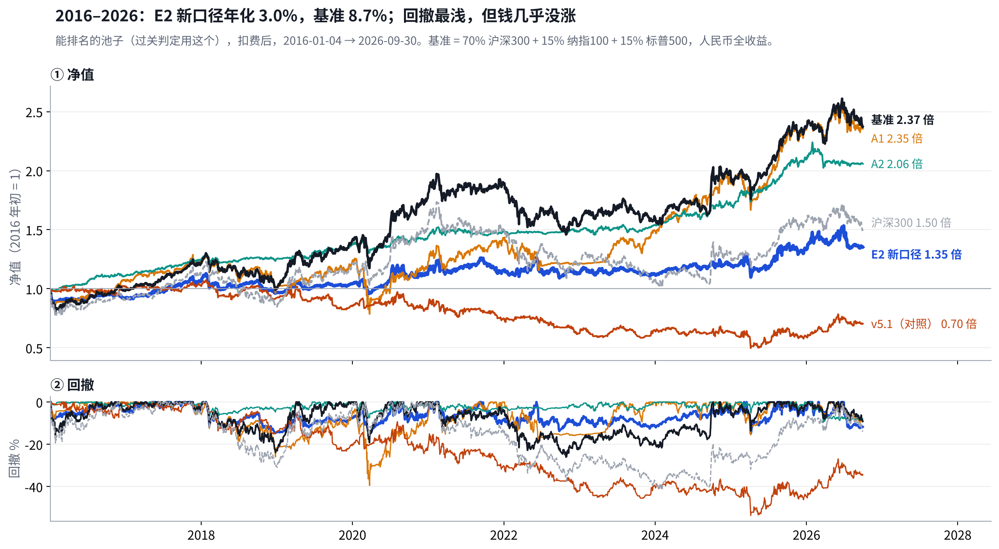
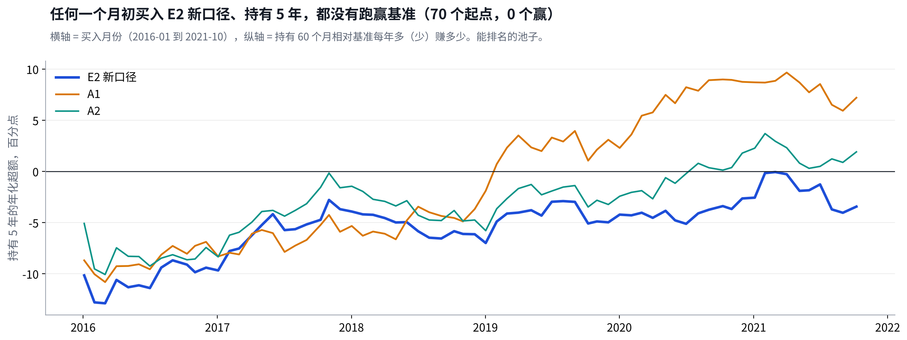
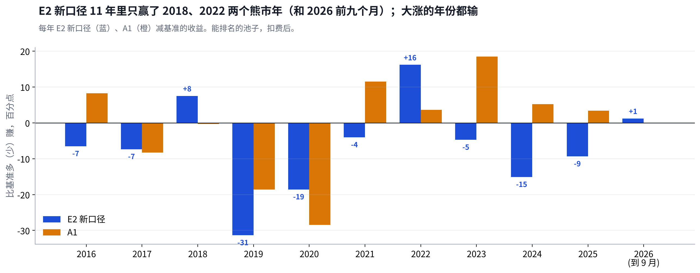
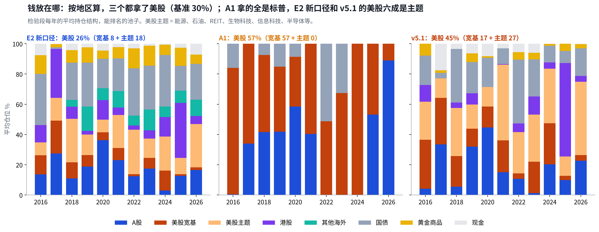
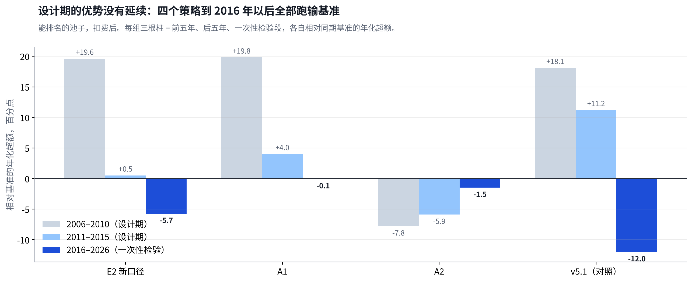

# 一次性检验报告：E2 新口径没有通过，2016 年以后十年没跑赢基准

## Metadata

- Project: ETF_Rotation_Quant
- Document type: owner（v5 一次性检验结论）
- Status: active（第 1.1 版：能买到的池子改为全部不可用；Reviewer 签收；三件事待 Owner 决定）
- Owner: L. Loric
- Maintainer: Orchestrator
- Date: 2026-11-04
- 依据：`results/v5/oneshot/`；`results/v5/LOCK`；`operations/reviews/2026-11-04-v5-oneshot-signoff.md`；D27、D34；图 `results/v5/report/charts.py`
- 页面：Claude 页面“一次性检验报告”；本文件是仓库镜像

---

**项目愿景**　在动态周期内，从多类资产里选出 Top N 强势 ETF 轮动持有，获得超额收益、稳定跑赢被动基准，同时把回撤控制住。

| 进度 | 结论 | 需要你 |
| --- | --- | --- |
| 一次性检验跑完一次，Reviewer 独立复算签收。冻结代码的设计期结果逐位复现，判据表 12 行全部一致。 | E2 新口径年化 **3.0%**，基准 **8.7%**。任何月初买入持有 5 年，**70 个起点 0 个**跑赢。判据 ① ⑥ 都不通过，没有可以上模拟盘的策略。 | **三件事**：确认按纪律关闭；批准补齐场外基金净值；定下一步怎么走。见第 8 节。 |

先认识这几个名字：E2 新口径、A1、A2、v5.1、基准、两个池子

| 问题 | 回答 |
| --- | --- |
| **E2 新口径** | 唯一入围的策略（v4 最终版）。看 1、3、6、12 个月四个回看期，只买跑赢现金的，按“涨幅 ÷ 波动”取前 N 名、各 1/N，单只跌 10% 就卖；周、月 × N = 3/5/8 六路平均。 |
| **A1 双动量** | 公开同行。每月末标普500 跑赢现金，就在标普500 和沪深300 里拿更强的一个，全仓；否则拿 10 年国债。 |
| **A2 五腿均线** | 公开同行。沪深300、标普500、恒生、10 年国债、黄金各 1/5，跌破 10 个月均线的那腿换成现金。 |
| **v5.1** | v5 最后一版，设计期没入围（别的市场检验没过）。这次只作对照，结果再好也不能入围。 |
| **基准** | 70% 沪深300 + 15% 纳指100 + 15% 标普500，全收益、人民币，每月再平衡。 |
| **两个池子** | **能排名的池子**：有指数数据就能参加，**过关判定只看它**。**能买到的池子**：只排当年真有基金能买的。 |

全部扣费后。检验段 2016-01-01 → 2026-09-30 是已污染检验段（v2 用过），只能跑一次，不能称为样本外。

## 1. 结论：入围的 E2 新口径没通过，四个策略都没跑赢基准

> **E2 新口径回撤最浅（−15%），但十年只赚了 35%，基准赚了 137%。四个策略全部跑输基准；最接近的是 A1，和基准几乎一样，回撤却深得多。**

| 能排名的池子，2016–2026 | 年化 | 最大回撤 | 年化 ÷ 回撤 | 判定 |
| --- | --- | --- | --- | --- |
| **基准** | 8.7% | −26% | 0.33 | — |
| **E2 新口径**（入围） | **3.0%** | **−15%** | 0.20 | **不通过** |
| 对照：不参加判定 | | | | |
| A1 双动量 | 8.6% | −40% | 0.22 | 和基准打平 |
| A2 五腿均线 | 7.2% | **−10%** | **0.74** | 少赚，但回撤最浅 |
| v5.1 | **−3.3%** | **−54%** | — | 亏钱 |
| 沪深300 · 标普500 · 纳指100 | 4.0% · 15.9% · 21.4% | −42% · −33% · −29% | — | 单一指数 |

能买到的池子的数字这里不列：57 只场外基金的净值只取到 2015 年底，四个策略的可交易结果都不可用（第 7 节）。

## 2. 过关：① 和 ⑥ 都没过，而且差得很远

> **这不是擦边。持有 5 年，70 个起点里一个都没赢基准，中位数每年少 4.8 个点。**

| 判据 | 要求 | E2 新口径 | 判定 |
| --- | --- | --- | --- |
| **① 稳定跑赢基准** | 持有 3 年，年化超额的中位数 > 0 | **−6.8** 个点（94 个起点） | **不通过** |
| 持有 5 年，年化超额的中位数 > 0，多数起点为正 | **−4.8** 个点；正的起点 **0 / 70** |
| **⑥ 顺应市场** | 牛市累计超额 ≥ 0 | **−78**（51 个月） | **不通过** |
| 反弹月超额的 t 值 ≥ −2（D33-3） | **−3.25**（23 个月） |
| **⑤ 尝试次数** | 按次数打折扣报告 | 115 次（v3 起累计） | ① 没过，不用再算折扣 |

| 四种行情（相对基准累计超额） | 月数 | E2 新口径 | A1 | A2 | 读法 |
| --- | --- | --- | --- | --- | --- |
| **牛市** | 51 | −78 | −30 | −101 | 三个都输，E2 输在仓位不满 |
| **回调** | 25 | +7 | 0 | +35 | E2 的离场线这十年几乎没帮上 |
| **熊市** | 30 | +66 | +87 | +98 | 都赢，靠国债和现金 |
| **反弹** | 23 | −56 | −53 | −56 | 趋势规则天生落后，三个一样 |

能排名的池子。行情按沪深300 过去 12 个月和这个月的涨跌划分。合计 = 该行情所有日子相对基准的日超额之和（百分点）。

## 3. 逐年：只赢了两个熊市年，大涨的年份都输

> **2018、2022 年跌的时候 E2 新口径多赚 7、16 个点；2019、2020 年基准涨 39%、28%，它只涨 8%、10%，两年少赚 50 个点。**

| 年份 | E2 新口径 | A1 | A2 | 基准 | 沪深300 |
| --- | --- | --- | --- | --- | --- |
| 2016 | −8.2% | 6.6% | 11.0% | −1.7% | −9.3% |
| 2017 | 15.6% | 14.7% | 12.2% | 23.0% | 24.3% |
| 2018 | **−9.0%** | −16.9% | 0.3% | −16.5% | −23.6% |
| 2019 | **7.8%** | 20.6% | 9.8% | 39.2% | 39.2% |
| 2020 | **9.9%** | 0.0% | 5.3% | 28.5% | 29.9% |
| 2021 | 1.0% | 16.6% | 2.8% | 5.1% | −3.5% |
| 2022 | **−2.4%** | −15.0% | 0.1% | −18.6% | −19.8% |
| 2023 | −0.2% | 23.1% | 3.7% | 4.6% | −9.1% |
| 2024 | **6.7%** | 27.1% | 11.6% | 21.8% | 18.2% |
| 2025 | 10.7% | 23.5% | 21.7% | 20.1% | 21.0% |
| 2026（到 9 月） | 1.7% | 0.4% | −1.6% | 0.4% | −4.1% |

能排名的池子，扣费后。绿、橙标出 E2 新口径明显赢、明显输基准的年份。

## 4. 为什么输：国债排在股票前面，剩下的钱又分得太散

> **这正是五步法在跑之前推出来的弱点（《v5 研究备忘》第 1 节）：“涨幅 ÷ 波动”让波动小的国债排到股票前面。十年里平均三成的钱在国债，2019 年风险资产只有 46%。**

① 国债挤掉了股票

2019 年沪深300 涨了 39%，但它一路小幅上涨的国债“涨幅 ÷ 波动”更高，E2 有 42% 在国债。股票越涨得猛、波动越大，在这把尺子上反而越吃亏。

② 剩下的钱分得太散

2016 年以后池子里有约 100 个容器，多数是海外和行业主题。2017 年它 98% 在风险资产，还是比基准少赚 7 个点：钱平均分在 26 个容器上，最大的一只只有 12%，没有集中在当年最强的那几个。

③ 成本

每年双边换手约 20 倍，成本每年约 2.2 个点。扣费前年化 5.2%，仍然远低于基准 8.7%，所以成本不是主因。

## 5. 设计期的优势为什么没延续：靠的是 2006–2010 那种单边大行情

> **E2 新口径设计期前五年每年多赚 19.6 个点，后五年只剩 0.5，到检验段变成每年少 5.7。这条衰减线其实在设计期就看得见。**

- **优势集中在一段行情里**：设计期的超额几乎全部来自 2006–2010 年的大牛大熊。那时候趋势一口气走到底，跟着强者走就能赚。2011 年以后趋势变短，E2 新口径就基本没有超额了。[《v4 体检报告》](v4-health-check.md)第 6 节当时已经写了“后五年刚好打平”。
- **2016 年以后，基准里的美股是主力**：沪深300 十年只有 4.0%，标普500、纳指100 有 16%、21%。基准每年再平衡，被动拿住了美股这一大段慢牛；E2 新口径要等它在排名里胜出才买，买进来又被国债分走一部分。
- **一条教训**：设计期十年里，独立的大行情只有十来次。“两段都要赢”的门槛是对的；当时 E2 新口径后五年 +0.5 就已经是警告，只是按规则它是唯一的入围者。

## 6. 对照：A1 和基准打平，A2 回撤最浅，v5.1 证明当初挡下它是对的

> **对照只用来诊断，不改判。它们说明了三件事：简单规则没有输、低回撤是可以做到的、高换手在平缓市场里一定亏。**

A1 双动量

8.6% · −40%

年化和基准打平。持有 5 年 47% 的起点赢基准，2019 年以后买入的多数赢。但 2020 年 3 月一次回撤 −40%，比基准深得多。

A2 五腿均线

7.2% · −10%

少赚 1.5 个点，但最大回撤只有基准的四成，年化 ÷ 回撤 0.74，是唯一一个明显高于基准（0.33）的。设计期它是最差的一个（年化 8.9%）。

v5.1

−3.3% · −54%

每年双边换手 66 倍、成本 6.4 个点，扣费前也只有 3.2%。和美国 ETF 上的结果一样：平缓的市场里，来回切换只是付成本。别的市场检验把它挡在外面是对的。

单一指数

美股 16–21%

这十年最大的收益来自美股慢牛；A 股（沪深300）只有 4.0%。所有策略都没能比基准更好地拿住美股这一段。

**不能事后挑**：A2 在这一段回撤最浅，但这是看过结果之后的发现。按纪律（D27-5），它只能算“设计证据”，不能直接拿来上模拟盘。

## 7. 结果靠得住吗：过关结论靠得住；能买到的池子有一处数据缺口

> **代码、判据、数据窗口都按冻结规则执行，Reviewer 独立复算一致。复查时我另外发现：57 只场外基金的净值只取到了 2015 年底，能买到的池子的结果因此全部不可用。过关只看能排名的池子，不受影响。**

| 检查 | 结果 | 判定 |
| --- | --- | --- |
| **先锁后跑** | LOCK 合入 main（0b6ac9e）之后才运行；运行入口只允许跑一次，已写 `ran.json` | **符合** |
| **运行代码和冻结代码** | 运行代码比冻结标签多了“打开 2016 年以后窗口”的开关。Reviewer 用运行代码重跑设计期，四个策略、两个池子共 8 条逐日净值和冻结结果**逐位一致** | **已证明不改规则** |
| **判据表** | Reviewer 只读净值、独立实现，12 行全部列一致；我另外重算了年化、回撤、5 年窗口、反弹 t 值，也一致 | **一致** |
| **基准** | 沪深300 全收益 2016 年 −9.3%、2019 年 +39.2%、2022 年 −19.8%；标普500 人民币 2016 年 +19%（美元 +12% 加人民币贬值），和公开数字对得上 | **核对过** |
| **能买到的池子** | 57 只场外基金的复权净值只取到 2015-12-31（场内 ETF 成交额不到 3000 万时，备选的就是它们）。中证全指 IT、可选消费、医药、金融地产 4 个容器 2016 年以后整整十年只有场外载体；标普500、纳指100、恒生也有 1–3 年。这些容器还能参加排名，但没有价格：买不进、卖不出，持仓按 0 收益卡住。E2 新口径可交易池约一半的钱卡在这些容器里（全指 IT 一只常年 12–13%） | **可交易池全部不可用** |
| **判据 ⑤ 次数** | 按冻结的写法记 115 次；v5、v5.1 的设计期账本另有 30 行没有计入。① 没过，不影响结论，账本里补记 | **登记** |
| **期望线** | D27-3 要求看结果前定稿，这一步没做。过关看的是预注册写死的 ① ⑥，不受影响 | **如实记录** |

- **数据缺口为什么不改结论**：过关只看能排名的池子，它用的是指数序列，不用场外基金净值。能买到的池子要等补完数据，作为 v6 的设计证据重算。
- **为什么 Reviewer 没发现**：它核对的是“输出和规则一致”，规则确实是“没有价格就不能买”。问题出在数据覆盖范围，不在程序。以后每次跑 2016 年以后，先查载体序列的最后日期。

## 8. 需要你定的三件事

> **我的建议：按纪律关闭，补数据，暂不急着开 v6。核心配置继续照常执行。**
#### 1：确认结论：第二阶段的轮动研究按“不成立”关闭

| 选项 | 说明 |  |
| --- | --- | --- |
| 关闭，如实记录 **建议** | E2 新口径不通过，没有模拟盘候选。记为第 3 次尝试“不成立”（第 1 次 V1 轮动、第 2 次 A 股择时）。依据：不是擦边（0/70，每年少 5.7 个点）；代码逐位复现、判据独立复算；预注册写死的规则，不能事后放宽。置信度高。 | ⭐ 建议 |
| 不关闭，换个判据再看 | 不建议。检验只能跑一次，看到结果再改判据，就是这个项目一直在防的事。 |  |

#### 2：补齐 57 只场外基金 2016 年以后的净值

| 选项 | 说明 |  |
| --- | --- | --- |
| 补数据，不重跑一次性检验 **建议** | Dev 按数据原则补数、记 SHA256。能买到的池子 2016 年以后的数字，以后在 v6 里作为“设计证据”重算（D27-5），不当作第二次一次性检验。另外要定：实盘只用场内 ETF 时，3000 万成交额的门槛按多大资金来定。 | ⭐ 建议 |
| 补完后登记重跑能买到的池子 | 可以，但要你按 LOCK 第 4 条批准登记。它不改变过关结论，价值是让能买到的池子的数字可用。 |  |

#### 3：下一步怎么走

| 选项 | 说明 |  |
| --- | --- | --- |
| 先停下来，写一页复盘，再决定要不要开 v6 **建议** | 三次尝试都没成立，说明问题可能不在参数，而在“跟着强弱轮动”这件事在这十年的中国市场上本身就难赚到超额。复盘回答：愿景里“稳定跑赢基准”和“控制回撤”，这十年哪一个更现实。A2 的低回撤和 A1 的打平都是线索，但都是看过结果之后的线索。 | ⭐ 建议 |
| 直接开 v6 | 按 D27-5：可以用 2016 年以后的历史做设计，但要过别的市场检验和至少 6 个月并行模拟，小资金起步。 |  |
| 转向期权研究 | 之前排在待办里的期权研究备忘，可以提前。 |  |

数据来源

- 结果：`results/v5/oneshot/`（运行代码 e4ccbc3，合入后为 6843df1；冻结标签 `milestone/v5-code-freeze` → 8970bcb；数据库 SHA256 167d4e39…）。
- 签收：`operations/reviews/2026-11-04-v5-oneshot-signoff.md`、附录 `…-appendix-a1-cash.md`；设计期逐位复现 `operations/reviews/diag/v51/v5-oneshot-design-bitmatch-e4ccbc3.json`。
- 图：`results/v5/report/charts.py`，只读签收结果。设计期的数字引用《v5.1 体检报告》和[《v4 体检报告》](v4-health-check.md)。

