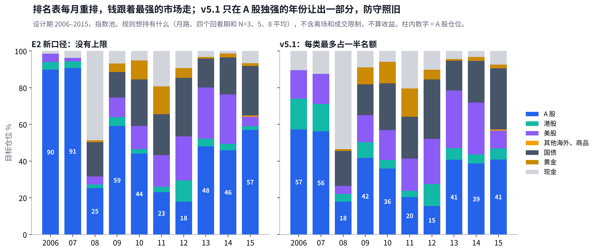

# v5 研究备忘：换了架构，没有赢过 E2 新口径

## Metadata

- Project: ETF_Rotation_Quant
- Document type: research
- Status: active（第 11.1 版；v5 原版淘汰；v5 策略讨论中，v5.1 为讨论稿）
- Owner: L. Loric
- Maintainer: Orchestrator
- Date: 2026-11-01
- 依据：Owner 2026-10-28/29 的讨论；D20；D26（10-31 Owner 同意换架构）；D27（封板条件）；`results/v4/diag/v5-evidence/evidence.json`；[《v4 体检报告》](v4-health-check.md)第 3.1 版
- 页面：Claude 页面“v5 研究备忘”；本文件是仓库镜像

---

**项目愿景**　在动态周期内，从多类资产里选出 Top N 强势 ETF 轮动持有，获得超额收益、稳定跑赢被动基准，同时把回撤控制住。

| 现状 | 结论 | 需要你 |
| --- | --- | --- |
| **原版已淘汰；v5 策略重新设计中。**第 1 节的 v5.1 是讨论稿，设计定下来之前不写预注册、不开发。 | v5 指数池年化 **12.7%**，E2 新口径 **24.9%**。原版输在结构：按类别分钱、不按强弱分钱，违背了“优中选优”。v5.1 回到 E2 的排名表，只加每类上限；预计设计期少赚，价值在品种多的年代。 | **和 Orchestrator 把 v5 策略想清楚**：排名怎么比、持几只、空位放什么、同类挤占怎么办。 |

## 1. v5 是什么：还是 E2 那张排名表，加一条“每类最多占一半”

> **现行的 v5 是修正版 v5.1：所有资产仍在一张表里比强弱，只规定同一个大类最多占一半名额。原版“两层 + 防守位”有四处结构硬伤（第 7 节），按 D30 可以改一次。下面的 v5.1 是讨论稿，设计讨论清楚之前不写定稿、不跑。**

### 策略核心：三版放在一起看（v5.1 为讨论稿）

E2 新口径（现在的唯一候选）

1. 所有容器（股票、国债、黄金）一起排名
2. 跑赢现金的才有资格，取前 N 名，每名 1/N
3. 不够 N 名，空位拿现金

防守自然发生：股票一弱，国债就排进前几名。

v5 原版（已淘汰）

1. ~~先分五个风险大类，各自判断开不开~~
2. ~~开着的类平分，每类买最强的一只~~
3. ~~五类都关掉才放国债、黄金~~

按类别分钱，不按强弱分钱；扣掉“押得少”和随机挑选没有区别。

v5.1（讨论稿）

1. 所有容器一起排名
2. 跑赢现金的才有资格，取前 N 名，每名 1/N
3. 同一个大类最多 ⌈N/2⌉ 名，被截的名额顺延给下一名
4. 不够 N 名，空位拿现金

只改一处：防止同一个市场里几乎一样的容器挤满前几名。其余和 E2 一字不差。

N 取 3、5、8，所以上限分别是 2、3、4 名。大类用 v5 已冻结的七类：A 股、港股、美股、其他海外、商品、国债、黄金。

三张卡里的“排名”是怎么排出来的

1. **每只算一个分数**：分数 = 这段时间的涨幅 ÷（每天涨跌的波动 × √天数）。意思是“涨得多、而且涨得稳”的排前面；两只涨幅一样，波动小的那只分数更高。
2. **先过门槛**：同一段时间的涨幅必须高于现金（货币基金）的收益，否则不参加排名。
3. **四张表**：回看 1、3、6、12 个月各排一张表，各管 1/4 的钱；周、月各调一次仓。
4. **不同资产用同一把尺子**：股票、国债、黄金直接比分数。因为分数除了波动，国债这种涨得慢但很稳的资产，在股市转弱时能排到第一（2012 年 5 月就是这样）。

这把尺子比的是“涨势有多可信”，不是“涨了多少”。它是 E2 能自然防守的原因，也意味着它天然偏向波动小的资产，这是 v5 讨论中的问题之一。

### 为什么要有 v5，为什么改成这样

- **问题是真的**：池子变大以后，E2 的前几名会被同一个市场里几乎一样的容器占满。14 个 A 股容器大约只等于 1.4 个独立选择；v4 的 T4 往池子里加了美股行业，前五年反而每年少赚 8.5 个百分点。名义上持有 5 只，实际只押了一个市场。
- **原版的方子错了**：它把“挑选”从全场挪到每一类内部、各类平分、防守做成开关，结果把钱给了不够强的类，违背了“优中选优”。
- **v5.1 的方子**：E2 的全部机制都留着，只限制“同一类挤占”。上限取一半，是因为：不设上限就是 E2，问题还在；上限 1 名又回到原版的“每类一个代表”；一半让最强的市场仍拿多数名额（大行情来了照样集中），但给第二强的市场留出位置。这个数在跑之前定，理由只来自结构。

### 资深研究员怎么在跑之前评估一个策略

回测只用来确认“量”有多大。方向和性格，应该在跑之前就从规则里推出来；推不出来，说明规则还没想清楚。做法分五步，都只用规则文字和信号（排名、门槛），不算任何收益，所以不消耗尝试次数。这已写进项目规矩（D30-1）。

1. **写成“钱怎么分”**：输入是排名表，输出是仓位。先看这个函数长什么样。
2. **问五问**：钱跟不跟强弱走、在哪一层挑、防守怎么进来、开关触发几次、去掉信号剩多少。
3. **数触发**：在十年的信号上数每个门槛、开关、上限各触发几次。从没触发的是空壳。
4. **画持仓**：挑几种行情里的真实日期，写出规则会持有什么，再看每年各类大概占多少。
5. **下判断**：画像违背愿景，直接否，不跑；成立才跑，跑完逐条对照画像。

| 用这五步看 | v5 原版 | v5.1 |
| --- | --- | --- |
| **钱跟不跟强弱走** | **不跟**：勉强跑赢现金的一类，和全场最强拿一样多 | **跟**：只给排名靠前的；截掉的名额给下一名 |
| **在哪一层挑** | 类内（同涨同跌，差别小） | 全场一张表 |
| **防守怎么进来** | **开关**：风险类全关才打开，十年只有 10% 的时间 | 和 E2 一样同场竞争：防守加现金平均 37%，E2 是 32% |
| **开关触发几次** | “其他海外”从没开过，商品 0.2%：五类实际三类 | 上限在 41% 的组里触发，集中在 2006–07 年（八成多）和 2015 年（近一半）；2011–12 年只有一成 |
| **判断** | **跑之前就该否** | **可以跑** 预计设计期少赚，价值在品种多、彼此相关的年代 |

“组”= 一个月度决策日 × 一个回看期 × 一个 N。原版那一列在 v5 跑之前就能写出来，只是当时没有做第 3 步。

### v5.1 的事前画像：跑之前写下，跑完逐条对照

| 那一天（3 个月回看、取前 5 名） | E2 新口径 | v5.1 |
| --- | --- | --- |
| **2007-05 大牛市** | 5 只 A 股：医药、能源、中证1000、工业、可选消费 | 前 3 只 A 股 + 标普500、纳指100 |
| **2009-03 反弹初期** | 5 只 A 股：中证1000、中证500、信息技术、材料、可选消费 | 前 3 只 A 股 + 黄金、纳指100 |
| **2011-07、2012-05 弱市** | 完全相同：A 股不多，上限不触发；2012-05 两者都是国债排第一、第二 | |
| **2015-06 急跌前夜** | 4 只 A 股 + 5 年国债 | 第 4 只 A 股换成 恒生指数 |

| 和 E2 新口径比（指数池） | 预测 | 为什么 |
| --- | --- | --- |
| **2006–07 A 股大牛市** | **明显少赚** | A 股从九成降到五成多，让出的港股、美股这两年涨得少 |
| **2008 熊市** | 相近 | 国债、黄金照常竞争，防守加现金 73% 对 69% |
| **2009 反弹** | 略少赚 | 上限在反弹初期就触发 |
| **2010–14** | 相近 | 上限很少触发 |
| **2015 急跌** | **略好** | 6 月时少一只 A 股 |
| **十年合计** | 年化低于 E2，回撤相近或略浅；**大概率进不了一次性检验** | 设计期正好是 A 股独强的十年，上限在这里吃亏 |
| **别的市场（美国上市 ETF）** | **好于或接近 E2** | 美股一类有 SPY、QQQ 和 11 只行业 ETF，高度同涨同跌，上限会经常触发，这正是它要解决的问题 |

画像只算“规则想持有什么”（月度调仓、四个回看期和 N=3、5、8 平均），不含离场和成交限制，不算收益。脚本 results/v5/diag/v51/profile.py。预测写进了 v5.1 预注册 §3.2，跑完不改。

### 为什么它能跟着市场变

> **它不预测哪个市场会涨，只是每周、每月重新问一遍：现在谁最强、谁跑赢了现金。所以钱会自己跟着走。**

上图能看到：2006–07 年九成在 A 股；2008 年国债和现金近七成；2012 年美股、国债接力；2013–14 年美股近三成；2015 年上半年又回到 A 股。这些都不是人为切换的，是五个机制共同作用的结果：

| 没有固定配置 | 跑赢现金才买 | 防守同场竞争 | 快慢四个回看期 | 10% 离场 | v5.1 新增：上限 |
| --- | --- | --- | --- | --- | --- |
| 每次调仓都重新排名，哪个市场强，名额就去哪。 | 弱的自动出局，空位拿现金。2008 年现金一度近一半。 | 股票一弱，国债、黄金的排名自然上来，不需要“判断熊市”。 | 1 个月的反应快，12 个月的稳；转折时一部分仓位先动。 | 单只从持有期高点回落 10% 就卖，不等下一次排名。 | 一个市场独强时，给第二强的市场留出位置，防止名义分散、实际单押。 |

**跟随就是滞后**：它赢在大趋势，输在急转弯。三周跌完的急跌躲不开（2015 年）；底部回场慢，2009 年反弹少赚 39 个百分点；来回震荡时会来回换（2011、2014 年）。这是跟随型策略的性格，不是缺陷；要改它，得换一类工具（例如期权保护），不是再调参数。

v5 原版是怎么设计的、同一天怎么分仓（已淘汰，留档）

E2 新口径：一张排名表

1. 所有容器（股票、国债、黄金）一起排名
2. 跑赢现金的才有资格，取前 N 名，每名 1/N
3. 不够 N 名，空位拿现金

防守是自然发生的：股票一弱，国债就排进前几名。

v5 原版：两层 + 防守位

1. 五个风险大类各自判断：有没有跑赢现金的成员
2. 跑赢的大类**平分**仓位，每类买最强的一只
3. **五类都不跑赢**时，才放国债、黄金，再不行拿现金

防守是一个开关：只有所有风险大类都转弱才打开。

### 同一天，E2 和 v5 原版怎么分仓

| 那一天 | 跑赢现金的 | E2 新口径 | v5 | 差在哪 |
| --- | --- | --- | --- | --- |
| **2007 年 5 月底** 大牛市 | 17 个全部跑赢，前 5 名都是 A 股 | A 股 **100%** | A 股医药、恒生、标普 **各 1/3** | v5 把牛市仓位平分给了涨得慢的港股、美股 |
| **2011 年 7 月底** 下跌途中 | 21 个里只有 3 个：主要消费、黄金、能源 | 三只各 20%，**现金 40%** | 主要消费 **100%** | 只要有一类在涨，v5 就全押，不留现金 |
| **2012 年 5 月底** 震荡市 | 8 个，排第一、第二的是 10 年和 5 年国债 | **国债 40%**，A 股 60% | 主要消费 **100%** | 国债排第一也买不到，因为 A 股类“开着” |

为了看得清，这里只用 3 个月回看、E2 取前 5 名；实际两者都是四个回看期、多组调仓的平均。标橙的三格就是 v5 原版输掉的原因，第 7 节用十年的持仓数据验证了它们。

第 2–9 节是 **v5 原版**（两层 + 防守位）的设计期结果和归因，留档。“v5 最终版”都指原版。

## 2. 结论：v5 原版没有赢过 E2 新口径，不入围

> **能排名的池子里 v5 年化 12.7%，连基准的 15.6% 都没跑过；只有在早年能买的很少的可交易池里，v5 比 E2 新口径好。**

| 设计期 2006–2015 | E2 新口径 | v5 最终版 | 基准 | A1 |
| --- | --- | --- | --- | --- |
| **指数池 年化** | 24.9% | **12.7%** | 15.6% | 27.0% |
| **指数池 最大回撤** | −35% | **−40%** | −66% | −43% |
| **可交易池 年化** | 8.7% | **17.4%** | 15.6% | 23.7% |
| **可交易池 最大回撤** | −32% | **−38%** | −66% | −43% |

v5 最终版 = 起点 + 10% 离场。绿、橙相对 E2 新口径。数字待 Reviewer 独立复算。

- **入围一次性检验的只有 E2 新口径。**按 D27，v5 做完就封板，不论结果。
- **可交易池的好成绩不改变结论。**它来自早年“能买的只有一两只时集中持有”。2016 年以后能买的品种多了，这个优势会消失；A1 在同样条件下仍高出 6 个百分点。

### 和随机挑比：E2 有真本事；v5 只是“少押一点的随机”

| 指数池 2006–2015 | 年化 | 最大回撤 | 年化 ÷ 回撤 | 在 2000 次随机里的位置 |
| --- | --- | --- | --- | --- |
| **随机挑 5 只、满仓**（中位数） | 20.1% | −67% | 0.30 | — |
| **E2 新口径** | 24.9% | **−35%** | **0.71** | 年化高于 96% 的随机；年化 ÷ 回撤**高于全部**随机 |
| **v5 最终版** | **12.7%** | −40% | **0.32** | 年化低于全部随机；年化 ÷ 回撤和随机的中位数差不多（高于 62%）：**没有挑选本事** |
| **基准** | 15.6% | −66% | 0.24 | 年化高于 4% 的随机 |

随机对照：每月末从当时有数据的风险容器（A 股、港股、美股等）里随机挑 5 只、等权、满仓持有一个月，重复 2000 次，不扣成本。它回答“完全不用判断，只靠这个池子能拿到多少”。设计期池子以 A 股为主，又碰上 2006–07 年大牛市，所以随机满仓也有 20%；但它扛满了 2008 年的下跌。**年化 ÷ 回撤**是每承受 1 份回撤换来多少年化，用来比较押得多和押得少的策略。E2 比随机多赚约 5 个点、回撤少一半，这个比值高于全部 2000 次随机，说明它的挑选有真本事。v5 回撤浅只是因为押得少，比值和随机的中位数差不多：去掉“少押”这层，它和闭眼挑没有区别。一个策略先要赢过随机，才谈得上和基准比；v5 在第一关就没过。脚本 results/v5/diag/memo/random_baseline.py；这是对照，不是策略候选。

## 3. 设计依据：v4 的证据，和两条推错的推论

> **v4 的四个微调都没过关；证据指向同一个方向：“该不该持有”有信号，“挑哪一只”几乎没有。**

| v4 的发现 | 关键数字 | 可信度 | 当时的推论 |
| --- | --- | --- | --- |
| **该不该持有** | 趋势向上的下个月比现金多赚 1.2%，向下的 −0.2% | **2.4 倍** | 把力气放在这一层 |
| **挑哪一只** | 打分高的，下个月只是略好一点 | **1.1–1.6 倍** | 少押注挑选 |
| **独立机会** | 14 个 A 股容器 ≈ 1.4 个独立选择 | — | 按大类分开判断 |
| **超额从哪来** | 熊市选到国债、黄金贡献 +50 | — | 设一个防守位 |
| **池子小的时候** | 可交易池 E2 8.7%，A1 23.7% | — | 能买的少时集中 |

**可信度** = 这个差别比“纯靠运气也会出现的波动”大几倍（统计上叫 t 值），2 倍以上才算比较可信。最后一列是当时从证据推出的设计方向；第 1 节的例子和第 7 节的持仓数据会看到，“按大类分开判断”和“设一个防守位”这两条推错了。

当时就有的反面证据，以及你今年 7–10 月的体感

- **集中以前试过更差**：探索阶段“把空位填满”，年化更低、回撤更深。当时判断 v5 的集中只发生在跑赢现金的大类之间，会不一样。第 7 节证明这个判断错了。
- **A1 不是全面更好**：指数池里和 E2 的差别只有运气波动的 0.4 倍；2015 年满仓扛了 −43%。
- **你的体感**：7 月全球科技一起回落，8 月美股创新高、A 股科技反弹失败。7 月时没人知道 8 月会分化。这段行情只作规则冻结后的检验案例，不用来设计。

## 4. 怎么做的：先写死规则，再跑

> **从定方向到跑出结果用了两天；规则在跑之前冻结，每一步都有独立复核。**

10-31你同意换架构（D26）、封板条件（D27）

10-31预注册草案第 1 版，写下跑之前的预判

11-01Reviewer 两轮复核，4 条必须改、14 条应改全部改完

11-01你批准四处选择（D29），预注册冻结

11-01117 个容器的大类表逐行签收

11-01代码复核时发现 v5 没用 E2 那套交易条件，修好后才开跑

11-01设计期运行：起点 → 加按波动调仓 → 加 10% 离场

账本 33 行（上限 45）。只用 2015 年以前的数据，没有算 2016 年以后的中国组合收益。标橙的一条如果没修，v5 和 E2 不在同一套交易条件下，所有比较都不成立。

## 5. 过关：两个部件各试一次，只有“10% 离场”留下；最终版没能入围

> **规则事先写死：先跑没有任何部件的 v5 基础版，再把部件一个个加上去试，过关才留下；最后拿最终版和 E2 新口径比。**
1. **v5 基础版**：只有“两层 + 防守位”，不加任何部件。
2. **加按波动调仓**：和基础版比，没过，丢掉。
3. **加 10% 离场**：还是和基础版比，过关，成为最终版。
4. **最终版对 E2**：入围条件两条都不满足。

| 版本 | 前五年 年化超额 | 后五年 年化超额 | 牛市 | 回调 | 熊市 | 反弹 | 结果 |
| --- | --- | --- | --- | --- | --- | --- | --- |
| **E2 新口径**（参照） | +19.6 | +0.5 | −2 | +27 | +95 | −54 | — |
| **v5 基础版** | −6.3 | −5.5 | −93 | +16 | +55 | −40 | 起点，只报告 |
| **基础版 + 按波动调仓** | **−7.9** | **−5.0** | **−123** | +35 | **+61** | −42 | **没过** 牛市多亏 29 |
| **基础版 + 10% 离场** | **−0.6** | **−5.0** | −92 | **+28** | +65 | −39 | **过关** = 最终版 |

指数池。**年化超额** = 相对基准每年多赚几个百分点；**四种行情** = 该行情所有月份相对基准的超额相加。部件行的绿、橙相对 v5 基础版；框 = 这个部件本来要改善的行情。**过关要四条同时满足**：前后五年都比上一版好；瞄准的行情变好；其他行情不比上一版差 10 以上；可交易池不比上一版差 2 以上。“按波动调仓”熊市确实变好了，但前五年变差、牛市多亏 29，没过。另外两个部件“小仓试错”“让赢家跑”按 D29 没有放进 v5。

| 最终版能不能入围（D29） | 要求 | 实际 |  |
| --- | --- | --- | --- |
| **(a) 收益更好** | 前后五年都赢 E2 新口径 | 前五年 −0.6 对 +19.6 | **不满足** |
| **(b) 收益差不多、回撤更浅** | 前后五年都不少于 2 个点，回撤浅 5 个点 | 前五年少 20 个点；回撤反而深近 5 个点 | **不满足** |

## 6. 哪里赢、哪里输：输在大牛市和下跌年份

> **指数池里，v5 在 2006–07 年少赚 130 个百分点，在 2008、2011、2015 年又多亏；赢的几年都是小幅。**

- **牛市**：E2 −2，v5 −92。这是最大的一块损失。
- **熊市**：E2 +95，v5 +65。v5 本来就是为“不输”设计的，结果熊市里反而躲得更少。
- **反弹**：v5 少输 15。这是 v5 唯一占优的行情，因为它弱市里仍在场内。

## 7. 为什么输：四处结构硬伤，都违背了“优中选优”

> **v5 按“类别”分钱，不按“强弱”分钱：三成风险仓位给了当天全局排名前 5 以外的品种。这是结构问题，换什么参数都改不掉。**

愿景里“选强势、跑赢现金才买”的潜台词是**优中选优**：先在所有品种里比，钱只给最强的。v5 改成了“每类里选优”：每个大类先出一个代表，再平分。一类整体不强，只要有一只勉强跑赢现金，它的代表就和全场最强的那只拿一样多的钱。下面四处硬伤都从这里来。

| 硬伤 | 规则怎么写的 | 错在哪 | 设计期的数据 | 本该怎么做 |
| --- | --- | --- | --- | --- |
| **① 挑选放错了层** | 先分五类，每类只挑最强的一只 | 强弱差别主要在**不同市场之间**；同一类的容器同涨同跌，类内挑谁差别很小。v5 留下了弱的“类内挑选”，把强的“跨类挑选”换成了平分 | 港股那份在全局排名中位**第 10**，68% 不在前 5；下个月只比现金多赚 **0.4%**，A 股那份 **2.4%** | 一张全局排名表；类别只做上限（例如每类最多 2 只），不做配额 |
| **② 门槛最松，仓位一样** | 类里**任一只**跑赢现金，这类就开；开着的类平分 | “任一只”是最松的门槛，成员越多越容易开。跑赢现金 0.1% 和 80% 拿一样的份额：强弱只用来开门，不用来分钱 | 风险持仓的得分只有当天最高分的 **54%**（中位）；**32%** 的风险仓位在全局前 5 以外 | 门槛 = 跑赢现金**且**进全局前 N；或仓位随得分递增 |
| **③ 防守是开关，不是竞争** | 风险大类**全部**关掉，才用国债、黄金 | 门槛太松，“全部关掉”很少发生。E2 让国债黄金和股票同场排名，股票一弱防守就逐步排进来，这正是 E2 回撤减半的来源；v5 把它拆掉了 | 只有 **10%** 的时间触发；防守加现金平均 **13%**，E2 是 **34%**；“去掉防守位”的检验几乎没变化 | 防守资产留在同一张排名表里，随时可以排到前面 |
| **④ 五类其实只有三类** | A 股、港股、美股、其他海外、商品 | 设计期里“其他海外”一次没开过，商品只占 0.2%。实际就是“A 股、港股、美股各三分之一”加开关。A 股和港股都是中国风险，2008 年一起跌，分散只是表面上的 | v5 平均给港股 **21%**，E2 只给 4% | 定类别前先看设计期里“真正有数据、有独立走势”的类别有几个 |

统计口径：设计期 2006–2015、指数池，每个月度决策日的四个回看期合并；“全局排名”= 当天所有跑赢现金的容器按同一个得分排。下个月收益是挑选后 21 个交易日减现金，不扣成本，只作归因，不是新策略的回测。A 股在这十年特别强，所以硬伤 ① 的代价格外大；换个年代代价会小，但方向不变：按身份分钱，就会在某个市场独强时少拿。脚本 results/v5/diag/memo/flaws.py。

### 比四条规则更根本的：研究流程上的三处错

| 病因和处方没对上 | 反面证据被我解释掉了 | 只设了结果门，没做愿景检查 |
| --- | --- | --- |
| v4 暴露的是“可交易池太小，空位拿现金代价大”，这是池子和执行的问题。v5 开的方子却改了整个组合结构，把本来没问题的指数池一起改坏了。 | 探索期“填满空位更差”已经说明强制持有伤收益。我当时用“v5 只在跑赢现金的大类之间集中”解释掉它；硬伤 ② 说明这层保护太松，等于没有。 | 预注册把过关条件写得很严，但跑之前没人问一句：这条规则会不会把钱给不够强的东西？四处硬伤都能在纸面上看出来，不需要跑回测。 |

以后每个版本跑之前，先过这五问（建议成为预注册的固定一节）

1. **钱是否跟着强弱走？**有没有可能让一个弱品种拿到和最强一样多的钱？
2. **挑选发生在哪一层？**那一层的品种之间差别大不大，独立选择有几个？
3. **防守是一直在竞争，还是到极端才打开？**
4. **每个类别、每个开关，在设计期里实际触发过几次？**从没触发的就是空壳。
5. **同结构去掉信号还剩多少？**先和随机挑选比，再和基准比。

逐年看：牛市分散了、弱市没防守（持仓图和年份表）

| 年份 | E2：A 股 | v5：A 股 | E2：国债黄金和现金 | v5：国债黄金和现金 | v5 相对 E2 |
| --- | --- | --- | --- | --- | --- |
| **2006–07 大牛市** | 86% | **40%** | 6% | 3% | 少赚 130 个点 |
| **2008 熊市** | 27% | 26% | 67% | **53%** | 多亏 11 个点 |
| **2011 弱市** | 25% | 33% | 54% | **23%** | 多亏 17 个点 |
| **2012 震荡** | 14% | 25% | 50% | **6%** | 多赚 6 个点 |

- 原因一：牛市里平分了仓位 “跑赢现金的大类平分”，2006–07 年港股、美股也在涨，A 股只分到四成。E2 是一张排名表，A 股的十几个容器挤满了前几名，几乎满仓 A 股，这十年最大的一段行情它吃满了。
- 原因二：防守的门槛太高 v5 只有在五个风险大类**全部**不跑赢现金时才放国债、黄金。五类里总有一类短期在涨，于是弱市里 v5 几乎一直满仓风险资产，只剩一类时还全押在它身上。E2 让国债、黄金和股票同场排名，股票一弱，国债就自然排进前几名。

持仓数字来自对已登记两个配置的复跑，复跑净值与登记逐日一致；脚本 results/v5/diag/memo/holdings.py。

## 8. 跑前预判对照：猜对三条，猜错三条

> **最大的错是回撤：预计更浅，实际更深。**

| 行情 | 预判（相对 E2） | 实际 |  |
| --- | --- | --- | --- |
| **2006–07 A 股大牛市** | 更差 | +61%、+72% 对 +106%、+156% | **猜对** |
| **2008 熊市** | 相近或略好 | −34% 对 −23% | **猜错** |
| **2009 反弹** | 相近 | +50% 对 +43% | **大致对** |
| **2010–13 震荡** | 略好 | 2012–13 更好，2011 年 −26% 对 −10% | **猜错** |
| **2015 急跌** | 相近 | 全年 +4% 对 +15% | **猜错** |
| **可交易池** | 明显更好 | 17.4% 对 8.7% | **猜对** |

猜错的三条都是同一个原因：防守是开关不是竞争（第 7 节硬伤 ③），下跌市里 v5 留在场内。这是设计错了，不是代码错了。

## 9. 稳健性：结论不靠运气和参数；唯一明显的改善指向“集中”

> **每一项只改一处，看结论会不会被推翻。十三项里十二项变化不到 4 个点，只有“只持最强的一类”明显更好。**

| 检验 | 在担心什么 | 怎么做 | 结果（前五年 / 后五年） |
| --- | --- | --- | --- |
| **邻近回看期** | 1、3、6、12 个月是不是刚好挑在“峰顶”，换一点就塌 | 换成稍短、更短、更长三组 | −3.5～−1.3 / −0.3～+1.6：不塌 |
| **成本加倍** | 交易费用被低估 | 所有费用 × 2 | −1.9 / −1.9 |
| **晚一天成交** | 实盘来不及在信号当天收盘下单 | 推迟一个交易日成交 | 0 / +0.6 |
| **去掉最好的 1、2、3 个** | 十年的成绩是不是靠一两个“明星”撑着，换个年代就没了 | 把十年里涨得最多的 1、2、3 个容器从池子里拿掉再跑 | −0.3～+1.7 / +0.2～+1.2：不靠明星 |
| **离场线 8%、12%** | 10% 是不是刚好最好 | 改成 8% 或 12% | −2.1～−0.9 / −0.1～+0.3 |
| **不设防守位** | 防守位到底有没有用 | 五类都不跑赢时直接拿现金 | −0.4 / +0.1：几乎没用 |
| **固定预算（A2 式）** | 平分给“跑赢的”是不是不如每类固定一份 | 五类各 1/5，没跑赢的那份放防守 | 0 / +1.2 |
| **只持最强的一类（A1 式）** | 平分是不是比集中更差 | 每个回看期只持最强的那一个大类 | **+11.4 / +7.7** |

指数池，数字是相对 v5 最终版的年化超额变化（百分点）。按预注册只报告、不改判，也不能拿来替换 v5。“不设防守位”几乎没有影响，正好印证了第 7 节硬伤 ③：防守位十年里只在 10% 的时间打开。

### 学到了什么

| 注意力是最稀缺的资源 | 为道日损：减法要减对地方 | 先为不可胜 |
| --- | --- | --- |
| 仓位就是策略的注意力。平分给所有在涨的大类，等于没有重点；只持最强的一类，前五年多 11 个点。E2 牛市满仓 A 股、A1 一次只拿一样，赢的都是这一点。 | E2 的一张排名表里，本来就藏着“防守资产和股票同场竞争”。v5 把它拆成两层，看起来更清楚，其实把这个机制减掉了。 | v5 想更“不输”，回撤反而更深。不输不靠单独设一个防守开关，而是让防守资产随时有机会排到前面。 |

这些都是封板后 v6 的线索，按 D27 走“设计证据 → 别的市场 → 并行模拟”的路径，不改 v5。

## 10. 接下来：先把 v5 策略讨论清楚，再写预注册

> **“跑前五问”已写进项目规矩（D30-1）；v5 允许一次设计修正（D30-2）。新的 v5 入围与否，跑完都封板。**
1. **讨论策略**：排名怎么比、持几只、空位放什么、同类挤占怎么办；逐条过“跑前五问”，写事前画像。
2. **预注册**：设计定下来再写定稿；Reviewer 复核、你批准后冻结。
3. **设计期和别的市场**：各跑一次，逐条对照事前画像。
4. **封板、一次性检验**：你定期望线和以哪个池子为准；入围的策略跑 2016 年以后，只跑一次。

v5.1 预注册草案（E2 + 每类上限）已入库作为讨论稿，暂不冻结。原版不再做别的市场检验（你已确认）。v5 策略讨论清楚、过完“跑前五问”之后，再写定稿预注册。

参考：封板规矩（D20、D27）、急跌和期权、结论报告的六项

- **封板**：v5 是最后一个研究版本；D30-2 允许一次设计缺陷修正（v5.1），之后只修程序错误。一次性检验只跑一次。模拟盘只上一个，12 个月不切换，看性格不只看收益。尝试次数有上限，结果按次数打折扣。
- **封板之后**：新想法记作 v6，可用全部历史设计，和在跑的策略逐项比；上线前过别的市场检验和至少 6 个月并行模拟，小资金起步。
- **急跌和期权**：三周跌完的行情趋势规则躲不开。境内期权数据大多在 2019 年以后；期权研究备忘待写，正式研究放到封板后。
- **结论报告的六项**：性格、四种行情、任意起点、优劣对照、市场和时代的变化、适应性。

