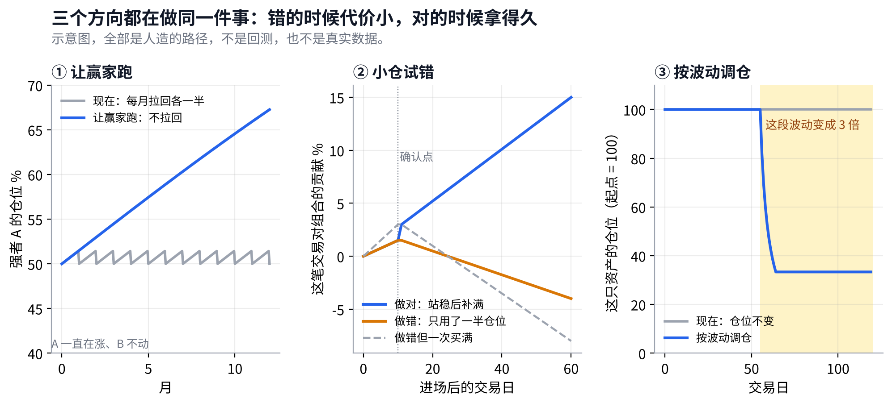

# v5 研究备忘：错的时候代价小，对的时候拿得久

## Metadata

- Project: ETF_Rotation_Quant
- Document type: research
- Status: active（第 2 版；只是研究方向，没有跑任何回测）
- Owner: L. Loric
- Maintainer: Orchestrator
- Date: 2026-10-29
- 依据：Owner 2026-10-28/29 的讨论（非对称收益、回撤的加速度、2026 年 7–10 月的经历）；D20

---

**项目愿景**　在动态周期内，从多类资产里选出 Top N 强势 ETF 轮动持有，获得超额收益、稳定跑赢被动基准，同时把回撤控制住。

| 现状 | 核心想法 | 需要你 |
| --- | --- | --- |
| v4 的预注册即将冻结。v5 等 v4 做完、一次性检验出结果之后再开始，**不影响 v4**。 | 转折点不可能提前看准，所以不追求“判断得更早”，而是让每一次试错都便宜：**胜率可以不高，但做错时亏得少，做对时拿得久**。 | **暂时不需要。**一次性检验、模拟盘和结论的安排已定（第 5 节）。 |

## 1. 从哪来：你的体感

> **滞后消除不了，只能让试错变便宜。**

- **你今年的经历**：7 月全球科技一起见顶回落；8 月美股收复失地、不断创新高，A 股科技（例如科创50）反弹失败，10 月加速下跌。你在 10 月中旬才清仓 A 股科技、换成 QDII。
- **能提前知道吗**：7 月两边一起跌的时候，没有人知道 8 月会分化。能看到分化，是 8 月以后的事。所以“7 月就该切”是事后才确定的。
- **一条绕不开的规律**：越早发现转折，误报就越多。想在山头一开始往下时就动，就一定会被很多“只是回调”骗到。
- **所以思路要换**：不是“更早判断对”，而是“早点试、试错的代价小、试对了让它跑”。这正是你从交易员那里看到的：胜率低，但止损严格，做对的动作随时间加强，靠不对称赚钱。

> **你说的“回撤是信息”**　回撤特别好看的策略一定有问题。我们要降低的是回撤的**加速度**：如果只是短期回调，损失的只是一段增长的速度，而不是整个增长；如果是下跌的开始，系统要在亏得不多的时候就已经减下来。

纪律：2026 年 7–10 月这段行情**不用来设计规则**。它是最近、印象最深的一段，拿它来调，最容易调出一个“刚好能躲过这一次”的规则。它最好的用处，是规则冻结以后作为一个检验案例：系统会在什么时候切换？比你实际操作早还是晚？

## 2. 现在的系统，哪里和这个想法不一致

> **止损和快速回场已经有了；缺的是“让做对的多赚、让试错的少亏”。**

| 你的想法 | 对应的机制 | 现在 |
| --- | --- | --- |
| 从山头往下就开始切换 | 单只从高点跌 10% 就卖，每天检查 | 已有（E2） |
| 不等大势确认，先跟上快信号 | 转折点换挡 | v4 的 T1 |
| 空出来的位置马上去试新的强者 | 空位当天补 | v4 的 T3 |
| 做对的动作随时间加强 | 让赢家跑：调仓时不把涨多的强者削回平均仓位 | 相反：每次调仓都把每只拉回 1/N，等于在削减赢家 |
| 试错用小仓位 | 小仓试错：新进的先买一半，站稳再补满 | 没有：一进来就买满 |
| 降低回撤的加速度 | 按波动调仓：某只资产波动变大，就自动减小它的仓位 | 没有：仓位不看波动 |

以前测过的 E3（整个组合波动高就整体减仓）没有通过：它对 2015 年那种两三周的急跌有效，对 2008 年持续十个月的阴跌没反应，长期收益更低。v5 的“按波动调仓”是按**每只资产自己的波动**来调，和 E3 不是一回事，但这个教训要记住。

## 3. 三个方向，每个只改一处

> **三个方向都在做同一件事：错的时候代价小，对的时候拿得久。**

#### ① · 让赢家跑

| 项目 | 内容 |
| --- | --- |
| 改的是 | **调仓日对已持有标的的处理** |
| 原规则 | ~~每次调仓都把每只拉回目标仓位（1/N）~~ |
| 新规则 | 仍在前 N 名、仍有资格的持仓，**涨多了不卖回去**；只处理新进和掉出的。单只最多涨到目标仓位的 2 倍，超过才削 |
| 说明 | 对应“做对的随时间加强”。风险：仓位集中，强者一旦急跌伤得更重（10% 离场兜底）。要定的数：上限 2 倍。 |

#### ② · 小仓试错

| 项目 | 内容 |
| --- | --- |
| 改的是 | **新进入标的的买入方式** |
| 原规则 | ~~一进来就买满目标仓位~~ |
| 新规则 | 新进的**先买一半**；20 个交易日后仍有资格、没触发离场，再补满；中途被卖出，只亏了一半 |
| 说明 | 对应“试错用小仓位”。风险：强势行情里前 20 天只吃到一半。要定的数：一半、20 天（20 天与 1 个月回看同长）。 |

#### ③ · 按波动调仓

| 项目 | 内容 |
| --- | --- |
| 改的是 | **每只持仓的仓位大小** |
| 原规则 | ~~仓位不看波动~~ |
| 新规则 | 仓位 × min(1, 这只过去 250 天的波动 ÷ 过去 20 天的波动)。**波动突然变大就自动减仓**，减下来的进现金；只减不加，不加杠杆 |
| 说明 | 对应“降低回撤的加速度”：不用判断涨跌方向。用的是已有的 20 天、250 天两个长度，不新造参数。 |

| 研究依据 | 说了什么 | 和哪个方向有关 |
| --- | --- | --- |
| **Barroso、Santa-Clara（2015）**《动量也有它的时刻》 | 按动量策略自己的近期波动调仓位，能大幅减轻动量崩溃，夏普比率明显提高 | ③ |
| **Moreira、Muir（2017）**《波动管理的组合》 | 波动高时减仓、低时加仓，多种资产上都改善了风险调整后的收益 | ③ |
| **海龟交易法**（Dennis、Eckhardt，1980 年代） | 按波动定每笔仓位的大小；先小仓进场，盈利后分批加仓；严格止损 | ②③ |
| **趋势跟踪的收益形态**（Hurst、Ooi、Pedersen 等） | 胜率常常不到一半，靠少数大赚的交易覆盖多数小亏 | ①② |

三个方向要定的数合计 3 个（①的 2 倍、②的一半和 20 天），都在写进预注册时一次定死，不试别的值。

## 4. 怎么检验，和 v4 一样

> **每个方向单独和 v4 最终版比，过关的才合进 v5 最终版。**

1. **对照**：v4 的最终版（同样的真实交易条件和数据）。
2. **该改善哪种行情**，事先写进预注册：①让赢家跑看牛市；②小仓试错看回调（来回打脸的代价变小）；③按波动调仓看熊市，同时反弹里不能明显变差。
3. **过关规则**同 v4：前后两段都比对照好；该改善的那种行情确实改善；熊市少赚不超过 10 个百分点。
4. **只用设计期**（2006–2015）。2016 年以后的数据和 2026 年这段经历，只在冻结以后作为检验和案例。
5. **全部计数**：每个方向都计入尝试次数。

## 5. 一次性检验、模拟盘和结论：已定（D20）

> **研究封板之前不看检验段；封板后所有入围策略一起检验一次；选谁上模拟盘看性格，不只看收益。**
- ✅ **已定****一次性检验推迟到研究封板**：v3、v4 现在不做，之后长出的新版本也不做；封板后所有入围策略在同一次运行里只做一次。检验段每看一次就“用掉”一点。
- ✅ **已定****模拟盘只上一个**：全部研究做完、封板之后的那一个。另外只记录基准和一条事先指定的简单规则作对照，12 个月内不切换。
- ✅ **已定****三层对照，每一版研究都做**：基准决定去留；公开同行（双动量、10 个月均线）只用来看我们的复杂有没有带来价值；单一指数只作参照。
- ✅ **已定****选上模拟盘的不一定是收益最高的**：曲线更平滑、回撤更浅、牛市不掉队、熊市和震荡能稳住小幅收益的，可以优先。

### 5.1 结论报告要讲清楚什么

| 部分 | 内容 |
| --- | --- |
| **性格** | 年化、最大回撤、回撤持续多久、曲线平滑程度、换手 |
| **四种行情** | 牛市、回调、熊市、反弹各赚了多少，是靠拿现金还是靠选标的 |
| **任意起点** | 持有 1、3、5 年，对基准、同行、单一指数的跑赢比例和最差的一次 |
| **优劣对照** | 每条策略在哪种行情里强、在哪种行情里弱，一两句话说清楚 |
| **市场和时代的变化** | 四个年代分别看；各年代的持仓主要来自哪些市场；池子变大以后策略的行为怎么变 |
| **适应性** | 去掉某一类市场（例如没有 QDII）结果变多少；换邻近的回看长度敏不敏感 |

选择时各项性格的先后顺序（例如先看最差的情况和回撤，再看收益），写进**期望说明书**，在看一次性检验结果之前定稿。这些都已写进 v4 预注册第 2.3 版 §7.3–§7.6。
