# v5 研究备忘：v5.1 中国十年最好，换个市场不成立，不入围

## Metadata

- Project: ETF_Rotation_Quant
- Document type: research
- Status: active（第 21 版；v5.1 设计期结果：不入围；封板待批准）
- Owner: L. Loric
- Maintainer: Orchestrator
- Date: 2026-11-04
- 依据：Owner 2026-10-28/29 的讨论；D20；D26（10-31 Owner 同意换架构）；D27（封板条件）；`results/v4/diag/v5-evidence/evidence.json`；[《v4 体检报告》](v4-health-check.md)第 3.1 版
- 页面：Claude 页面“v5 研究备忘”；本文件是仓库镜像

---

**项目愿景**　在动态周期内，从多类资产里选出 Top N 强势 ETF 轮动持有，获得超额收益、稳定跑赢被动基准，同时把回撤控制住。

| 现状 | 结论 | 需要你 |
| --- | --- | --- |
| **v5.1 设计期跑完，不入围。**中国十年年化 30%、回撤 −26%；美国 ETF 上只有 1.3%。下一步按 D27 封板，一次性检验只有 E2 新口径。 | v5.1 中国指数池年化 **30.1%**、可交易池 15.8%（基准 15.6%），回撤 −26%；但美国 ETF 上只有 **1.3%**。优势依赖中国的急涨急跌，换手太高是主因。 | **两件事要你批准**：按 D27 封板；一次性检验只跑 E2 新口径（写 LOCK）。见第 0 节 ⑤。 |

## 0. 设计期结果：中国十年是最好的一版，换个市场不成立，v5.1 不入围

> **中国设计期年化 30%、最深回撤 −26%，四个对照都赢了；但同一套规则放到美国 ETF 上，二十多年只有 1.3%。主要原因是换手太高：每年双边换手 43–59 倍，成本吃掉 3–6 个点，这是我事前画像里估错的地方。按跑之前写死的规则，v5.1 不入围，一次性检验只有 E2 新口径。**

### ① 入围 7 条：过了 5 条，栽在“换个市场”和“顺应市场”

| 条 | 要求 | 结果 | 判定 |
| --- | --- | --- | --- |
| **0 先赢随机** | 年化 ÷ 回撤高于随机挑选的 95 分位 | 两个池都高于全部 2000 次；同结构随机（只把挑选换成随机、仓位档位照抄）也高于 99.8% | **通过** |
| **1 跑赢基准** | 十年年化高于基准，四格不明显跑输 | 指数池 **30.1%**，可交易池 15.8%，基准 15.6% | **通过** 可交易池险过 |
| **2 不明显输给 A1** | 相对 A1 的 t 值不低于 −2 | 指数池 +0.45，可交易池 −1.03 | **通过** |
| **3 赢过更简单的版本** | 高于等权版、波动比版 | 28.5%、14.4% | **通过** |
| **4 回撤不比基准深** | 最大回撤不深于基准 | **−25.9%**，基准 −65.5% | **通过** |
| **5 别的市场也成立** | 美国 ETF 上赢随机、赢基准 | 年化 **1.3%**，基准 8.2% | **未通过** |
| **6 顺应市场** | 牛市超额 ≥ 0；反弹 t 值 ≥ −2 | 牛市 **−28**；反弹 t 值 **−2.36** | **未通过** |

第 2 条通过，所以 A1 的退路不启用；入围名单只有 E2 新口径（预注册里的代号是 B0）。这些都是跑之前写死的，看到结果以后不改。

### ② 中国十年：每一年和事前画像对得上

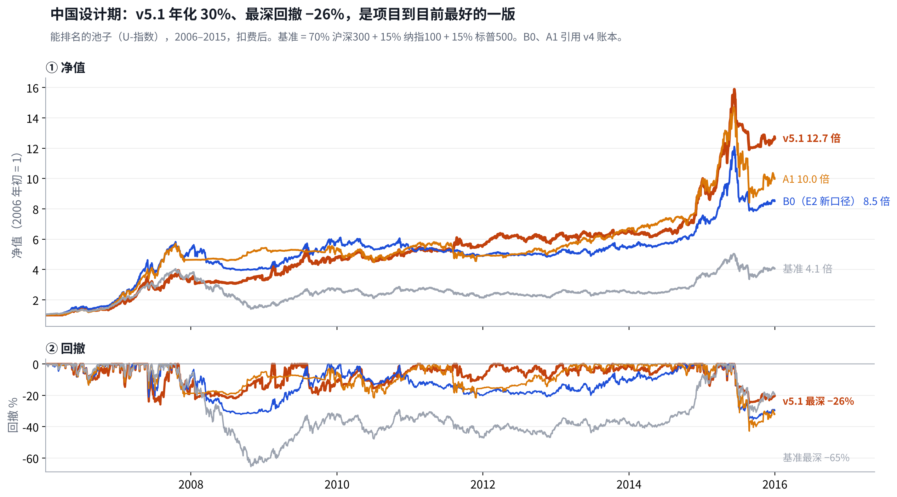

| 年份 | 事前预测（和 E2 新口径比） | v5.1 | E2 新口径 | 基准 | 对了吗 |
| --- | --- | --- | --- | --- | --- |
| **2006–07** | 少赚 | 74%、93% | 106%、156% | 83%、104% | **对** |
| **2008** | 略好 | **−1%** | −23% | −60% | **对** 好得比预想多 |
| **2009** | 少赚 | 45% | 43% | 83% | **一半** 跑输基准，但没输 E2 新口径 |
| **2010–14** | 明显多赚 | 7、8、9、8、49% | −7、−10、2、10、35% | −4、−18、12、5、45% | **对** |
| **2015** | 略好 | **30%** | 15% | 10% | **对** 好得比预想多 |
| **可交易池** | 明显好于 E2 新口径 | 15.8% | 8.7% | 15.6% | **对** |

- **转折时点都落在疼痛表里**：2007、2009、2015 年见顶后 8–27 天减到半仓；2008 年见底后 10 天回到半仓、45 天满仓。和设计时的画像完全一致。
- **稳健**：17 行稳健性里，指数池年化在 24–38% 之间；成本加倍 25.8%，只在周末减仓 28.6%，不设硬闸门 30.0%，去掉最好的 3 只仍是 30.8%。

### ③ 换到美国 ETF：扣费前就没赢，成本又吃掉近 6 个点

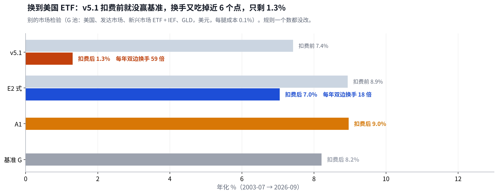

- **转折照样做得快**：2008、2020、2022 年见顶后 5–34 天减到半仓；2009、2020 年见底后 4–17 天回到半仓。规则在美国也按设计在动。
- **但美国的牛市又长又平**：回调浅，前沿在一半附近反复晃，仓位反复被减到一半。扣费前 7.4%，已经低于基准 8.2% 和 E2 式 8.9%。中国的牛市第 6 条也是同样的问题（牛市超额 −28），只是中国的大趋势和大崩盘够剧烈，快速离场的好处盖过了它。
- **所以中国十年的 30% 有相当一部分来自中国市场的特性**：急涨急跌时，快速离场、快速回场很值钱；市场平缓时，同一个机制变成了来回付成本。这正是别的市场检验要回答的问题。

### ④ 换手从哪来，以及我估错的地方

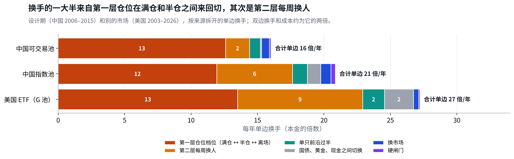

**我的错**：疼痛表写的是“震荡时每年多花约 1–2 个百分点”，实际中国 3–4 个点、美国近 6 个点。我只算了第一层档位变动的次数，没有把每次变动要换掉的仓位、和第二层每周换人的成本折算进去。画像里其实已经有这些次数（十年 187 次档位变动、176 次每周换人），是我在“跑前五问”第 4 问上停在了“数次数”，没有往下走一步“算成本”。以后的跑前评估要把触发次数直接换算成每年的换手和成本。

### ⑤ 接下来

1. **按 D27 封板**：v5 是封板前最后一个版本，不论结果都封板；v5.1 不再改。
2. **一次性检验**：入围只有 E2 新口径，在 2016–2026 已污染检验段跑一次，须你批准、写 LOCK。
3. **留给 v6 的三条**：① 第一层仓位加回差，减仓线和加仓线分开（来回切是最大的换手来源）；② 第二层少换人，比如新的必须明显更强才换；③ 跑前评估把触发次数换算成成本。v6 按 D27-5 的路径：设计证据 → 别的市场 → 至少 6 个月并行模拟 → 小资金起步。

全部结果都经 Reviewer 独立复算签收：设计期、对照、别的市场、稳健性 17 行、同结构随机、换手拆解（`results/v5.1/`）。账本 30 行，判据 ⑤ 只数可能入围的配置。

## 1. v5 要解决什么：两个池子、前后两段，都稳定跑赢基准

> **愿景说“稳定跑赢被动基准”。把它拆成四格来看：E2 新口径只赢了 1 格，最简单的 A1 四格全赢。v5 立项，就是为了补上 E2 缺的那 3 格。**

| 设计期，相对基准 每年多赚几个点 | 能排名的池子 | | 当年真能买到的池子 | | 四格 |
| --- | --- | --- | --- | --- | --- |
| 2006–10 | 2011–15 | 2006–10 | 2011–15 |
| **E2 新口径**（现在的唯一候选） | **+19.6** | +0.5 | **−12.3** | **−2.0** | **1 格** 只赢在 A 股大牛市，而且是买不到的池子 |
| **A1**（公开同行：沪深300、标普500 二选一，都不行就国债） | **+19.8** | **+4.1** | **+11.5** | **+5.1** | **4 格** 三个品种，四格全赢 |
| **v5 原版**（已淘汰） | −0.6 | **−5.0** | **+9.6** | **−5.0** | **1 格** 补上了一格，丢了另一格 |

每格 = 策略年化 − 基准年化（百分点）；基准 = 70% 沪深300 + 15% 纳指100 + 15% 标普500，两段年化 22.3%、9.4%。绿 = 跑赢 2 个点以上，橙 = 跑输。“能排名的池子”包含早年还没有基金跟踪的指数，真实交易买不到；“当年真能买到的池子”才是实盘的样子。全部是已登记的设计期结果。

### 我们是怎么走到 v5 的

1. **10-29 · 想法**：你提出把交易员的三个做法放进 v5：让赢家跑、小仓试错、按波动调仓。出发点是愿景里的“动态周期”。
2. **10-31 · v4 体检**：四个微调都没过；体检把上面那张四格表摆了出来：E2 能买到的池子跑输基准，后五年几乎没有超额，而 A1 两个池子都赢。
3. **10-31 · 换架构**：我根据 v4 的证据提议“两层 + 防守位”，你同意了。这一步出了问题。

### 原版为什么偏了：瞄准了机制，没瞄准目标

- **目标是四格，原版追的是机制。**证据说“该不该持有”比“挑哪一只”可信，我就把架构改成先按大类判断，却没有回头检查这样能不能补上那 3 格。
- **入围门槛量错了地方。**原版要入围，得在“能排名的池子”里两段都赢 E2，也就是在 E2 最强的那一格和它比；愿景要的是四格都赢基准。门槛和目标不一致，原版即使过了门槛，也不等于离愿景更近。
- **最强的线索被放在了对照栏里。**A1 只有三个品种，却四格全赢。它的三个特点：只比大市场（没有同类挤占）、跑不赢现金就整体退到国债（不留空位）、只持一只（钱全部集中）。原版一个也没有用上。

v5 的成功标准（提议第 2 版，讨论定了再写进预注册）

0. **先赢随机**：两个池子里，年化 ÷ 回撤都高于 95% 的“每月随便挑、满仓持有”（2000 次）；年化不低于随机的中位数。赢不了随机，后面都没有意义。
1. **跑赢基准**：~~四格都跑赢~~ → 十年合计在两个池子里都跑赢；四格逐一报告，任何一格都不能“明显跑输”（跑输的可信度达到 2 倍）。
2. **复杂要有回报**：~~四格合计不输 A1~~ → 两个池子都不明显输给 A1。
3. **换个市场也成立**：同一套规则在美国上市的 ETF 上（2003–2026），也要跑赢随机和基准。
4. **回撤不比基准深**。

为什么改：十年里只有十来次独立的大判断，“四格全赢”主要看运气。一个真的每年多赚 5 个点的策略，四格全赢的概率只有 40%；A1 按它自己的成绩重来一次，也只有 49%。证明见第 2 节。改完并没有放松对 E2 的判断：E2 在可交易池十年合计跑输基准 7 个点，而且明显输给 A1（可信度 2.95 倍），照样不过关。

随机对照两个池子都做了。能排名的池子：E2 的年化 ÷ 回撤高于全部 2000 次随机。当年真能买到的池子：随机挑的年化中位数 15.1%、最大回撤约 −72%（早年能买的只有一只）；E2 的年化 8.7% **低于全部随机**，年化 ÷ 回撤高于全部随机；A1 两项都高于全部随机。

### 用五步法看 E2：跑之前就能推出它会输在哪三格

> **E2 输掉的三格不是运气：一格是钱闲着，两格是押得太少。这些只看规则和信号就能推出来，不需要回测。**

| 步骤 | 做了什么 | 在 E2 上看到的 | 指向哪一格 |
| --- | --- | --- | --- |
| **① 写成“钱怎么分”** | 把规则写成：输入排名，输出仓位 | 每个名额固定 1/N（N = 3、5、8）；合格的不够 N 只，空位拿现金。**合格的越少，闲钱越多** | 可交易池两格 |
| **② 问五问** | 钱跟不跟强弱走、在哪挑、防守怎么进来 | 钱跟着强弱走、全场一起比、防守同场竞争，都对。但尺子是“涨幅 ÷ 波动”，**国债靠稳就能排到股票前面** | 后五年 |
| **③ 数触发** | 在十年的信号上数 | 可交易池 2006–10 年，每月平均只有 1–2 只“跑赢现金又能买到”，E2 有 **71%** 的钱闲着；能排名的池子只有 13% | 可交易池前五年 −12.3 |
| **④ 画持仓** | 看每年想持有什么 | 2011–15 年 E2 的风险仓位约**六成**，其余是行业分散和国债；A1 近**九成**，2010–14 年大部分时间全仓标普500 | 两个池子后五年 +0.5、−2.0 |
| **⑤ 下判断** | 不跑回测，先预言 | 可交易池前五年会大幅跑输，后五年两个池子的超额都很薄 | 和四格表一致 |

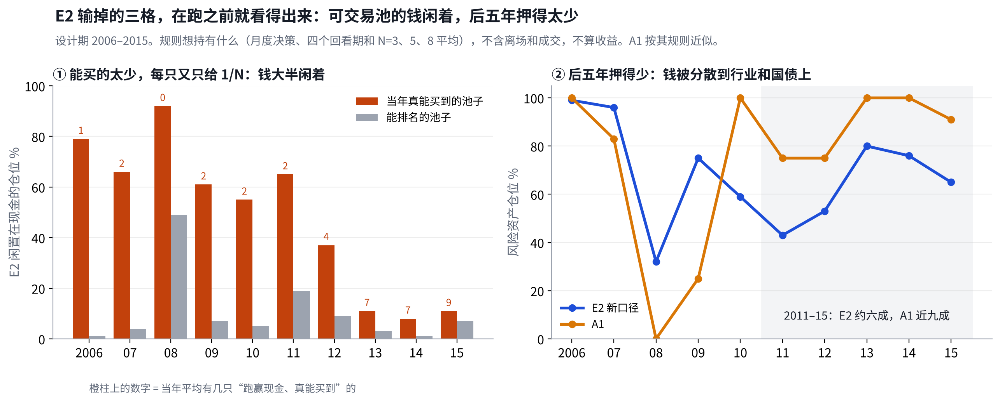

五步只用规则文字和信号（谁跑赢了现金、排第几），不算收益，不消耗尝试次数（D30-1）。图和表都是“规则想持有什么”：月度决策、四个回看期和 N 平均，不含离场和成交。脚本 results/v5/diag/design/evidence.py。

### 仓位比例从哪来：没有一个比例是人定的

备忘里出现的“防守加现金 37%”“A 股九成”这类数字，**都不是设计出来的**，是规则每月重新排名、十年平均下来的结果，作用是画出策略的样子。真正需要证明的，是“分钱的规则”本身。可选的只有三种：

| 分钱的规则 | 谁在用 | 证据 | 结论 |
| --- | --- | --- | --- |
| **每个名额固定 1/N，空位拿现金** | E2 | 合格的少时钱闲着：可交易池前五年闲置 71%，输掉两格 | **不用** |
| **合格的平分，不留空位** | A1（全仓一只） | A1 四格全赢；钱总在合格的品种上 | **采用** |
| **按得分高低加权** | — | “挑哪一只”的信号可信度只有 1.1–1.6 倍（2 倍以上才算可信），按分数加权等于把噪音放大。学术上也有结论：估计不准时，等权很难被打败（DeMiguel 等，2009） | **不用** |

### 策略核心：三版放在一起看

E2 新口径（现在的唯一候选）

1. 所有容器一起排名
2. 跑赢现金的才有资格，取前 N 名，**每名 1/N**
3. 不够 N 名，**空位拿现金**

防守自然发生：股票一弱，国债就排进前几名。

v5 原版（已淘汰）

1. ~~先分五个风险大类，各自判断开不开~~
2. ~~开着的类平分，每类买最强的一只~~
3. ~~五类都关掉才放国债、黄金~~

开着的类不论强弱都拿一份；防守是开关。

v5 设计稿第 3.2 版（定稿，第 2 节）

1. 第一层选市场：A、港、美各用宽基，在 3–250 天铺满的尺子上比整体强度，只持最强的一个
2. 两条腿各管一半仓位，见顶、见底镜像
3. 都不该持有：国债、黄金，再不行现金
4. 第二层选 ETF：选中的市场里取前 3 只

和 E2 的区别：先选市场再选 ETF；不定尺子，读尺子之间的关系；仓位分三档。

卡里的“排名”是怎么排出来的

1. **每只算一个分数**：分数 = 这段时间的涨幅 ÷（每天涨跌的波动 × √天数）。意思是“涨得多、而且涨得稳”的排前面；两只涨幅一样，波动小的那只分数更高。
2. **先过门槛**：同一段时间的涨幅必须高于现金（货币基金）的收益，否则不参加排名。
3. **四张表**：回看 1、3、6、12 个月各排一张表，各管 1/4 的钱；周、月各调一次仓。
4. **不同资产用同一把尺子**：股票、国债、黄金直接比分数。因为分数除了波动，国债这种涨得慢但很稳的资产，在股市转弱时能排到第一（2012 年 5 月就是这样）。

这把尺子比的是“涨势有多可信”，不是“涨了多少”。它是 E2 能自然防守的原因，也意味着它天然偏向波动小的资产，这是 v5 讨论中的问题之一。

### 它为什么能跟着市场变，又为什么会滞后

| 能跟着市场变，因为 | 代价是滞后，因为 |
| --- | --- |
| 没有固定配置：每月重新排名，哪个市场强，名额就去哪。E2 在 2006–07 年九成在 A 股，2008 年国债和现金近七成，2013–14 年美股近三成，都不是人为切换的 | 它只认已经发生的涨跌，不预测。底部回场慢：2009 年反弹少赚 39 个百分点 |
| 跑赢现金才买，弱的自动出局；国债黄金同场竞争，股票一弱它们就排上来 | 三周跌完的急跌躲不开（2015 年）；来回震荡时会来回换（2011、2014 年） |
| 四个回看期快慢搭配；单只回落 10% 就卖，不等下一次排名 | 要改掉滞后，得换一类工具（例如期权保护），不是再调参数 |

v5.1（E2 + 每类最多一半）为什么搁置

- **它是什么**：E2 不变，同一个大类最多占前 N 名的一半，被截的名额顺延给下一名。
- **为什么是一半**：说实话，这是我的判断，不是证据。我能讲出“不设上限有同类挤占、上限太小又压住大行情”，但证明不了一半比 40% 或 60% 好。拿不出证据的参数，按项目规矩不该进策略。
- **为什么搁置**：它不碰“空位拿现金”，补不上可交易池的两格；它也不提高后五年的风险仓位。补不上目标的改动，做了也只是又一个 v4 式的小微调。
- **更正我之前的一句话**：我写过“上限 1 名就回到原版的每类一个代表”。这不对：原版的病是开着的类不论强弱都平分，不是每类只派一个代表。冠军赛也是每类一个代表，但冠军之间还要再比，弱的冠军拿不到钱。

v5 原版是怎么设计的、同一天怎么分仓（已淘汰，留档）

E2 新口径：一张排名表

1. 所有容器（股票、国债、黄金）一起排名
2. 跑赢现金的才有资格，取前 N 名，每名 1/N
3. 不够 N 名，空位拿现金

防守是自然发生的：股票一弱，国债就排进前几名。

v5 原版：两层 + 防守位

1. 五个风险大类各自判断：有没有跑赢现金的成员
2. 跑赢的大类**平分**仓位，每类买最强的一只
3. **五类都不跑赢**时，才放国债、黄金，再不行拿现金

防守是一个开关：只有所有风险大类都转弱才打开。

### 同一天，E2 和 v5 原版怎么分仓

| 那一天 | 跑赢现金的 | E2 新口径 | v5 | 差在哪 |
| --- | --- | --- | --- | --- |
| **2007 年 5 月底** 大牛市 | 17 个全部跑赢，前 5 名都是 A 股 | A 股 **100%** | A 股医药、恒生、标普 **各 1/3** | v5 把牛市仓位平分给了涨得慢的港股、美股 |
| **2011 年 7 月底** 下跌途中 | 21 个里只有 3 个：主要消费、黄金、能源 | 三只各 20%，**现金 40%** | 主要消费 **100%** | 只要有一类在涨，v5 就全押，不留现金 |
| **2012 年 5 月底** 震荡市 | 8 个，排第一、第二的是 10 年和 5 年国债 | **国债 40%**，A 股 60% | 主要消费 **100%** | 国债排第一也买不到，因为 A 股类“开着” |

为了看得清，这里只用 3 个月回看、E2 取前 5 名；实际两者都是四个回看期、多组调仓的平均。标橙的三格就是 v5 原版输掉的原因，第 8 节用十年的持仓数据验证了它们。

## 2. v5 设计稿第 3.2 版（定稿）：两层 FOF + 读尺子的规则

> **不挑尺子，也不定“看多长”：3 天到 250 天铺满，每把尺子先跟自己比，按它最近有多响定权重，再读水平、传导前沿和长尺子放缓。见顶、见底按镜像处理，仓位分两条腿；抗噪放在决策上。画像显示：震荡来回换的问题解决了，大跌后回场快了，代价是熊市里会被反弹拉进去几次。**

### ① 从第 2 版到第 3.2 版：改了什么，为什么改

| 项目 | 第 2 版 | 第 3.2 版 | 为什么 |
| --- | --- | --- | --- |
| **尺子** | 一个动态周期（1–12 个月，按波动比伸缩） | 3–250 天铺满 28 把，不挑 | 你的判断：先定尺子再回看市场，是先射箭后画靶。铺满以后，“选哪几把”这个数就消掉了 |
| **权重** | — | 按响度自动调整 | 你的判断：牛市后段、下跌猛时看短，跌势衰竭移向长端，震荡接近平均（⑥） |
| **怎么读** | 一把尺子上的涨幅 | 水平、传导前沿、长尺子放缓 | 28 把尺子的速度只相当于 2–3 把独立的，前三个综合量解释 83–88%（下图 ①） |
| **加速度** | 逐把尺子看 | 看三个综合量和前沿怎么变 | 逐把尺子做差，噪音放大到相当于 9–10 把独立的（下图 ②） |
| **见顶、见底** | 只有“跑赢现金”的正负开关 | 两条腿各管一半，涨跌镜像 | 见顶 8/8、见底 15/18 抓到；见底时长尺子放缓区分力最强（⑤） |
| **离场** | 单只回落 10% 回宽基 | 单只按自己的前沿换；回撤面过半当天减；10% 留作硬闸门 | 只靠 10% 太被动；但十年 362 段持有里有 17 段（约 5%）在前沿过半之前就先跌到 −10%，都在急跌里，所以保留硬闸门兜底 |
| **防守** | 国债、黄金跑赢现金才持有 | 默认国债（像 A1） | 国债数据 2008 年才满一年，旧规则那年只能拿现金 |
| **抗噪** | 噪音带（只管换市场） | 保留；另加压缩和分步仓位 | 平滑越多反应越慢，这是数学上的限制，所以不在信号上再磨 |
| **动态周期（波动比）** | 规则 | **降为对照组** | 新的读法必须跑赢它和“所有尺子等权平均”两个对照，才值得多出来的复杂度 |

### ② 尺子铺满，会不会更吵

**不会。铺满多出来的是重复，不是噪音。**相邻两把尺子用的几乎是同一段数据，相关在 0.92–0.96。真正的噪音在“加速度”上：做差会把短期的抖动放大。

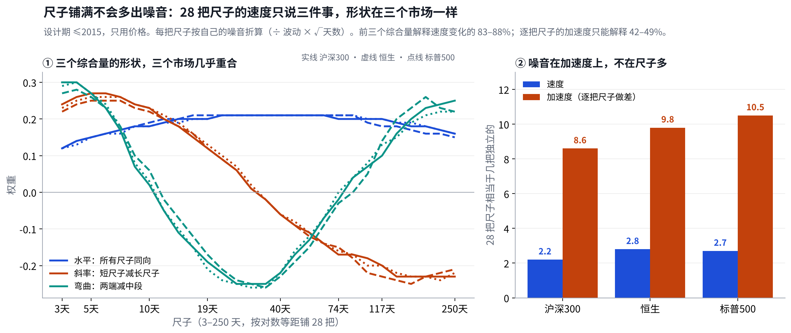

| 每天只看这几个数 | 是什么 | 对应你说的 | 形状怎么定 |
| --- | --- | --- | --- |
| **水平** | 28 把尺子的平均速度 | 速度：整体在涨还是在跌；它的变化就是加速度 | 写死，不用数据估。三个市场里数据自己估出的形状几乎一样，说明它们是数学结构 |
| **斜率** | 短尺子减长尺子 | 谁领先；在收尺子还是放尺子 | 同上 |
| **弯曲** | 两端减中段 | 中段先熄火，还是中段最响 | 同上 |
| **传导前沿** | 速度已经转负的尺子占几成 | 你说的传导、过山车 | 只数个数，不用权重 |

每把尺子先按自己的噪音折算（涨幅 ÷ 平常的日波动 × √天数），这是“跟自己比”的第一步；需要判断“高不高”的地方，一律用它在自己过去历史里的排名。利率的期限结构也是几十个期限压成水平、斜率、弯曲三个数来读（Litterman、Scheinkman 1991），我们的结构和它一样。

### ③ 传导：回调还是见顶，看转负传到了哪里

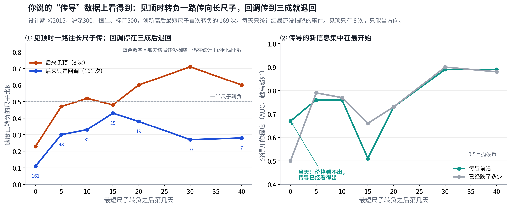

| 规则：一半以上的尺子转负，判为见顶 | 上一轮：逐把尺子看加速度 | 这次：传导前沿过半 | 判定 |
| --- | --- | --- | --- |
| **8 次见顶抓到** | 4 次 | **8 次** | **更好** 做砝码够用，做开关不够 |
| **回调被当成见顶** | 45 次 | **22 次** | 同上 |
| **报警里真是见顶的** | 8% | **27%** | 同上 |
| **报警时已经承受的回撤** | — | 约 4.5% | 见顶时中位 5 天报警；误报中位 10 天 |

- **新信息在最开始**：最短尺子刚转负的那天，价格跌了多少完全分不开见顶和回调（0.50），转负的尺子有几把已经能分开一部分（0.67）。5 天以后，前沿基本就是在反映价格已经跌了多少。
- **传导的本质是持续性**：一次下跌持续下去，自然会累积到越来越长的尺子上；马上反弹，就传不过去。学术上对应方差比检验（Lo、MacKinlay 1988）和异质市场假说（Müller 等 1997）。
- **过山车**：一波一波从短尺子出发、没到长尺子就消散的波浪。前沿反复过不了半，本身就说明是震荡，不需要单独一套规则。

事件：沪深300、恒生、标普500 在 2015 年以前创 60 天新高后，最短尺子第一次转负，共 169 次。每天只统计结局还没揭晓的事件。只有 8 次见顶，而且事件定义漏掉了 2007-10、2015-06 两个大顶；“过半”是跑之前写的，但这个数是我选的，要检验 0.4–0.6 结论变不变。

### ④ 抗噪放在决策上，不在信号上

| 办法 | 怎么做 | 会不会让反应变慢 |
| --- | --- | --- |
| **压缩** | 28 把尺子合成几个数，噪音互相抵消 | **不会**：短尺子的反应保留在斜率和前沿里 |
| **回差** | 换市场要强出一倍噪音；在两条线之间来回抖不交易 | **不会**：只在门槛附近起作用，信号本身一天不晚 |
| **分步仓位** | 满仓、一半、离场三档，不是全进全出 | **不会**：抖一下只是小幅调仓；误报的代价变小 |
| **再平滑信号** | 例如把速度再做移动平均 | **会**：误报少了，但见顶和回场都晚，**不用** |

### ⑤ 见底是见顶的镜像：逻辑对称，读的尺子不同

把见顶的传导检验原样镜像到见底：在新低附近、最短尺子刚转正时，看“转正的尺子过半”能不能分开真反转和熊市反弹。

|  | 见顶：转负过半 | 见底：转正过半 | 判定 |
| --- | --- | --- | --- |
| **真转折抓到** | 8/8 | **15/18** | **见底更好认** |
| **误报** | 22 次回调 | 18 次熊市反弹 | 同上 |
| **报警里真是转折的** | 27% | **45%** | 同上 |
| **区分力最强的信号** | 转负从短尺子传向中尺子 | **长尺子的下跌在放缓**（0.68–0.79） | 和你的 P4 一致：“从次一级尺子起，向下的加速度逐步放缓” |

第 3 版回场慢（2008 年 94 天），原因在规则不对称：离场看前沿（数尺子，快），回场要等 28 把尺子的平均转正（被长尺子拖住，慢）。第 3.1 版按镜像改，见规则第 3 条。

### ⑥ 尺子的权重：按“响度”自动调整

你的判断：牛市越往后，资金成本越高、回调越急，短尺子越重要；下跌一波比一波猛就保持看短，一波比一波弱就移向长端；震荡时接近平均。做法是**每把尺子的权重 = 它最近有多响，在自己历史上排第几**，不新增参数。

| 行情 | 权重重心（天） | 和你的描述 |
| --- | --- | --- |
| **2008 上半年第一波暴跌**（沪深300） | 19 | **对上** 下跌猛，重心在短端 |
| **2008 下半年第二波** | 21 | **对上** 下一波仍猛，保持短 |
| **2008-11 见底后三个月** | 30 | **对上** 跌势衰竭，移向长端 |
| **2015 年 3–4 月加速**（恒生） | 19 | **对上** 牛市后段，移向短端 |
| **2015 加速到见顶**（沪深300） | 33 | **没对上** 长尺子同样响 |
| **2011–13 震荡** | 20 | **偏短** 不是平均 |

等权时重心约 31 天。最关键的一个数：2008-11 见底后，等权的水平 34 天才转正（离底 +29%），响度加权 **10 天**（+19%）。响度要积累一年历史才有，2006–07 年按规则用等权；牛市后段变短这一条，要等 2003 年以前的长历史检验。

### ⑦ 规则（第 3.2 版，定稿）

每周最后一个交易日决定加仓、换市场；减仓和单只替换每天看；都在下一个交易日收盘成交

1. **量**：每个序列在 3–250 天的 28 把尺子上算速度 = 超出现金的涨幅 ÷（过去 250 天的日波动 × √天数）。权重 = 每把尺子最近一段（自己的长度）平均有多响，在自己历史上的排名；历史不足一年时等权。读出三个数：**水平**（加权平均速度）、**转负前沿**（速度为负的尺子占几成）、**长尺子放缓**（63–250 天 10 把尺子的平均速度**连续两个月**都比前一个月高）。
2. **第一层·选市场**：A 股（沪深300）、港股（恒生）、美股（标普500）里，至少一条腿成立才有资格，持水平最高的一个；另一个市场的水平要强出一倍噪音才换。
3. **两条腿，各管一半仓位**：腿一 = 宽基的转负前沿不到一半，而且这个市场的回撤面不到一半（回撤面 = 市场里有几成 ETF 的前沿已过半，至少 3 只 ETF 时才看）；腿二 = 水平大于零，或长尺子连续两个月放缓。两条都成立满仓，一条半仓，都不成立离场。每天看，只减不加：哪天一条腿失效，当天就减；加仓等周末。
4. **防守默认国债**（像 A1）：没放进风险市场的部分放 10 年国债；黄金明显更强才换黄金；国债自己在跌才拿现金。
5. **第二层·选 ETF**：选中的市场里，按水平取水平大于零、前沿不到一半的前 3 只平分；不足 3 只就平分给够格的；一只都没有就持宽基。
6. **单只替换**：持有的 ETF 自己一半以上的尺子转负，**或**从买入后高点回落 10%（硬闸门，保险），哪个先到按哪个，当天换成排名下一只；换上去的也降速、回撤面扩大，就由第 3 条接回第一层。

**新增自由度 4 个**：① 前沿门槛“一半”（尺子之间、ETF 之间、单只三处用同一个数）；② 长尺子连续两个月放缓；③ 噪音带“一倍”；④ 第二层取前 3。10% 硬闸门沿用 E2 原有的数，不算新增。结构定的数：3 天、250 天、28 把、一年历史、回撤面至少 3 只。

### ⑧ 事前画像和跑前五问：长成什么样，值不值得跑

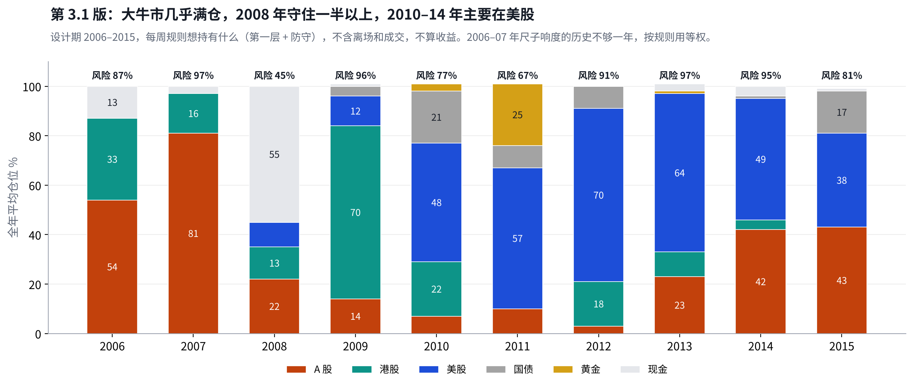

| 转折（沪深300 涨跌对照） | 第 2 版 | 第 3.1 版 | 第 3.2 版（定稿） | 判定 |
| --- | --- | --- | --- | --- |
| **2007-10 见顶，减到半仓** | 45 天，−19%（清零） | 38 天，−17%（清零） | **27 天，−15%** | **更早** |
| **2009-08 见顶，减到半仓** | 283 天（清零） | 178 天 | **8 天，−10%** | **明显更早** |
| **2015-06 见顶，风险清零** | 21 天，−27% | 21 天，−27% | **17 天，−21%** | **更早** |
| **2008-11 见底，回到半仓 / 满仓** | 10 天 / 10 天（+19%） | 10 天 / 45 天 | 10 天 / 45 天（+19% / +26%） | 和第 2 版一样快回到半仓 |
| **2008 熊市** | 风险 23% | 风险 30%，现金 70% | **风险 16%，国债 84%** | **更好** |
| **2009 年持仓** | — | 港股 70%，A 股 14% | **A 股 55%，港股 25%** | **更好** |
| **平均风险仓位** | 81% | 80% | 71% | **代价** 牛市里常被减到半仓 |
| **仓位档位变动** | — | 十年 103 次 | **十年 187 次** | **代价** 三分之二一个月内变回 |

| 跑前五问 | 第 3.2 版的回答 | 判定 |
| --- | --- | --- |
| **1. 钱是否跟着强弱走** | 市场按水平选最强的一个，ETF 按水平取前 3；两条腿只决定持多少 | **是** |
| **2. 挑选发生在哪一层** | 第一层在三个市场之间，第二层在市场内部；B（全部一起排）只做对照 | **清楚** |
| **3. 防守怎么进来** | 分步进来：一条腿失效，一半去国债；国债自己在跌才拿现金 | **不是开关** |
| **4. 每个开关触发几次** | 十年档位变动 187 次（每年 7–30 次，约三分之二一个月内变回）；当天减仓 76 次；单只离场按原因：周度换掉 176、自己的前沿 120、市场退出 40、硬闸门 17（都在急跌里）；单只持有的最大回撤最深 −15.8%；第二层平均持 2.3 只 | **开关都在动** 来回晃写进疼痛表 |
| **5. 去掉信号还剩多少** | 预注册写死对照：随机选市场、随机选 3 只，仓位档位照抄，2000 次 | **跑时报告** |

画像只算规则想持有什么，不算收益；2015 年以前的数据，记为探索，不计入判据 ⑤。2006–07 年还没有国债数据，防守只能是现金。

### ⑨ 预期疼痛表：每种行情下，事先认下的代价

冻结后不改，每次转折都对照复盘：落在范围里是正常代价；超出范围，说明策略的性格变了，要查原因。范围来自设计期画像和长历史上的 40 次熊市（标普 1955–2003，恒生、日经 1987–2015）。

| 行情 | 规则会怎么动 | 事先认下的代价 | 超出就要查 |
| --- | --- | --- | --- |
| **单边牛市** | 持有领先市场；回调时常被减到半仓 | 平均风险仓位 **70–90%**；涨得多但波动更大的市场可能排在后面（2006–07 年一到三成在港股） | 牛市里平均风险仓位低于 60% |
| **急跌**（几天内跌 10% 以上） | 前沿来不及过半，硬闸门在 −10% 卖出 | 每段持有最多亏约 **10%** 加成交滑点；急跌后马上反弹时会错过反弹 | 单只卖出时已跌超过 15% |
| **见顶、牛转熊** | 单只先换；回撤面过半当天减半；水平转负且长尺子还在恶化时清零 | 1–4 周减到半仓，此时离顶已跌 **10–20%**；2–5 周清零 | 6 周还没减到半仓，或减半时已跌超过 25% |
| **熊市中的反弹** | 长尺子要连续两个月放缓才算数 | 熊市平均风险仓位 15–30%；偶尔被拉进去半仓再打出，每次付 **2–5%** | 熊市平均风险仓位超过 40% |
| **大跌后见底** | 先回半仓，两条腿都成立才满仓 | 1–5 周回到半仓，错过底部以来 **10–25%**；满仓要 5–10 周；底部附近可能早进来一次又被打出 | 3 个月还没回到半仓 |
| **反弹月份**（大势跌、本月涨） | 趋势规则天生落后 | 相对基准的超额大概率为负，这是趋势跟踪的结构性代价 | 超额 t 值低于 −2（入围第 6 条） |
| **震荡** | 前沿在一半附近来回晃 | 每年档位变动 15–30 次，六到七成一个月内变回；每年多花约 **1–2 个百分点**成本 | 一年超过 40 次 |
| **两个市场接力** | 噪音带要强出一倍噪音才换 | 慢 1–4 周；领先不明显时会一直留在原市场 | 另一市场的水平连续 3 个月更高却没换 |

“来回晃”的根源是前沿在门槛附近摆动，治它要给门槛加回差（多一个数字），留给 v6（D33-4）。

**定稿了，进入设计期检验**：预注册 v5.1（设计稿第 3.2 版）已送 Reviewer R1，签收后冻结，Dev 实现，Reviewer 独立复算读数，然后跑设计期 2006–2015 两个池子和全部对照。长历史复核通过（判据跑前写死）：40 次熊市里见顶后减到半仓中位 10–14 天（12 个月动量 39–72 天），见底后回到半仓中位 14–38 天（104–267 天）。

设计稿第 2 版：两层 FOF + 动态周期（已被第 3 版取代，留档）

> **像 FOF 一样分两层：第一层决定钱放在 A、港、美哪个市场，还是撤到国债、黄金、现金；第二层在选中的市场里挑 ETF。看多长跟着市场的快慢伸缩，只有信号明显高于噪音才动。**

### ① 四个动作，设计期里做到了没有

| 行情 | 要做到的 | 怎么做 | 做到了吗 | 关键数字（沪深300，和 E2 式比） |
| --- | --- | --- | --- | --- |
| **单边牛市** | 赢家通吃 | 按涨幅比 A、港、美，只持最强的一个 | **做到** | 2006–07 年七到九成在 A 股；2010–14 年三到六成在美股 |
| **牛转熊** | 少痛离场 | 牛市末段波动上来，周期自动变短 | **大部分做到** | 2015 年见顶 **少跌 25 个点**；2009 年底 **少跌 12 个点**；2007 年差不多 |
| **大跌之后** | 快速回场 | 周期在市场平静前一直保持短；回场先买宽基 | **部分做到** | 2008 年底 **早 20 天**；平静中慢慢形成的底（2014 年 3 月）**晚 74 天、多错过 5 个点** |
| **震荡** | 不被来回甩 | 换市场要求强度差超过一倍噪音 | **大部分做到** | 十年换手 **153 → 92 次**，回场速度不变；震荡年份仍有每年 13–17 次 |

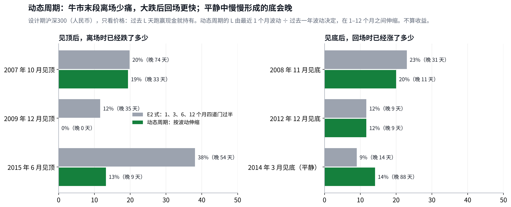

### ② 为什么震荡时换得太勤：复盘一轮完整的走势

你描述的一轮走势是：牛市里量加速度的尺子越用越短，见顶时加速度衰竭；转熊先在短尺子上向下加速，再传到长尺子；底部短尺子的加速度趋于零；反弹时长尺子在动、短尺子平稳；震荡时都稳定在一个区间里。我用 3 天到 120 天七把尺子量沪深300 的加速度，看每个阶段哪把尺子在响：

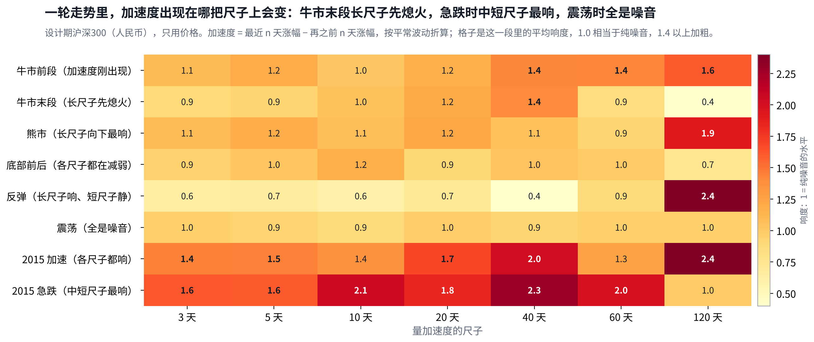

| 阶段 | 你的描述 | 数据 | 对上了吗 |
| --- | --- | --- | --- |
| **牛市末段** | 尺子越用越短，见顶时加速度衰竭 | 120 天尺子先熄火（0.4），40 天还在响（1.4） | **对上** |
| **转熊、急跌** | 先在短尺子上向下加速 | 2015 年急跌：10–60 天最响（1.8–2.3），120 天还没反应（1.0） | **对上** |
| **底部** | 短尺子的加速度趋于零 | 2008 年底各尺子都回到噪音附近（0.7–1.2） | **大致对上** |
| **反弹** | 长尺子在动，短尺子平稳 | 2009 年上半年 120 天最响（2.4），3–40 天只有 0.4–0.7 | **对上** |
| **震荡** | 稳定在一个区间 | 2011–14 年七把尺子全在 0.9–1.0，就是噪音 | **对上** |

响度 = 这一段里加速度的平均大小，按平常的波动折算；1.0 相当于纯噪音。设计期只有一轮完整的牛熊（2006–09）和一次 2015 年，样本很少。

**所以换得勤的原因很清楚：震荡时根本没有信号，规则却每周都在做决定。**设计期第一层一共换了 146 次，其中 **60%** 发生在信号还不到噪音一半的时候，**90%** 不到噪音的一倍；三分之二是在 A、港、美之间来回换“第一名”。按你说的“在更宽的频率里做更确定的选择”，加一条噪音带。

| 噪音带管什么 | 十年换几次 | 2008 年底见底后回到风险市场 | 判定 |
| --- | --- | --- | --- |
| **不加** | 153 | 10 天 | 换得太勤 |
| **换市场、进场、离场都管**（一倍噪音） | **49** | **122 天** | **不用** 回场被拖了 4 个月 |
| **只管换市场**（一倍噪音） | **92** | **10 天** | **采用** 半倍、两倍分别是 104、86 次，结论不变 |

为什么第二行不行：大跌之后，“过去一年的平常波动”里装满了暴跌，噪音被算得很大，信号很难超过它，进场就被拖住了。换市场是在两个市场之间比，不受这个影响。第三行是看到第二行的结果后改的，两次都登记了。

### ③ 规则（草案）

每周最后一个交易日决定，下一个交易日收盘成交

1. **动态周期**：每个市场各自算“最近 1 个月的波动 ÷ 过去一年的平常水平”，看它在自己历史上排第几。越剧烈，看的周期越短，最短 1 个月；越平静越长，最长 12 个月。
2. **第一层·选市场**：A 股（沪深300）、港股（恒生）、美股（标普500）各算“动态周期里的涨幅 − 同期现金”，大于零才有资格，持有最强的一个。
3. **防守**：三个市场都没资格，国债、黄金按同样的办法比，取跑赢现金的那个；都不行拿现金。
4. **噪音带**：只管换市场。另一个市场要比当前持有的强出一倍噪音（噪音 = 平常的日波动 × √周期天数）才换；进场、离场仍按“跑赢现金”的正负，不设噪音带，保住大跌后的快速回场。
5. **第二层·选 ETF**：在选中的市场里，宽基和行业、主题 ETF 一起，按同一个动态周期的涨幅排名，取前 3 只平分。
6. **回场先买宽基**：从防守或现金回到某个市场后，最初的一个动态周期内只持宽基，之后才按第 5 条挑行业。
7. **单只离场**：第二层的 ETF 从持有期高点回落 10% 就卖，钱回到这个市场的宽基。

和上一稿的区别：第 4 条由“分三批进出”改为“噪音带，只管换市场”，依据是上面的复盘和测试。新增的自由度 4 个：动态周期的伸缩方式、噪音带、第二层取前 3 只、回场先买宽基；1 个月、12 个月两端和 10% 离场沿用 E2。“一倍噪音”是统计上常用的界线（约等于一个标准误），不是照设计期挑的；要求它和半倍、两倍都有效才算数。

### ④ 每条规则的依据有多硬

| 规则 | 来自你的哪句话 | 依据有多硬 | 最大的风险 |
| --- | --- | --- | --- |
| **动态周期** | “单边时周期要变短，震荡时动态调节阀门” | **外部研究 + 设计期** Kaufman 自适应均线；Daniel、Moskowitz | 第一版失败后才改用波动，结论要打折扣 |
| **只持最强的一个市场** | “赢家通吃”“每个阶段选出胜者” | **外部研究强** 跨市场动量两百年；双动量 | 三个市场里押一个，十年只有十来次判断 |
| **噪音带** | “在更宽的频率里做更确定的选择” | **设计期诊断** 60% 的换仓发生在半倍噪音以内；半倍到两倍结果接近 | 两个市场接力时（例如 A 股转美股）会慢一两周换过去 |
| **第二层选 ETF** | “市场在分化，指数靠少数权重股带” | **结构判断** 设计期行业排名的信号偏弱（1.6 倍） | 价值主要寄望于未来更分化的市场，设计期证明不了 |
| **回场先买宽基** | “大跌之后快速回场” | **外部研究强** 动量崩溃：反弹由跌得最惨的品种领涨 | 2009 年的教训我们看过，要登记 |

### ⑤ 事前画像：第一层每年会持有什么

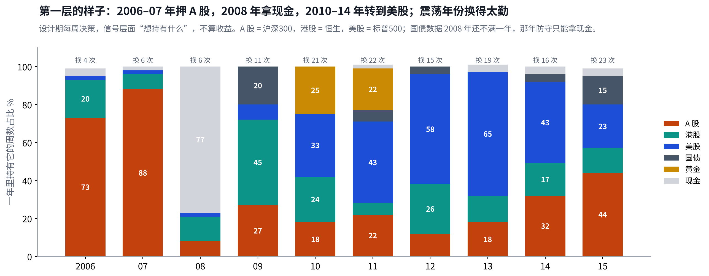

- **和 E2 比**：2006–08 年一样（押 A 股、拿现金）；2012–14 年七成以上在美股，E2 分散在 A 股行业、美股和国债里。这是最可能补上 E2 后五年短板的地方。
- **和 A1 比**：多了港股、黄金和动态周期；2009 年先回到港股（51%）和 A 股，A1 那年几乎全在国债。
- **震荡年份**：2010–11 年仍每年换 13–17 次，在港股、美股、国债之间来回，这是剩下的主要代价。

画像只算“规则想持有什么”，含噪音带，不含第二层、离场和成交，不算收益。国债数据 2008 年还不满一年，那年防守只能是现金。脚本 results/v5/diag/design/。

### ⑥ 预期疼痛表（初稿，第 3 版定稿后重写）：每种行情下，事先认下的代价

下面是根据设计期信号写下的预期，不是收益承诺。封板时冻结，之后每次转折都对照复盘：落在范围里是正常代价；超出范围，说明策略的性格变了，要查原因。

| 行情 | 规则会怎么动 | 预期代价 | 超出就要查 |
| --- | --- | --- | --- |
| **单边牛市** | 领先市场持有八成以上的周数 | 主升段前 1–2 个月还没认出领先者，少赚这一段 | 领先市场持有不到一半的周数 |
| **牛转熊** | 1–3 周内先转到别的市场，1–2 个月内全部撤到防守或现金 | 见顶后多跌 **10–20%** 才全部撤出 | 多跌超过 25%，或 3 个月还没撤完 |
| **大跌之后** | 2–4 周内回到某个风险市场，先买宽基 | 错过底部以来 **10–25%** 的涨幅；假底回场后再离场，每次付 3–5% | 2 个月还没回场，或连续三次假底 |
| **平静中慢慢起来** | 周期被拉长，回场晚 | 晚 3–6 个月，少赚 **5–15%** | 晚超过 9 个月 |
| **震荡** | 在几个市场和国债之间换 | 每年换 **8–17 次**，每次假换付 1–3% | 一年超过 20 次 |

范围来自设计期沪深300 和标普500 的信号诊断（离场、回场的天数和涨跌），只有两三次大转折，范围偏宽。别的市场检验后再收紧。

**写预注册之前还差一份证据**：美国上市 ETF 2003–2026 的数据（Grok 正在下载），在 2008、2011、2018、2020、2022 年多次转折上检验动态周期和噪音带，并用同样的办法收紧预期疼痛表。其余三项（噪音带、可交易池随机对照、预期疼痛表初稿）已经做完。

设计稿第 1 版：冠军赛（已被第 2 版取代，留档）

> **冠军赛修的是 E2 有机制原因的毛病：可交易池的钱闲着。能排名池后五年那一格，A1 是靠押中美股赢的，我们的数据分不出那是本事还是运气，所以不为它改规则。**

| 决定 | 选择 | 瞄准 | 证据 | 反面证据和代价 |
| --- | --- | --- | --- | --- |
| **① 合格的不够时** | 平分给合格的，不留空位 | 可交易池两格 | E2 闲置 71% 输掉两格；A1 从不留空位 | 探索期“把空位填满”更差，但那次是把名额给了不合格的；这次只给合格的。代价是更集中，单个市场急跌时伤得更重 |
| **② 在哪里比** | 冠军赛：每类一个冠军，冠军之间再比 | 四格 | A 股 14 个容器只相当于 1.37 个独立选择，全池约 2.35 个；类内挑选可信度 1.6 倍，比没有好 | A 股独强时 A 股最多一个名额：能排名池前五年 A 股从九成降到六成多 |
| **③ 持几只** | k = 1、2、3 三路平均 | 四格 | 独立选择约 2 个；三路平均不押单个数字，和 E2 的 N = 3、5、8 同理 | “只持最强一类”（k = 1）的结果我们已经看过，很好；正因为看过，才不单独选它 |
| **④ 防守怎么进来** | 保留 E2 的同场竞争，不改 | 先求不输 | 专门诊断：国债靠稳排到风险冠军前面时，下个月谁赚得多**没有定论**（可信度 −0.29 倍：熊市年份国债赢，牛市年份风险冠军赢）。没有证据就不改。另一种做法是像 A1 那样“风险的不合格才让国债补位”，它的依据在外部，但会让 2008、2011 年的风险仓位分别从 32%、43% 升到 44%、67% | 能排名池后五年国债仓位比 E2 更高，那一格可能补不上；按下面的分析，不为这一格改规则 |
| **⑤ 回看期、10% 离场** | 不变 | — | 四个回看期单看是 60 天最强（可信度 1.78 倍），但只挑 60 天就是照着结果选；10% 离场在 8–15% 是一片平台 | 20 天的开关每年切换约 5 次，来回换的成本还在 |

本节新做了三个诊断，都只用 2015 年以前的数据，计入尝试次数：各回看期“跑赢现金”信号的强弱；国债排到风险冠军前面时下个月谁赚得多；领头大市场下个月是否继续领先。画像只用信号，不算收益。脚本 results/v5/diag/design/。

### 事前画像

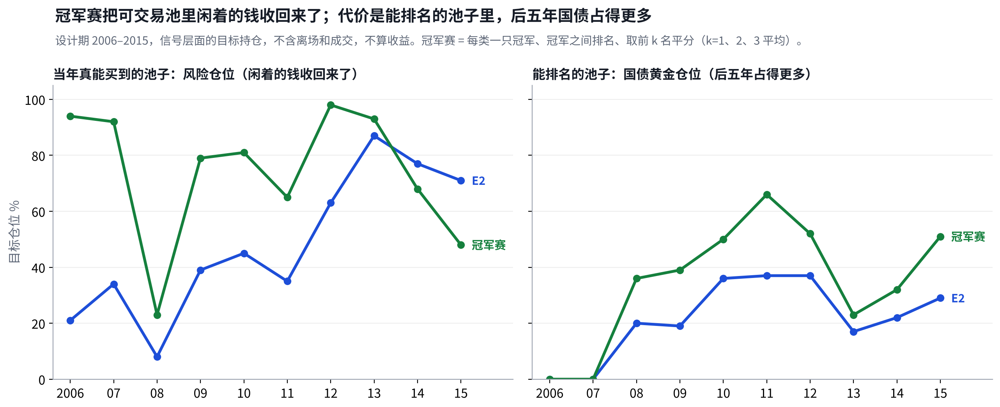

| 四格 | E2 新口径 | 冠军赛预计 | 为什么 |
| --- | --- | --- | --- |
| **能排名的池子 2006–10** | +19.6 | 略低 | A 股独强时最多一个名额，A 股从九成降到六成多 |
| **能排名的池子 2011–15** | +0.5 | **补不上，可能更差** | 风险仓位 55%（E2 64%），国债占了名额 |
| **真能买到的池子 2006–10** | −12.3 | **明显改善** | 闲置的钱从 71% 降到 26% |
| **真能买到的池子 2011–15** | −2.0 | **改善** | 闲置的钱从 26% 降到 8%，风险仓位 74%（E2 67%） |

### 押最强的大市场：是机制，但我们的数据证明不了

A1 赢下“能排名池后五年”那一格，靠的是 2010–14 年几乎全仓标普500。要不要为这一格改规则，先要回答：“押最强的大市场”是能事先写成规则的机制，还是那几年美股恰好最强？跑之前我先写下判定：领头市场下个月跑赢三个市场的平均，可信度到 2 倍、前后两段都为正、去掉最好的一段仍为正，才算机制。

| 按过去多久选领头市场 | 十年里几段领先期 | 下月多赚（月均） | 可信度 | 去掉最好一段后 | 判定 |
| --- | --- | --- | --- | --- | --- |
| **3 个月** | 39 | 0.67% | 1.36 倍 | 0.04% | **分不开** |
| **6 个月** | 26 | 0.84% | 1.78 倍 | 0.05% | **分不开** |
| **12 个月（A1 用的）** | 12 | 0.88% | 1.83 倍 | 0.20% | **分不开** |

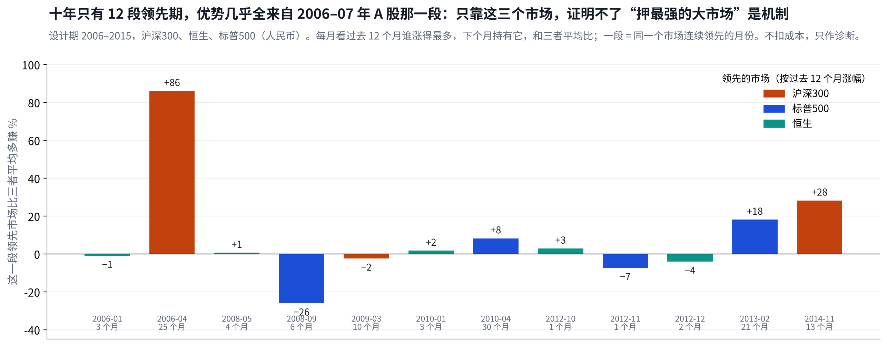

- **我们的数据里只有三个大市场**：2006 年以前就有数据的只有 A 股、港股、美股。十年按 12 个月选只有 12 段领先期，优势几乎全来自 2006–07 年 A 股那一段。A1 在 2010–14 年押美股，本质上是一次判断，从它自己的成绩看不出是本事还是运气。
- **外部证据说这是真机制**：在几十个国家的股指、债券、外汇、商品里，过去一年涨得多的接下来继续强，这在学术研究里反复出现（Asness、Moskowitz、Pedersen 2013）；有人把多资产动量的历史拉到 200 多年，各类资产里都成立，但也有持续几十年表现不好的时期（Geczy、Samonov）。A1 的原型双动量，在发表前的 1950–73 年和发表后的 2012–18 年都表现不错。
- **结论**：机制是真的，但只在三个市场之间押，宽度太小，十年的结果主要看那一两次判断。要验证它，得靠更多市场，也就是别的市场检验（美国上市 ETF 有二十多个国家和行业），不能靠中国这十年。

### 这对成功标准意味着什么：四格全赢主要看运气

按设计期的实际波动做模拟：假设一个策略真的比基准每年多赚若干个点，重来很多次，看它多大概率四格全赢。

| 策略真实的超额（每年） | 四格全赢的概率 | 十年合计两个池子都赢的概率 |
| --- | --- | --- |
| **+3 个点** | **28%** | 59% |
| **+5 个点** | **40%** | 73% |
| **+8 个点** | 60% | **88%** |
| **A1 按它自己的成绩** | **49%** | — |

模拟用 E2 新口径在两个池子的月度超额波动和相关性（跟踪误差每年约 16–19 个点），每次重来 120 个月。十年里，E2 相对基准的超额可信度是 1.29 倍，A1 是 1.2 倍（能排名池）、0.78 倍（可交易池），都不到 2 倍。E2 和 A1 在能排名池里的差距是 −1.7 个点，可信度只有 0.36 倍，等于分不出高低；可交易池差 13.9 个点，可信度 2.95 倍，是真差距，原因就是钱闲着。

所以“四格全赢”这道门槛会把四成真正好的策略误判成失败，A1 自己也只有一半的机会通过。门槛应该设在**证据够得着的地方**：十年合计、两个池子都要赢；任何一格不能明显跑输；再加随机对照和别的市场两份更宽的证据。改动见第 1 节的成功标准。

**我的判断**：冠军赛修的是一个有机制、有证据的毛病（可交易池的钱闲着，E2 因此明显输给 A1），这是 v5 该做的事。能排名池后五年那一格，不为它改规则：本地数据分不出 A1 是本事还是运气，改了就是照着答案出题。冠军赛在新标准下有机会通过；要证明它，还缺两份证据：可交易池的随机对照，和美国上市 ETF 的别的市场检验。成功标准定下来以后，我再写预注册。

第 3–10 节是 **v5 原版**（两层 + 防守位）的设计期结果和归因，留档。“v5 最终版”都指原版。

## 3. 结论：v5 原版没有赢过 E2 新口径，不入围

> **能排名的池子里 v5 年化 12.7%，连基准的 15.6% 都没跑过；只有在早年能买的很少的可交易池里，v5 比 E2 新口径好。**

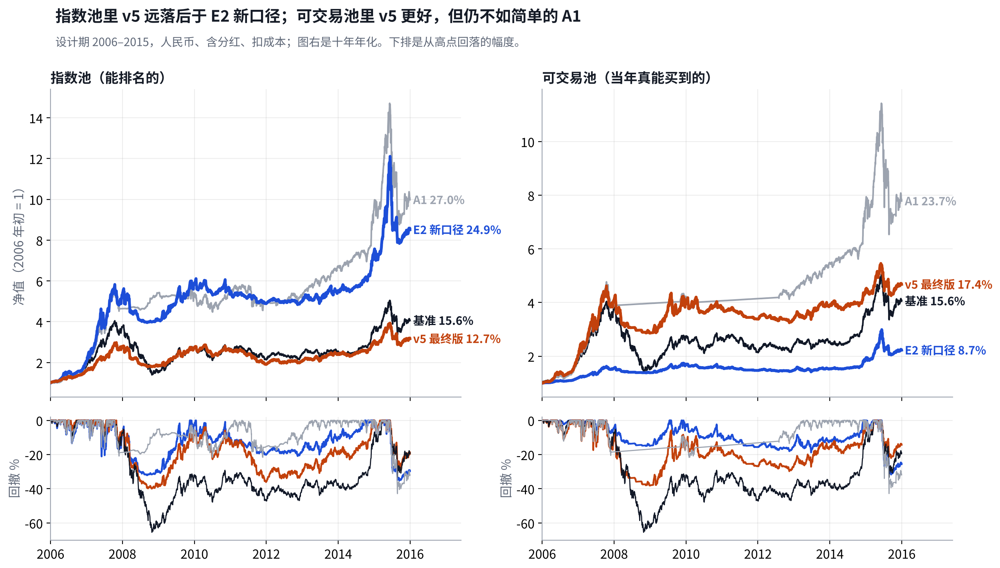

| 设计期 2006–2015 | E2 新口径 | v5 最终版 | 基准 | A1 |
| --- | --- | --- | --- | --- |
| **指数池 年化** | 24.9% | **12.7%** | 15.6% | 27.0% |
| **指数池 最大回撤** | −35% | **−40%** | −66% | −43% |
| **可交易池 年化** | 8.7% | **17.4%** | 15.6% | 23.7% |
| **可交易池 最大回撤** | −32% | **−38%** | −66% | −43% |

v5 最终版 = 起点 + 10% 离场。绿、橙相对 E2 新口径。数字待 Reviewer 独立复算。

- **入围一次性检验的只有 E2 新口径。**按 D27，v5 做完就封板，不论结果。
- **可交易池的好成绩不改变结论。**它来自早年“能买的只有一两只时集中持有”。2016 年以后能买的品种多了，这个优势会消失；A1 在同样条件下仍高出 6 个百分点。

### 和随机挑比：E2 有真本事；v5 只是“少押一点的随机”

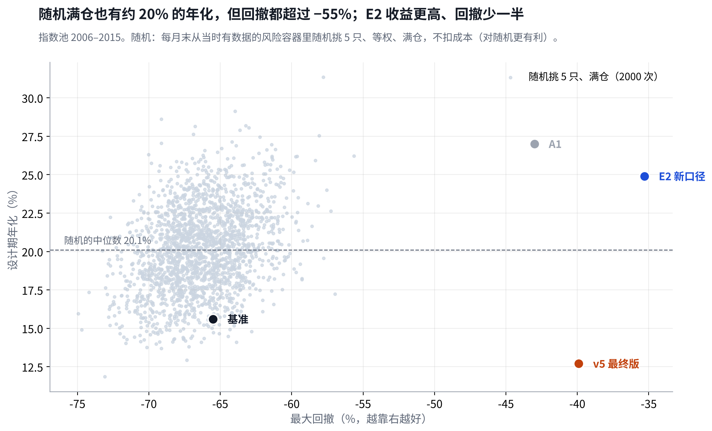

| 指数池 2006–2015 | 年化 | 最大回撤 | 年化 ÷ 回撤 | 在 2000 次随机里的位置 |
| --- | --- | --- | --- | --- |
| **随机挑 5 只、满仓**（中位数） | 20.1% | −67% | 0.30 | — |
| **E2 新口径** | 24.9% | **−35%** | **0.71** | 年化高于 96% 的随机；年化 ÷ 回撤**高于全部**随机 |
| **v5 最终版** | **12.7%** | −40% | **0.32** | 年化低于全部随机；年化 ÷ 回撤和随机的中位数差不多（高于 62%）：**没有挑选本事** |
| **基准** | 15.6% | −66% | 0.24 | 年化高于 4% 的随机 |

随机对照：每月末从当时有数据的风险容器（A 股、港股、美股等）里随机挑 5 只、等权、满仓持有一个月，重复 2000 次，不扣成本。它回答“完全不用判断，只靠这个池子能拿到多少”。设计期池子以 A 股为主，又碰上 2006–07 年大牛市，所以随机满仓也有 20%；但它扛满了 2008 年的下跌。**年化 ÷ 回撤**是每承受 1 份回撤换来多少年化，用来比较押得多和押得少的策略。E2 比随机多赚约 5 个点、回撤少一半，这个比值高于全部 2000 次随机，说明它的挑选有真本事。v5 回撤浅只是因为押得少，比值和随机的中位数差不多：去掉“少押”这层，它和闭眼挑没有区别。一个策略先要赢过随机，才谈得上和基准比；v5 在第一关就没过。脚本 results/v5/diag/memo/random_baseline.py；这是对照，不是策略候选。

## 4. 设计依据：v4 的证据，和两条推错的推论

> **v4 的四个微调都没过关；证据指向同一个方向：“该不该持有”有信号，“挑哪一只”几乎没有。**

| v4 的发现 | 关键数字 | 可信度 | 当时的推论 |
| --- | --- | --- | --- |
| **该不该持有** | 趋势向上的下个月比现金多赚 1.2%，向下的 −0.2% | **2.4 倍** | 把力气放在这一层 |
| **挑哪一只** | 打分高的，下个月只是略好一点 | **1.1–1.6 倍** | 少押注挑选 |
| **独立机会** | 14 个 A 股容器 ≈ 1.4 个独立选择 | — | 按大类分开判断 |
| **超额从哪来** | 熊市选到国债、黄金贡献 +50 | — | 设一个防守位 |
| **池子小的时候** | 可交易池 E2 8.7%，A1 23.7% | — | 能买的少时集中 |

**可信度** = 这个差别比“纯靠运气也会出现的波动”大几倍（统计上叫 t 值），2 倍以上才算比较可信。最后一列是当时从证据推出的设计方向；第 1 节折叠区的例子和第 8 节的持仓数据会看到，“按大类分开判断”和“设一个防守位”这两条推错了。

当时就有的反面证据，以及你今年 7–10 月的体感

- **集中以前试过更差**：探索阶段“把空位填满”，年化更低、回撤更深。当时判断 v5 的集中只发生在跑赢现金的大类之间，会不一样。第 8 节证明这个判断错了。
- **A1 不是全面更好**：指数池里和 E2 的差别只有运气波动的 0.4 倍；2015 年满仓扛了 −43%。
- **你的体感**：7 月全球科技一起回落，8 月美股创新高、A 股科技反弹失败。7 月时没人知道 8 月会分化。这段行情只作规则冻结后的检验案例，不用来设计。

## 5. 怎么做的：先写死规则，再跑

> **从定方向到跑出结果用了两天；规则在跑之前冻结，每一步都有独立复核。**

10-31你同意换架构（D26）、封板条件（D27）

10-31预注册草案第 1 版，写下跑之前的预判

11-01Reviewer 两轮复核，4 条必须改、14 条应改全部改完

11-01你批准四处选择（D29），预注册冻结

11-01117 个容器的大类表逐行签收

11-01代码复核时发现 v5 没用 E2 那套交易条件，修好后才开跑

11-01设计期运行：起点 → 加按波动调仓 → 加 10% 离场

账本 33 行（上限 45）。只用 2015 年以前的数据，没有算 2016 年以后的中国组合收益。标橙的一条如果没修，v5 和 E2 不在同一套交易条件下，所有比较都不成立。

## 6. 过关：两个部件各试一次，只有“10% 离场”留下；最终版没能入围

> **规则事先写死：先跑没有任何部件的 v5 基础版，再把部件一个个加上去试，过关才留下；最后拿最终版和 E2 新口径比。**
1. **v5 基础版**：只有“两层 + 防守位”，不加任何部件。
2. **加按波动调仓**：和基础版比，没过，丢掉。
3. **加 10% 离场**：还是和基础版比，过关，成为最终版。
4. **最终版对 E2**：入围条件两条都不满足。

| 版本 | 前五年 年化超额 | 后五年 年化超额 | 牛市 | 回调 | 熊市 | 反弹 | 结果 |
| --- | --- | --- | --- | --- | --- | --- | --- |
| **E2 新口径**（参照） | +19.6 | +0.5 | −2 | +27 | +95 | −54 | — |
| **v5 基础版** | −6.3 | −5.5 | −93 | +16 | +55 | −40 | 起点，只报告 |
| **基础版 + 按波动调仓** | **−7.9** | **−5.0** | **−123** | +35 | **+61** | −42 | **没过** 牛市多亏 29 |
| **基础版 + 10% 离场** | **−0.6** | **−5.0** | −92 | **+28** | +65 | −39 | **过关** = 最终版 |

指数池。**年化超额** = 相对基准每年多赚几个百分点；**四种行情** = 该行情所有月份相对基准的超额相加。部件行的绿、橙相对 v5 基础版；框 = 这个部件本来要改善的行情。**过关要四条同时满足**：前后五年都比上一版好；瞄准的行情变好；其他行情不比上一版差 10 以上；可交易池不比上一版差 2 以上。“按波动调仓”熊市确实变好了，但前五年变差、牛市多亏 29，没过。另外两个部件“小仓试错”“让赢家跑”按 D29 没有放进 v5。

| 最终版能不能入围（D29） | 要求 | 实际 |  |
| --- | --- | --- | --- |
| **(a) 收益更好** | 前后五年都赢 E2 新口径 | 前五年 −0.6 对 +19.6 | **不满足** |
| **(b) 收益差不多、回撤更浅** | 前后五年都不少于 2 个点，回撤浅 5 个点 | 前五年少 20 个点；回撤反而深近 5 个点 | **不满足** |

## 7. 哪里赢、哪里输：输在大牛市和下跌年份

> **指数池里，v5 在 2006–07 年少赚 130 个百分点，在 2008、2011、2015 年又多亏；赢的几年都是小幅。**

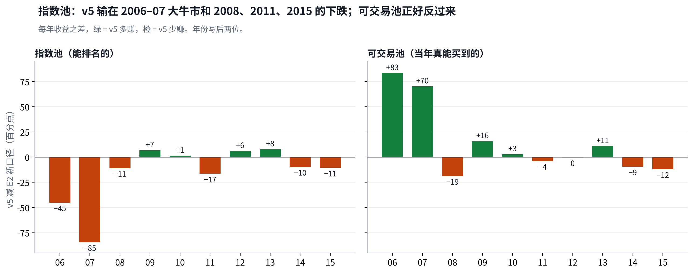

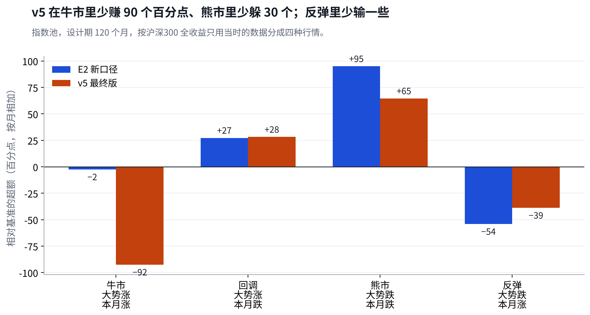

- **牛市**：E2 −2，v5 −92。这是最大的一块损失。
- **熊市**：E2 +95，v5 +65。v5 本来就是为“不输”设计的，结果熊市里反而躲得更少。
- **反弹**：v5 少输 15。这是 v5 唯一占优的行情，因为它弱市里仍在场内。

## 8. 为什么输：四处结构硬伤，都违背了“优中选优”

> **v5 按“类别”分钱，不按“强弱”分钱：三成风险仓位给了当天全局排名前 5 以外的品种。这是结构问题，换什么参数都改不掉。**

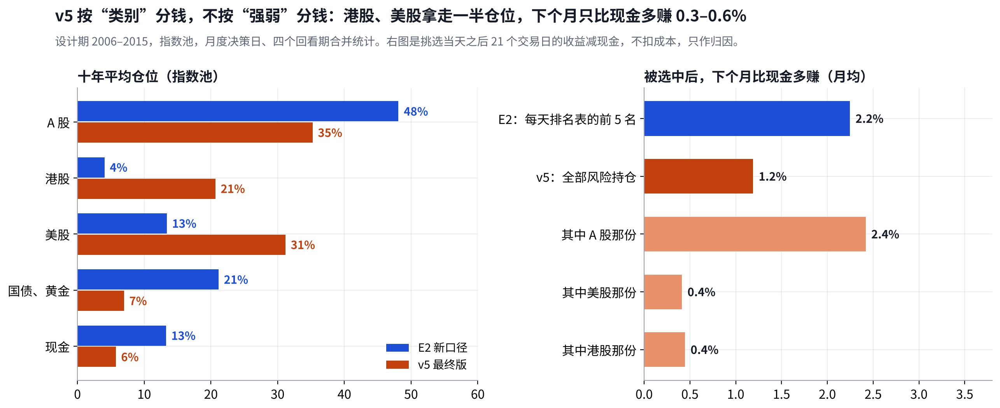

愿景里“选强势、跑赢现金才买”的潜台词是**优中选优**：先在所有品种里比，钱只给最强的。v5 改成了“每类里选优”：每个大类先出一个代表，再平分。一类整体不强，只要有一只勉强跑赢现金，它的代表就和全场最强的那只拿一样多的钱。下面四处硬伤都从这里来。

| 硬伤 | 规则怎么写的 | 错在哪 | 设计期的数据 | 本该怎么做 |
| --- | --- | --- | --- | --- |
| **① 挑选放错了层** | 先分五类，每类只挑最强的一只 | 强弱差别主要在**不同市场之间**；同一类的容器同涨同跌，类内挑谁差别很小。v5 留下了弱的“类内挑选”，把强的“跨类挑选”换成了平分 | 港股那份在全局排名中位**第 10**，68% 不在前 5；下个月只比现金多赚 **0.4%**，A 股那份 **2.4%** | 一张全局排名表；类别只做上限（例如每类最多 2 只），不做配额 |
| **② 门槛最松，仓位一样** | 类里**任一只**跑赢现金，这类就开；开着的类平分 | “任一只”是最松的门槛，成员越多越容易开。跑赢现金 0.1% 和 80% 拿一样的份额：强弱只用来开门，不用来分钱 | 风险持仓的得分只有当天最高分的 **54%**（中位）；**32%** 的风险仓位在全局前 5 以外 | 门槛 = 跑赢现金**且**进全局前 N；或仓位随得分递增 |
| **③ 防守是开关，不是竞争** | 风险大类**全部**关掉，才用国债、黄金 | 门槛太松，“全部关掉”很少发生。E2 让国债黄金和股票同场排名，股票一弱防守就逐步排进来，这正是 E2 回撤减半的来源；v5 把它拆掉了 | 只有 **10%** 的时间触发；防守加现金平均 **13%**，E2 是 **34%**；“去掉防守位”的检验几乎没变化 | 防守资产留在同一张排名表里，随时可以排到前面 |
| **④ 五类其实只有三类** | A 股、港股、美股、其他海外、商品 | 设计期里“其他海外”一次没开过，商品只占 0.2%。实际就是“A 股、港股、美股各三分之一”加开关。A 股和港股都是中国风险，2008 年一起跌，分散只是表面上的 | v5 平均给港股 **21%**，E2 只给 4% | 定类别前先看设计期里“真正有数据、有独立走势”的类别有几个 |

统计口径：设计期 2006–2015、指数池，每个月度决策日的四个回看期合并；“全局排名”= 当天所有跑赢现金的容器按同一个得分排。下个月收益是挑选后 21 个交易日减现金，不扣成本，只作归因，不是新策略的回测。A 股在这十年特别强，所以硬伤 ① 的代价格外大；换个年代代价会小，但方向不变：按身份分钱，就会在某个市场独强时少拿。脚本 results/v5/diag/memo/flaws.py。

### 比四条规则更根本的：研究流程上的三处错

| 病因和处方没对上 | 反面证据被我解释掉了 | 只设了结果门，没做愿景检查 |
| --- | --- | --- |
| v4 暴露的是“可交易池太小，空位拿现金代价大”，这是池子和执行的问题。v5 开的方子却改了整个组合结构，把本来没问题的指数池一起改坏了。 | 探索期“填满空位更差”已经说明强制持有伤收益。我当时用“v5 只在跑赢现金的大类之间集中”解释掉它；硬伤 ② 说明这层保护太松，等于没有。 | 预注册把过关条件写得很严，但跑之前没人问一句：这条规则会不会把钱给不够强的东西？四处硬伤都能在纸面上看出来，不需要跑回测。 |

以后每个版本跑之前，先过这五问（建议成为预注册的固定一节）

1. **钱是否跟着强弱走？**有没有可能让一个弱品种拿到和最强一样多的钱？
2. **挑选发生在哪一层？**那一层的品种之间差别大不大，独立选择有几个？
3. **防守是一直在竞争，还是到极端才打开？**
4. **每个类别、每个开关，在设计期里实际触发过几次？**从没触发的就是空壳。
5. **同结构去掉信号还剩多少？**先和随机挑选比，再和基准比。

逐年看：牛市分散了、弱市没防守（持仓图和年份表）

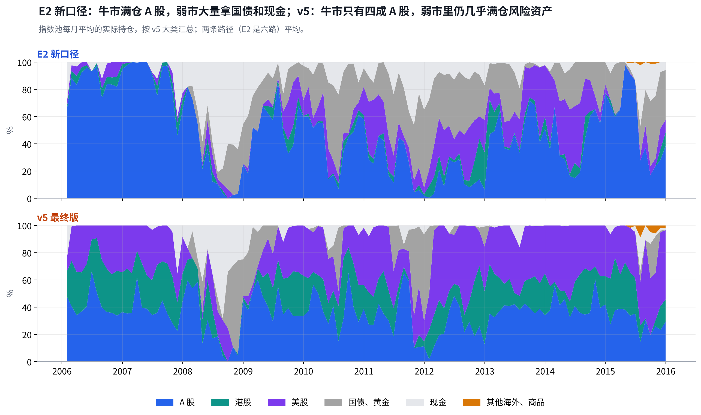

| 年份 | E2：A 股 | v5：A 股 | E2：国债黄金和现金 | v5：国债黄金和现金 | v5 相对 E2 |
| --- | --- | --- | --- | --- | --- |
| **2006–07 大牛市** | 86% | **40%** | 6% | 3% | 少赚 130 个点 |
| **2008 熊市** | 27% | 26% | 67% | **53%** | 多亏 11 个点 |
| **2011 弱市** | 25% | 33% | 54% | **23%** | 多亏 17 个点 |
| **2012 震荡** | 14% | 25% | 50% | **6%** | 多赚 6 个点 |

- 原因一：牛市里平分了仓位 “跑赢现金的大类平分”，2006–07 年港股、美股也在涨，A 股只分到四成。E2 是一张排名表，A 股的十几个容器挤满了前几名，几乎满仓 A 股，这十年最大的一段行情它吃满了。
- 原因二：防守的门槛太高 v5 只有在五个风险大类**全部**不跑赢现金时才放国债、黄金。五类里总有一类短期在涨，于是弱市里 v5 几乎一直满仓风险资产，只剩一类时还全押在它身上。E2 让国债、黄金和股票同场排名，股票一弱，国债就自然排进前几名。

持仓数字来自对已登记两个配置的复跑，复跑净值与登记逐日一致；脚本 results/v5/diag/memo/holdings.py。

## 9. 跑前预判对照：猜对三条，猜错三条

> **最大的错是回撤：预计更浅，实际更深。**

| 行情 | 预判（相对 E2） | 实际 |  |
| --- | --- | --- | --- |
| **2006–07 A 股大牛市** | 更差 | +61%、+72% 对 +106%、+156% | **猜对** |
| **2008 熊市** | 相近或略好 | −34% 对 −23% | **猜错** |
| **2009 反弹** | 相近 | +50% 对 +43% | **大致对** |
| **2010–13 震荡** | 略好 | 2012–13 更好，2011 年 −26% 对 −10% | **猜错** |
| **2015 急跌** | 相近 | 全年 +4% 对 +15% | **猜错** |
| **可交易池** | 明显更好 | 17.4% 对 8.7% | **猜对** |

猜错的三条都是同一个原因：防守是开关不是竞争（第 8 节硬伤 ③），下跌市里 v5 留在场内。这是设计错了，不是代码错了。

## 10. 稳健性：结论不靠运气和参数；唯一明显的改善指向“集中”

> **每一项只改一处，看结论会不会被推翻。十三项里十二项变化不到 4 个点，只有“只持最强的一类”明显更好。**

| 检验 | 在担心什么 | 怎么做 | 结果（前五年 / 后五年） |
| --- | --- | --- | --- |
| **邻近回看期** | 1、3、6、12 个月是不是刚好挑在“峰顶”，换一点就塌 | 换成稍短、更短、更长三组 | −3.5～−1.3 / −0.3～+1.6：不塌 |
| **成本加倍** | 交易费用被低估 | 所有费用 × 2 | −1.9 / −1.9 |
| **晚一天成交** | 实盘来不及在信号当天收盘下单 | 推迟一个交易日成交 | 0 / +0.6 |
| **去掉最好的 1、2、3 个** | 十年的成绩是不是靠一两个“明星”撑着，换个年代就没了 | 把十年里涨得最多的 1、2、3 个容器从池子里拿掉再跑 | −0.3～+1.7 / +0.2～+1.2：不靠明星 |
| **离场线 8%、12%** | 10% 是不是刚好最好 | 改成 8% 或 12% | −2.1～−0.9 / −0.1～+0.3 |
| **不设防守位** | 防守位到底有没有用 | 五类都不跑赢时直接拿现金 | −0.4 / +0.1：几乎没用 |
| **固定预算（A2 式）** | 平分给“跑赢的”是不是不如每类固定一份 | 五类各 1/5，没跑赢的那份放防守 | 0 / +1.2 |
| **只持最强的一类（A1 式）** | 平分是不是比集中更差 | 每个回看期只持最强的那一个大类 | **+11.4 / +7.7** |

指数池，数字是相对 v5 最终版的年化超额变化（百分点）。按预注册只报告、不改判，也不能拿来替换 v5。“不设防守位”几乎没有影响，正好印证了第 8 节硬伤 ③：防守位十年里只在 10% 的时间打开。

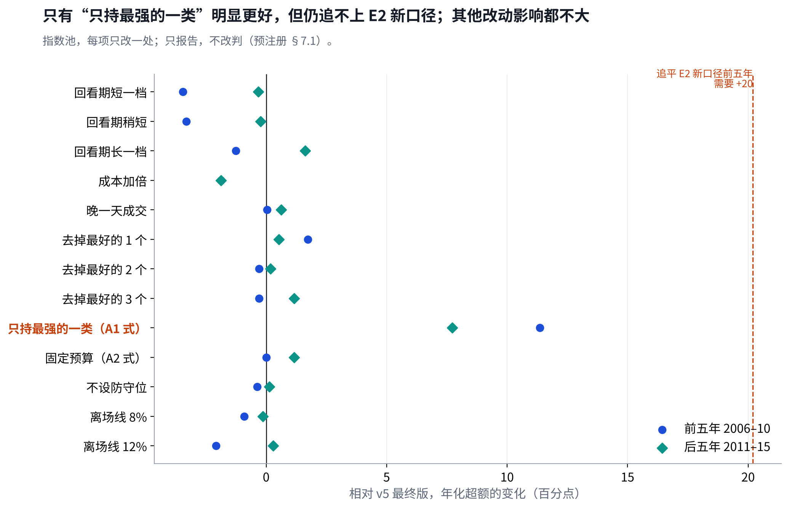

### 学到了什么

| 注意力是最稀缺的资源 | 为道日损：减法要减对地方 | 先为不可胜 |
| --- | --- | --- |
| 仓位就是策略的注意力。平分给所有在涨的大类，等于没有重点；只持最强的一类，前五年多 11 个点。E2 牛市满仓 A 股、A1 一次只拿一样，赢的都是这一点。 | E2 的一张排名表里，本来就藏着“防守资产和股票同场竞争”。v5 把它拆成两层，看起来更清楚，其实把这个机制减掉了。 | v5 想更“不输”，回撤反而更深。不输不靠单独设一个防守开关，而是让防守资产随时有机会排到前面。 |

这些都是封板后 v6 的线索，按 D27 走“设计证据 → 别的市场 → 并行模拟”的路径，不改 v5。

## 11. 接下来：先把 v5 策略讨论清楚，再写预注册

> **“跑前五问”已写进项目规矩（D30-1）；v5 允许一次设计修正（D30-2）。新的 v5 入围与否，跑完都封板。**
1. **讨论策略**：排名怎么比、持几只、空位放什么、同类挤占怎么办；逐条过“跑前五问”，写事前画像。
2. **预注册**：设计定下来再写定稿；Reviewer 复核、你批准后冻结。
3. **设计期和别的市场**：各跑一次，逐条对照事前画像。
4. **封板、一次性检验**：你定期望线和以哪个池子为准；入围的策略跑 2016 年以后，只跑一次。

v5.1 预注册草案（E2 + 每类上限）已入库作为讨论稿，暂不冻结。原版不再做别的市场检验（你已确认）。v5 策略讨论清楚、过完“跑前五问”之后，再写定稿预注册。

参考：封板规矩（D20、D27）、急跌和期权、结论报告的六项

- **封板**：v5 是最后一个研究版本；D30-2 允许一次设计缺陷修正（v5.1），之后只修程序错误。一次性检验只跑一次。模拟盘只上一个，12 个月不切换，看性格不只看收益。尝试次数有上限，结果按次数打折扣。
- **封板之后**：新想法记作 v6，可用全部历史设计，和在跑的策略逐项比；上线前过别的市场检验和至少 6 个月并行模拟，小资金起步。
- **急跌和期权**：三周跌完的行情趋势规则躲不开。境内期权数据大多在 2019 年以后；期权研究备忘待写，正式研究放到封板后。
- **结论报告的六项**：性格、四种行情、任意起点、优劣对照、市场和时代的变化、适应性。

