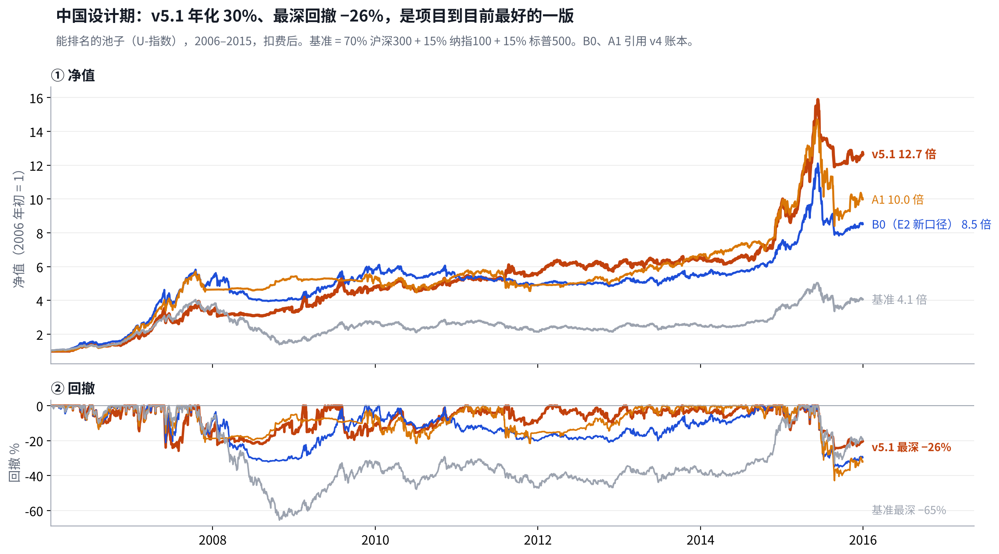
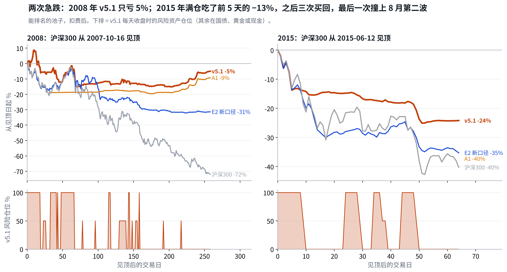
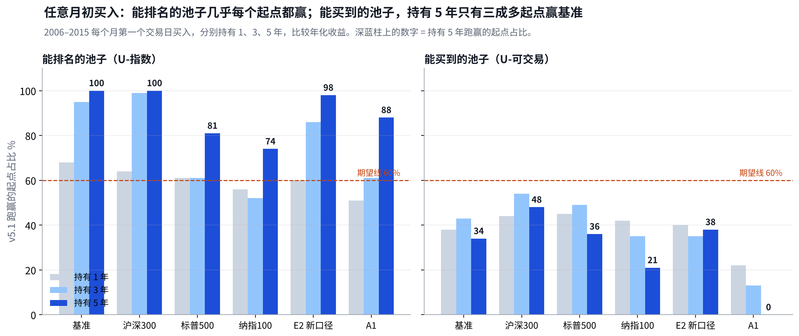
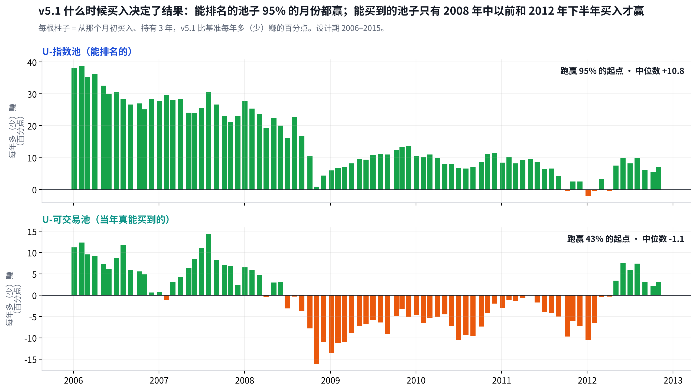
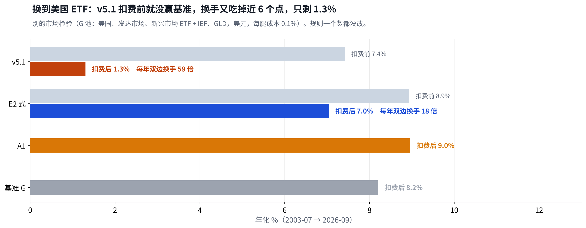
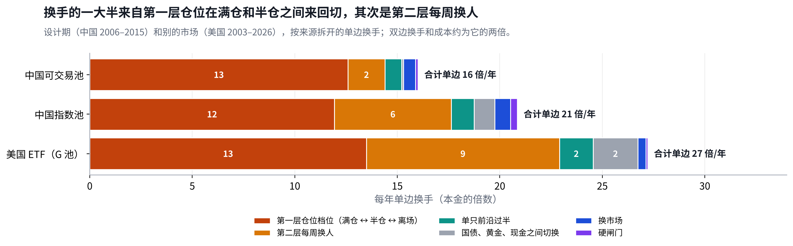

# v5.1 体检报告：能排名时样样最好，换成当年真能买到的、换个市场，优势都不在了

## Metadata

- Project: ETF_Rotation_Quant
- Document type: owner（v5.1 设计期体检）
- Status: active（第 1.1 版：任意起点改用逐月柱状图；v5.1 不入围，已封板，D34）
- Owner: L. Loric
- Maintainer: Orchestrator
- Date: 2026-11-04
- 依据：`results/v5.1/`（Reviewer 签收）；`results/v5.1/report/health.py`、`charts_anystart.py`；D33、D34；[《v4 体检报告》](v4-health-check.md)
- 页面：Claude 页面“v5.1 体检报告”；本文件是仓库镜像

---

**项目愿景**　在动态周期内，从多类资产里选出 Top N 强势 ETF 轮动持有，获得超额收益、稳定跑赢被动基准，同时把回撤控制住。

| 进度 | 结论 | 需要你 |
| --- | --- | --- |
| v5.1 设计期跑完，**不入围**；你已批准封板（D34）。一次性检验里它只作对照，和 E2 新口径、A1、基准同次跑。 | 能排名的池子年化 **30.1%**、回撤 **−26%**，任何月初买入持有 5 年都赢基准。但当年真能买到的只有 **15.8%**，5 年只有 34% 的起点赢；美国 ETF 上只有 **1.3%**。 | **不用操作。**这份报告是封板前的留档，一次性检验的结论另写。 |

先认识这几个名字：v5.1、E2 新口径、A1、基准、两个池子

| 问题 | 回答 |
| --- | --- |
| **v5.1** | 两层轮动。第一层每周在 A 股、港股、美股三个市场里选一个，仓位分两半：前沿没过半（短中长 28 把尺子里，正在走弱的不到一半，而且同市场里多数品种也没走弱）给一半；水平为正或长尺子在改善再给一半。仓位每天可以减、每周才加。第二层在选中的市场里拿最强的前 3 只，单只自己走弱或从高点跌 10% 就卖。不在股票里的钱默认拿 10 年国债，黄金明显更强时换黄金。 |
| **E2 新口径** | v4 的最终版，也是一次性检验唯一能入围的一版。看 1、3、6、12 个月四个回看期，只买跑赢现金的，每组前 N 名各 1/N，单只跌 10% 就卖。 |
| **A1 双动量** | 公开同行。每月末：标普500 过去 12 个月跑赢现金，就在标普500 和沪深300 里拿更强的那个，100% 仓位；否则拿 10 年国债。 |
| **基准** | 70% 沪深300 + 15% 纳指100 + 15% 标普500，全收益、人民币，每月再平衡。 |
| **两个池子** | **能排名的池子（U-指数）**：有指数数据就能参加排名，回答“选法好不好”，用来判过关。**能买到的池子（U-可交易）**：只排当年真有基金能买的，回答“当年真能赚多少”。2006 年两者差 16 个容器，到 2015 年差 9 个。细节见[《v4 体检报告》](v4-health-check.md)“两个池子”。 |

年化、回撤都从 2006-01-01 算到 2015-12-31，扣费后。前五年 = 2006–2010，后五年 = 2011–2015。中国 2016 年以后的收益一律没有算。

## 1. 过关：7 条过了 5 条，栽在“换个市场”和“顺应市场”

> **中国十年的五条全过，而且都过得很宽；没过的两条，一条是美国 ETF 上只有 1.3%，一条是牛市和反弹里跟不上。按跑之前写死的规则，不入围。**

| 条 | 要求 | 结果 | 判定 |
| --- | --- | --- | --- |
| **0 先赢随机** | 年化 ÷ 回撤高于随机挑选的 95 分位 | 两个池都高于全部 2000 次随机；同结构随机也高于 99.8% | **通过** |
| **1 跑赢基准** | 十年年化高于基准，四格不明显跑输 | 能排名 30.1%，能买到 15.8%，基准 15.6% | **通过** 能买到的险过 |
| **2 不明显输给 A1** | 相对 A1 的 t 值 ≥ −2 | 能排名 +0.45，能买到 −1.03 | **通过** |
| **3 赢过更简单的版本** | 高于等权版、波动比版 | 等权版 28.5%，波动比版 14.4% | **通过** |
| **4 回撤不比基准深** | 最大回撤不深于基准 | −25.9%，基准 −65.5% | **通过** |
| **5 别的市场也成立** | 美国 ETF 上赢随机、赢基准 | 年化 **1.3%**，基准 8.2% | **未通过** |
| **6 顺应市场** | 牛市超额 ≥ 0；反弹 t 值 ≥ −2 | 牛市 **−28**；反弹 t 值 **−2.36** | **未通过** |

第 2 条通过，A1 的退路不启用。全部由 Reviewer 独立复算签收（`results/v5.1/`）。

## 2. 性格：跌的时候躲得最快，涨的时候跟不满，换手很高

> **能排名的池子里，下跌月份只跟基准的 35%，上涨月份跟到 85%；代价是每年双边换手约 43 倍，成本约 3 个点。**

|  | v5.1 · 能排名 | v5.1 · 能买到 | E2 新口径 · 能排名 | 基准 |
| --- | --- | --- | --- | --- |
| 年化 | **30.1%** | 15.8% | 24.9% | 15.6% |
| 最大回撤 | **−26%** | −37% | −35% | −66% |
| 年化波动 | 21.4% | 17.9% | 19.3% | 23.2% |
| 上涨月份跟到 | 85% | **62%** | 86% | 100% |
| 下跌月份只跟 | **35%** | **39%** | 52% | 100% |
| 每年双边换手 | **约 43 倍** | — | — | — |

上涨（下跌）月份跟到 = 基准上涨（下跌）的月份里，平均收益是基准的百分之几。下跌月份越低越好。

- **波动不比 E2 新口径低**：v5.1 要么满仓、要么半仓、要么全在国债，仓位一跳一半，所以波动 21%，比 E2 新口径还高 2 个点。回撤浅，靠的是“跌得深之前就走了”，不是“平时拿得少”。
- **换手是最大的毛病**：前沿在一半附近来回晃，仓位就在满仓和半仓之间来回切。十年 187 次档位变动，67% 在一个月内又切回去（见《v5 研究备忘》第 9 节）。

### 2.1 两次急跌：2008 年几乎全躲开，2015 年躲开了一大半

> **从沪深300 见顶算起，2008 年 v5.1 只亏 5%（沪深300 −72%）；2015 年亏 24%（沪深300 −40%）。2015 年的亏损一半以上发生在见顶后的前 5 天，那时还是满仓。**

2008：靠的是国债

前 70 个交易日仓位切了 9 次（整段 29 次），净值来回磨掉约 12 个点；之后大半时间空仓拿国债。2008 年 8–11 月国债涨了约 14%，把亏损补回来，全年 −1%。

2015：头 5 天来不及

见顶时满仓在 A 股，前 5 天跌了 13%，第 10 天才清仓。之后三次因为反弹买回，最后一次在 8 月中买回，正好碰上第二波，又亏了约 7 个点。

和 E2 新口径、A1 比

2008 年 A1 也躲开了（−9%），E2 新口径 −31%。2015 年 A1 满仓扛完（−40%），E2 新口径 −35%。**两次都躲开的只有 v5.1**，这是它最大的长处。

## 3. 四种行情：熊市和回调大赢，牛市和反弹大输，两个池子一样

> **两个池子的形状完全一样：熊市、回调赢 100 多个百分点，牛市、反弹输掉一大半。能买到的池子里，牛市输得更多（−93）。**

按沪深300 全收益在每个月末划分：过去 12 个月涨、这个月也涨 = **牛市**；12 个月涨、这个月跌 = **回调**；12 个月跌、这个月也跌 = **熊市**；12 个月跌、这个月涨 = **反弹**。

| 行情 | 月数 | 能排名的池子 合计 · 跑赢月份 | 能买到的池子 合计 · 跑赢月份 | E2 新口径 能排名 · 能买到 | 读法 |
| --- | --- | --- | --- | --- | --- |
| **牛市** | 53 | −28 · 43% | −93 · 43% | −2 · −178 | 回调时常被减到半仓，回来又要等；能买到的池子比 E2 新口径好一半 |
| **回调** | 21 | +45 · 71% | +52 · 71% | +27 · +57 | 前沿过半当天减仓，在起作用 |
| **熊市** | 27 | +131 · 81% | +112 · 74% | +95 · +112 | 能排名的池子多出来的，主要是国债 |
| **反弹** | 19 | −37 · 26% | −80 · 16% | −54 · −71 | 趋势规则天生落后，回到半仓要 10 天、满仓要 45 天 |

合计 = 该行情所有日子相对基准的日超额相加（百分点）。跑赢月份 = 该行情里月超额为正的月份占比。E2 新口径用同一方法算。

## 4. 任意起点：能排名的池子每个起点都赢，能买到的池子只有三成多

> **能排名的池子持有 5 年，58 个起点全部跑赢基准，最差也每年多 1.5 个点。能买到的池子只有 34% 的起点跑赢，最差每年少 12 个点。**

| 持有 5 年（58 个起点），v5.1 对 | 能排名的池子 跑赢的起点 · 中位 · 最差 | 能买到的池子 跑赢的起点 · 中位 · 最差 |
| --- | --- | --- |
| **基准** | 100% · +16.6 · +1.5 | 34% · −1.5 · −12.2 |
| 沪深300 | 100% · +14.5 · +5.9 | 48% · −0.1 · −11.0 |
| 标普500 | 81% · +10.9 · −8.8 | 36% · −4.0 · −20.7 |
| 纳指100 | 74% · +6.5 · −13.1 | 21% · −8.5 · −25.2 |
| E2 新口径（同池） | 98% · +9.4 · −0.5 | 38% · −1.7 · −6.0 |
| A1 双动量（同池） | 88% · +6.9 · −2.6 | 0% · −9.3 · −14.9 |

2006–2015 每个月第一个交易日买入，持满 1260 个交易日，比较年化收益；中位、最差 = 每年多（少）赚的百分点。持有 1 年、3 年的数字在图上。

- **能买到的池子里，输赢由起点决定**：持有 3 年，2008 年中以前和 2012 年下半年买入的赢，2008 年下半年到 2012 年初买入的几乎都输——先碰上 2009 年反弹，跟不满。
- **两个池子差在两处**：能挑的少（2006–2012 年平均只拿得到 1.0–1.6 只，能排名的池子 1.7–2.7 只）；2008–2012 年没有能买的国债基金，防守只相当于现金。
- **持有越短越看运气**：能排名的池子持有 1 年只有 68% 的起点赢基准，3 年 95%，5 年 100%。

## 5. 和同行比：能排名时赢 A1，能买到时输给 A1 很多

> **能排名的池子 v5.1 30.1% 对 A1 27.0%，回撤浅 17 个点；能买到的池子 15.8% 对 23.7%。A1 是唯一一个两个池子持有 5 年都有九成起点赢基准的。**

|  | v5.1 | E2 新口径 | A1 双动量 | 基准 |
| --- | --- | --- | --- | --- |
| 能排名 年化 · 回撤 | 30.1% · −26% | 24.9% · −35% | 27.0% · −43% | 15.6% · −66% |
| 能买到 年化 · 回撤 | 15.8% · −37% | 8.7% · −32% | 23.7% · −43% | 15.6% · −66% |
| 能排名 5 年赢基准的起点 | **100%** | 64% | 90% | — |
| 能买到 5 年赢基准的起点 | **34%** | **29%** | **90%** | — |
| 美国 ETF 2003–2026 年化 | **1.3%** | 7.0%（E2 式） | 9.0% | 8.2% |

E2 新口径、A1 的中国数字引用 v4 账本；美国数字是同一次别的市场检验里跑的，美国基准 = 60% SPY + 40% IEF。

- **同行只用来诊断，不决定过不过**。它说明：v5.1 多出来的复杂度，在“选法本身”上换来了更好的结果；但在能买的东西很少、或者市场平缓的时候，换不来。
- **要谨慎看 A1**：它 2008 年躲开有美国先出事的运气，2015 年满仓扛完股灾（第 2.1 节）。

## 6. 两个年代：后五年才是 v5.1 拉开差距的地方

> **能排名的池子后五年年化 20.6%，基准 9.4%、E2 新口径 9.9%。这正是 v5 要补的那一格。能买到的池子前五年仍没跑过基准。**

| 年代 | v5.1 能排名 · 能买到 | E2 新口径 能排名 · 能买到 | A1 能排名 · 能买到 | 基准 |
| --- | --- | --- | --- | --- |
| **2006–2010** | 40.4% · 20.0% | 41.9% · 10.0% | 42.1% · 33.8% | 22.3% |
| **2011–2015** | 20.6% · 11.8% | 9.9% · 7.4% | 13.4% · 14.4% | 9.4% |
| 2016–2020 | 留空：一次性检验才看 | | | |
| 2021–2026 | 留空：同上 | | | |

- **后五年是横盘加快牛快熊**：2010–13 年每年稳定 7–9%，2015 年股灾里还赚 30%。快速离场、快速回场，在这种行情里最值钱。
- **前五年是一口气走到底的单边市**：2006–07 年大牛市里，v5.1 每次回调都减到半仓，比 E2 新口径少赚。

## 7. 换个市场：规则照样在动，但成本吃掉了全部好处

> **美国 ETF 上扣费前 7.4%，已经低于基准 8.2%；每年双边换手 59 倍、成本近 6 个点，扣完只剩 1.3%。**

- **转折照样做得快**：2008、2020、2022 年见顶后 5–34 天减到半仓；见底后 4–17 天回到半仓。
- **但美国的牛市又长又平**：回调浅，前沿在一半附近反复晃。换手一大半来自第一层仓位在满仓和半仓之间来回切（每年单边 12–13 倍），其次是第二层每周换人（美国 9 倍）。
- **中国十年的 30% 有相当一部分来自中国市场的特性**：急涨急跌时快速反应值钱，市场平缓时同一个机制变成了来回付成本。

## 8. 改参数会不会塌：不会塌，但对成交时点敏感

> **成本加倍、去掉最好的容器、改门槛和噪音带，年化都在 24–32% 之间；唯一要警惕的是决策日晚一天，年化反而升到 38%。**

成本加倍

25.8%

少 4.3 个点，仍高于 E2 新口径。换手高，所以成本是最敏感的一项之一。

门槛、噪音带、硬闸门

27.9–31.6%

前沿门槛 0.4、0.6，噪音带 0.5、2，硬闸门 8%、12%、不设，都差 2 个点以内。去掉最好的 1–3 个容器反而略高，不靠明星。

长尺子放缓比 10、40 天前

26.0%、23.8%

少 4–6 个点，是规则里最敏感的一个读数。

决策日晚一天

38.0%

多 8 个点。晚一天反而更好，说明结果对成交时点很敏感，30% 里有一部分可能只是时点上的运气。

能排名的池子，每项只改一处，其余照原规则。全部只报告，不改判。完整 17 行见《v5 研究备忘》第 11 节。

## 9. 对照期望：能排名的池子三条全过，能买到的池子只过一条

> **和 E2 新口径（[《v4 体检报告》](v4-health-check.md)第 8 节）比，能排名的池子从两条到三条；能买到的池子仍然只过“回撤”一条。**

| 期望（草稿） | 线 | 能排名的池子 | 能买到的池子 | E2 新口径 能排名 · 能买到 |
| --- | --- | --- | --- | --- |
| 任意起点持有 5 年，跑赢基准的比例 | ≥ 60% | **100%　达到** | **34%　没达到** | 64% · 29% |
| 最差的 5 年，每年比基准少赚 | 不超过 3 个百分点 | **没有少赚（+1.5）　达到** | **12.2　没达到** | 4.8 · 12.9 |
| 最大回撤不超过基准的 | 0.6 倍 | **0.40 倍　达到** | **0.57 倍　达到** | 0.54 · 0.48 |

E2 新口径的前两行按这里同一方法重算，和[《v4 体检报告》](v4-health-check.md)差 1–3 个百分点（这里要求持满 1260 天）。

- **两版的共同问题**：能买到的池子都没过前两条。2006–2012 年能买的太少，任何“挑前几名”的规则都用不上本事；只有一次拿一样、满仓的 A1 不受影响。2016 年以后两个池子会接近，一次性检验会给出更公平的对照。

## 10. 下一步

1. **封板（已批准，D34）**：v5.1 不再改。
2. **一次性检验**：2016-01 到 2026-09，两个池子同次跑 E2 新口径、A1、基准、v5.1。只有 E2 新口径能入围；v5.1 只作对照，不进模拟盘。先写 LOCK，再跑，Reviewer 独立复算。
3. **v6 的起点**：① 第一层仓位加回差，减仓线和加仓线分开；② 第二层少换人；③ 跑前评估把触发次数换算成成本。详见《v5 研究备忘》第 12 节。

数据来源

- 过关、换手、稳健性、别的市场的数字来自 Reviewer 签收的 `results/v5.1/`。E2 新口径、A1 引用 v4 账本（`results/v4/r5/design/`）。
- 性格、四种行情、任意起点、两个年代、急跌是我用签收的逐日净值重新统计的：`results/v5.1/report/health.py`，图 `charts_anystart.py`。没有重跑策略；中国数据只到 2015-12-31。
- 急跌图的仓位是 v5.1 每天收盘时的风险资产仓位（`risk` 列）。

