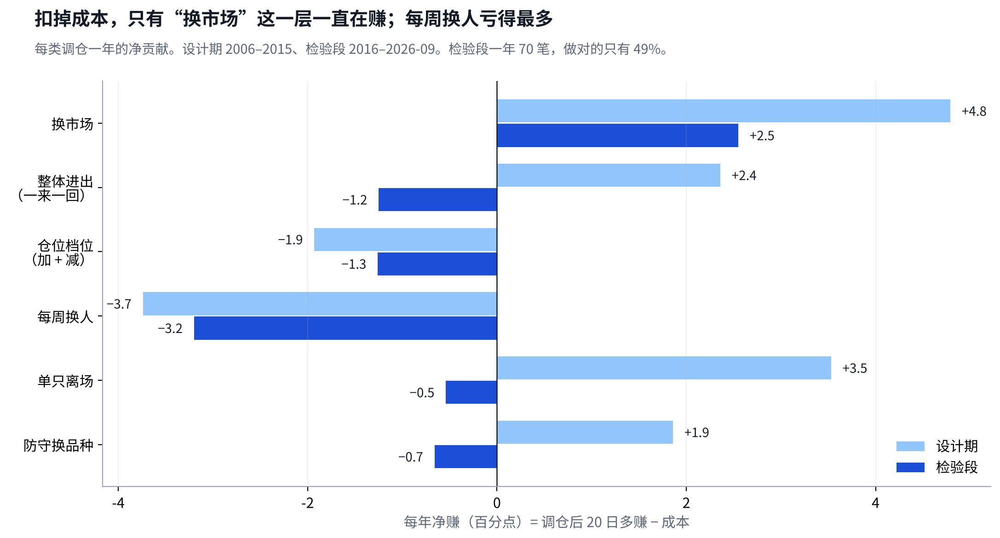
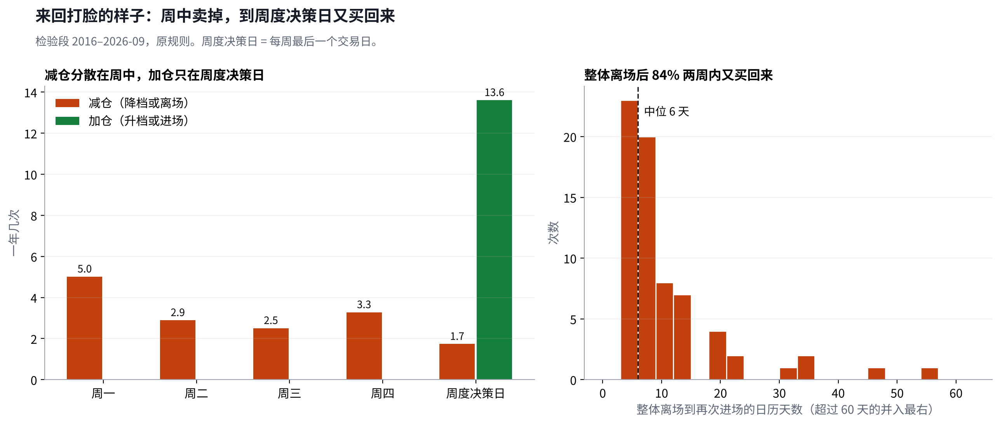
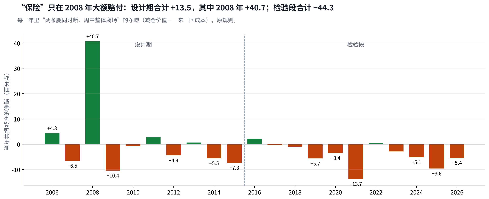
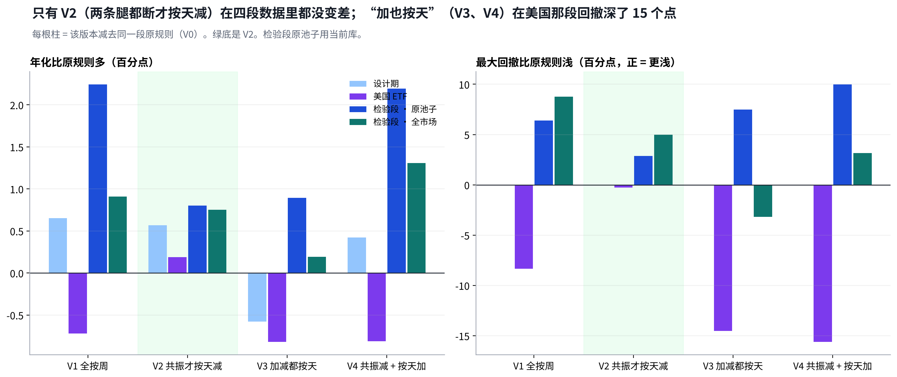
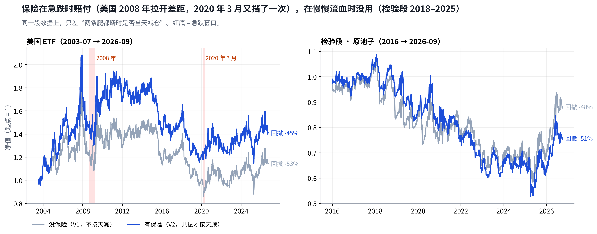
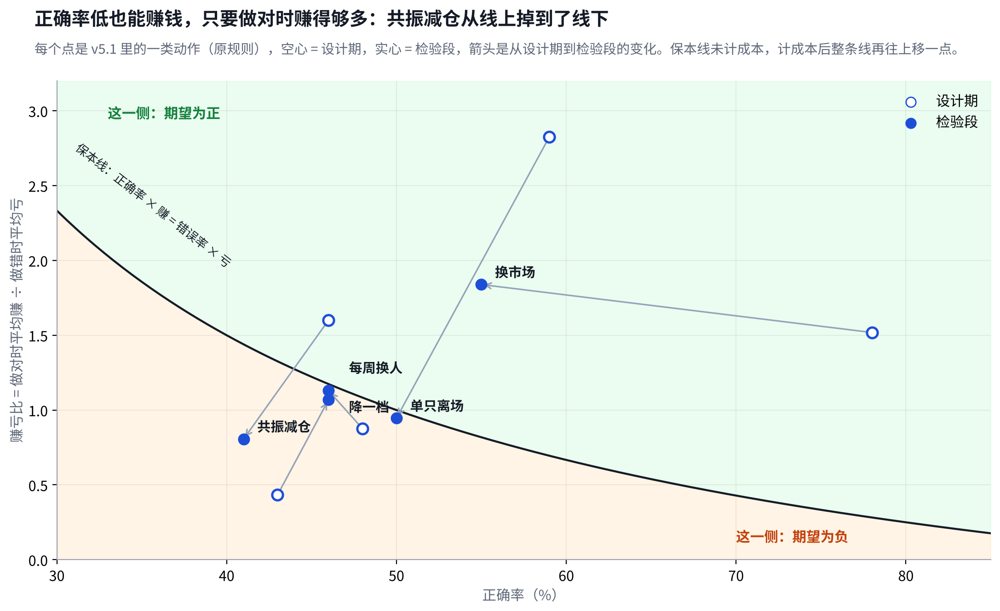
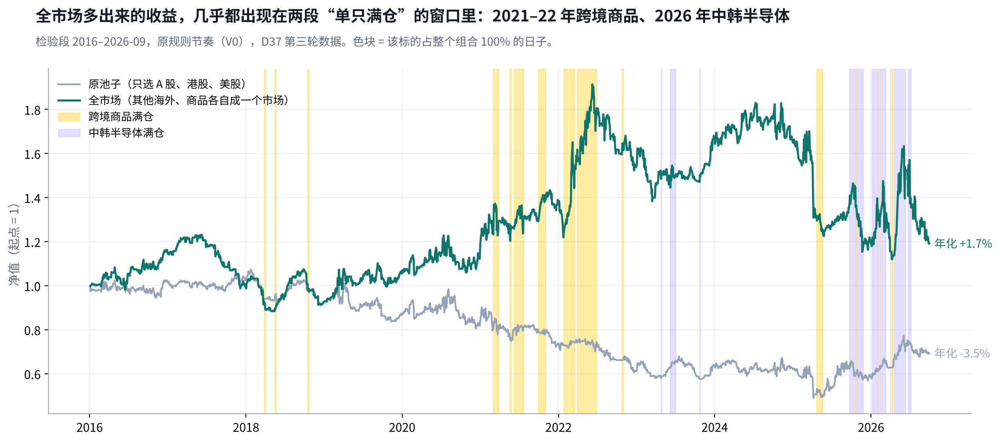

# v5.1 换手深挖：一年 70 笔调仓只有一半做对；来回打脸来自“每天只减、每周才加”

## Metadata

- Project: ETF_Rotation_Quant
- Document type: owner（进入 v6 之前的诊断）
- Status: active（第 5 版：每节先图后表；明细表折叠）
- Owner: L. Loric
- Maintainer: Orchestrator
- Date: 2026-11-05
- 依据：`results/v5/report/v51_turnover.py`、`v51_turnover.json`、`v51_buyback.json`；`results/v5.1/turnover`、`results/v5.1/controls`；D36、D37；`results/v51-diag/d37/`（PR #271、签收 #274）
- 页面：Claude 页面“v5.1 换手深挖”；本文件是仓库镜像

| 进度 | 结论 | 需要你 |
| --- | --- | --- |
| 第二阶段已按“不成立”关闭（D36）。这是进入 v6 之前的第一轮诊断；D37 诊断已跑完并签收（设计期、美国 ETF、检验段 2016–2026、全市场 S1），结果在第 6–8 节。 | 检验段一年 **70** 笔，做对 **49%**；调仓本身每年多赚 **2.4**，成本 **6.6**。只有“换市场”这一层有信号。 | **要你想**：看完第 7–9 节后，定 v6 的“保险”方案。 |

## 1. 一年 70 笔调仓做对了多少：一半；只有“换市场”这一层真有用

> **检验段每笔调仓 20 个交易日后看，做对 49%（设计期 51%）。所有调仓加起来每年多赚 2.4 个点，成本 6.6，净亏 4.2。**

明细表

| 调仓类别 | 一年几笔 检验段 | 做对比例 设计期 → 检验段 | 每年多赚 设计期 → 检验段 | 每年成本 检验段 | 结论 |
| --- | --- | --- | --- | --- | --- |
| 慢的那层按周看、很少动 | | | | | |
| 换市场 A 股、港股、美股之间 | 1.9 | 78% → **55%** | +4.9 → **+3.0** | **0.4** | **唯一有用** |
| 快的那层每天可减仓、每周换人 | | | | | |
| 整体进出 进场 + 离场一来一回 | 13.4 | 进 59→68%，出 45→**42%** | +3.8 → **+0.3** | **1.6** | **白付成本** |
| 仓位档位 满仓 ↔ 半仓 | 14.9 | 加 67→57%，减 43→**46%** | −1.6 → **+0.3** | **1.6** | **白付成本** |
| 每周换人 | **21.4** | 48% → **46%** | −2.9 → **−0.8** | **2.4** | **越换越差** |
| 单只离场 走弱或跌 10% | 5.6 | 59% → **50%** | +3.8 → **−0.2** | **0.4** | **失效** |
| 防守换品种 | 3.6 | 58% → **51%** | +2.0 → **−0.4** | **0.2** | **失效** |
| 合计 含零星小调整 | **70** | 51% → **49%** | +9.9 → **+2.4** | **6.6** | **净亏 4.2** |

“做对比例”就是正确率：这笔调仓之后 20 个交易日，新持仓比原持仓多赚（不含成本）。“每年多赚”是期望的合计，正确率低时它也可以是正的（见第 7 节）。“每年多赚” = 一年里所有这类调仓多赚的合计（百分点）。进场、离场单看会被大盘长期上涨带偏，所以合成一来一回看；加仓、减仓同理。看 5 天、60 天结论相同。

- **“正确交易数”在这里能直接数**：检验段一年 70 笔，扣掉成本还赚的不到一半。交易次数上来了，正确率没有上来，所以多出来的每一笔都是在付钱。
- **有信号的只有慢的那层**：换市场一年不到 2 次，设计期做对 78%，检验段还有 55%，每年多赚 3 个点、成本只要 0.4。快的那几层在检验段全部接近抛硬币。

## 2. 为什么来回打脸：减仓九成发生在周中，加仓全部等到周五

> **规则是“每天只减不加，每周才加回去”。检验段整体离场后 84% 两周内又回来，中间只隔 6 天；被每周换掉的名字，45% 四周内又买回。**

明细表

| 动作 | 设计期 | 检验段 | 结论 |
| --- | --- | --- | --- |
| 减和加不在同一个节奏上 | | | |
| 整体离场发生在周中 | 91% | **88%** | **每天的检查在减** |
| 减仓档发生在周中 | 80% | **91%** | **每天的检查在减** |
| 整体进场、加仓档发生在周五 | 100% | **99–100%** | **只有周度能加** |
| 结果：卖了又买回来 | | | |
| 整体离场后两周内回来 | 74% | 84% | **一周一个来回** |
| 离场到回来的天数（中位） | 7 天 | **6 天** | **等到下个周五** |
| 减仓档两周内加回 | 37% | **54%** | **更频繁** |
| 每周换掉的，四周内又买回 | 48% | **45%** | **换出去又换回来** |
| 走弱离场的，四周内又买回 | 44% | **42%** | **换出去又换回来** |

- **机制是一个“棘轮”**：周中某天读数掉下来就减仓；到周五重新打分，读数又够了就加回。市场只是周中晃一下，v5.1 就完成一次“低位卖、高位买”，还付两次钱。
- **这是规则结构造成的，不是参数没调好**：减仓和加仓用了两个节奏（每天 vs 每周），也没有任何“回来要多涨一点才加”的缓冲。

## 3. 单看减仓：按天减，扣成本后只有 37% 减对；设计期“共振时提前减”有用，但钱全来自 2008 年

> **检验段一年减仓 15 次，扣成本后减对 37%，每次净亏 0.44 个点，一年合计 −6.8。两条腿同时断时提前减，设计期每年 +1.4，去掉 2008 年就是负的。**

明细表

| 减仓类型 | 一年几次 设计期 / 检验段 | 减对比例 扣成本后 | 每次净赚（个点） 设计期 → 检验段 | 一年合计（点） 设计期 → 检验段 | 结论 |
| --- | --- | --- | --- | --- | --- |
| 全部减仓 | 9.9 / 15.4 | 33% → **37%** | −0.23 → **−0.44** | −2.3 → **−6.8** | **多数减错** |
| 按“几条腿断了”分你设计按天减的理由：多把尺子共振时不必等到周五 | | | | | |
| 周中、两条腿都断 共振，整体离场 | 6.3 / 5.9 | 41% → **34%** | +0.21 → **−0.73** | **+1.4** → **−4.3** | **设计期有用，检验段失效** |
| 周中、只断一条腿 降一档 | 2.4 / 7.8 | 21% → **40%** | −0.90 → **−0.18** | −2.2 → **−1.4** | **不该按天减** |
| 按“后来加没加回”分 | | | | | |
| 周中减，周五就加回 | 4.8 / 7.5 | 31% → **33%** | −0.62 → **−0.56** | −3.0 → **−4.2** | **来回打脸** |
| 周中减，过了周五还在减 | 3.9 / 6.2 | 41% → **42%** | **+0.56** → **−0.24** | **+2.2** → −1.5 | **真破位时有用** |
| 同上，比“等到周五再减” | 3.9 / 6.2 | 提前更好 62% → **42%** | **+0.69** → **+0.02** | **+2.7** → +0.1 | **设计期提前有价值** |

“减对” = 从减仓成交到下一次加回成交，被卖掉的那部分（减去换进的国债、黄金、现金）是跌的；扣成本 = 减和加回两次成交。“个点”按整个组合的收益计。

- **你的设计理由在设计期是成立的**：两条腿都断才提前减，一年 6 次，每次净赚 0.21 个点；真破位的那些，比等到周五再减每次多赚 0.69 个点。
- **但它是一份“保险”，十年只赔付了一次**：设计期共振减仓合计 +13.5 个点，其中 2008 年 +40.7；去掉最好的 5 次就是 −40.1。检验段 2018、2020、2022 的大跌也赔付了，但不够付平时的保费。
- **规则里有两处偏离了你的理由**：只断一条腿也按天减（设计期减对 21%），以及减了之后只能等周五加回（一半在周五就加回来，每次 −0.6 个点）。

## 4. 设计期就看得出来：周度换人当时就在亏钱，成本也已经是预估的两倍

> **设计期 v5.1 每年赢基准 11 个点，靠的是进场、换市场和 A 股大行情；周度换人每年 −2.9、减仓档 −5.3，当时就在亏。**

| 当时就有的证据 | 数字 | 本该得出的结论 |
| --- | --- | --- |
| 周度换人（设计期） | 做对 **48%**，每年 **−2.9** | **删掉或改慢** |
| 减仓档（设计期） | 做对 **43%**，每年 **−5.3** | **减仓线有问题** |
| 同结构、挑选换成等权 | 年化 **28.5%** 对 v5.1 30.1% | **换人几乎没增值** |
| 设计期成本 | 每年 **3.2**，预估 1–2 | **成本低估一半** |
| 别的市场（美国 ETF）换手 | 每年单边约 **30** 倍 | **池子大了会更勤** |

前两行是本次按同一套代码在设计期补算的；后三行来自 v5.1 设计期已签收的对照和换手拆分。

## 5. 对 v6 的含义：目标不是交易次数，是每一笔的期望

> **每一笔的期望 = 做对比例 × 平均赚 − 做错比例 × 平均亏 − 成本。v5.1 的快层做对比例 ≈ 50%、赚亏差不多，再减成本，每一笔都是负的。**

① 只在有信号的层交易

慢层做决定

选市场、大类该不该拿：**按周或按月**，一年几次。快层（每天减仓、每周换人）要先证明每笔期望为正，否则不设。

② 加和减用同一个节奏

加缓冲

减仓线和加仓线分开（减了之后要**多涨一截**才加回）；换人要“新的明显更强”才换。直接拆掉棘轮。

③ 冻结前逐层算每笔期望

新的一道门

每一类调仓：一年几笔、做对比例、平均赚亏、成本。**扣成本后为负的层不进预注册**。这一步只用设计期和别的市场。

## 6. 加减节奏五个版本跑完：只有“共振时才按天减”在四段数据里都不比原规则差

> **四段数据里，“加也按天”两段变好、两段变差，不稳定；V2（两条腿都断才按天减）每段都不差于原规则。但不管怎么改节奏，做对比例都在 48–52%，还是抛硬币。**

> **什么叫“共振”**　v5.1 给持有的市场看两条腿，每条腿管一半仓位： **腿一 · 面**：代表指数（沪深300、恒生、标普500）的 28 把尺子（3 天到 250 天的涨跌速度）里，转负的不到一半；并且这个市场里转负过半的 ETF 也不到一半。两者有一个不满足，腿一就断。 **腿二 · 势**：代表指数的综合速度为正；或者长周期（63–250 天）的速度连续两个月在回升。两个都不满足，腿二就断。 断一条 = 降到半仓；**两条同时断 = 共振**，当天整体离场。V2 的意思是：只断一条时不按天减，等到周五再说；两条都断才当天减。

明细表

| 版本 | 设计期 年化差 / 回撤 | 美国 ETF 年化差 / 回撤 | 检验段 · 原池子 年化差 / 回撤 | 检验段 · 全市场 年化差 / 回撤 | 做对比例 检验段 | 结论 |
| --- | --- | --- | --- | --- | --- | --- |
| V0 原规则 按天减、周五加 | 30.1% / −26% | 1.3% / −45% | −3.5% / −54% | 1.7% / −42% | **49%** | **基线** |
| V1 全按周 不按天减 | **+0.7** / −26% | **−0.7** / **−53%** | **+2.2** / −48% | **+0.9** / −33% | **50%** | **美国那段回撤深 8 个点** |
| V2 共振才按天减 | **+0.6** / −26% | **+0.2** / −45% | **+0.8** / −51% | **+0.8** / −37% | **50%** | **四段都不差** |
| V3 加减都按天 | **−0.5** / −26% | **−0.8** / **−59%** | **+0.9** / −47% | **+0.2** / −45% | **50%** | **不稳** |
| V4 共振减 + 按天加 | **+0.5** / −26% | **−0.8** / **−61%** | **+2.2** / −44% | **+1.3** / −38% | **52%** | **不稳** |

年化差 = 比同一段 V0 多（少）几个百分点；第一行是 V0 本身的年化。检验段 V0 用当前库（−3.5%）；签收结果 −3.3%，差别来自场外净值续接，Reviewer 已在签收库上逐位复现。全市场 = D37 的 S1（见第 8 节）。

- **你的第 2 问：加也按天，正确率不会上去**。做对比例都在一半左右，期望有时变好有时变差；美国 ETF 这段回撤从 −45% 加深到 −60%。
- **节奏只是次要因素**：换手每年都还在 57–79 倍，大头是每周换人，正确率靠调节奏解决不了。

## 7. 保险值不值：平均每次都在亏，但只有它挡住过大跌——美国那段回撤少 8 个点

> **“两条腿都断就减仓”每次平均净亏：美国 ETF −0.55 个点，检验段 −0.65。但在美国那段，有它比没它年化多 0.9、回撤少 8 个点（挡住了 2008 年和 2020 年 3 月）。**

明细表

| 数据段 | 共振减仓 一年几次 · 每次净赚 | 有保险比没保险 V2 − V1：年化 / 回撤 | 结论 |
| --- | --- | --- | --- |
| 设计期 | 6.3 次 · **+0.16** | −0.1 / 0 | **没差别** |
| 美国 ETF | 6.1 次 · **−0.55** | **+0.9** / **回撤少 8.1** | **赔付了** |
| 检验段 · 原池子 | 5.9 次 · **−0.65** | **−1.4** / 回撤多 3.5 | **没赔付** |
| 检验段 · 全市场 | 7.4 次 · **−0.74** | −0.2 / 回撤多 3.8 | **没赔付** |

共振减仓的数字都取 V2（只在两条腿都断时按天减的版本）。

### 正确率低，期望也可以是正的：看点在保本线的哪一侧

**怎么读这张图**：横轴是正确率，纵轴是“做对时平均赚 ÷ 做错时平均亏”。曲线是保本线，线上方期望为正，下方为负。正确率 40% 的动作，只要赚亏比超过 1.5 就赚钱。注意：这些点不是可以挑的“方案”，而是 v5.1 里同时在做的几类动作。

明细表

| 调仓 | 正确率 | 做对时平均赚 | 做错时平均亏 | 每次净期望 扣成本 | 结论 |
| --- | --- | --- | --- | --- | --- |
| 共振减仓 · 设计期 | **46%** | **+3.26** | −2.04 | **+0.21** | **错多对少，仍赚** |
| 共振减仓 · 检验段 | **41%** | +1.61 | **−2.00** | **−0.73** | **对时赚得少了** |
| 换市场 · 检验段 | **55%** | **+5.02** | −2.73 | **+1.32** | **赚亏比 1.8** |
| 每周换人 · 检验段 | **46%** | +2.27 | −2.01 | **−0.15** | **要 50% 才保本** |
| 单只离场 · 设计期 | **59%** | **+2.26** | −0.80 | **+0.95** | **止损亏得小** |

这张表都是原规则（V0），所以检验段共振减仓是 −0.73（上表 V2 是 −0.65）。单位是整个组合的百分点。共振减仓：从减仓到加回；其余：调仓后 20 个交易日。保本所需正确率 =（平均亏 + 成本）÷（平均赚 + 平均亏）。

- **你问的两种情况都存在**：设计期的共振减仓正确率只有 46%，但做对时平均赚 3.3、做错时亏 2.0，每次仍净赚 0.21，一年还倒赚 1.4，相当于保费是负的。到检验段，做对时只赚 1.6，保费变成每年 4.3 个点，太贵。
- **保险要按“挡住了几次大跌”来评，不能只看每次平均**：每次平均是负的，相当于保费；挡住一次深跌，对复利的帮助比平均数显示的大得多。美国那段就是这样。
- **检验段的大回撤是慢慢流血，不是急跌**：v5.1 的 −54% 从 2018 年 1 月一路跌到 2025 年 4 月，是七年持续跑输，按天减仓挡不住，反而常在反弹前卖掉。

## 8. 全市场为什么每年多 5.2 个点：几乎全靠两只——跨境商品和中韩半导体

> **把其他海外、商品各自算成市场，再在上市前接指数，检验段年化从 −3.5% 到 +1.7%（基准 8.7%）。跨境商品累计 +38.6、中韩半导体 +26.8，合起来每年约 6 个点，比整体提升还多。**

明细表

| 比原池子每年多（少）赚 | 点 | 代表（十年累计） | 结论 |
| --- | --- | --- | --- |
| 商品 | **+2.4** | 跨境商品（银华抗通胀等 3 只 LOF）**+38.6**，豆粕 −13.5 | **一只撑起** |
| 其他海外 | **+1.6** | 中韩半导体 **+26.8**，印度 −12.8 | **一只撑起** |
| 美股、A 股、黄金 | **+4.0** | 纳指100 +26.9、创业板 +13.0 | **少输了** |
| 港股 | **−3.1** | 中国互联网、港股通科技 | **更差** |
| 国债、现金 | **−0.2** | — | **差不多** |
| 成本 | **+1.5** | 每年 6.6 → 5.1 | **少一点** |

每年算术贡献，合计 +6.1，和年化差 5.2 的差别来自复利。数字是第三轮（又接上日经225 和 5 个中证港股、香港指数）之后的；比第二轮各版本年化低约 0.2，结论不变。持有收益用能排名的池子计价；能不能买，按场内上市日和近 5 日成交额 200 万。

- **为什么偏偏是这两只：它们各自算一个市场，被选中就是满仓**：持有的日子都是整个组合的 100%（2022 年跨境商品 +40.1，2026 年中韩半导体 +28.2）。纳指科技在美股里和约 30 个主题争前 3，只拿过 16 天、平均 24%。这是集中押注，不是稳健的提升。
- **“不要硬等”：接上指数后真正提前买到的只有 4 只**：中韩半导体早了 882 天、港股通高股息 1267 天、纳斯达克生物科技 475 天、海外中国互联网50 203 天。
- **纳指科技、费城半导体提前不了**：纳指科技跟踪的指数 2023 年才发布，没有更早的历史；费城半导体从 2007 年就能打分，但上市后到 2024-06 才排进前 3。
- **还有 44 只没接上**：恒生、标普的官网要邮箱验证或拒绝云端访问。下一轮不限取数方式，只要求序列连贯、贴近当时市场；其中 2016 年前就上市的接了也不改变检验段。
- **D35 场内口径的 v5.1（1.6%、−21%）好在“池子小、动得少”**：2016–2018 年每天只有 7–8 只过 3000 万门槛，2017 年全年没调仓；到 2025 年池子变成 63 只，换手又回到每年 50 倍左右。

## 9. 看完要你想的：v6 的“保险”怎么设计

> **事实只有三条，来自 4 段数据：只在共振时减最稳；保险平均是亏的，只在急跌时赔付；拦不住慢慢流血的回撤。**

保留什么

只在共振时减

单腿断不减、等周度；两条腿都断才当天减。这是四段数据里**唯一都不差**的。

怎么评

按回撤和复利评

不再用“每次平均赚不赚”评保险，改看**最大回撤、回撤持续多久、复利**，并报告去掉最好几次后还剩多少。

还能怎么买保险

卖出以外的办法

按波动调仓位，或用 **ETF 期权买保护**（项目里本来就有期权方向）。都还没测，v6 设计评审时再比。

这一节只摆事实和可选方向，不替你决定；你看完后我们再定 v6 的保险方案。

数据来源和方法（工程用）

- **脚本**：`results/v5/report/v51_turnover.py` → `v51_turnover.json`、`v51_trades.csv`；买回比例 `v51_buyback.json`；单看减仓 `v51_sells.py` → `v51_sells.json`、`v51_sells.csv`；D37 各格在 `results/v51-diag/d37/`（PR #271，Reviewer 签收 #274）。
- **口径**：成交日 T（当日买卖额 > 0）；Δw = 次日持仓 − 当日持仓；多赚 = Σ Δw × 之后 h 日累计收益（h = 5、20、60）。类别按 T−1 相对 T−2 的状态变化（信号次日成交）。设计期读 `results/v5.1/design/index`，检验段读 `results/v5/oneshot/index/v5.1-对照`，都是能排名的池子。
- **局限**：固定窗口会和后续调仓重叠，不是严格的“只差这一笔”的反事实；进出、加减要成对看。

