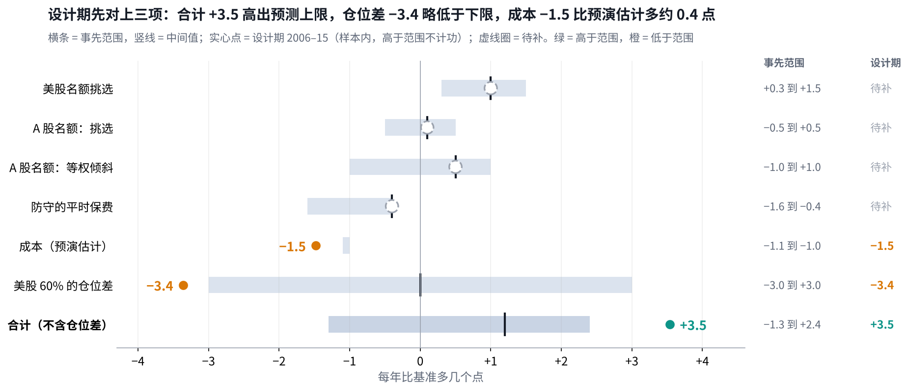

# v6 体检报告（设计期，骨架）：复算 10 项里 8 项差 0；每年 15.3%，比同仓位基准多 3.5 点，钱主要来自挑选

## Metadata

- Project: ETF_Rotation_Quant
- Document type: owner report（v6 设计期体检，冻结稿 §9.1 第 5 步）
- Status: draft（骨架第 0.1 版：只用已经两边独立对上的数字；第 1、3、4 节的待补项等 Dev 补算、Reviewer 签收后填入定稿）
- Owner: L. Loric
- Maintainer: Orchestrator
- Date: 2026-11-25（Asia/Taipei）
- 依据：冻结预注册（tag `milestone/v6-prereg-freeze` → `f066da8e`）；D45（#376）、D46（#378）；Dev 设计期结果 #377、Reviewer 独立复算 #375；附表 B 数字取自 `results/v6-preflight/v6-appendix-b.json`（两边复算差 0）
- 数据：只用 ≤ 2015-12-31；美股为人民币价格指数，A 股一级行业用回填点位（冻结稿 §1.1）
- 页面：Claude 页面“v6 体检报告”；本文件是仓库镜像

---

**项目愿景**　在动态周期内，从多类资产里选出 Top N 强势 ETF 轮动持有，获得超额收益、稳定跑赢被动基准，同时把回撤控制住。

| 进度 | 结论 | 需要你 |
| --- | --- | --- |
| 实现与复算接近收尾：Dev 和 Reviewer 各自独立复算设计期，10 项里 8 项和冻结稿差 0；判据、同行比较、预测对账等 Dev 补算。 | 设计期 v6 净每年 **15.3%**，比 BM-同仓位（11.7%）多 **3.5** 点，和 BM-主（15.1%）几乎持平；钱主要来自挑选 **+4.3**，美股 60% 的仓位差吃掉 **3.4**。 | 不用操作。这是骨架，先看结构；补数签收后定稿，再请你批准一次性检验。 |

<!-- 主线：这份体检的故事主线：从“数字可信吗”读到“还差什么” -->

名词解释：口径、设计期、BM-主、BM-同仓位、K2A、仓位差、等权倾斜、挑选、防守、成本、把握 p、判据

| 名字 | 是什么 |
| --- | --- |
| **口径** | 冻结规则是两个名额每月再平衡 60/40：v6 净 15.28%。附表 B 的收益拆分用每日固定 60/40 近似（15.54%），两者差 0.26 点；本页对基准的比较用前者，拆分图沿用后者。 |
| **设计期** | 2006–2015。规则是看着这段数据定的，所以这里的好成绩只说明“规则按设计在动”，不说明将来会赚钱；能不能赚钱看一次性检验（2016-01 → 2026-09）。 |
| **BM-主** | 70% 沪深300 + 15% 纳指100 + 15% 标普500，全收益、人民币、每月再平衡。AGENTS.md 规定的并列基准。 |
| **BM-同仓位** | 40% 沪深300 + 30% 纳指100 + 30% 标普500。和 v6 的 A 股 40%、美股 60% 同仓位，用来把“美股多放 20 点”的影响拆出去；判据 ④ 和它比。 |
| **K2A** | 增强基准：A 股 50% + 美股 50%；只给 A 股那一半上保险（月末低于 10 个月均线就换国债，仓位按波动调），美股那一半一直持有（你 11-17 定的保险层，D39-3）。判据 ③ 和它比。 |
| **仓位差** | BM-同仓位 − BM-主：只因为美股 60%、A 股 40% 而多或少的部分。 |
| **等权倾斜** | 同结构等权（每个名额等权持有全部候选）− BM-同仓位：不挑、只是“全拿”带来的部分。 |
| **挑选** | 前 3、不设防守 − 同结构等权：每月选最强的 3 只值多少。 |
| **防守** | v6 毛 − 前 3、不设防守：确认紧张时按把握减仓值多少。 |
| **成本** | 单边 0.2%，按换手计。 |
| **把握 p** | p = Φ(t)，t 按以往紧张月里领头者下个月的涨幅算；紧张时股票只拿 p 那么多。不足 12 个紧张月时 p = 0.5。 |
| **判据** | 一次性检验的四条门槛：① 回撤 ≤ 40%、② 防守保费 ≤ 4 点、③ 年化 ÷ 回撤高于 K2A、④ 不落后 BM-同仓位；全部满足才通过。 |

## 0. 复算对上了没有：10 项里 8 项和冻结稿差 0，1 处示例勘误、1 处在查

<!-- 问：v6 的代码算出来的，和冻结稿上的数字是不是同一回事？｜短：复算｜状态：已定 -->

> **附表 B 八条年化、逐年画像、可参选人数（25 / 27 / 28）、两个月份的选人都和冻结稿差 0；1 处示例要勘误，1 处合成行情小差异在查。**

<!-- 组件：对账｜复算结果：10 项里 8 项和冻结稿差 0 -->

| 结果 | 条目 | 说明 |
| --- | --- | --- |
| 勘误 | 2015-08 A 股示例 | 把握 0.235 → 约 0.50；股票 9.4 万 → 约 20.1 万 |
| 在查 | 合成行情新系统 | 最低剩差 ≤ 0.4 万、年化差 ≤ 0.5 点；疑似数据版本，不改判定 |
| 差 0 | 附表 B 八条年化 | 三段（2006–10、2011–15、2006–15） |
| 差 0 | 收益拆分 | 仓位差、等权倾斜、挑选、防守、成本 |
| 差 0 | 逐年画像 | 紧张月、年末把握 p、平均股票仓位 |
| 差 0 | 年末可参选人数 | 2014 / 2015-11 / 2015-12 = 25 / 27 / 28 |
| 差 0 | 两个月份的选人 | 2013-04、2015-08 的名单和涨幅 |
| 差 0 | 美股把握 p | 2015-08 = 0.997 |
| 差 0 | TRIN 截尾修正后 | 程序错误已改；设计期投票 0 个月变化 |
| 差 0 | French 长历史 | 和预演用的是同一份文件 |

- **读这块**：先看左上的 8 / 10；两张例外卡各 1 项，都不改规则、不改判定；下面 8 个绿格覆盖了设计期的全部收益数字。
- **勘误怎么来的**：冻结稿里讲“定仓位”的例子用了一级行业按发布日截断的旧口径；按冻结规则的口径（一级行业用回填点位），2015 年 8 月 A 股把握约 0.50，股灾那个月大约留一半股票（第 5 节）。

怎么复算的：两条线各写一遍代码，规范以冻结稿加同一冻结版本里的预演代码为准

<!-- 页面：定义 -->

- **Dev**：按冻结规则在 `src/v6/` 写新实现，跑设计期，和冻结稿逐项对账（#377）。
- **Reviewer**：不读 Dev 的代码，自己再实现一遍，和冻结稿、和 Dev 各对一次（#375）。
- **规范的范围**：冻结稿写给人读，可执行的细节在同一冻结版本的预演代码里；两边都可以读预演代码，不读对方的新代码（D45，你 11-25 确认）。
- **程序错误**：TRIN 截尾原来用整段样本的 99% 分位，属于向前看；改为只用当天及以前的数据（D45-10，你 11-25 确认）。设计期投票一个月都没变，只影响一次性检验。
- **最大的一处分歧**：12−1 的“12 个月前”，Reviewer 起初读成从上月末再往前 12 个月；改成从信号月往前 12 个月后，两个示例逐位一致（D45-1）。

<!-- 接力：设计期的收益数字都对上了，先看最关心的问题：四条判据过不过 -->

## 1. 过不过：设计期对同仓位基准每年多 3.5 点；回撤、保费、对 K2A 三条待补

<!-- 问：一次性检验的四条门槛，放在设计期里能不能过？｜短：过不过｜状态：待补 -->

> **④ 对同仓位基准：v6 净 15.3% − BM-同仓位 11.7% = +3.5（冻结规则口径，每月再平衡）；①②③ 等 Dev 按冻结稿 §5 的算法补算。**

<!-- 组件：闸门｜四条判据：设计期已算 1 条（④ 过），3 条待补 -->

| 编号 | 名称 | 门槛 | 事先机会 | 设计期 |
| --- | --- | --- | --- | --- |
| ① 底线 | 最大回撤 | ≤ 40% | 80% | 待补 |
| ② 保费 | 防守的平时成本 | ≤ 4 点 | 85% | 待补 |
| ③ 对 K2A | 年化 ÷ 回撤 | 高于 K2A | 60% | 待补 |
| ④ 对同仓位基准 | 年化之差 | ≥ 0 | 50% | +3.5 点｜过 |
| 合计 | 四条全部满足才通过 | 四条全过 | 30% | 已算 1 / 4 |

- **读这块**：门槛和事先机会照抄冻结稿 §5，每张卡最下面一格是设计期的值。事先只有约五成机会的 ④，设计期多出 3.5 点。
- **设计期过了不算数**：规则是看着这段数据定的；四条在设计期全过只是必要条件，判过不过只看一次性检验。

判据原文与设计期怎么算

| 编号 | 门槛 | 判据 | 来历 |
| --- | --- | --- | --- |
| ① 底线 | 回撤 ≤ 40% | 指数池净值从任何高点算的最大回撤不超过 −40%（100 万最低不跌破 60 万；按 D39-1 括号里的定义，比“从 100 万起最低剩 60 万”更严） | D39-1 |
| ② 保费 | ≤ 4 点 | 取 BM-主全年收益为正的自然年（首尾不满一年的不计）；逐年算“对照‘不设防守’的年收益 − v6 年收益”，取算术平均，不超过 4 点 | D39-2；Owner 2026-11-23 定：只量防守这份保险的成本（D40-14） |
| ③ 对 K2A | 高于 K2A | 同一窗口、同一口径（指数池、人民币、扣成本）：v6 的年化 ÷ 最大回撤的绝对值，高于 K2A 的同一比值 | D38 第 18 行“赢过增强基准”；Owner 2026-11-23 定（D40-14） |
| ④ 对同仓位基准 | ≥ 0 | 同一窗口、同一口径：v6 年化 − BM-同仓位年化 ≥ 0 | 愿景“稳定跑赢被动基准”；Owner 2026-11-23 定（D40-14）；预测范围 −1.3 到 +2.4 只用于事后对账 |

- **④ 用哪个数**：冻结规则是每月再平衡（15.28%），对 BM-同仓位（11.74%）多 3.54 点；附表 B 的每日固定近似（15.54%）是多 3.80 点。本页用前者，Dev 按 §5 的口径给出正式值。
- **①②③ 要什么**：① 要 v6 净的最大回撤；② 要“不设防守”对照逐年的收益；③ 要 K2A 的年化和最大回撤。附表 B 里都没有，Dev 正在补算（#377）。

<!-- 接力：④ 多出来的 3.5 点从哪里来？下一节把它拆开 -->

## 2. 钱从哪来：挑选每年 +4.3，抵掉了美股 60% 的仓位差（−3.4）和成本（−1.5）

<!-- 问：比基准多出来的钱，来自挑选、防守，还是只是仓位？｜短：钱从哪来｜状态：已定 -->

> **前五年 v6 比 BM-主每年少 3.3 点（A 股大牛市里只放 40%），后五年多 3.9 点；挑选两段都是正的（+5.0、+3.5）。**

- **读这张图**：从左往右累加，绿色加分、橙色减分。最高的绿柱是挑选（+4.3）；最长的橙柱是仓位差（−3.4），来自 2006–10 年 A 股大牛市里只放了 40%。
- **防守十年下来几乎打平**：前五年 +0.65（2008 年躲开了大跌），后五年 −0.88，合计 −0.1。拆分用每日固定 60/40 近似（v6 净 15.5%），按月再平衡少 0.26 点。
- **挑选 +4.3 不能当检验段的预期**：一级行业只用当年已发布的点位时，v6 净只有 13.3%（图中蓝线），比 BM-主少 1.8 点；申万一级上 12−1 前 3 对等权每年 −5.9（冻结稿 §4 第 7 条），A 股挑选的证据一正一反。

两段拆开看：前五年仓位差吃掉 9.3 点，后五年挑选和仓位一起加分

| 收益来源 | 2006–10 | 2011–15 | 2006–15 |
| --- | ---: | ---: | ---: |
| 仓位差 | −9.33 | +2.25 | −3.36 |
| 等权倾斜 | +1.78 | +0.49 | +1.13 |
| 挑选 | +5.03 | +3.54 | +4.28 |
| 防守 | +0.65 | −0.88 | −0.13 |
| 成本 | −1.46 | −1.49 | −1.48 |
| 合计 | −3.33 | +3.91 | +0.44 |

单位：每年比 BM-主多几个点。

| 序列 | 2006–10 | 2011–15 | 2006–15 |
| --- | ---: | ---: | ---: |
| BM-主（70/15/15） | 21.81 | 8.76 | 15.10 |
| BM-同仓位（40/30/30） | 12.48 | 11.01 | 11.74 |
| 同结构等权、不设防守 | 14.26 | 11.50 | 12.87 |
| 前 3、不设防守 | 19.29 | 15.04 | 17.15 |
| v6 毛（不计成本） | 19.94 | 14.16 | 17.02 |
| v6 净（单边 0.2%，每日固定 60/40） | 18.48 | 12.67 | 15.54 |
| v6 净（每月再平衡 60/40） | 18.51 | 12.14 | 15.28 |
| 参照：一级行业按发布日截断（第 47 行口径） | 13.87 | 12.74 | 13.30 |

单位：每年 %。只用 ≤ 2015 的数据，口径与预演相同（美股为人民币价格指数）。

- **两种口径差约 2 点**：一级行业按发布日截断时，2006–10 年 A 股只有 2–7 个可选，v6 净每年 13.3%；按冻结规则的回填口径是 15.5%。检验段两种口径的名单完全相同，判据不受影响。
- **换手**：A 股名额每年 6.6 倍，美股名额 5.9 倍；按单边 0.2% 每年约 1.5 点成本，仍在疼痛表“每年成本超过 2 点”的警戒线以内。

<!-- 接力：拆开看，v6 主要赢在挑选；放在别的做法中间，它站在哪？ -->

## 3. 和别人比：v6 15.3% 与 BM-主几乎持平、高于 BM-同仓位；另外五条待补

<!-- 问：同一段时间里，v6 和别的做法比，收益和回撤各在什么位置？｜短：和别人比｜状态：待补 -->

> **已知：v6 净 15.3%，BM-主 15.1%，BM-同仓位 11.7%；八条线的最大回撤和另外五条的年化等 Dev 补算后画成散点。**

<!-- 组件：同行｜八条线：3 条已有年化，5 条待补 -->

| 序列 | 年化 | 最大回撤 | 是什么 |
| --- | --- | --- | --- |
| v6 净 | 15.3% | 待补 | 冻结规则，两个名额每月再平衡 60/40 |
| BM-主 | 15.1% | 待补 | 70/15/15 并列基准 |
| BM-同仓位 | 11.7% | 待补 | 40/30/30，判据 ④ |
| 连续性版 | 待补 | 待补 | A 股名额换成连续性版，挑战者 |
| K2A | 待补 | 待补 | 增强基准，判据 ③ |
| A1 | 待补 | 待补 | 双动量，同行，只报告 |
| A2 | 待补 | 待补 | 五类资产各 1/5 加均线，同行，只报告 |
| 现行配置 | 待补 | 待补 | 现在实际在用的配置，对照 |

- **读这块**：已有数的 3 条画成条，v6 是蓝条；虚线框里的 5 条还没有数。补齐后换成“年化 × 最大回撤”散点：越靠左上越好。
- **A1、A2 不重跑**：数字从 v4 已签收的账本里取（D42-8），还没取出来。
- **连续性版要完整实现**：A 股名额换成连续性版、其余三步相同，不能拿预演的拆分脚本代替（冻结稿 §1.3）。

<!-- 接力：和别人比要等数；预测表能先对上一部分，看设计期落在事先估的范围哪里 -->

## 4. 预测准不准：合计 +3.5 高出预测范围上限 +2.4；仓位差 −3.4 略低于下限，成本多约 0.4 点

<!-- 问：事先估的每一项，设计期实际落在范围里吗？｜短：预测｜状态：待补 -->

> **设计期在样本内，预测已打过五折和六折，所以合计 +3.5 高出范围上限 +2.4 在意料之中，不计功；真正的对账看一次性检验。美股挑选、A 股两块、防守保费待补。**

- **读这张图**：横条是事先范围，竖线是中间值，圆点是设计期实际，空心虚线是待补的项。
- **仓位差 −3.4 略低于下限 −3**：事先按“美股每年比 A 股强或弱 10 点，约 ±3”估；2006–10 年 A 股大牛市超出了这个幅度。
- **成本多约 0.4 点**：预演估每年 1.0–1.1 点，附表 B 按实际换手重估约 1.5 点，仍低于疼痛表 2 点的警戒线。

预测表原文与对账口径

| 来源 | 中间值 | 范围 | 设计期 |
| --- | ---: | --- | --- |
| 美股名额挑选（前 3） | +1.0 | +0.3 到 +1.5 | 待补 |
| A 股名额：挑选 | +0.1 | −0.5 到 +0.5 | 待补 |
| A 股名额：等权倾斜 | +0.5 | −1.0 到 +1.0 | 待补 |
| 防守的平时保费 | −0.4 | −1.6 到 −0.4 | 待补 |
| 美股 60% 的仓位差 | 0 | −3 到 +3 | −3.36 |
| 成本 | — | −1.1 到 −1.0（预演估计） | −1.48 |
| 合计（不含仓位差） | +1.2 | −1.3 到 +2.4 | +3.54 |

单位：每年比基准多几个百分点。预测取自《v6 预演预测表》第 3.22 版（冻结稿 §3.1 原样进入）；A 股一项按 D40-12 拆成挑选和等权倾斜两块对账；成本的预演估计取自冻结稿 §6 疼痛表。

- **合计怎么算**：不含仓位差的合计 = v6 净 − BM-同仓位 = 15.28 − 11.74 = +3.54（冻结稿 §5.1：挑选、防守、成本的合计 = v6 − BM-同仓位；每日固定近似是 +3.80）。
- **为什么设计期高于预测是预期之中**：预测表把历史超额打了五折，再按候选个数打了六折，专门扣掉设计期的挑选偏差；冻结稿也写明预测表各项不直接取设计期年化。

<!-- 接力：预测对上的是十年平均；平均背后，防守在哪几年启动、启动时留多少股票？ -->

## 5. 规则怎么动：A 股 42 个紧张月、美股 29 个；紧张时 A 股平均只拿 24% 股票，美股 55%

<!-- 问：防守什么时候启动、启动时股票留多少？｜短：怎么动｜状态：已定 -->

> **A 股 42 个紧张月里 36 个在 2008–2012 年，美股 29 个里 19 个在 2007–09 年；紧张时 A 股平均股票仓位 24%，美股 55%。**

<!-- 组件：构成｜2015 年 8 月股灾后（勘误后）：A 股大约留一半股票，美股几乎满仓 -->

| 名称 | 成分 | 用途 |
| --- | --- | --- |
| A 股名额（40 万） | 股票 20.1｜国债 19.9 | 三票全中，把握 p 约 0.50 |
| 美股名额（60 万） | 股票 59.8｜国债 0.2 | 紧张，把握 p 0.997 |

- **读这块**：上图看哪几年紧张、紧张时留多少股票；下面的条是 2015 年 8 月一个月的实际持仓（万元）。冻结稿原来写 A 股只留 9.4 万，是用旧口径算的（第 0 节勘误）。
- **美股的减仓来自“只买涨的”**：美股把握接近 1，紧张时仓位仍降到 55%，靠的是母指数跌破均线时只选过去一年为正的候选、空位放国债。

逐年信号明细：紧张月数、去重改名单、可参选个数、年末把握 p、平均股票仓位

| 年 | A 紧张月 | A 去重改名单月 | A 可参选（年末） | A 把握 p（年末） | A 平均股票仓位 | 美 紧张月 | 美 去重改名单月 | 美 把握 p（年末） | 美 平均股票仓位 |
| --- | ---: | ---: | ---: | ---: | ---: | ---: | ---: | ---: | ---: |
| 2006 | 0 | 0 | 12 | 0.500 | 1.00 | 0 | 0 | 1.000 | 1.00 |
| 2007 | 0 | 0 | 12 | 0.500 | 1.00 | 3 | 0 | 1.000 | 1.00 |
| 2008 | 12 | 2 | 14 | 0.500 | 0.25 | 12 | 2 | 0.997 | 0.31 |
| 2009 | 2 | 6 | 15 | 0.311 | 0.83 | 4 | 10 | 0.995 | 0.58 |
| 2010 | 6 | 8 | 17 | 0.439 | 0.66 | 3 | 0 | 0.996 | 1.00 |
| 2011 | 8 | 7 | 18 | 0.341 | 0.52 | 5 | 0 | 0.996 | 0.94 |
| 2012 | 8 | 8 | 18 | 0.439 | 0.26 | 0 | 2 | 0.997 | 1.00 |
| 2013 | 0 | 5 | 19 | 0.439 | 1.00 | 0 | 6 | 0.997 | 1.00 |
| 2014 | 2 | 5 | 25 | 0.503 | 0.91 | 0 | 3 | 0.997 | 1.00 |
| 2015 | 4 | 2 | 27 | 0.572 | 0.82 | 2 | 7 | 0.997 | 1.00 |

2015 年一行取 2015-11 信号日（D45-2）。

- **入选最集中**：A 股是全指主要消费（35 个月）和全指金融地产（31）；美股是 NBI（56）；A 股 9 个主题指数十年里从未入选。

| 名额 | 入选月数最多的候选 | 从未入选 |
| --- | --- | --- |
| A 股 | 全指主要消费 35、全指金融地产 31、全指信息技术 28、全指能源 26、全指通信服务 23、全指可选消费 20、创业板指 20、全指原材料 17、全指医药卫生 15、全指公用事业 13、中证500 12、全指软件 12、沪深300医药卫生 10、全指工业 7、全指证券公司 7 | 人工智能主题、农业、有色金属、机器人、煤炭、红利低波动、酒、钢铁、银行 |
| 美股 | NBI 56、XLY 39、NDX 39、DWRTF 33、XLE 29、SOX 29、XLB 23、XLF 17、XLU 15、XLI 13、XLK 10、XLP 10、DJIA 1、XLV 1 | 无 |

<!-- 接力：规则按设计在动，数字也对上了；还差的几项补完、签收，就可以请你批准一次性检验 -->

## 6. 接下来：补数签收后定稿，再请你批准一次性检验

<!-- 问：还差什么，谁来做，什么时候轮到你？｜短：接下来｜状态：待补 -->

> **还差 5 项：判据、八条线、预测拆分、合成行情的版本差异由 Dev 补算、Reviewer 独立复算；D46 勘误签收。之后定稿、请你批准一次性检验。**

<!-- 组件：路线｜冻结之后的路线：现在在复算收尾 -->

| 步 | 谁 | 状态 |
| --- | --- | --- |
| 冻结 | Owner、Reviewer | 已完成 |
| 实现与复算 | Dev、Reviewer | 现在 |
| 补数并签收 | Dev、Reviewer | 之后 |
| 体检定稿 | Claude | 之后 |
| 一次性检验 | Owner | 你批准 |
| 别的市场检验（欧洲） | 数据组、Dev | 之后 |
| 模拟盘 | 全体 | 之后 |

| # | 事项 | 谁 | 状态 | 说明 |
| --- | --- | --- | --- | --- |
| 1 | 设计期四条判据 | Dev、Reviewer | 待补 | ① 最大回撤、② 防守保费、③ 对 K2A，按冻结稿 §5 的算法 |
| 2 | 八条线的年化和最大回撤 | Dev、Reviewer | 待补 | 连续性版完整实现；A1、A2 引用 v4 已签收账本 |
| 3 | 预测表逐项对账 | Dev、Reviewer | 待补 | 美股挑选、A 股挑选与等权倾斜、防守保费 |
| 4 | 合成行情的版本差异 | Dev | 待补 | 用冻结结果生成时的行情库和脚本重跑，逐格对照（D46-3） |
| 5 | 勘误与 French 验收 | Reviewer | 待补 | D46 签收合入 |

- **别的市场检验**：一次性检验通过后、上线前，把规则原样搬到欧洲跑一次，只报告（冻结稿 §7）；数据已备好。

工程用：结果文件和 PR

- 冻结稿：tag `milestone/v6-prereg-freeze` → `f066da8e`；实现口径 D45（#376，合并 `a1b23743`）；对账收尾 D46（#378）
- Dev：#377，`src/v6/`、`results/v6/`（`appendix-b-reconcile.csv`、`examples.json`、`trin-vote-diff-monthly.csv`、`synthetic-no-help.csv`）
- Reviewer：#375，`operations/reviews/v6-independent-design/`（`output/d45-design.json`、`output/d45-synthetic.json`）
- 附表 B：`results/v6-preflight/v6-appendix-b.json`；图 `docs/assets/v6-prereg/p3-decompose.png`、`p4-signals.png`（冻结稿原图）
- 本页的新图：`scripts/v6_report/charts_health.py` → `docs/assets/v6-health/h1-forecast.png`

