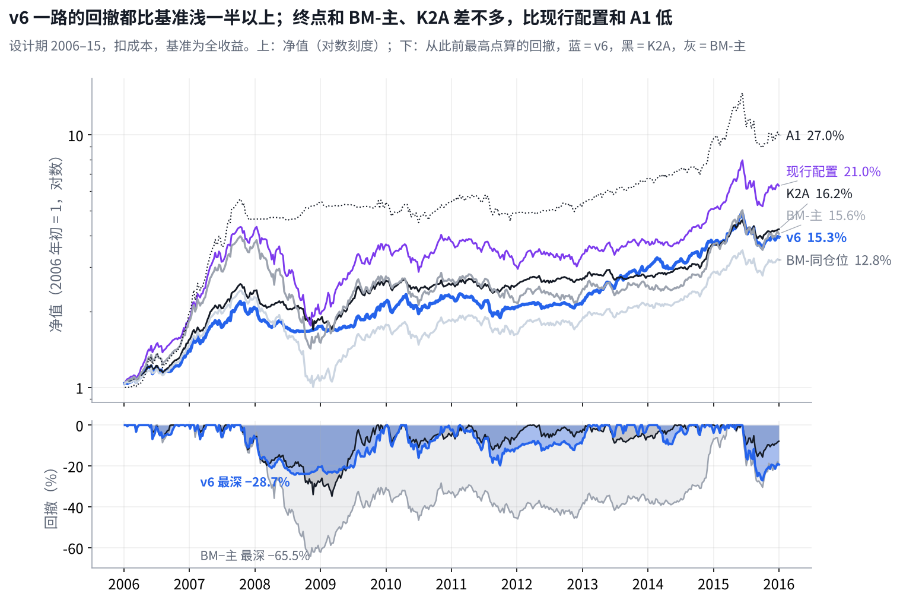
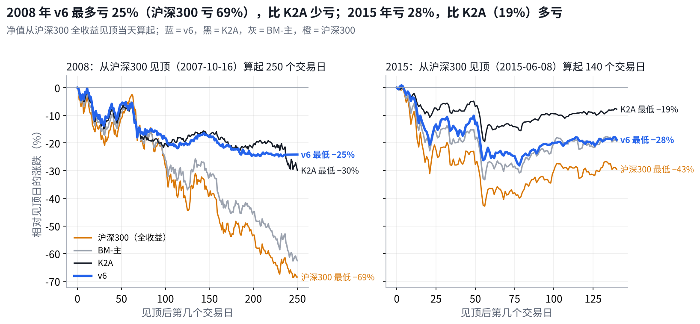
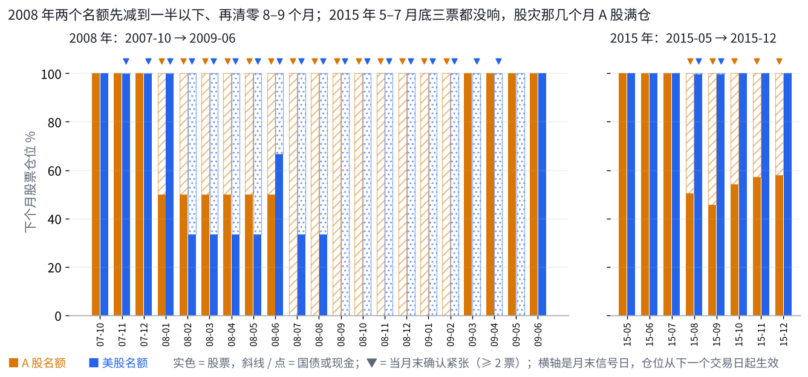
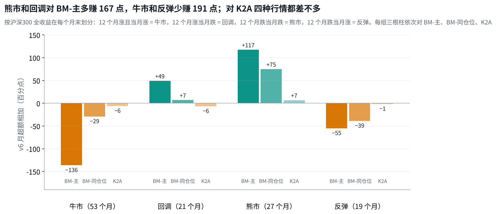
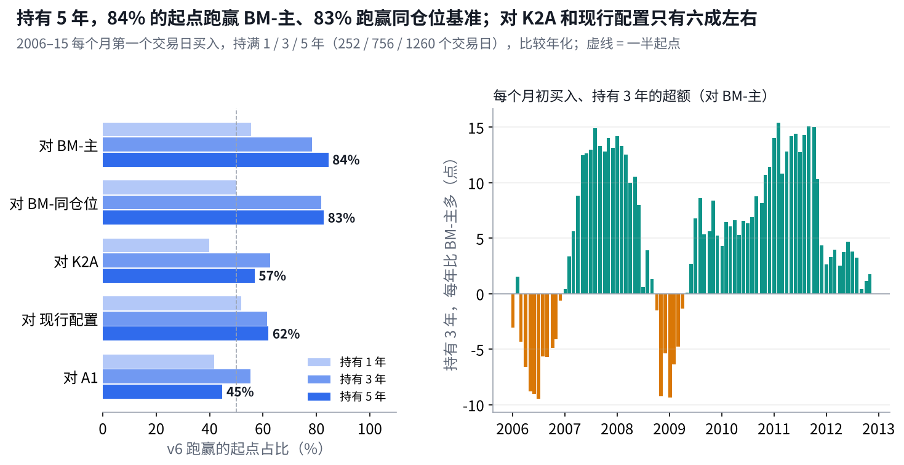
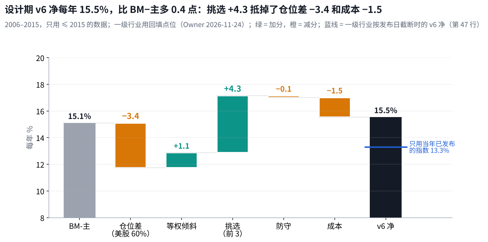
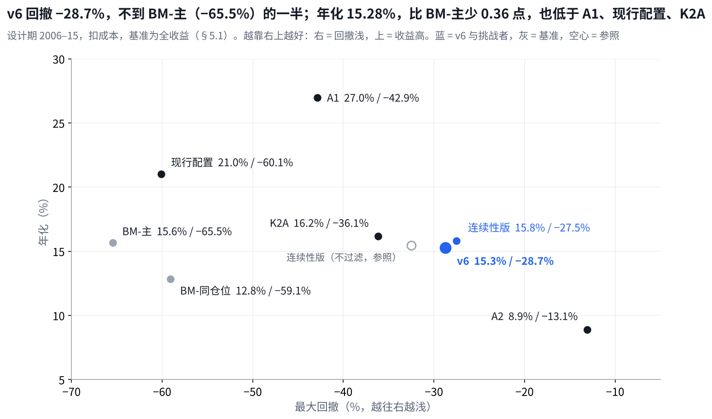
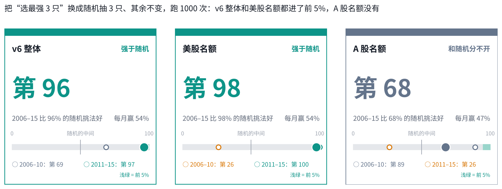
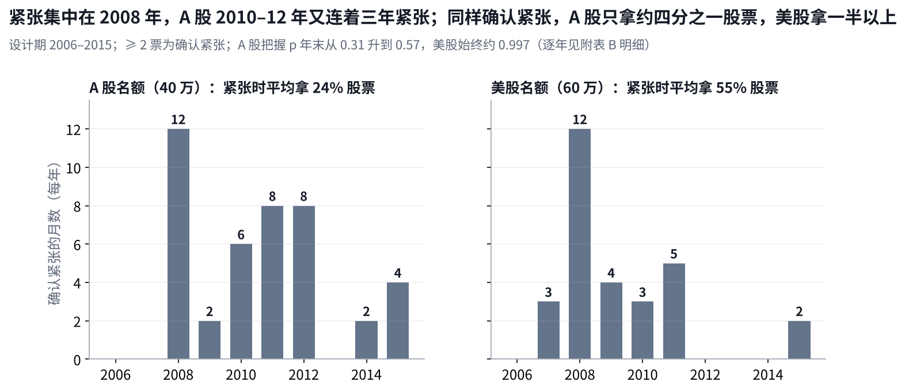

# v6 体检报告（设计期）：十年四条判据都过，后五年 ③④ 两条不过；回撤 −28.7% 不到基准一半，收益比 BM-主少 0.4 点

## Metadata

- Project: ETF_Rotation_Quant
- Document type: owner report（v6 设计期体检，冻结稿 §9.1 第 5 步）
- Status: final（第 1.5 版，2026-11-26：按 Owner 评论重做页首：结论缩成一句，新增四格指标（年化、回撤、跑赢随机、判据），进度和需要你各一句。第 1.4.2 版：第 3.1 节写明 2008 年现金和国债的来由。第 1.4.1 版：页首和第 10 节写入你批准开考、D50-4 选 B。第 1.4 版：第 3.1 节补上两次急跌的逐月仓位（Dev #389）；第 7.1 节按 Reviewer 两条 Should-fix 改为一位小数、删掉超出数据的说法，随机图改为 1000 条路径的分布。第 1.3 版：新增第 7.1 节“跑赢随机吗”（同结构随机 1000 次，Dev #377 @ 9935a314 与 Reviewer 锁定值对上）。第 1.2.1 版：按 Reviewer 独立复核把 v6 跟涨改为 58%，写明 K2A 记账差带来的两处差异。第 1.2 版：新增第 2 节“八条线是什么”，逐条写清做法和收益、回撤为什么不同；净值图改为普通刻度、单位万元。第 1.1 版：按 v5.1 体检的结构补了性格、两次急跌、四种行情、任意起点四块；第 1.0 版：Dev #377 @ a9a1e9e9 与 Reviewer #375 @ 7f1da3ff 独立算出的体检输入逐项对上后定稿；取代 11-25 的骨架第 0.1 版。骨架里判据 ④ 的 +3.5 用的是附表 B 的价格指数基准，按 D47-1 改为全收益基准下的 +2.5）
- Owner: L. Loric
- Maintainer: Orchestrator
- Date: 2026-11-26（Asia/Taipei）
- 派生分析：第 3–5 节由 `scripts/v6_report/health_extra.py` 从两边已对上的日收益（`results/v6/health-returns.csv`）和沪深300 全收益（H00300）算出，只做算术，截到 2015-12-31；Reviewer 用自己的日收益独立重算（#375 @ 36fb0870，`output/d48-health-extra-report-def.json`），除 K2A 记账差带来的两处外整数一致，v6 跟涨按其指出由 59% 改为 58%（完整值 58.46%）
- 依据：冻结预注册（tag `milestone/v6-prereg-freeze` → `f066da8e`）；实现口径 D45（#376）、D46（#378）、D47（#380）、D48（#382）；Dev #377、Reviewer #375
- 数据：只用 ≤ 2015-12-31。候选是人民币价格指数（不含分红）；判据和散点里的基准按 §5.1 用全收益（含分红）、每月第一个交易日再平衡；v6 两个名额每月末按 60/40 再平衡
- 页面：Claude 页面“v6 体检报告”；本文件是仓库镜像

---

**项目愿景**　在动态周期内，从多类资产里选出 Top N 强势 ETF 轮动持有，获得超额收益、稳定跑赢被动基准，同时把回撤控制住。

| 进度 | 结论 | 需要你 |
| --- | --- | --- |
| 两边各写一遍代码，设计期数字逐项对上。 | 设计期十年四条判据都过，后五年 ③④ 不过。这是看着数据定的，不算数。 | 不用操作。一次性检验已批准，过不过只看检验段。 |

<!-- 组件：指标 -->

| 指标 | v6 | 对照 | 对照值 | 读法 | 色 |
| --- | --- | --- | --- | --- | --- |
| 年化（2006–15） | 15.3% | BM-主 | 15.65% | 每年少 0.37 点 | 中 |
| 最大回撤 | −28.7% | BM-主 | −65.5% | 不到基准一半 | 好 |
| 跑赢随机 | 第 96.4 | 随机中位 | 第 50 | 前 5%，靠美股挑选 | 好 |
| 四条判据 | 4/4 | 后五年 | 2/4 | 后五年 ③④ 不过 | 中 |

<!-- 主线：这份体检的故事主线：从“数字可信吗”读到“要不要开考” -->

名词解释：口径、设计期、BM-主、BM-同仓位、A1、A2、现行配置、连续性版、K2A、仓位差、等权倾斜、挑选、防守、成本、把握 p、判据

| 名字 | 是什么 |
| --- | --- |
| **口径** | 判据、散点、预测对账：v6 两个名额每月末按 60/40 再平衡（15.28%），基准按 §5.1 用全收益。附表 B 和那张收益拆分图是另一套口径：基准用价格指数、v6 用每日固定 60/40 近似（15.54%），只用来和冻结稿对账。 |
| **设计期** | 2006–2015。规则是看着这段数据定的，所以这里的好成绩只说明“规则按设计在动”，不说明将来会赚钱；能不能赚钱看一次性检验（2016-01 → 2026-09）。 |
| **BM-主** | 70% 沪深300 + 15% 纳指100 + 15% 标普500，全收益、人民币、每月再平衡。AGENTS.md 规定的并列基准。 |
| **BM-同仓位** | 40% 沪深300 + 30% 纳指100 + 30% 标普500。和 v6 的 A 股 40%、美股 60% 同仓位，用来把“美股多放 20 点”的影响拆出去；判据 ④ 和它比。 |
| **A1** | 同行做法：每月末在沪深300、标普500 里全仓拿过去一年涨得多的那个；标普500 跑输现金就全仓国债。v4 已签收的账本，只报告。 |
| **A2** | 同行做法：沪深300、标普500、恒生、10 年国债、黄金各 1/5，每份低于 10 个月均价就拿现金。v4 已签收的账本，只报告。 |
| **现行配置** | 现在实际在跑的组合：A 股 70%（16 个指数等权）、海外 30%（纳指100、标普500 各半），不防守。只报告。 |
| **连续性版** | v6 的挑战者：只换 A 股名额的选法（先取涨幅前一半，再挑上涨天数占比最高的 3 只），其余同 v6。 |
| **K2A** | 增强基准：A 股 50% + 美股 50%；只给 A 股那一半上保险（月末低于 10 个月均线就换国债，仓位按波动调，每 5 个交易日看），美股那一半一直持有（你 11-17 定，D39-3）。“月末”用真实月末（你 11-26 定，D48-4）。判据 ③ 和它比。 |
| **仓位差** | BM-同仓位 − BM-主：只因为美股 60%、A 股 40% 而多或少的部分。 |
| **等权倾斜** | 同名额等权（按行业标签等权持有全部候选）− 名额的母指数：不挑、只是“全拿”带来的部分。 |
| **挑选** | 前 3、不设防守 − 同名额等权：每月选最强的 3 只值多少。预测表里美股这一项不拆，比的是前 3 − SPX（D48-3）。 |
| **防守** | v6 − 前 3、不设防守：确认紧张时按把握减仓值多少。 |
| **成本** | 单边 0.2%，按换手计。 |
| **把握 p** | p = Φ(t)，t 按以往紧张月里领头者下个月的涨幅算；紧张时股票只拿 p 那么多。不足 12 个紧张月时 p = 0.5。 |
| **判据** | 一次性检验的四条门槛：① 回撤 ≤ 40%、② 防守保费 ≤ 4 点、③ 年化 ÷ 回撤高于 K2A、④ 不落后 BM-同仓位；全部满足才通过。 |

## 0. 复算对上了没有：14 项里 12 项两边差 0，1 处冻结稿示例勘误，1 处记账差 ≤ 0.03 点

<!-- 问：v6 的代码算出来的，和冻结稿、和另一边是不是同一回事？｜短：复算｜状态：已定 -->

> **两边各自算出来，14 项里 12 项差 0；2015-08 的示例要勘误，K2A 年化差 0.03 点以内。**

<!-- 组件：对账｜复算结果：14 项里 12 项两边差 0 -->

| 结果 | 条目 | 说明 |
| --- | --- | --- |
| 勘误 | 2015-08 A 股示例（40 万） | 把握 0.235 → 约 0.50；股票 9.4 万 → 约 20.1 万 |
| 小差 | K2A（真实月末） | 年化差 ≤ 0.03 点：成本记账时点不同；回撤、结论相同 |
| 差 0 | 附表 B 八条年化 | 三段 |
| 差 0 | 收益拆分 | 仓位差、等权倾斜、挑选、防守、成本 |
| 差 0 | 逐年画像 | 紧张月、年末把握 p、平均股票仓位 |
| 差 0 | 年末可参选人数 | 2014 / 2015-11 / 2015-12 = 25 / 27 / 28 |
| 差 0 | 两个月份的选人 | 名单和涨幅 |
| 差 0 | 美股把握 p | 2015-08 = 0.997 |
| 差 0 | TRIN 截尾修正后 | 设计期投票 0 个月变化 |
| 差 0 | French 长历史 | 和预演用的是同一份文件 |
| 差 0 | 合成行情 | 当时版本重跑，逐格相同 |
| 差 0 | 三段四条判据 | v6 和连续性版 |
| 差 0 | 八条线 | 年化和最大回撤（K2A 见上） |
| 差 0 | 预测五项 | 名额内的值和组合贡献 |

- **读这块**：先看左上的 12 / 14；两张例外卡都不改规则、不改判定；下面的绿格覆盖了设计期的全部数字。

怎么复算的：两条线各写一遍代码，规范以冻结稿加同一冻结版本里的预演代码为准，冻结稿没写尽的地方写成 D45–D48

<!-- 页面：定义 -->

- **勘误怎么来的**：冻结稿里讲“定仓位”的例子用了一级行业按发布日截断的旧口径；按冻结规则的口径（一级行业用回填点位），2015 年 8 月 A 股把握约 0.50，股灾那个月大约留一半股票（第 9 节）。
- **Dev**：按冻结规则在 `src/v6/` 写新实现，跑设计期，和冻结稿逐项对账（#377）。
- **Reviewer**：不读 Dev 的代码，自己再实现一遍；每一轮先把自己的数字锁定、记下哈希，再去读 Dev 的结果（#375）。
- **规范的范围**：冻结稿写给人读，可执行的细节在同一冻结版本的预演代码里；两边都可以读预演代码，不读对方的新代码（D45，你 11-25 确认）。
- **程序错误**：TRIN 截尾原来用整段样本的 99% 分位，属于向前看；改为只用当天及以前的数据（D45-10，你 11-25 确认）。设计期投票一个月都没变，只影响一次性检验。
- **对账时定下的口径**：基准用全收益（D47-1）；预测按组合贡献对账（D47-2）；连续性版也过“只选为正”，只改 A 股名额（D47-3、D48-5）；v6 两个名额每月再平衡（D48-1）；美股挑选比 SPX（D48-3）；K2A 用真实月末（D48-4）。

<!-- 接力：数字两边都对上了，先看最关心的问题：四条判据过不过 -->

## 1. 过不过：十年全段四条都过；后五年 ③ 对 K2A、④ 对同仓位基准两条不过

<!-- 问：一次性检验的四条门槛，放在设计期里能不能过？｜短：过不过｜状态：已定 -->

> **全段：回撤 −28.7%、保费 0.8 点、年化 ÷ 回撤 0.53 对 K2A 0.45、对同仓位基准 +2.5 点。2011–15 年：0.42 对 K2A 0.57，对同仓位基准 −0.1 点。**

<!-- 组件：闸门格｜四条判据 × 三段：全段四条都过，后五年 ③④ 不过 -->

| 编号 | 门槛 | 事先机会 | 2006–10 | 2011–15 | 2006–15 |
| --- | --- | --- | --- | --- | --- |
| ① 回撤 | ≤ 40% | 80% | −25.0%｜过 | −28.7%｜过 | −28.7%｜过 |
| ② 防守保费 | ≤ 4 点 | 85% | 0.0 点｜过 | 1.4 点｜过 | 0.8 点｜过 |
| ③ 对 K2A | 年化 ÷ 回撤高于 K2A | 60% | 0.74 对 0.59｜过 | 0.42 对 0.57｜不过 | 0.53 对 0.45｜过 |
| ④ 对同仓位基准 | ≥ 0 | 50% | +5.2 点｜过 | −0.1 点｜不过 | +2.5 点｜过 |
| 四条全过 | 全部满足才通过 | 30% | 过 | 不过 | 过 |

- **读这块**：每行一条判据，右边三格是三段的值，框起来的一列是全段。橙格是不过：都在 2011–15 年。
- **后五年为什么不过**：2011–15 年 v6 每年 12.1%，回撤仍是 −28.7%（2015 年股灾）；K2A 同期每年 11.1%，回撤只有 −19.6%；BM-同仓位每年 12.28%，比 v6（12.14%）多 0.14 点。
- **设计期过了不算数**：规则是看着这段数据定的；四条在设计期全过只是必要条件，过不过只看一次性检验。事先估计四条全过的机会约三成。

判据原文、K2A 两种月末，以及连续性版（挑战者）的四条判据

| 编号 | 门槛 | 判据 | 来历 |
| --- | --- | --- | --- |
| ① 底线 | 回撤 ≤ 40% | 指数池净值从任何高点算的最大回撤不超过 −40%（100 万最低不跌破 60 万；按 D39-1 括号里的定义，比“从 100 万起最低剩 60 万”更严） | D39-1 |
| ② 保费 | ≤ 4 点 | 取 BM-主全年收益为正的自然年（首尾不满一年的不计）；逐年算“对照‘不设防守’的年收益 − v6 年收益”，取算术平均，不超过 4 点 | D39-2；Owner 2026-11-23 定：只量防守这份保险的成本（D40-14） |
| ③ 对 K2A | 高于 K2A | 同一窗口、同一口径（指数池、人民币、扣成本）：v6 的年化 ÷ 最大回撤的绝对值，高于 K2A 的同一比值 | D38 第 18 行“赢过增强基准”；Owner 2026-11-23 定（D40-14） |
| ④ 对同仓位基准 | ≥ 0 | 同一窗口、同一口径：v6 年化 − BM-同仓位年化 ≥ 0 | 愿景“稳定跑赢被动基准”；Owner 2026-11-23 定（D40-14）；预测范围 −1.3 到 +2.4 只用于事后对账 |

- **K2A 两种月末**：真实月末（主值）三段是 0.59 / 0.57 / 0.45；预演代码那种每 21 个交易日算一个月（参照）是 0.50 / 0.57 / 0.38。三段的过与不过两种都一样。
- **② 用了哪几年**：BM-主全年为正的 2006、2007、2009、2012、2013、2014、2015 年；“不设防守”和 v6 都按每月再平衡、单边 0.2%。

<!-- 组件：闸门格｜连续性版（挑战者）：全段四条都过，后五年 ③ 不过、④ 过 -->

| 编号 | 门槛 | 事先机会 | 2006–10 | 2011–15 | 2006–15 |
| --- | --- | --- | --- | --- | --- |
| ① 回撤 | ≤ 40% |  | −27.5%｜过 | −24.9%｜过 | −27.5%｜过 |
| ② 防守保费 | ≤ 4 点 |  | 0.0 点｜过 | 1.2 点｜过 | 0.7 点｜过 |
| ③ 对 K2A | 高于 K2A |  | 0.65 对 0.59｜过 | 0.55 对 0.57｜不过 | 0.57 对 0.45｜过 |
| ④ 对同仓位基准 | ≥ 0 |  | +4.6 点｜过 | +1.4 点｜过 | +3.0 点｜过 |
| 四条全过 | 全部满足才通过 |  | 过 | 不过 | 过 |

- **连续性版只在这里报告**：它只换 A 股名额的选法；按冻结稿 §5.3，要在一次性检验里也过四条、并且检验段 A 股名额的月度差平均为正，才在前向模拟盘换上。设计期好一点不构成理由。

<!-- 接力：判据过不过看完了；后面要拿 v6 和七条线比，先说清每条线是怎么做的 -->

## 2. 八条线是什么：有没有防守定回撤深浅，A 股牛市里放多少定收益高低

<!-- 问：后面图里的 A1、A2、K2A、现行配置、BM-主、BM-同仓位、连续性版各是什么做法？做法不同，收益和回撤差在哪？｜短：八条线｜状态：已定 -->

> **没设防守的三条回撤 −59% 到 −66%，设了防守的五条 −13% 到 −43%；同仓位下，v6 比 BM-同仓位每年多 2.5 点、回撤浅一半。**

| 线 | 放哪 | 怎么选 | 防守 | 年化 | 最大回撤 | 为什么是这个结果 |
| --- | --- | --- | --- | --- | --- | --- |
| v6 | A 股 40%、美股 60% | 每月每个名额取涨幅前 3 | 紧张时股票只拿 p | 15.3% | −28.7% | 减仓躲大跌；A 股少，牛市少赚 |
| 连续性版 | 同 v6 | A 股改挑上涨天数最多的 3 只 | 同 v6 | 15.8% | −27.5% | 和 v6 几乎一样 |
| K2A | A 股 50%、美股 50% | 不挑：沪深300、纳指、标普 | 只管 A 股：破均线换国债 | 16.2% | −36.1% | 美股不防，2008 年跌得深 |
| A1 | 沪深300 或标普500，全仓 | 每月拿过去一年涨得多的那个 | 标普跑输现金就全换国债 | 27.0% | −42.9% | 全仓吃到牛市；太集中，回撤深 |
| A2 | 五类各 1/5 | 不挑：A、美、港股，国债，黄金 | 每份破均线就拿现金 | 8.9% | −13.1% | 股票少又分散：最稳、最低 |
| 现行配置 | A 股 70%、海外 30% | 不挑：16 个 A 股指数等权 | 没有 | 21.0% | −60.1% | A 股多，牛市赚得多，跌得也深 |
| BM-主 | A 股 70%、美股 30% | 不挑：沪深300、纳指、标普 | 没有 | 15.6% | −65.5% | A 股多，2008 年跟着跌 |
| BM-同仓位 | A 股 40%、美股 60% | 不挑：沪深300、纳指、标普 | 没有 | 12.8% | −59.1% | v6 去掉挑选和防守：差一截 |

每条线的完整做法和口径；差在哪的两条读法

- **回撤看有没有防守**：同样 A 股 40%、美股 60%，v6 −28.7%，不防守的 BM-同仓位 −59.1%。
- **收益看 A 股牛市里放了多少**：A 股 70% 的 BM-主比 40% 的 BM-同仓位每年多 2.8 点；v6 只放 40%，这块吃亏最多（第 6 节）。

| 线 | 完整做法 |
| --- | --- |
| v6 | A 股 40%、美股 60% 两个名额。每月末每个名额按过去一年涨幅（不算最近一个月）排名，同一行业只留一只，取前 3 等分；母指数跌破 10 个月均线时只选涨幅为正的。三票（母指数破均线、宽度、TRIN）里 ≥ 2 票算紧张，股票只拿把握 p，其余放国债 |
| 连续性版 | 美股同 v6；A 股先按涨幅去重取前一半，再取其中信息离散度最低（上涨天数占比远高于下跌天数）的 3 只；其余三步同 v6 |
| K2A | A 股 50% 拿沪深300：月末跌破 10 个月均线换国债，仓位 = 长期波动 ÷ 近 20 日波动（最多 1），每 5 个交易日看；美股 50%（纳指100、标普500 各半）一直持有 |
| A1 | 每个月末：标普500 全收益过去 12 个月高于现金，就在标普500、沪深300 全收益里全仓过去 12 个月涨得多的那个；否则全仓 10 年国债 |
| A2 | 沪深300、标普500、恒生、10 年国债、黄金各 1/5；每个月末，这一份高于过去 10 个月末收盘的平均才持有，否则这一份拿现金 |
| 现行配置 | `config/portfolio.toml`：A 股 70%（16 个指数等权）、海外 30%（纳指100、标普500 各半），阀门关闭，月末调仓，单边 0.05% |
| BM-主 | 70% 沪深300 + 15% 纳指100 + 15% 标普500，全收益、人民币，每月第一个交易日再平衡 |
| BM-同仓位 | 40% 沪深300 + 30% 纳指100 + 30% 标普500，同上 |

全部为 2006–15 年设计期，扣成本，基准为全收益；A1、A2 引用 v4 已签收的账本。把握 p：以往紧张月里领头的 3 只下个月赚钱的把握，设计期 A 股约 0.3–0.6，美股接近 1（第 9 节）。v6 比 BM-同仓位多出的 2.5 点，是挑选、防守、成本相加后的净结果，拆开见第 6 节。

<!-- 接力：做法看清了；这十年它们各自怎么走过来的？先看 100 万变成多少、回撤有多深 -->

## 3. 性格：跌的时候只跟四成，涨的时候只跟六成；最深回撤 −28.7%，不到基准的一半

<!-- 问：v6 这十年是怎么走过来的，和别人比是什么性格？｜短：性格｜状态：已定 -->

> **BM-主下跌的 46 个月里，v6 平均只跟到 41%；上涨的 74 个月里跟到 58%。年化波动 15.7%，比 BM-主（23.2%）低三分之一，和 K2A（14.8%）相近。**

|  | v6 | K2A | 现行配置 | A1 | 基准 BM-主 | 读法 |
| --- | --- | --- | --- | --- | --- | --- |
| 年化 | 15.3% | 16.2% | 21.0% | 27.0% | 15.6% | 收益不高 |
| 最大回撤 | −28.7% | −36.1% | −60.1% | −42.9% | −65.5% | 五条里最浅 |
| 年化波动 | 15.7% | 14.8% | 23.8% | 21.7% | 23.2% | 和 K2A 相近 |
| 上涨月份跟到 | 58% | 61% | 106% | 77% | 100% | 涨时跟不满 |
| 下跌月份只跟 | 41% | 42% | 94% | 31% | 100% | 跌时躲开六成 |

上涨（下跌）月份跟到 = BM-主上涨（下跌）的月份里，平均月收益是 BM-主的百分之几；下跌月份越低越好。窗口 2006-01-04 → 2015-12-31，扣成本，基准为全收益。

- **和 K2A 几乎是一种性格**：跟涨、跟跌、波动都差不多，十年下来收益少 0.9 点、回撤浅 7.4 点。判据 ③ 比的正是这两样，所以 ③ 过得不宽。
- **换手**：A 股名额每年约 6.6 倍、美股名额约 5.9 倍，单边 0.2% 每年约 1.5 点成本（附表 B）。

### 3.1 两次急跌：2008 年最多亏 25%，比 K2A 少；2015 年亏 28%，比 K2A 多

> **从沪深300 全收益见顶算起，2008 年 v6 最多亏 25%（沪深300 −69%、BM-主 −63%、K2A −30%）；2015 年最多亏 28%（沪深300 −43%、BM-主 −33%、K2A −19%）。**

- **2008 年躲开了大半**：一年后 v6 还是 −24%，沪深300 −69%、BM-主 −63%。
- **2015 年这次防守帮得不多**：v6 最多亏 28%，和 BM-主（−33%）差不多，K2A 只亏 19%，这是后五年判据 ③ 不过的主要原因。下图说明为什么。

- **2015 年的防守晚了一拍**：5、6、7 月底 A 股三票都是 0，股灾那几个月 A 股名额一直满仓；8 月底三票全中，之后只留约一半股票。
- **2008 年的清零靠“只买涨的”**：A 股名额 1 月底起按把握 0.5 留一半，7 月底起一只为正的都没有，清零；美股名额 2 月底起只剩 1 只为正，留三分之一，9 月底起清零。

两段急跌的逐月明细：三票、紧张、把握 p、股票仓位

| 月末 | A 股票数 | A 股股票 | 美股票数 | 美股股票 |
| --- | ---: | ---: | ---: | ---: |
| 2015-05 | 0 | 100% | 0 | 100% |
| 2015-06 | 0 | 100% | 1 | 100% |
| 2015-07 | 0 | 100% | 1 | 100% |
| 2015-08 | 3 | 50% | 2 | 100% |
| 2015-09 | 2 | 46% | 2 | 100% |
| 2015-10 | 2 | 54% | 0 | 100% |
| 2015-11 | 3 | 57% | 0 | 100% |
| 2015-12 | 2 | 58% | 0 | 100% |

- **读法**：月末算信号，下一个交易日起按这个仓位持有。≥ 2 票算紧张；紧张时股票 = 把握 p × 入选只数 ÷ 3，空出来的放国债或现金。
- **2008 年**（2007-10 → 2009-06，21 个月）：A 股 2008-01 到 2009-02 连续紧张，前 6 个月留 50%，2008-07 起 0%，2009-03 起恢复满仓；美股 2007-11 到 2009-04 紧张，2008-02 起 33%（6 月一度 67%），2008-09 到 2009-05 为 0%，2009-06 恢复满仓。
- **现金还是国债**：规则本身没变。冻结稿 §1.2 第 ③ 步：空出来的钱放国债，国债跌破自己的 10 个月均线时放现金。A 股用的中债 10 年期国债财富指数 2008-01 才有数据，要满 10 个月末才有均线；2008-09 及以前算不出均线，只能放现金，2008-10 起才放国债（Dev #391 说明，冻结代码 `scripts/preflight/v6_appendix_b.py` 第 28、69–70 行）。
- 数据：Dev #389 @ 907d9530 `results/v6/health-crash-positions.csv`（58 行，Reviewer 已复核哈希和 2015-08 一行）。

<!-- 接力：两次急跌一好一差；把十年按行情切开，看 v6 在哪种行情里赢、哪种里输 -->

## 4. 四种行情：熊市和回调对 BM-主多赚 167 点，牛市和反弹少赚 191 点；对 K2A 四种都差不多

<!-- 问：v6 在什么行情里赢、什么行情里输？｜短：四种行情｜状态：已定 -->

> **对 BM-主：熊市 +117、回调 +49，牛市 −136、反弹 −55。对 K2A 四种行情都在 ±7 点以内，跑赢的月份都在一半上下。**

四种行情的明细：月数、合计、跑赢月份，三个对照

| 行情 | 月数 | 对 BM-主 合计 · 跑赢月份 | 对 BM-同仓位 合计 · 跑赢月份 | 对 K2A 合计 · 跑赢月份 | 读法 |
| --- | --- | --- | --- | --- | --- |
| 牛市 | 53 | −136 · 30% | −29 · 47% | −6 · 53% | 只放 40% 在 A 股，牛市追不上 |
| 回调 | 21 | +49 · 76% | +7 · 52% | −6 · 43% | 主要靠少放 A 股 |
| 熊市 | 27 | +117 · 78% | +75 · 63% | +7 · 48% | 防守起作用 |
| 反弹 | 19 | −55 · 26% | −39 · 32% | −1 · 47% | 减仓后回来慢 |

按沪深300 全收益在每个月末划分：过去 12 个月涨、当月也涨 = 牛市；12 个月涨、当月跌 = 回调；12 个月跌、当月也跌 = 熊市；12 个月跌、当月涨 = 反弹。合计 = 该行情每月 v6 收益减对照收益（百分点）相加。Reviewer 独立重算（#375 @ 36fb0870）月数、对 BM-主的合计和跑赢月份全部对上；反弹对 K2A 为 −1.5（这里 −1.4），差在 K2A 的成本记账时点。

- **对 BM-主的输赢大半是仓位**：换成同仓位基准，牛市只少 29 点、熊市多 75 点，形状不变但幅度小了一半以上。
- **对 K2A 没有哪种行情明显占优**：四种都在 ±7 点以内，这和第 3 节“性格相近”是同一件事。

<!-- 接力：按行情切开是“什么时候”；换个角度，任何一个月买进去，持有几年能不能赢？ -->

## 5. 任意起点：持有 5 年，84% 的起点跑赢 BM-主；对 K2A 和现行配置只有六成左右

<!-- 问：任何一个月买进去，持有 1、3、5 年，有多少起点能赢？｜短：任意起点｜状态：已定 -->

> **持有 5 年（58 个起点）：对 BM-主 84% 跑赢，中位每年多 4.4 点，最差少 4.3 点；对同仓位基准 83%；对 K2A 57%、对现行配置 62%、对 A1 45%。**

任意起点的明细：持有 5 年、3 年，五个对照的跑赢占比、中位、最差

| 持有 5 年（58 个起点），v6 对 | 跑赢的起点 · 中位 · 最差 | 持有 3 年（83 个起点） | 读法 |
| --- | --- | --- | --- |
| BM-主 | 84% · +4.4 · −4.3 | 78% · +5.4 · −9.4 | 多数起点赢 |
| BM-同仓位 | 83% · +3.7 · −2.7 | 82% · +5.1 · −11.7 | 多数起点赢 |
| K2A | 57% · +1.6 · −5.3 | 63% · +1.0 · −10.9 | 接近一半 |
| 现行配置 | 62% · +1.5 · −12.9 | 61% · +3.2 · −16.6 | 输的时候输得多 |
| A1 | 45% · −1.3 · −26.0 | 55% · +0.3 · −56.3 | 一半以下 |

2006–15 每个月第一个交易日买入，持满 1260（756）个交易日，比较年化；中位、最差 = 每年多（少）赚的百分点。持有 1 年的数字在图上。Reviewer 用自己的日收益独立重算（#375 @ 36fb0870），其余整数都对上；只有持有 5 年对 K2A 是 55%（32/58），这里是 57%（33/58），差在 K2A 的成本记账时点（第 0 节“小差”），中位和最差相同。

- **输的起点集中在两段**：2006 年和 2008 年底到 2009 年初买入、持有 3 年的，都赶上了 A 股大涨（2006–07 年、2009 年），v6 只放 40% 在 A 股，跑输 BM-主。
- **持有越短越看运气**：对 BM-主，持有 1 年只有 56% 的起点赢，3 年 78%，5 年 84%。

<!-- 接力：输赢的形状看清了；再把十年的钱按来源拆开 -->

## 6. 钱从哪来：挑选每年 +4.3 是主要来源；对 BM-主，附表 B 口径多 0.4 点，判据口径少 0.4 点

<!-- 问：比基准多出来的钱，来自挑选、防守，还是只是仓位？｜短：钱从哪来｜状态：已定 -->

> **拆分沿用附表 B 口径（基准不含分红）：前五年 v6 比 BM-主每年少 3.3 点，后五年多 3.9 点，挑选两段都是正的（+5.0、+3.5）。换成判据口径（基准含分红、每月再平衡），v6 比 BM-主每年少 0.4 点。**

- **读这张图**：冻结稿原图，附表 B 口径。从左往右累加，绿色加分、橙色减分；最高的绿柱是挑选（+4.3），最长的橙柱是仓位差（−3.4），来自 2006–10 年 A 股大牛市里只放了 40%。
- **两套口径差在哪**：判据口径下基准含分红（BM-主 15.65%，附表 B 是 15.10%），v6 用每月再平衡（15.28%，附表 B 是 15.54%），于是“多 0.44”变成“少 0.37”。候选是价格指数、不含分红，这一层对 v6 不利，检验偏保守。
- **挑选 +4.3 不能当检验段的预期**：一级行业只用当年已发布的点位时，v6 净只有 13.3%（图中蓝线）；申万一级上 12−1 前 3 对等权每年 −5.9（冻结稿 §4 第 7 条），A 股挑选的证据一正一反。

两段拆开看：前五年仓位差吃掉 9.3 点，后五年挑选和仓位一起加分

| 收益来源 | 2006–10 | 2011–15 | 2006–15 |
| --- | ---: | ---: | ---: |
| 仓位差 | −9.33 | +2.25 | −3.36 |
| 等权倾斜 | +1.78 | +0.49 | +1.13 |
| 挑选 | +5.03 | +3.54 | +4.28 |
| 防守 | +0.65 | −0.88 | −0.13 |
| 成本 | −1.46 | −1.49 | −1.48 |
| 合计 | −3.33 | +3.91 | +0.44 |

单位：每年比 BM-主多几个点。

| 序列 | 2006–10 | 2011–15 | 2006–15 |
| --- | ---: | ---: | ---: |
| BM-主（70/15/15） | 21.81 | 8.76 | 15.10 |
| BM-同仓位（40/30/30） | 12.48 | 11.01 | 11.74 |
| 同结构等权、不设防守 | 14.26 | 11.50 | 12.87 |
| 前 3、不设防守 | 19.29 | 15.04 | 17.15 |
| v6 毛（不计成本） | 19.94 | 14.16 | 17.02 |
| v6 净（单边 0.2%，每日固定 60/40） | 18.48 | 12.67 | 15.54 |
| v6 净（每月再平衡 60/40） | 18.51 | 12.14 | 15.28 |
| 参照：一级行业按发布日截断（第 47 行口径） | 13.87 | 12.74 | 13.30 |

单位：每年 %。只用 ≤ 2015 的数据，口径与预演相同（美股为人民币价格指数）。

- **两种口径差约 2 点**：一级行业按发布日截断时，2006–10 年 A 股只有 2–7 个可选，v6 净每年 13.3%；按冻结规则的回填口径是 15.5%。检验段两种口径的名单完全相同，判据不受影响。
- **换手**：A 股名额每年 6.6 倍，美股名额 5.9 倍；按单边 0.2% 每年约 1.5 点成本，仍在疼痛表“每年成本超过 2 点”的警戒线以内。

<!-- 接力：拆开看，v6 主要赢在挑选、输在仓位；放在别的做法中间，它站在哪？ -->

## 7. 和别人比：v6 回撤 −28.7%，不到 BM-主的一半；收益低于 A1、现行配置、K2A 和 BM-主

<!-- 问：同一段时间里，v6 和别的做法比，收益和回撤各在什么位置？｜短：和别人比｜状态：已定 -->

> **2006–15 年 v6 每年 15.3%、回撤 −28.7%：回撤比它浅的只有 A2 和连续性版；收益在八条线里排第 6，比现行配置每年少 5.7 点。**

- **读这张图**：越靠右上越好。v6 在右侧中间，回撤比它浅的只有 A2 和连续性版；左边的基准和现行配置，回撤都在 −59% 到 −66%。

八条线三段的年化和最大回撤

- **A1 的高收益来自前五年**：2006–10 年每年 42.1%，2011–15 年 13.4%，回撤 −42.9%。
- **和现行配置比**：v6 每年少 5.7 点，最大回撤从 −60.1% 降到 −28.7%；这是 v6 用收益换回撤的账。

| 序列 | 2006–10 | 2011–15 | 2006–15 |
| --- | ---: | ---: | ---: |
| v6 净 | 18.51 | 12.14 | 15.28 |
| 连续性版 | 17.92 | 13.70 | 15.79 |
| A1 | 42.07 | 13.44 | 26.96 |
| A2 | 14.52 | 3.52 | 8.88 |
| K2A | 21.38 | 11.15 | 16.15 |
| 现行配置 | 31.79 | 11.13 | 21.02 |
| BM-主 | 22.29 | 9.37 | 15.65 |
| BM-同仓位 | 13.36 | 12.28 | 12.82 |

单位：年化，每年 %。扣成本；基准为全收益（§5.1）；K2A 为真实月末，Reviewer 独立结果差 ≤ 0.03 点。

| 回撤 | 2006–10 | 2011–15 | 2006–15 |
| --- | ---: | ---: | ---: |
| v6 | −25.0 | −28.7 | −28.7 |
| 连续性版 | −27.5 | −24.9 | −27.5 |
| A1 | −21.6 | −42.9 | −42.9 |
| A2 | −10.7 | −13.1 | −13.1 |
| K2A | −36.1 | −19.6 | −36.1 |
| 现行配置 | −60.1 | −35.9 | −60.1 |
| BM-主 | −65.5 | −33.3 | −65.5 |
| BM-同仓位 | −59.1 | −22.7 | −59.1 |

单位：最大回撤，%，窗口内从窗口内高点算。

- **现行配置怎么算的**：`config/portfolio.toml` 全部字段，阀门关闭，单边 0.05%；数据面板只用 2015 年及以前的数据重建（D47-4）。偏离带、溢价上限、主备基金、净值滞后、一手 100 份不在日频回测里。
- **A1、A2**：引用 v4 已签收的账本，不重跑（D42-8）；哈希与冻结稿 §5.2 一致。

### 7.1 跑赢随机吗：v6 整体排第 96.4 百分位；美股名额第 97.6，A 股名额第 67.5

<!-- 问：把“每月选最强 3 只”换成随机抽 3 只，v6 还比得过吗？｜短：跑赢随机｜状态：已定 -->

> **随机 1000 次：v6 整体第 96.4、美股名额第 97.6，都在前 5%；A 股名额第 67.5，不在前 5%。**

<!-- 组件：读数｜三条读法 -->

| 读法 | 焦点 | 说明 | 色 |
| --- | --- | --- | --- |
| 量的是什么 | 只换掉了挑选 | 其余全不变 | 中 |
| 不是每段都灵 | 美股 26.2 → 100.0；A 股 88.9 → 26.4 | 前后五年，两个名额正好反过来 | 差 |
| 不是月月赢 | 每月赢 54.2% | 一半多的月份赢过随机中位数 | 中 |

<!-- 组件：随机格｜三本账 × 三段：大数是百分位，框住的是全段 -->

| 账 | 2006–10 | 2011–15 | 2006–15 |
| --- | --- | --- | --- |
| v6 整体 | 68.7｜47%｜18.5% | 97.2｜62%｜12.1% | 96.4｜54%｜15.3% |
| 美股名额 | 26.2｜37%｜1.3% | 100.0｜72%｜13.6% | 97.6｜54%｜7.3% |
| A 股名额 | 88.9｜48%｜45.6% | 26.4｜45%｜8.1% | 67.5｜47%｜25.5% |

口径：百分位、每月赢、年化怎么算，两边怎么对上

- **和前面对得上**：第 8 节里美股挑选（+3.4）远高于事先范围，第 6 节里 A 股挑选的证据一正一反；这里也是美股强、A 股说不清。

- **百分位**：1000 条随机路径的年化里，不高于 v6 年化的比例。种子 20261122、1000 次，只用 ≤ 2015。
- **每月赢**：v6 月收益严格高于当月 1000 条中位数的月份比例。
- **年化**：名额的年化是名额自己的人民币收益；美股名额 2006–10 年只有 1.3%，A 股名额 45.6%。
- **对账**：Dev #377 @ 9935a314 与 Reviewer 锁定的 `d48-random.json` 九格都在事先约定的容差内（百分位差 ≤ 3、每月差 ≤ 2 个百分点），例如 v6 整体 2006–15 是 96.4 对 95.5。

<!-- 接力：回撤浅、收益偏低；事先估的每一项，设计期落在哪里？ -->

## 8. 预测准不准：挑选三项都高于范围，防守保费和仓位差在范围里；合计 +2.5 刚过上限 +2.4

<!-- 问：事先估的每一项，设计期实际落在范围里吗？｜短：预测｜状态：已定 -->

> **设计期在样本内，预测已打过五折和六折，挑选高于范围在意料之中，不计功；防守保费 −0.8、仓位差 −2.8 落在范围里；成本 −1.5 比预演估计多约 0.4 点。**

- **这张图和第 6 节不是一套账**：这里每项是组合贡献，挑选和等权倾斜不扣成本、比的是价格指数，合计比的是 BM-同仓位，所以各项不相加，也和第 6 节的 +4.3、−3.4 不同。绿点高于范围，橙点低于范围。
- **挑选高出最多的是美股**：组合贡献 +3.4，范围上限 +1.5。名额内前 3 比 SPX 每年多 5.7 点，其中前 3 比等权 4.9 点、等权比 SPX 0.8 点。
- **成本多约 0.4 点**：预演估每年 1.0–1.1 点，附表 B 按实际换手重估约 1.5 点，仍低于疼痛表 2 点的警戒线。

预测表原文、设计期实际与对账口径

| 来源 | 中间值 | 范围 | 设计期 |
| --- | ---: | --- | --- |
| 美股名额挑选（前 3） | +1.0 | +0.3 到 +1.5 | +3.41 |
| A 股名额：挑选 | +0.1 | −0.5 到 +0.5 | +1.48 |
| A 股名额：等权倾斜 | +0.5 | −1.0 到 +1.0 | +2.28 |
| 防守的平时保费 | −0.4 | −1.6 到 −0.4 | −0.79 |
| 美股 60% 的仓位差 | 0 | −3 到 +3 | −2.83 |
| 成本 | — | −1.1 到 −1.0（预演估计） | −1.48 |
| 合计（不含仓位差） | +1.2 | −1.3 到 +2.4 | +2.46 |

单位：每年比基准多几个百分点（组合层面）。预测取自《v6 预演预测表》第 3.22 版（冻结稿 §3.1 原样进入）；A 股一项按 D40-12 拆成挑选和等权倾斜两块；成本的预演估计取自冻结稿 §6 疼痛表，设计期成本取附表 B。

- **组合贡献怎么算**：名额内的值 × 名额权重（美股 0.6、A 股 0.4），和预测表“乘美股 60%”“乘 40%”的算法相同（D47-2）。名额内：美股前 3 − SPX 5.68，A 股挑选 3.71，A 股等权倾斜 5.69。
- **各项不相加**：挑选、等权倾斜不计成本、比的是价格指数；合计 = v6 净 − BM-同仓位 = 15.28 − 12.82，扣成本、基准含分红。
- **为什么设计期高于预测是预期之中**：预测表把历史超额打了五折，再按候选个数打了六折，专门扣掉设计期的挑选偏差；冻结稿也写明预测表各项不直接取设计期年化。

<!-- 接力：挑选比事先估的强，防守保费在范围里；保费背后，防守在哪几年启动、启动时留多少股票？ -->

## 9. 规则怎么动：A 股 42 个紧张月、美股 29 个；紧张时 A 股平均只拿 24% 股票，美股 55%

<!-- 问：防守什么时候启动、启动时股票留多少？｜短：怎么动｜状态：已定 -->

> **A 股 42 个紧张月里 36 个在 2008–2012 年，美股 29 个里 19 个在 2007–09 年；紧张时 A 股平均股票仓位 24%，美股 55%。**

<!-- 组件：构成｜2015 年 8 月股灾后（勘误后）：A 股大约留一半股票，美股几乎满仓 -->

| 名称 | 成分 | 用途 |
| --- | --- | --- |
| A 股名额（40 万） | 股票 20.1｜国债 19.9 | 三票全中，把握 p 约 0.50 |
| 美股名额（60 万） | 股票 59.8｜国债 0.2 | 紧张，把握 p 0.997 |

- **读这块**：上图看哪几年紧张、紧张时留多少股票；下面的条是 2015 年 8 月一个月的实际持仓（万元）。冻结稿原来写 A 股只留 9.4 万，是用旧口径算的（第 0 节勘误）。
- **美股的减仓来自“只买涨的”**：美股把握接近 1，紧张时仓位仍降到 55%，靠的是母指数跌破均线时只选过去一年为正的候选、空位放国债。

逐年信号明细：紧张月数、去重改名单、可参选个数、年末把握 p、平均股票仓位

| 年 | A 紧张月 | A 去重改名单月 | A 可参选（年末） | A 把握 p（年末） | A 平均股票仓位 | 美 紧张月 | 美 去重改名单月 | 美 把握 p（年末） | 美 平均股票仓位 |
| --- | ---: | ---: | ---: | ---: | ---: | ---: | ---: | ---: | ---: |
| 2006 | 0 | 0 | 12 | 0.500 | 1.00 | 0 | 0 | 1.000 | 1.00 |
| 2007 | 0 | 0 | 12 | 0.500 | 1.00 | 3 | 0 | 1.000 | 1.00 |
| 2008 | 12 | 2 | 14 | 0.500 | 0.25 | 12 | 2 | 0.997 | 0.31 |
| 2009 | 2 | 6 | 15 | 0.311 | 0.83 | 4 | 10 | 0.995 | 0.58 |
| 2010 | 6 | 8 | 17 | 0.439 | 0.66 | 3 | 0 | 0.996 | 1.00 |
| 2011 | 8 | 7 | 18 | 0.341 | 0.52 | 5 | 0 | 0.996 | 0.94 |
| 2012 | 8 | 8 | 18 | 0.439 | 0.26 | 0 | 2 | 0.997 | 1.00 |
| 2013 | 0 | 5 | 19 | 0.439 | 1.00 | 0 | 6 | 0.997 | 1.00 |
| 2014 | 2 | 5 | 25 | 0.503 | 0.91 | 0 | 3 | 0.997 | 1.00 |
| 2015 | 4 | 2 | 27 | 0.572 | 0.82 | 2 | 7 | 0.997 | 1.00 |

2015 年一行取 2015-11 信号日（D45-2）。

- **入选最集中**：A 股是全指主要消费（35 个月）和全指金融地产（31）；美股是 NBI（56）；A 股 9 个主题指数十年里从未入选。

| 名额 | 入选月数最多的候选 | 从未入选 |
| --- | --- | --- |
| A 股 | 全指主要消费 35、全指金融地产 31、全指信息技术 28、全指能源 26、全指通信服务 23、全指可选消费 20、创业板指 20、全指原材料 17、全指医药卫生 15、全指公用事业 13、中证500 12、全指软件 12、沪深300医药卫生 10、全指工业 7、全指证券公司 7 | 人工智能主题、农业、有色金属、机器人、煤炭、红利低波动、酒、钢铁、银行 |
| 美股 | NBI 56、XLY 39、NDX 39、DWRTF 33、XLE 29、SOX 29、XLB 23、XLF 17、XLU 15、XLI 13、XLK 10、XLP 10、DJIA 1、XLV 1 | 无 |

<!-- 接力：设计期的体检做完了；接下来是你决定要不要开考 -->

## 10. 接下来：你已批准一次性检验；D50 合入、Dev 接线并经 Reviewer 签收后开考

<!-- 问：轮到谁、要做什么？｜短：接下来｜状态：已定 -->

> **体检做完：设计期全段四条都过，后五年 ③④ 不过。你 11-26 已批准开考；等 D50 合入、Dev 把检验代码接上（含现行配置面板到 2026-09）并经 Reviewer 签收，就跑。**

<!-- 组件：路线｜冻结之后的路线：现在在体检，下一步是你批准开考 -->

| 步 | 谁 | 状态 |
| --- | --- | --- |
| 冻结 | Owner、Reviewer | 已完成 |
| 实现与复算 | Dev、Reviewer | 已完成 |
| 设计期体检 | Claude | 现在 |
| 一次性检验 | Owner | 下一步 |
| 检验报告 | Claude | 之后 |
| 别的市场检验（欧洲） | 数据组、Dev | 之后 |
| 模拟盘 | 全体 | 之后 |

| # | 事项 | 谁 | 状态 | 说明 |
| --- | --- | --- | --- | --- |
| 1 | 欧洲数据 | 数据组 | 已完成 | 已登记、已下载；EXV9 2021 年记“无法判定”（D48-6） |
| 2 | 批准一次性检验 | Owner | 已完成 | 开考 2016-01 → 2026-09，计 1 次；过不过按冻结稿 §5 的四条判据 |
| 3 | #375、#377 签收合入 | Reviewer、Manager | 已完成 | 11-26 合入 main（21dbb269） |
| 7 | D50-4：有条件再遇欧洲“不支持” | Owner | 已完成 | 11-26 选 B：再降一级 = 不通过 |
| 4 | 检验段现行配置的数据面板 | Dev | 待做 | 一次性检验里现行配置也要跑到 2026-09（D47-4） |
| 5 | 设计期同结构随机 1000 次 | Dev、Reviewer | 已完成 | 两边对上，见第 7.1 节 |
| 6 | 两次急跌期间的逐月仓位 | Dev | 已完成 | 见第 3.1 节 |

- **别的市场检验**：一次性检验通过后、上线前，把规则原样搬到欧洲跑一次，只报告（冻结稿 §7）。

工程用：结果文件和 PR

- 冻结稿：tag `milestone/v6-prereg-freeze` → `f066da8e`；实现口径 D45（#376）、D46（#378）、D47（#380）、D48（#382）
- Dev：#377 @ `a9a1e9e9`，`src/v6/`、`results/v6/health-gates.csv`、`health-scatter.csv`、`health-forecast.csv`、`health-continuity.csv`、`health-meta.json`；复算命令 `.venv/bin/python -m src.v6.health`
- Reviewer：#375 @ `7f1da3ff`，`operations/reviews/v6-independent-design/output/d48-health.json`（SHA256 `f7b4d929…`）、`2026-11-26-v6-d48-health.md`
- 附表 B：`results/v6-preflight/v6-appendix-b.json`；图 `docs/assets/v6-prereg/p3-decompose.png`、`p4-signals.png`（冻结稿原图）
- 本页的新图：`scripts/v6_report/charts_health.py` → `docs/assets/v6-health/h1-forecast.png`、`h2-peers.png`（读 `results/v6/health-*.csv`），`h3-nav.png`、`h4-crash.png`、`h5-regime.png`、`h6-anystart.png`（读 `scripts/v6_report/health_extra.py` 的输出）

