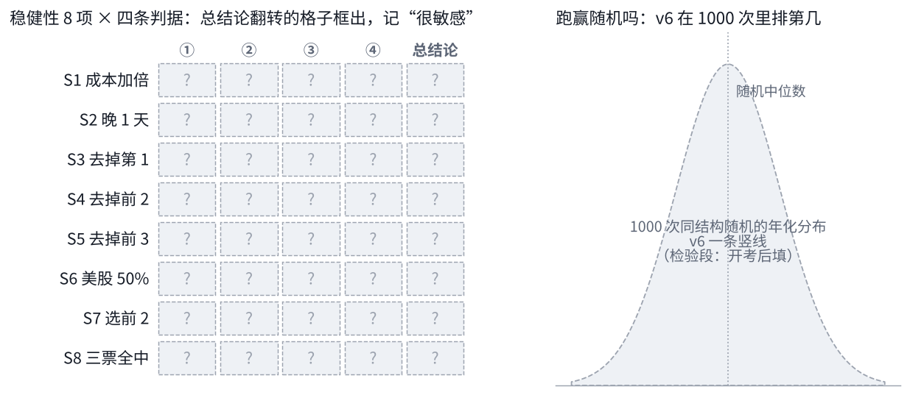
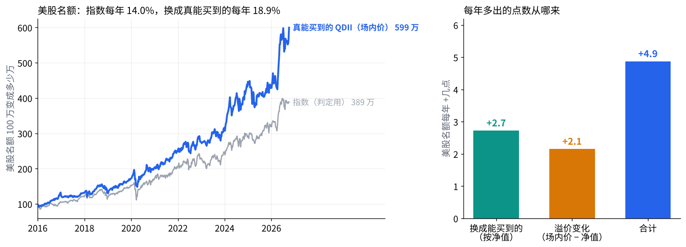
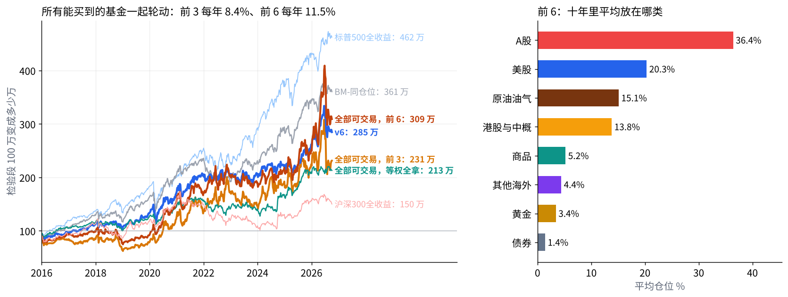
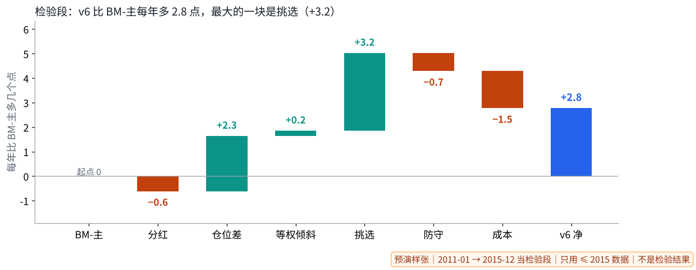
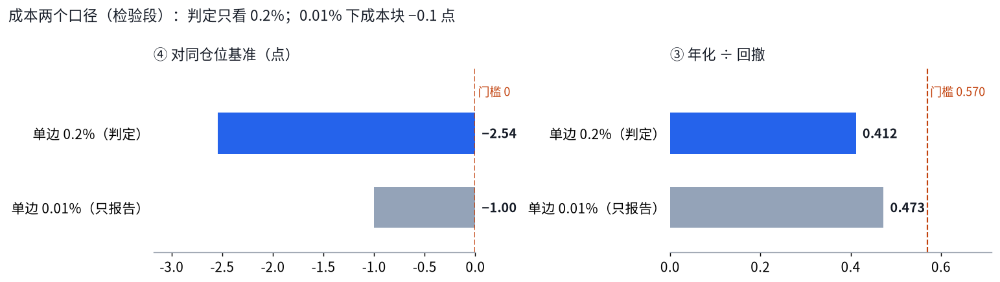
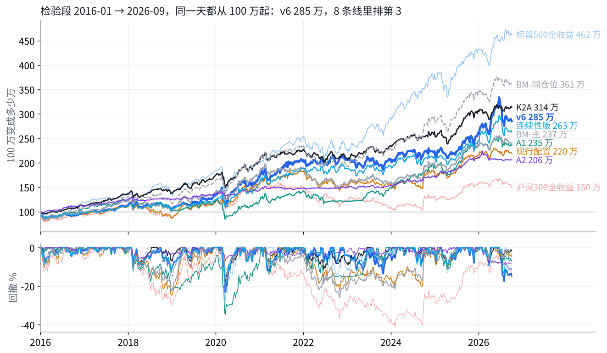
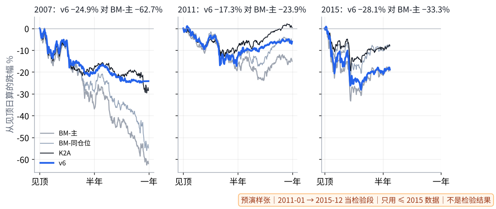

# v6 一次性检验报告：不通过——挑选是真的，但被候选池和成本吃掉了

## Metadata

- Project: ETF_Rotation_Quant
- Document type: owner report（v6 一次性检验，冻结稿 §9.1 第 6 步）
- Status: final（第 1.0.4 版，2026-11-27）：修正事后假设“所有能买到的场内基金一起轮动”：按 D36 上市当天就用跟踪指数打分（第 1.0.3 版错用了基金自己的价格，要等满 12 个月）。第 1.0.3 版：第 2 节加这一假设（Owner 要求，只报告）。第 1.0.2 版：第 2 节补可交易池（美股名额换成 A 股真能买到的 QDII，只报告，看过结果后补做）。第 1.0.1 版：第 6 节加一张只看检验段的净值图（所有线 2016-01 同一天从 100 万起），按 Owner 页面评论。第 1.0 版填入正式检验结果。结构、图和结论句沿用开考前定下的骨架 0.5，只填数；结论句由填数脚本按 `verdict.json` 从三版预写句里选出，未改字。看过结果后改了一处取法：几次急跌的起点原写“BM-主当年最高日”，2020 年取到了年末（2020-12-31），不是急跌起点，改为“当年最低点之前 250 个交易日里的最高日”，四次里只有 2020 年和 2022 年因此变了起点，注明在第 6 节。骨架历史：第 0.5 版页首四格、名词卡、预演样张；第 0.4.1 版写入 Owner 批准开考、D50-4 选 B。
- Owner: L. Loric
- Maintainer: Orchestrator
- Date: 2026-11-27（Asia/Taipei）
- 依据：冻结预注册（tag `milestone/v6-prereg-freeze` → `f066da8e`）§5、§5.2–§5.4、§7；D45–D52
- 数据：Dev #399 @ `1ab3a73a`（`results/v6/oneshot/`，运行次数 = 1，manifest SHA256 `b1f98f8f…2aa1`）；Reviewer 独立复算 #400 @ `a046ad48`
- 页面：Claude 页面“v6 一次性检验报告”；本文件是仓库镜像

---

**项目愿景**　在动态周期内，从多类资产里选出 Top N 强势 ETF 轮动持有，获得超额收益、稳定跑赢被动基准，同时把回撤控制住。

| 进度 | 结论 | 需要你 |
| --- | --- | --- |
| 正式检验只跑了一次（#399）；Reviewer 用自己的程序独立复算（#400），四条判据的过与不过全部一致。 | 一次性检验不通过：判据 ③ 对 K2A、④ 对同仓位基准 没过；每年 10.6%，比同仓位基准少 2.5 点。 | 定下一步：按冻结稿 v6 关闭、不进模拟盘；第 5 次尝试从哪里入手，等你定。 |

<!-- 组件：指标 -->

| 指标 | v6 | 对照 | 对照值 | 读法 | 色 | 本段 |
| --- | --- | --- | --- | --- | --- | --- |
| 年化（检验段） | 10.6% | BM-同仓位 | 13.2% | 每年少 2.5 点，判据 ④ 不过 | 差 |  |
| 最大回撤 | −25.8% | BM-同仓位 | −23.5% | 在 40% 门槛内，但没比同仓位浅 | 中 |  |
| 跑赢随机 | 第 100 | 随机中位 | 第 50 | 挑选是真的：1000 次全部跑赢 | 好 |  |
| 四条判据 | 2/4 | 后五年 | 2/4 | ③④ 不过，和设计期后五年一样 | 差 | 检验段 |

<!-- 主线：这份报告的故事主线：挑选是真的，但候选池整体落后宽基、再加成本，挑选赚的被吃掉；比 BM-主多出的部分来自美股放 60% -->

名词解释：23 个词，分三组——怎么读这份检验报告、拿来比的七条线、收益拆成哪六块

<!-- 组件：名词 -->

| 组 | 名字 | 一句话 | 图 | 细节 |
| --- | --- | --- | --- | --- |
| 怎么读这份检验报告 | 检验段 | 过不过只看这一段 | 大字：2016-01 → 2026-09｜只用了一次 | 规则定的时候没看过，但市场走势大家都见过，所以不叫“样本外”（D9-1）。 |
| 怎么读这份检验报告 | 全段 | 用来看钱从哪来，不当第二个计分板 | 大字：2006–2026｜只报告 | 全段四条判据也算，但不参与判定（D49）。 |
| 怎么读这份检验报告 | 判定口径 | 从 2006 年一路跑下来，再截出检验段 | 两套：判定=连续运行截出｜把握 p 和仓位从 2006 年累积；只报告=2016-01 重新起步｜另列差多少 | 冻结代码没有在 2016-01 清零，所以判定用连续运行截出（D49-1）。 |
| 怎么读这份检验报告 | 成本 | 判定按单边 0.2%，万分之一只报告 | 两套：判定=单边 0.2%｜佣金、价差、冲击和指数与 ETF 的差都算进去；实盘=单边 0.01%｜只是佣金，不含价差和 QDII 溢价 | 你 11-26 定（D52）。 |
| 怎么读这份检验报告 | 判据 | 四条门槛，全部满足才通过 | 门槛：最大回撤=≤ 40%｜防守保费=≤ 4 点｜年化 ÷ 回撤=高于 K2A｜对 BM-同仓位=不落后 |  |
| 怎么读这份检验报告 | 跑赢随机 | 同样结构、随机挑 1000 次，v6 排第几 | 大字：第 100｜检验段 | 设计期是第 96.4；种子 20261122。 |
| 怎么读这份检验报告 | 三级结论 | 主判加稳健性 8 项，三选一 | 步骤：四条没全过 → **不通过**，改完能过也不升档｜四条全过，S1–S8 有一项让总结论翻转 → **通过（有条件）**｜四条全过、没有一项翻转 → **通过**｜上线前欧洲检验“不支持”，再降一级 | D50；这次走的是第一条。 |
| 怎么读这份检验报告 | 很敏感 | 改一处设定，总结论就翻 | 式：改动后的总结论 ≠ 主判 | 只在检验段、指数池的主判上判（D50-1）；对照跟着同样改（D51）。 |
| 怎么读这份检验报告 | 读法标签 | 六块各贴一个，按顺序判，先符合哪条记哪条 | 步骤：设计期为正，检验段为负或不到 0.5 点 → **设计期才有**｜否则四段至少三段同号，且检验段和设计期同号 → **稳定**｜其余 → **不稳定** | D49-8；不另造说法。 |
| 拿来比的七条线 | BM-主 | AGENTS.md 规定的并列基准 | 仓位：沪深300 70｜纳指100 15｜标普500 15 | 全收益、人民币、每月再平衡。 |
| 拿来比的七条线 | BM-同仓位 | 和 v6 同仓位的基准，判据 ④ 和它比 | 仓位：沪深300 40｜纳指100 30｜标普500 30 | 和 v6 的 A 股 40%、美股 60% 同仓位，用来把“美股多放 20 点”的影响拆出去。 |
| 拿来比的七条线 | K2A | 增强基准，判据 ③ 和它比 | 仓位：A 股 50｜美股 50 | 只给 A 股那一半上保险（月末低于 10 个月均线就换国债，仓位按波动调，每 5 个交易日看），美股那一半一直持有（你 11-17 定，D39-3）；“月末”用真实月末（你 11-26 定，D48-4）。 |
| 拿来比的七条线 | 现行配置 | 现在实际在跑的组合，不防守，只报告 | 仓位：A 股 70｜美股 30 | A 股是 16 个指数等权；海外 30% 是纳指100、标普500 各半。 |
| 拿来比的七条线 | 连续性版 | v6 的挑战者，只换 A 股名额的选法 | 仓位：A 股 40｜美股 60 | 先取涨幅前一半，再挑上涨天数占比最高的 3 只；其余同 v6。 |
| 拿来比的七条线 | A1 | 同行做法：每月全仓二选一，只报告 | 式：沪深300 或 标普500 | 每月末全仓拿过去一年涨得多的那个；标普500 跑输现金就全仓国债。v4 已签收的账本。 |
| 拿来比的七条线 | A2 | 同行做法：五类资产各 1/5，只报告 | 仓位：沪深300 20｜标普500 20｜恒生 20｜国债 20｜黄金 20 | 每份低于 10 个月均价就拿现金。v4 已签收的账本。 |
| 收益拆成哪六块 | 六块怎么接起来 | 从 BM-主一步一步走到 v6：每走一步换一样东西，两条线之差就是一块；六块加起来正好是 v6 比 BM-主多出的部分 | 链：BM-主｜分红 −0.4｜价格版｜仓位差 +4.0｜BM-同仓位｜等权倾斜 −3.6｜同结构等权｜挑选 +3.6｜前 3 不防守｜防守 −0.1｜v6 毛｜成本 −1.6｜v6 净 | BM-主是全收益，价格版是它去掉分红；数字是检验段每年几点，合计 +1.9。汇率单独报，不进合计。 |
| 收益拆成哪六块 | 分红 | 候选用价格指数、基准用全收益，差出来的分红 | 式：BM-主价格 − BM-主全收益 ‖ 值：−0.4 点/年 | 一直为负：不是规则的问题，是口径。 |
| 收益拆成哪六块 | 仓位差 | 只因为美股 60%、A 股 40% 而多或少的部分 | 式：BM-同仓位 − BM-主 ‖ 值：+4.0 点/年 | 检验段美股强、A 股弱，多放美股这一块赚得最多。 |
| 收益拆成哪六块 | 等权倾斜 | 不挑、全拿带来的部分 | 式：同结构等权 − BM-同仓位 ‖ 值：−3.6 点/年 | 候选池整体落后宽基；设计期是正的，检验段翻负，标“设计期才有”。 |
| 收益拆成哪六块 | 挑选 | 每月选最强的 3 只值多少 | 式：前 3、不设防守 − 同结构等权 ‖ 值：+3.6 点/年 | 四个五年段都为正，标“稳定”。 |
| 收益拆成哪六块 | 防守 | 确认紧张时按把握减仓值多少 | 式：v6 毛 − 前 3、不设防守 ‖ 值：−0.1 点/年 | 2018 年帮了大忙，2022 年上半年亏回去；合起来几乎为 0。 |
| 收益拆成哪六块 | 成本 | 换手扣掉的部分 | 式：v6 净 − v6 毛 ‖ 值：−1.6 点/年 | 按判定口径单边 0.2%；万分之一下约 −0.08 点（D52）。 |

## 0. 开考前提：七件事全部做完，正式检验只跑了一次

<!-- 问：开考前该齐的都齐了吗？跑了几次？｜短：开考前提｜状态：已定 -->

> **D49–D52 开考前都已登记；正式检验跑了一次（#399），Reviewer 用自己的程序复算（#400），过与不过逐条一致。**

| # | 事项 | 谁 | 状态 | 说明 |
| --- | --- | --- | --- | --- |
| 1 | 批准一次性检验 | Owner | 已完成 | 2016-01 → 2026-09，只跑一次，判定只看检验段 |
| 2 | D49 全段只报告、六块拆账 | Reviewer、Manager | 已完成 | 11-26 合入 |
| 3 | D50 很敏感与三级结论 | Owner | 已完成 | D50-4 选 B |
| 4 | D51 判据 ② 的对照、S 项怎么跟着改 | Orchestrator、Reviewer | 已完成 | 预演里判据 ② 回到签收的 1.38 |
| 5 | D52 成本两个口径 | Owner | 已完成 | 判定 0.2%；万分之一只报告 |
| 6 | 预演对上 | Dev、Reviewer | 已完成 | 预演保费两边差约 1e-7（#397） |
| 7 | 正式跑一次 + 独立复算 | Dev、Reviewer | 已完成 | 运行次数 = 1；四条判据、S1、S3、连续性版的过与不过全部一致 |

- **两边的数有水平差，不改判定**：Reviewer 算的 ④ 是 −3.5 点、② 是 1.3 点，Dev 是 −2.5 点、0.9 点；③ 两边都远低于 K2A。这份报告的数字和图用 Dev 那一次正式运行，差多少列在第 1 节折叠里，差异来源另行对账。
- **“实质差异 26 条”不是错误**：manifest 里的这一栏，是拿正式检验段的数去和预演签收值（2011–15）比，窗口不同，本来就对不上。

<!-- 接力：前提齐了、只跑了一次；先看过没过 -->

## 1. 过不过：不通过——判据 ③ ④ 没过，比同仓位基准每年少 2.5 点

<!-- 问：一次性检验过没过？｜短：过不过｜状态：已定 -->

> **回撤 −25.8%、保费 0.9 点两条过；年化 ÷ 回撤 0.41 低于 K2A 的 0.57，对同仓位基准每年 −2.5 点，两条不过。**

<!-- 组件：闸门格｜四条判据：检验段一列判定，设计期两段作参照 -->

| 编号 | 门槛 | 事先机会 | 2006–10 | 2011–15 | 2016-01 → 2026-09 |
| --- | --- | --- | --- | --- | --- |
| ① 回撤 | ≤ 40% | 80% | −25.0%｜过 | −28.7%｜过 | −25.8%｜过 |
| ② 防守保费 | ≤ 4 点 | 85% | 0.0 点｜过 | 1.4 点｜过 | 0.9 点｜过 |
| ③ 对 K2A | 年化 ÷ 回撤高于 K2A | 60% | 0.74 对 0.59｜过 | 0.42 对 0.57｜不过 | 0.41 对 0.57｜不过 |
| ④ 对同仓位基准 | ≥ 0 | 50% | +5.2 点｜过 | −0.1 点｜不过 | −2.5 点｜不过 |
| 四条全过 | 全部满足才通过 | 30% | 过 | 不过 | 不过 |

- **页首结论句**由填数脚本按 `verdict.json` 从三版预写句里选出，只填了数，没改字。
- **换口径也不过**：2016-01 重新起步 ④ 是 −0.3 点、③ 0.50，仍不过；按万分之一成本 ④ −1.0、③ 0.47，仍不过（第 3 节）。
- **全段只报告**：2006–2026 年 ③ 0.40 对 0.38 过，④ −0.15 点不过。

两边独立复算、三种口径的四条判据

| 判据 | Dev 正式运行（判定用） | Reviewer 独立复算 | 2016-01 重新起步 | 单边 0.01%（只报告） | 全段（只报告） |
| --- | --- | --- | --- | --- | --- |
| ① 最大回撤 | −25.8%｜过 | −26.4%｜过 | −25.8%｜过 | −25.7%｜过 | −32.1%｜过 |
| ② 防守保费 | 0.95 点｜过 | 1.28 点｜过 | 0.89 点｜过 | 0.92 点｜过 | 0.87 点｜过 |
| ③ 年化 ÷ 回撤（K2A） | 0.412（0.570）｜不过 | 0.367（0.570）｜不过 | 0.497（0.570）｜不过 | 0.473（0.570）｜不过 | 0.401（0.382）｜过 |
| ④ 对同仓位基准 | −2.54 点｜不过 | −3.48 点｜不过 | −0.34 点｜不过 | −1.00 点｜不过 | −0.15 点｜不过 |
| 总结论 | 不通过 | 不通过 | 不通过 | 不通过 | 不通过 |

- **水平差从哪来还没查清**：预演窗口两边差约 1e-7，正式窗口差到约 1 点，说明差异出在 2016 年以后才用到的部分（新发布的候选、补数的序列等）；③ 的差距和 ④ 的负号都比这个差大得多，不会改判定。
- **重新起步差很多**：④ 从 −2.5 点变成 −0.3 点，说明 2016 年起的状态（把握 p、持仓）是从设计期带过来的；判定按 D49-1 用连续运行。

<!-- 接力：不通过已经定了；下一节看这个结论稳不稳 -->

## 2. 结论稳不稳：8 项稳健性全部不通过；挑选在随机 1000 次里排第 100

<!-- 问：换个成本、晚一天下单、去掉最赚钱的几只，结论会不会变？｜短：稳不稳｜状态：已定 -->

> **8 项改动后都是不通过，没有一项翻转；同结构随机 1000 次，v6 的年化全部跑赢，检验段、全段都排第 100。**

- **不通过很稳**：离通过最近的是 S7 选前 2（④ −1.0 点），最远的是 S4 去掉前 2 名（④ −4.5 点）。
- **挑选是真的**：随机挑同样结构，没有一次比 v6 好；每月跑赢随机中位数的月份占 58.9%。所以输不在“挑”上，看第 3 节。
- **换成真能买到的 QDII（只报告）**：美股名额每年多 4.9 点，组合近似 ④ −0.04 点；但多出来的是“被迫拿纳指、标普”和“溢价越来越高”，不是挑得更好，判定不变。

8 项逐项、随机对照、能买到的池子

| 编号 | 改动 | ① 回撤 | ② 保费 | ③ 比值 | ④ 对同仓位 | 结论 |
| --- | --- | --- | --- | --- | --- | --- |
| S1 | 成本加倍（单边 0.4%） | −25.9% | 0.97 | 0.35 | −4.1 | 不通过 |
| S2 | 信号日延后 1 个交易日 | −26.0% | 0.90 | 0.42 | −2.3 | 不通过 |
| S3 | 去掉费城半导体 | −25.7% | 0.96 | 0.34 | −4.3 | 不通过 |
| S4 | 再去掉中证光伏产业 | −25.7% | 0.98 | 0.34 | −4.5 | 不通过 |
| S5 | 再去掉全指通信 | −25.7% | 1.32 | 0.35 | −4.1 | 不通过 |
| S6 | 美股 50%、A 股 50% | −24.5% | 1.19 | 0.40 | −2.0 | 不通过 |
| S7 | 每个名额选前 2 | −24.5% | 1.21 | 0.50 | −1.0 | 不通过 |
| S8 | 三票全中才算紧张 | −25.8% | −0.31 | 0.43 | −2.0 | 不通过 |
| 随机 | 同结构随机 1000 次（种子 20261122） | 组合第 100；A 股名额第 99.0，美股名额第 99.8 | 每月跑赢随机中位数 58.9% |  |  | 只报告 |
| 可交易池 | 美股名额只买当年真有的场内 QDII，计溢价（看过结果后补做） | −22.3%（近似） |  | 0.59（近似） | −0.04（近似） | 只报告（D52-3） |

可交易池（只报告）：美股名额换成真能买到的 QDII，多出的 4.9 点从哪来、为什么不改判定

| 美股名额（检验段） | 年化 | 最大回撤 | 说明 |
| --- | --- | --- | --- |
| 指数（判定用，同一套时点重放） | 14.0% | −31.8% | 前 3 与官方持有 129 个月全部一致 |
| 真能买到的，按基金净值 | 16.7% | −30.0% | 比指数每年多 2.7 点：被迫换成能买到的 |
| 真能买到的，按场内价 | 18.9% | −28.8% | 再多 2.1 点：溢价变化 |

| 组合（近似：60% × 美股名额的差逐日加回） | 年化 | 最大回撤 | ③ 年化 ÷ 回撤（K2A 0.570） | ④ 对同仓位基准 |
| --- | --- | --- | --- | --- |
| 官方（判定用） | 10.6% | −25.8% | 0.412 | −2.54 点 |
| 真能买到的，按净值 | 12.1% | −24.8% | 0.490 | −1.04 点 |
| 真能买到的，按场内价 | 13.1% | −22.3% | 0.588 | −0.04 点 |

- **为什么会多**：费城半导体的场内基金（501225）2023-04 才上市，指数版拿了 76 个月，实际只能买到 27 个月；金融、公用事业、必需消费、工业、材料五个行业在 A 股没有场内基金。买不到就递补，最后多半落在纳指100（拿了 99 个月）和标普500（72 个月）上，这十年这两只本来就比行业强，正是第 3 节“候选池落后宽基”。
- **溢价那 2.1 点靠不住**：QDII 额度紧张，溢价一路走高；2026-09-30 费城半导体基金溢价 34%、纳指基金 11–15%。额度一放开，这部分会一次性还回去。
- **不改判定**：冻结稿 §5.1 写明指数池主判、可交易池只报告；这份是看过检验结果后补做的。基金净值含分红，指数是价格指数，2.7 点里有一部分是分红。
- **怎么算的**：`scripts/v6_report/tradable_us.py`，按冻结稿 §2：信号日下一个交易日收盘成交；同一候选选溢价偏离最小的基金，偏离超 5 点不买，已持有的照旧；都买不了递补下一名，再不够给标普500；单边 0.2%。逐月持有和跳过原因在 `results/v6/oneshot/supplement/tradable/`。A 股名额没有换，仍用指数。

事后假设：把所有能在 A 股场内买到的 ETF、LOF 一起轮动（含黄金、原油、商品、港股、日德印等），10 年怎样

| 检验段 2016-01 → 2026-09 | 年化 | 最大回撤 | 100 万变成 |
| --- | --- | --- | --- |
| 全部可交易，前 6 | 11.5% | −33.9% | 309 万 |
| 全部可交易，前 3 | 8.4% | −41.0% | 231 万 |
| 全部可交易，等权全拿 | 7.6% | −22.3% | 213 万 |
| v6（判定用） | 10.6% | −25.8% | 285 万 |
| BM-同仓位 | 13.2% | −23.5% | 361 万 |
| 标普500 全收益 | 15.9% | −32.9% | 462 万 |

- **池子越大没有越好**：前 6 每年 11.5%，比 v6 多 0.9 点，但回撤 −34%，年化 ÷ 回撤 0.34，比 v6 的 0.41 低；前 3 只有 8.4%、回撤 −41%。都没跑过一直拿着的同仓位基准和标普500。前 3 和前 6 谁好谁坏随选法变，说明这里面噪声很大。
- **钱去了哪**：前 6 十年平均 36% 在 A 股行业，美股 20%，原油油气 15%，港股与中概 14%；拿得最多的是标普信息科技 LOF（36 个月）、两只美国油气 LOF、中概互联网、全球芯片（21 个月）。不设防守，2018 年跌 23%。
- **上市当天就能打分**（D36）：有跟踪指数的 133 只用指数的人民币走势还原历史，上市当天就能参选；全球芯片用费城半导体、纳指科技用纳指科技指数、中韩半导体用中证韩交所中韩半导体指数。另 101 只（多是港股通行业基金和商品基金）库里没有跟踪指数，只能上市满 12 个月才参选。纳指科技的指数库里只从 2023-01 起，所以它也要到 2024-01 才能打分，拿了 12 个月。
- **为什么只能当参考**：这是看过结果后提出的；池子是 2026 年库里有的 234 只（不含货币基金），已经退市的基金不在里面，有幸存者偏差；2016 年初能参选的只有 36 只，后面一大半是 2021 年以后上市的港股基金。
- **怎么算的**：`scripts/v6_report/tradable_all.py`：按打分线的 12−1 排名，和已选中的基金过去一年日收益相关超过 0.95 视为同一指数跳过，等权，不设防守；有净值的基金溢价比常态高 5 点不买（挡下 6 次）；下一个交易日收盘成交，单边 0.2%。结果在 `results/v6/oneshot/supplement/tradable-all/`。

<!-- 接力：挑选是真的，那钱输在哪？ -->

## 3. 钱从哪来：挑选每年 +3.6 点，正好被候选池的 −3.6 点抵掉；比 BM-主多的 1.9 点来自美股放 60%

<!-- 问：v6 赚的是挑选、防守，还是美股放 60%？输给同仓位基准，输在哪？｜短：钱从哪来｜状态：已定 -->

> **挑选四个五年段都为正（标“稳定”）；但候选池等权持有本身每年比同仓位宽基少 3.6 点（标“设计期才有”），再扣 1.6 点成本，挑选赚的就没了。**

- **输给同仓位基准，输在候选池**：同仓位基准里 30% 是纳指100、30% 是标普500；两个名额按行业标签等权拿着全部候选，每年落后它 3.6 点；2017、2020、2023 年各落后 10 点以上，2024 年 9.8 点。
- **比 BM-主多，靠美股**：仓位差 +4.0 点；这十年沪深300 全收益每年 4.0%，标普500 15.9%。
- **防守几乎为 0**：−0.1 点；第 4 节看它在哪几次帮了忙、哪几次亏回去。

六块 × 四段、两个名额各自的拆分、逐年

| 块 | 2006–10 | 2011–15 | 2016–20 | 2021-01 → 2026-09 | 检验段 | 全段 | 读法标签 |
| --- | --- | --- | --- | --- | --- | --- | --- |
| 分红 | −0.5 | −0.6 | −0.4 | −0.4 | −0.4 | −0.5 | 稳定 |
| 仓位差 | −9.3 | +2.3 | +2.8 | +5.1 | +4.0 | +0.5 | 不稳定 |
| 等权倾斜 | +1.3 | +0.2 | −7.4 | −0.3 | −3.6 | −1.5 | 设计期才有 |
| 挑选 | +5.5 | +3.2 | +4.8 | +2.6 | +3.6 | +4.0 | 稳定 |
| 防守 | +0.7 | −0.7 | +1.0 | −1.0 | −0.1 | −0.1 | 不稳定 |
| 成本 | −1.5 | −1.5 | −1.7 | −1.6 | −1.6 | −1.6 | 稳定 |
| 合计 | −3.8 | +2.8 | −1.0 | +4.3 | +1.9 | +0.9 |  |

| 名额（检验段，名额内每年几点） | 等权倾斜 | 挑选 | 防守 | 成本 | 前 3 − 标普500 |
| --- | --- | --- | --- | --- | --- |
| 美股（占 60%） | −2.1 | +3.5 | −0.0 | −1.5 | +1.4 |
| A 股（占 40%） | −1.2 | +3.1 | +0.4 | −1.7 |  |

| 年 | 等权倾斜 | 挑选 | 防守 |
| --- | --- | --- | --- |
| 2016 | +0.0 | −11.3 | +3.7 |
| 2017 | −12.1 | +9.1 | −0.3 |
| 2018 | −4.4 | +5.9 | +4.2 |
| 2019 | −7.8 | −2.4 | −0.0 |
| 2020 | −14.5 | +25.5 | −5.0 |
| 2021 | +6.6 | +1.3 | 0.0 |
| 2022 | +10.4 | +12.4 | −2.2 |
| 2023 | −10.4 | −7.1 | +0.0 |
| 2024 | −9.8 | −5.8 | −1.4 |
| 2025 | −2.2 | +4.3 | −0.0 |
| 2026 年前 9 个月 | −0.6 | +11.7 | −2.8 |

- **读法标签按顺序判**（D49-8）：等权倾斜设计期为正、检验段为负 → 设计期才有；挑选四段同号且检验段与设计期同号 → 稳定。
- **六块首尾相接**：相加 = v6 净 − BM-主全收益；第 ③ 块减去的，就是第 ② 块终点的价格 BM-同仓位（D49-3）。
- **汇率**：美股名额的人民币收益减美元收益，单独报，不进合计；这次结果目录没有导出汇率层，待补。

<!-- 接力：挑选和防守各自是哪几笔赚的？ -->

## 4. 挑选赚的是谁、防守赚的是哪几次：美股九成靠费城半导体和纳指100；A 股防守 2018 年赚、2022 年上半年亏

<!-- 问：挑选的钱是不是集中在几只上？防守在哪几次真帮上了忙？｜短：挑选与防守｜状态：已定 -->

> **美股名额前 3 名占前 10 名贡献的 91%，费城半导体一只入选 76 个月；A 股前 3 名占 54%。美股紧张时几乎不减仓，防守全看 A 股。**

- **钱集中在一只上**：去掉费城半导体（S3），④ 从 −2.5 点降到 −4.3 点。
- **美股把握 p 一直接近 1**：美股紧张段股票仓位平均 99.6%–99.9%，等于不防守；A 股 2018-04 → 2019-01 平均只拿 26% 股票，那一段比不设防守多 9.9 点。

检验段紧张段明细、平时保费

| 名额 | 起 | 止 | 月数 | 股票平均仓位 | 比不设防守多或少（点） |
| --- | --- | --- | --- | --- | --- |
| A 股 | 2015-08 | 2016-05 | 10 | 34% | +1.3 |
| A 股 | 2018-04 | 2019-01 | 10 | 26% | +9.9 |
| A 股 | 2022-01 | 2022-05 | 5 | 55% | −5.0 |
| A 股 | 2022-07 | 2022-10 | 4 | 54% | +4.0 |
| A 股 | 2023-08 | 2024-03 | 8 | 62% | −1.1 |
| 美股 | 2020-02 | 2020-04 | 3 | 99.8% | −0.3 |
| 美股 | 2022-04 | 2022-09 | 6 | 99.9% | −0.3 |

只列了 A 股差超过 1 点的段和美股最长的两段；其余 15 段都在 ±0.4 点以内。

| 平时保费（不紧张月份累计，点） | 2016–20 | 2021-01 → 2026-09 |
| --- | --- | --- |
| A 股名额 | 17.0（43 个月） | 21.5（45 个月） |
| 美股名额 | 6.0（51 个月） | 6.3（57 个月） |

- **A 股挑选前 10 里没有贡献为负的**；从未入选的有全指工业、全指医药、全指信息、中证500 等。

<!-- 接力：钱的来源看清了，再把 v6 放回八条线里 -->

## 5. 和别人比：检验段 v6 年化排第 3，同仓位基准第 1、K2A 第 2

<!-- 问：检验段里 v6 和 A1、A2、K2A、现行配置、基准比，站在哪？｜短：和别人比｜状态：已定 -->

> **检验段 v6 每年 10.6%，比 BM-主（8.7%）、现行配置（7.9%）高；比不挑不防的 BM-同仓位（13.2%）低，回撤也没比它浅。**

| 线 | 放哪 | 怎么选 | 防守 | 年化 | 最大回撤 | 为什么是这个结果 |
| --- | --- | --- | --- | --- | --- | --- |
| v6 | A 股 40%、美股 60% | 每月每个名额取涨幅前 3 | 紧张时股票只拿 p | 10.6% | −25.8% | 挑选赚的被候选池拖回去 |
| 连续性版 | 同 v6 | A 股改挑上涨天数最多的 3 只 | 同 v6 | 9.8% | −23.3% | 换选法，每月反而少 0.19% |
| K2A | A 股 50%、美股 50% | 不挑：沪深300、纳指、标普 | 只管 A 股：破均线换国债 | 11.7% | −20.5% | 不挑，只给 A 股上保险 |
| A1 | 沪深300 或标普500，全仓 | 每月拿过去一年涨得多的那个 | 标普跑输现金就全换国债 | 8.6% | −39.5% | 全仓二选一，2018–20 跌得深 |
| A2 | 五类各 1/5 | 不挑：A、美、港股，国债，黄金 | 每份破均线就拿现金 | 7.2% | −9.7% | 股票少又分散：最稳、最低 |
| 现行配置 | A 股 70%、海外 30% | 不挑：16 个 A 股指数等权 | 没有 | 7.9% | −26.2% | A 股多，A 股这十年弱 |
| BM-主 | A 股 70%、美股 30% | 不挑：沪深300、纳指、标普 | 没有 | 8.7% | −26.0% | 70% 沪深300，每年只有 4.0% |
| BM-同仓位 | A 股 40%、美股 60% | 不挑：沪深300、纳指、标普 | 没有 | 13.2% | −23.5% | 不挑不防，检验段最高 |

- **v6 的回撤没有优势**：检验段最深一跌在 2020 年 2–3 月，v6 −25.8%，不设防守的同仓位基准 −23.5%。

八条线检验段、全段的年化和回撤

| 线 | 检验段年化 | 检验段回撤 | 全段年化 | 全段回撤 |
| --- | --- | --- | --- | --- |
| v6 | 10.6% | −25.8% | 12.9% | −32.1% |
| 连续性版 | 9.8% | −23.3% | 12.6% | −28.3% |
| K2A | 11.7% | −20.5% | 13.8% | −36.1% |
| A1 | 8.6% | −39.5% | 17.1% | −46.6% |
| A2 | 7.2% | −9.7% | 8.0% | −13.1% |
| 现行配置 | 7.9% | −26.2% | 14.0% | −60.1% |
| BM-主 | 8.7% | −26.0% | 12.0% | −65.5% |
| BM-同仓位 | 13.2% | −23.5% | 13.0% | −59.1% |

- **BM-主逐年并列**（冻结稿 §5.1）：逐年数在 `returns-daily.csv`，待补成表。A1、A2 检验段接 v5 账本，接口处重叠日 0 天（D49）。

<!-- 接力：比完位置，看这 20 年一条线怎么走 -->

## 6. 性格：2006–2026 年 100 万变 1122 万；最深一跌跨 2015 年底，四次急跌三次比 BM-主浅

<!-- 问：一直拿着的人，20 年里会经历什么？｜短：性格｜状态：已定 -->

> **全段每年 12.9%，最深一跌 −32.1%（2015-06-11 → 2016-02-15，跨两段）；四次急跌里 2018、2022 年明显比 BM-主浅，2020 年反而更深。**

- **2020 年更深**：美股名额紧张时把握 p 接近 1、几乎不减仓，A 股名额那时没有确认紧张；这一跌又快又短。
- **急跌起点看过结果后改过**：原写“BM-主当年最高日”，2020 年取到了 2020-12-31；改为“当年最低点之前 250 个交易日里的最高日”，2020 年起点变成 2020-02-20、2022 年变成 2021-12-13。

这一节的数

| 看什么 | 数 |
| --- | --- |
| 只看检验段，100 万变成多少（2016-01 → 2026-09） | BM-同仓位 361 万；K2A 314 万；v6 285 万；连续性版 263 万；BM-主 237 万；A1 235 万；现行配置 220 万；A2 206 万；另有标普500 全收益 462 万、沪深300 全收益 150 万 |
| 100 万变成多少（2006 → 2026-09） | v6 1122 万；K2A 1328 万；现行配置 1383 万；BM-同仓位 1153 万；BM-主 964 万；A1 2350 万 |
| 全段最深一跌 | −32.1%，2015-06-11 → 2016-02-15，跨 2015-12 / 2016-01 |
| 四次急跌（v6 对 BM-主） | 2015：−31.5% 对 −34.9%；2018：−13.7% 对 −23.9%；2020：−25.8% 对 −19.2%；2022：−7.2% 对 −24.3% |
| 当时股票仓位 | 每月仓位没有导出；紧张段平均仓位见第 4 节 |
| 上涨月份跟到、下跌月份只跟 | 没有导出，待补 |

<!-- 接力：一条线看完，再按行情和起点切开看 -->

## 7. 四种行情、任意起点：回调里多赚，熊市月份反而少于同仓位基准；持有 5 年跑赢同仓位的起点不到一半

<!-- 问：牛熊里各赚亏多少？什么时候买进来会输？｜短：行情与起点｜状态：已定 -->

> **全段 2006–2026：回调月份对 BM-同仓位合计多 31 点，熊市月份少 30 点；持有 5 年，跑赢 BM-主的起点占 68%，跑赢 BM-同仓位、K2A 的不到一半。**

- **熊市里没赢**：熊市月份（140 个）对 BM-同仓位合计 −30 点、对 K2A −25 点；设计里该多赚的地方没有多赚。
- **持有越久越接近一半**：对同仓位基准，持有 1 年 39%、3 年 50%、5 年 49%。

四种行情明细；跨两段起点

| 行情（月数） | 对 BM-主 | 对 BM-同仓位 | 对 K2A |
| --- | --- | --- | --- |
| 牛市（30） | −43 | −18 | −7 |
| 回调（41） | +36 | +31 | +11 |
| 熊市（140） | −10 | −30 | −25 |
| 反弹（38） | +11 | +10 | +10 |

- **2011–2021 年买入、跨两段的起点**：这次只导出了全段，没有单独标出，待补。

<!-- 接力：结果和事先估的对得上吗？ -->

## 8. 预测准不准：列出的五项都在范围内或更好，但预测表没有美股候选池落后和分红这两块

<!-- 问：事先估的每一项，检验段落在范围里吗？｜短：预测｜状态：已定 -->

> **五项里三项在范围内、两项高于范围，合计（不含仓位差）+0.6 在范围内；但表里没有美股名额的等权倾斜（组合里约 −1.3 点）和分红（−0.4 点），成本也比事先估的多。**

- **漏项是这次最大的教训**：美股名额等权拿着 15 个候选，名额内每年落后 2.1 点，组合里约 −1.3 点，这一项事先没有估；分红 −0.4 点也不在表里；成本事先估每年 1.0–1.5 点，实际 1.6 点。
- **A 股挑选比预期好**：+1.2 点，高于 +0.5 的上限。

预测表原文、设计期实际和检验段

| 来源 | 中间值 | 范围 | 设计期 | 检验段 |
| --- | ---: | --- | --- | --- |
| 美股名额挑选（前 3 − 标普500） | +1.0 | +0.3 到 +1.5 | +3.41 | +0.82｜范围内 |
| A 股名额：挑选 | +0.1 | −0.5 到 +0.5 | +1.48 | +1.24｜高于范围 |
| A 股名额：等权倾斜 | +0.5 | −1.0 到 +1.0 | +2.28 | −0.47｜范围内 |
| 防守的平时保费 | −0.4 | −1.6 到 −0.4 | −0.79 | −0.95｜范围内 |
| 美股 60% 的仓位差 | 0 | −3 到 +3 | −2.83 | +4.48｜高于范围 |
| 合计（不含仓位差） | +1.2 | −1.3 到 +2.4 | +2.46 | +0.64｜范围内 |

都按组合贡献算（名额内 × 权重），每年几点。

<!-- 接力：最后两件：连续性版换不换，以及下一步 -->

## 9. 连续性版换不换：不换——自己也不通过，A 股月度差均值为负

<!-- 问：挑战者在检验段赢了吗？｜短：连续性版｜状态：已定 -->

> **连续性版 ③ 0.42、④ −3.4 点，同样不通过；A 股名额里它比 12−1 每月少 0.19%，t = −0.84，离 2.24 很远。两个条件都不满足。**

<!-- 组件：闸门格｜连续性版：检验段 ③④ 不过，和 v6 一样 -->

| 编号 | 门槛 | 事先机会 | 2006–10 | 2011–15 | 2016-01 → 2026-09 |
| --- | --- | --- | --- | --- | --- |
| ① 回撤 | ≤ 40% |  | −27.5%｜过 | −24.9%｜过 | −23.3%｜过 |
| ② 防守保费 | ≤ 4 点 |  | 0.0 点｜过 | 1.2 点｜过 | 0.8 点｜过 |
| ③ 对 K2A | 高于 K2A |  | 0.65 对 0.59｜过 | 0.55 对 0.57｜不过 | 0.42 对 0.57｜不过 |
| ④ 对同仓位基准 | ≥ 0 |  | +4.6 点｜过 | +1.4 点｜过 | −3.4 点｜不过 |
| 四条全过 | 全部满足才通过 |  | 过 | 不过 | 不过 |

- **第二个条件**：129 个月，连续性版 − 12−1 月均 −0.19%，t = −0.84（Reviewer 复算 −0.23%、t = −0.95）；全段 249 个月 t = −0.41。
- **A 股挑选也不能“报钱”**：要 t ≥ 2.24，差得很远。

<!-- 接力：最后看结论出来以后怎么走 -->

## 10. 接下来：按冻结稿走“不通过”这条路——如实记录、关闭 v6

<!-- 问：结论出来以后做什么？｜短：接下来｜状态：在做 -->

> **v6 不进模拟盘、不做欧洲检验、三个影子都不开；下一次尝试记为第 5 次，方向等你定。**

<!-- 组件：载体｜三种结论各走哪条路；这次走“不通过” -->

| 类型 | 候选 |
| --- | --- |
| 通过 | 6 个月前向模拟盘、小资金起步另批、上线前欧洲检验 |
| 通过（有条件） | 6 个月前向模拟盘、页首写明条件、每月单列对应的量、小资金起步另批 |
| 不通过（这次） | 如实记录、关闭 v6、新想法注明第 5 次尝试 |

- **哪几块“稳定”**：挑选、成本、分红稳定；等权倾斜“设计期才有”；仓位差、防守不稳定。每月选前 3 的规则本身有用，输在候选池整体落后宽基、再加成本。
- **这次学到的三件事**：① 挑选能赚钱，但前提是候选池不能整体落后对照的宽基；② 美股名额的防守几乎从不减仓，防守只靠 A 股；③ 预测表要把每个名额的等权倾斜和分红都列进去，判据 ④ 的事先机会才估得准。
- **还要补的四样**（只导出，不改结论）：两边水平差的来源、汇率层、每月仓位、2011–2021 年跨两段的起点。

工程用：输入文件和 PR

- 冻结稿：tag `milestone/v6-prereg-freeze` → `f066da8e`；预注册 SHA256 `f75bfc28…177c` 未变；D45–D52（D49 #385、D50 #388、D51 #393、D52 #396）
- 预演：Dev #391 @ b2698663；Reviewer 锁定 #397
- 正式：Dev #399 @ `1ab3a73a`，起点 main `a89647dd`；运行次数 = 1；manifest SHA256 `b1f98f8fcaab15aa307af18a63575c7581cdf14cfcc9552eb043df7abc532aa1`；`data/market.sqlite` SHA256 `02458762…72f8`；`continuity.json` 同一次运行写出
- 复算：Reviewer #400 @ `a046ad48`，`d52-official-lock.json` SHA256 `bc7efc0b…bdebf7`；随机 1000 次没有重算
- 图：`python -I scripts/v6_report/oneshot_fill.py results/v6/oneshot docs/assets/v6-oneshot <填数 JSON>`
- manifest 的“对照”一栏（实质差异 26、可以签收 false）是拿正式检验段和预演签收值比，窗口不同，属预期

