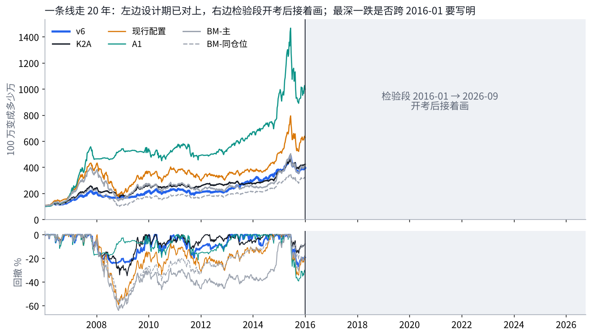
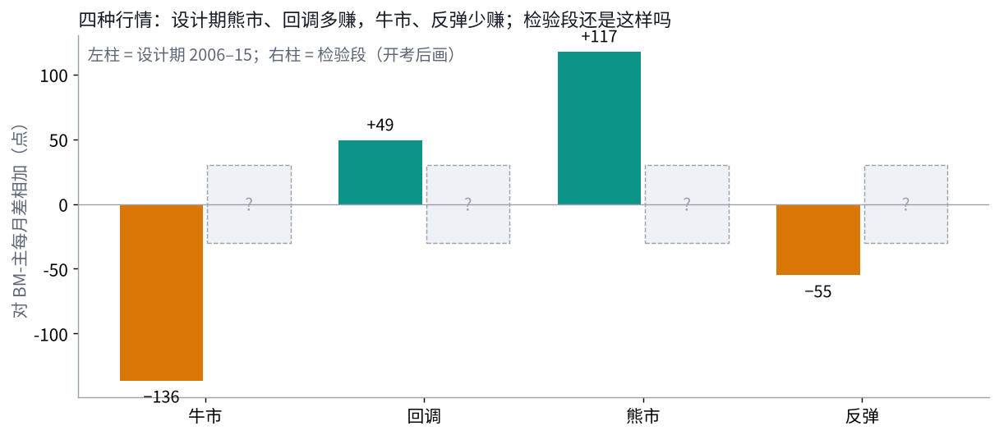

# v6 一次性检验报告（骨架）：结构和结论句在开考前定下，跑完只填数

## Metadata

- Project: ETF_Rotation_Quant
- Document type: owner report（v6 一次性检验，冻结稿 §9.1 第 6 步）
- Status: skeleton（第 0.2 版，2026-11-26）：**只有结构，没有检验段的任何数字。** 结构、图和读法在看结果之前定下，跑完只填数，不改结构、不临场造说法；确需加的内容另写 D 编号并注明“看过结果后提出”。第 0.2 版写入 D50（Owner 同意两项都选 A），改为 Owner 页面格式。
- Owner: L. Loric
- Maintainer: Orchestrator
- Date: 2026-11-26（Asia/Taipei）
- 依据：冻结预注册（tag `milestone/v6-prereg-freeze` → `f066da8e`）§5、§5.2–§5.4、§7；D45–D50；《v6 体检报告》第 1.2.1 版（设计期，同法的图和表）
- 页面：Claude 页面“v6 一次性检验报告”；本文件是仓库镜像

---

**项目愿景**　在动态周期内，从多类资产里选出 Top N 强势 ETF 轮动持有，获得超额收益、稳定跑赢被动基准，同时把回撤控制住。

| 进度 | 结论 | 需要你 |
| --- | --- | --- |
| 骨架：11 节的结构、图和读法已定；还没开考，页面上没有任何 2016 年以后的数字。 | 跑完从三版预写结论句里选一版，只填数：通过、通过（有条件）、不通过。 | 批准一次性检验（2016-01 → 2026-09，只跑一次）。开考前还要 D49、D50 和 #375、#377 合入。 |

<!-- 主线：这份报告的故事主线：从“过没过”读到“钱从哪来、在检验段还在不在” -->

## 0. 开考前要齐的五件事：两件已定，三件待合入或待你批准

<!-- 问：什么都齐了才能跑？｜短：开考前提｜状态：在做 -->

> **D49（全段只报告）和 D50（稳健性怎么降级）已定；还差你批准、代码冻结、Dev 按 D49 备好代码。**

| # | 事项 | 谁 | 状态 | 说明 |
| --- | --- | --- | --- | --- |
| 1 | D49 全段窗口只报告、拆账口径写死 | Reviewer、Manager | 已完成 | Reviewer 复核第 2 稿无问题，待合入 |
| 2 | D50 “很敏感”和“降一级”的定义 | Owner | 已完成 | 你 11-26 同意两项都选 A；待 Reviewer 核对、合入 |
| 3 | 批准一次性检验 | Owner | 待你定 | 2016-01 → 2026-09，只跑一次，判定只看检验段 |
| 4 | #375、#377 签收合入，代码冻结 | Reviewer、Manager | 待做 | 等 Dev 交同结构随机和急跌仓位 |
| 5 | Dev 按 D49 备好代码 | Dev | 待做 | 含现行配置 2006–2026 面板、A1 / A2 账本衔接 |

- **D50 定了什么**：稳健性 8 项里任何一项改动后四条判据的总结论翻转，记“很敏感”；主判通过而有一项很敏感，结论是“通过（有条件）”，照常进 6 个月模拟盘，页首写明条件。
- **成本加倍最可能触发降级**：设计期成本每年约 1.5 点，判据 ④ 的余量不到这个数时，成本加倍就会让它翻转。

<!-- 接力：前提齐了才跑；跑完先看的，是过没过 -->

## 1. 过不过：只看检验段四条判据，结论句三版已预写

<!-- 问：一次性检验过没过？｜短：过不过｜状态：待填 -->

> **判定只看检验段 2016-01 → 2026-09、四条判据全部满足；全段和设计期都不参与判定（冻结稿 §5，D49-1）。**

<!-- 组件：闸门格｜四条判据：检验段一列判定，设计期两段作参照 -->

| 编号 | 门槛 | 事先机会 | 2006–10 | 2011–15 | 2016-01 → 2026-09 |
| --- | --- | --- | --- | --- | --- |
| ① 回撤 | ≤ 40% | 80% | −25.0%｜过 | −28.7%｜过 | 待填｜待填 |
| ② 防守保费 | ≤ 4 点 | 85% | 0.0 点｜过 | 1.4 点｜过 | 待填｜待填 |
| ③ 对 K2A | 年化 ÷ 回撤高于 K2A | 60% | 0.74 对 0.59｜过 | 0.42 对 0.57｜不过 | 待填｜待填 |
| ④ 对同仓位基准 | ≥ 0 | 50% | +5.2 点｜过 | −0.1 点｜不过 | 待填｜待填 |
| 四条全过 | 全部满足才通过 | 30% | 过 | 不过 | 待填 |

| 结论 | 预写的页首结论句（跑完选一版，只填【】） |
| --- | --- |
| 通过 | 一次性检验通过：四条判据都过；每年【X】%，比同仓位基准多【Y】点，最大回撤【Z】%。下一步 6 个月模拟盘 |
| 通过（有条件） | 通过（有条件）：四条判据都过，但对【S?】很敏感，【判据】翻转；照常进模拟盘，先盯这一项 |
| 不通过 | 一次性检验不通过：判据【编号】没过；每年【X】%，比同仓位基准【多 / 少】【Y】点。按冻结稿如实记录并关闭 |

- **读这块**：框住的是检验段一列，只有它决定结论；左边两列是设计期参照，后五年 ③④ 已经不过。
- **不加形容词**：通过版本不写“稳定跑赢”，不通过版本不写“接近通过”；差多少直接写数字。

<!-- 接力：过没过只是一个字；下一节看这个字稳不稳 -->

## 2. 结论稳不稳：稳健性 8 项、同结构随机、能买到的池子，都只报告

<!-- 问：换个成本、晚一天下单、去掉最赚钱的几只，结论还在不在？｜短：稳不稳｜状态：待填 -->

> **8 项里有一项让总结论翻转，就记“很敏感”，通过降为“通过（有条件）”（D50）；随机对照和能买到的池子只报告。**

8 项各看什么，以及随机对照、能买到的池子

| 编号 | 改动 | 看什么 | 状态 |
| --- | --- | --- | --- |
| S1 | 成本加倍（单边 0.4%） | 判据 ④ 的余量够不够付成本 | 待填 |
| S2 | 信号日延后 1 个交易日 | 是不是靠月末那一天的时点 | 待填 |
| S3–S5 | 去掉贡献最大的 1、2、3 个候选 | 钱是不是集中在少数几只 | 待填 |
| S6 | 美股 50%、A 股 50% | 超额是不是只来自美股多放 | 待填 |
| S7 | 每个名额选前 2 | 前 3 是不是挑出来的数字 | 待填 |
| S8 | 三票全中才算紧张 | 防守门槛是不是挑出来的 | 待填 |
| 随机 | 同结构随机 1000 次（种子 20261122） | v6 在随机分布里的百分位 | 待填 |
| 可交易池 | 只买当年真有的场内基金 | 和指数池差多少 | 待填 |

- **图**：8 行 × 四条判据的小闸门格，翻转的格子框出；1000 次随机年化的分布条，v6 一条竖线。
- **为什么成本加倍排第一**：设计期成本每年约 1.5 点，比预测合计的中间值 +1.2 还大；超额薄的时候，最先被成本吃掉。

<!-- 接力：结论稳不稳看完，最想知道的是钱从哪来 -->

## 3. 钱从哪来：六块拆账按四个五年段看，每块贴“稳定 / 设计期才有 / 不稳定”

<!-- 问：v6 赚的是挑选、防守，还是美股放 60%、人民币贬值？｜短：钱从哪来｜状态：待填 -->

> **六块相加 = v6 比 BM-主多出的部分；全段只放在分段旁边，不单独引用（D49）。**

六块 × 四段的空表（跑完填数）

| 块 | 2006–10 | 2011–15 | 2016–20 | 2021-01 → 2026-09 | 读法标签 |
| --- | --- | --- | --- | --- | --- |
| 分红 | 待填 | 待填 | 待填 | 待填 | 待填 |
| 仓位差 | 待填 | 待填 | 待填 | 待填 | 待填 |
| 等权倾斜 | 待填 | 待填 | 待填 | 待填 | 待填 |
| 挑选 | 待填 | 待填 | 待填 | 待填 | 待填 |
| 防守 | 待填 | 待填 | 待填 | 待填 | 待填 |
| 成本 | 待填 | 待填 | 待填 | 待填 | 待填 |

- **读法标签按顺序判**（D49-8）：设计期为正、检验段为负或不到 0.5 点 → 设计期才有；否则四段至少三段同号且检验段与设计期同号 → 稳定；其余 → 不稳定。
- **汇率单独看**：美股名额的人民币收益减美元收益，另报，不进合计（D49-3）。
- **图**：检验段瀑布图；上面这张格子正绿负橙；A 股、美股名额各一张。

<!-- 接力：挑选和防守各自是哪几笔赚的？ -->

## 4. 挑选赚的是谁、防守赚的是哪几次：看前 10 名占多少，逐次列紧张段

<!-- 问：挑选的钱是不是集中在几只上？防守在哪几次真帮上了忙？｜短：挑选与防守｜状态：待填 -->

> **挑选看贡献最大的 10 个候选占多少；防守逐次列出紧张段，2008、2011、2015–16、2018、2020、2022 年都要如实写（D49-5、D49-6）。**

这一节跑完要填的四样

| 看什么 | 图 | 状态 |
| --- | --- | --- |
| 挑选贡献最大的 10 个候选 | 每段一张横条图，加从未入选名单 | 待填 |
| 前 3 名占挑选合计的比例 | 和 S3–S5 并排看 | 待填 |
| 每一次紧张段 | 两个名额的时间线：平均股票仓位、该段比不设防守多或少 | 待填 |
| 平时保费 | 每个五年段不紧张月份的累计 | 待填 |

<!-- 接力：钱的来源看清了，再把 v6 放回八条线里 -->

## 5. 和别人比：八条线，检验段为主、全段并列

<!-- 问：检验段里 v6 和 A1、A2、K2A、现行配置、基准比，站在哪？｜短：和别人比｜状态：待填 -->

> **沿用体检第 2 节的八条线做法表，年化和回撤换成检验段；散点用实心画检验段、空心画全段。**

八条线检验段的年化和回撤（跑完填）

| 线 | 做法（同体检第 2 节） | 检验段年化 | 检验段回撤 |
| --- | --- | --- | --- |
| v6 | 两个名额各选前 3，紧张时只拿把握 p | 待填 | 待填 |
| 连续性版 | A 股改挑上涨天数最多的 3 只 | 待填 | 待填 |
| K2A | A 股、美股各半，只给 A 股上保险 | 待填 | 待填 |
| A1 | 沪深300、标普500 二选一全仓 | 待填 | 待填 |
| A2 | 五类资产各 1/5，各自破均线拿现金 | 待填 | 待填 |
| 现行配置 | A 股 70%、海外 30%，不防守 | 待填 | 待填 |
| BM-主 | 70/15/15，不挑不防 | 待填 | 待填 |
| BM-同仓位 | 40/30/30，不挑不防 | 待填 | 待填 |

- **BM-主逐年并列**：冻结稿 §5.1 规定，放折叠。
- **A1、A2**：设计期 v4 账本接检验段 v5 账本，接口处逐日核对（D49）。

<!-- 接力：比完位置，看这 20 年一条线怎么走 -->

## 6. 性格：2006–2026 一条线走下来，几次急跌各怎样

<!-- 问：一直拿着的人，20 年里会经历什么？｜短：性格｜状态：待填 -->

> **净值用普通刻度、单位万元，2016-01 一条竖线分开设计期和检验段；必须写全段最深一跌在哪，是否跨 2015-12 / 2016-01。**

这一节跑完要填的四样

| 看什么 | 图 | 状态 |
| --- | --- | --- |
| 100 万变成多少 + 回撤 | 八条线逐周（同体检第 3 节） | 待填 |
| 上涨月份跟到、下跌月份只跟 | 检验段和设计期并列 | 待填 |
| 2015–16 跨两段那一跌 | 从 2015-06 高点算 | 待填 |
| 2018、2020、2022 三次急跌 | 从见顶日算 250 个交易日，标出当时股票仓位 | 待填 |

<!-- 接力：一条线看完，再按行情和起点切开看 -->

## 7. 四种行情、任意起点：全段 2006–2026

<!-- 问：牛熊里各赚亏多少？什么时候买进来会输？｜短：行情与起点｜状态：待填 -->

> **四种行情和任意起点同体检第 4、5 节，检验段和设计期并列；2011–2021 年买入、跨两段的起点单独标出。**

这一节跑完要填的两样

| 看什么 | 图 | 状态 |
| --- | --- | --- |
| 牛市、回调、熊市、反弹 | 对 BM-主、BM-同仓位、K2A 的合计和跑赢月份 | 待填 |
| 持有 1 / 3 / 5 年 | 跑赢的起点占比，约 190 个起点 | 待填 |

<!-- 接力：结果和事先估的对得上吗？ -->

## 8. 预测准不准：检验段逐项对账，不判过不过

<!-- 问：事先估的每一项，检验段落在范围里吗？｜短：预测｜状态：待填 -->

> **预测范围横条 + 检验段实际点，设计期的点灰色并列（D38-6）；超出范围的项，先查原因再做下一版。**

预测表原文、设计期实际和检验段（跑完填）

| 来源 | 中间值 | 范围 | 设计期 | 检验段 |
| --- | ---: | --- | --- | --- |
| 美股名额挑选（前 3） | +1.0 | +0.3 到 +1.5 | +3.41 | 待填 |
| A 股名额：挑选 | +0.1 | −0.5 到 +0.5 | +1.48 | 待填 |
| A 股名额：等权倾斜 | +0.5 | −1.0 到 +1.0 | +2.28 | 待填 |
| 防守的平时保费 | −0.4 | −1.6 到 −0.4 | −0.79 | 待填 |
| 美股 60% 的仓位差 | 0 | −3 到 +3 | −2.83 | 待填 |
| 合计（不含仓位差） | +1.2 | −1.3 到 +2.4 | +2.46 | 待填 |

<!-- 接力：最后两件：连续性版换不换，以及下一步 -->

## 9. 连续性版换不换：两个条件都满足才换

<!-- 问：挑战者在检验段赢了吗？｜短：连续性版｜状态：待填 -->

> **连续性版整套也过四条判据，且检验段 A 股名额里它比 12−1 的月度差均值为正，才在模拟盘换上；要给 A 股挑选“报钱”还需 t ≥ 2.24（冻结稿 §5.3）。**

<!-- 组件：闸门格｜连续性版：设计期全段四条都过；检验段一列开考后填 -->

| 编号 | 门槛 | 事先机会 | 2006–10 | 2011–15 | 2016-01 → 2026-09 |
| --- | --- | --- | --- | --- | --- |
| ① 回撤 | ≤ 40% |  | −27.5%｜过 | −24.9%｜过 | 待填｜待填 |
| ② 防守保费 | ≤ 4 点 |  | 0.0 点｜过 | 1.2 点｜过 | 待填｜待填 |
| ③ 对 K2A | 高于 K2A |  | 0.65 对 0.59｜过 | 0.55 对 0.57｜不过 | 待填｜待填 |
| ④ 对同仓位基准 | ≥ 0 |  | +4.6 点｜过 | +1.4 点｜过 | 待填｜待填 |
| 四条全过 | 全部满足才通过 |  | 过 | 不过 | 待填 |

- **第二个条件**：检验段 A 股名额里，连续性版比 12−1 的月度差均值要 > 0；给 A 股挑选“报钱”还要 t ≥ 2.24。两个数开考后填。
- **设计期参照**：后五年 ③ 差一点（0.55 对 0.57），比 v6（0.42）好；设计期好一点不构成换上的理由。

<!-- 接力：最后看结论出来以后怎么走 -->

## 10. 接下来：按结论三级走，三条路事先写好

<!-- 问：结论出来以后做什么？｜短：接下来｜状态：待填 -->

> **通过和通过（有条件）都进 6 个月模拟盘，上线前做欧洲检验；不通过就如实记录并关闭。**

<!-- 组件：载体｜三种结论各走哪条路 -->

| 类型 | 候选 |
| --- | --- |
| 通过 | 6 个月前向模拟盘、小资金起步另批、上线前欧洲检验 |
| 通过（有条件） | 6 个月前向模拟盘、页首写明条件、每月单列对应的量、小资金起步另批 |
| 不通过 | 如实记录、关闭 v6、新想法注明第 5 次尝试 |

- **三种结论都要写**：第 3 节哪几块“稳定”。钱若主要来自仓位差或汇率，说明赚的是“美股放 60%”，更简单的配置也能拿到；挑选和防守“稳定”，才说明每月四步的规则本身有用。

工程用：输入文件和 PR（跑完填）

- 冻结稿：tag `milestone/v6-prereg-freeze` → `f066da8e`；D45–D50（D49 #385、D50 #388）
- Dev：待填（PR、结果目录、复算命令）
- Reviewer：待填（PR、锁定文件与 SHA256）
- 图：`scripts/v6_report/`（沿用体检报告的画法）

