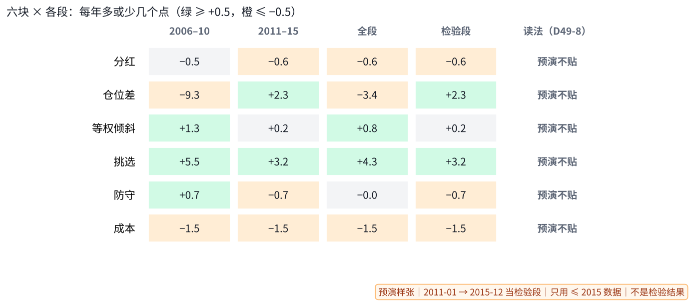
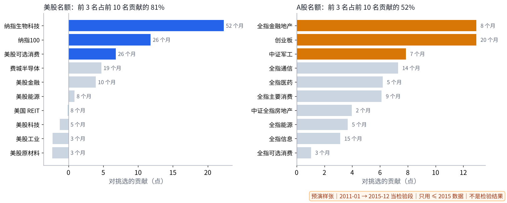
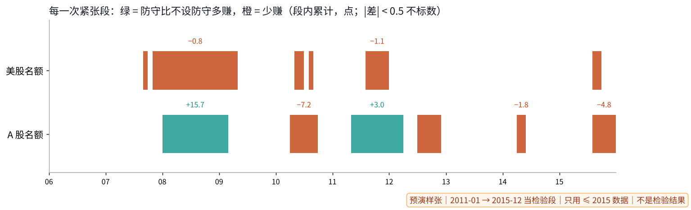
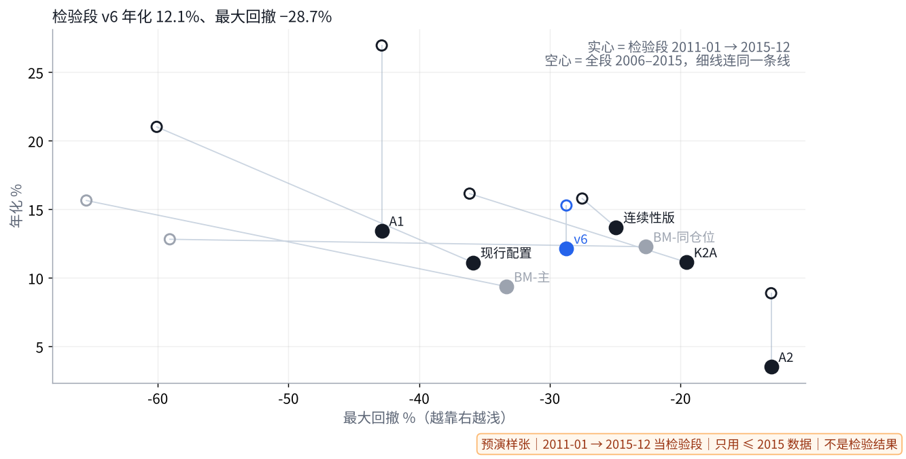
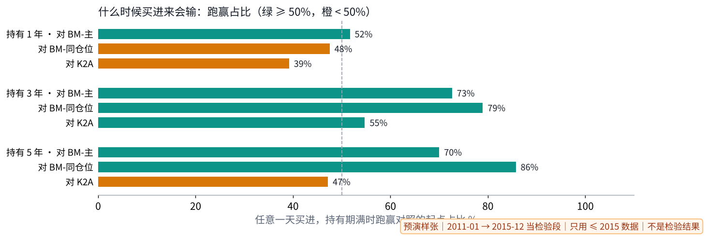
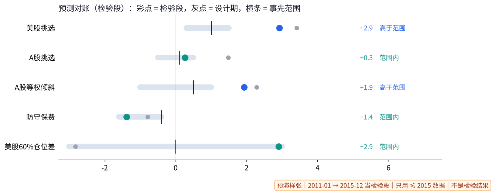

# v6 一次性检验报告（骨架）：结构、图和结论句开考前定下，跑完只填数

## Metadata

- Project: ETF_Rotation_Quant
- Document type: owner report（v6 一次性检验，冻结稿 §9.1 第 6 步）
- Status: skeleton（第 0.5 版，2026-11-26）。**只有结构，没有检验段的任何数字。** 结构、图和读法在看结果之前定下，跑完只填数，不改结构、不临场造说法；确需加的内容另写 D 编号并注明“看过结果后提出”。第 0.5 版吸取体检报告几轮评论的经验：页首加四格指标；加名词解释三组卡片（怎么读、拿来比的线、收益六块）；所有图换成填数脚本（`scripts/v6_report/oneshot_fill.py`，#395）在预演结果上真跑出来的样张，开考后同一脚本换成检验段；新增成本两个口径（D52）、紧张段时间线、几次急跌、任意起点四张图；第 0 节改为开考前提的最新状态；第 5 节用八条线的阵列。第 0.4.1 版：写入 Owner 批准开考、D50-4 选 B。
- Owner: L. Loric
- Maintainer: Orchestrator
- Date: 2026-11-26（Asia/Taipei）
- 依据：冻结预注册（tag `milestone/v6-prereg-freeze` → `f066da8e`）§5、§5.2–§5.4、§7；D45–D52；《v6 体检报告》第 1.5 版（设计期，同法的图和表）
- 样张数据：Dev #391 @ b2698663 的预演结果 `results/v6/rehearsal/`（检验窗口临时设为 2011-01 → 2015-12，全段 2006–2015，只用 ≤ 2015 数据，不计试验）；Reviewer #397 独立锁定后对上。
- 页面：Claude 页面“v6 一次性检验报告”；本文件是仓库镜像

---

**项目愿景**　在动态周期内，从多类资产里选出 Top N 强势 ETF 轮动持有，获得超额收益、稳定跑赢被动基准，同时把回撤控制住。

| 进度 | 结论 | 需要你 |
| --- | --- | --- |
| 开考前提都齐了：D49–D52 已定，预演两边独立算对上；Manager 合并后 Dev 开考。 | 还没开考，图都是预演样张（2011–15 当检验段，只用 ≤ 2015 数据）。 | 不用操作。对图和版式有意见现在提，开考后只填数。 |

<!-- 组件：指标 -->

| 指标 | v6 | 对照 | 对照值 | 读法 | 色 |
| --- | --- | --- | --- | --- | --- |
| 年化（检验段） | 待填 | 设计期 v6 | 15.3% | 和同仓位基准差几点看判据 ④ | 中 |
| 最大回撤 | 待填 | 设计期 v6 | −28.7% | 门槛 ≤ 40% | 中 |
| 跑赢随机 | 待填 | 设计期 v6 | 第 96.4 | 同结构随机 1000 次里排第几 | 中 |
| 四条判据 | 待填 | 后五年 | 2/4 | 全部满足才通过 | 中 |

<!-- 主线：这份报告的故事主线：从“过没过”读到“钱从哪来、在检验段还在不在” -->

名词解释：23 个词，分三组——怎么读这份检验报告、拿来比的七条线、收益拆成哪六块

<!-- 组件：名词 -->

| 组 | 名字 | 一句话 | 图 | 细节 |
| --- | --- | --- | --- | --- |
| 怎么读这份检验报告 | 检验段 | 过不过只看这一段 | 大字：2016-01 → 2026-09｜只用一次 | 规则定的时候没看过，但市场走势大家都见过，所以不叫“样本外”（D9-1）。 |
| 怎么读这份检验报告 | 全段 | 用来看钱从哪来，不当第二个计分板 | 大字：2006–2026｜只报告 | 全段四条判据也算，但不参与判定（D49）。 |
| 怎么读这份检验报告 | 判定口径 | 从 2006 年一路跑下来，再截出检验段 | 两套：判定=连续运行截出｜把握 p 和仓位从 2006 年累积；只报告=2016-01 重新起步｜另列差多少 | 冻结代码没有在 2016-01 清零，所以判定用连续运行截出（D49-1）。 |
| 怎么读这份检验报告 | 成本 | 判定按单边 0.2%，万分之一只报告 | 两套：判定=单边 0.2%｜佣金、价差、冲击和指数与 ETF 的差都算进去；实盘=单边 0.01%｜只是佣金，不含价差和 QDII 溢价 | 你 11-26 定（D52）。 |
| 怎么读这份检验报告 | 判据 | 四条门槛，全部满足才通过 | 门槛：最大回撤=≤ 40%｜防守保费=≤ 4 点｜年化 ÷ 回撤=高于 K2A｜对 BM-同仓位=不落后 |  |
| 怎么读这份检验报告 | 跑赢随机 | 同样结构、随机挑 1000 次，v6 排第几 | 大字：第 96.4｜设计期 2006–15 | 种子 20261122；每月跑赢随机中位数的比例一起报。 |
| 怎么读这份检验报告 | 三级结论 | 主判加稳健性 8 项，三选一 | 步骤：四条没全过 → **不通过**，改完能过也不升档｜四条全过，S1–S8 有一项让总结论翻转 → **通过（有条件）**｜四条全过、没有一项翻转 → **通过**｜上线前欧洲检验“不支持”，再降一级 | D50；欧洲检验见第 10 节。 |
| 怎么读这份检验报告 | 很敏感 | 改一处设定，总结论就翻 | 式：改动后的总结论 ≠ 主判 | 只在检验段、指数池的主判上判（D50-1）；对照跟着同样改（D51）。 |
| 怎么读这份检验报告 | 读法标签 | 六块各贴一个，按顺序判，先符合哪条记哪条 | 步骤：设计期为正，检验段为负或不到 0.5 点 → **设计期才有**｜否则四段至少三段同号，且检验段和设计期同号 → **稳定**｜其余 → **不稳定** | D49-8；不另造说法。 |
| 拿来比的七条线 | BM-主 | AGENTS.md 规定的并列基准 | 仓位：沪深300 70｜纳指100 15｜标普500 15 | 全收益、人民币、每月再平衡。 |
| 拿来比的七条线 | BM-同仓位 | 和 v6 同仓位的基准，判据 ④ 和它比 | 仓位：沪深300 40｜纳指100 30｜标普500 30 | 和 v6 的 A 股 40%、美股 60% 同仓位，用来把“美股多放 20 点”的影响拆出去。 |
| 拿来比的七条线 | K2A | 增强基准，判据 ③ 和它比 | 仓位：A 股 50｜美股 50 | 只给 A 股那一半上保险（月末低于 10 个月均线就换国债，仓位按波动调，每 5 个交易日看），美股那一半一直持有（你 11-17 定，D39-3）；“月末”用真实月末（你 11-26 定，D48-4）。 |
| 拿来比的七条线 | 现行配置 | 现在实际在跑的组合，不防守，只报告 | 仓位：A 股 70｜美股 30 | A 股是 16 个指数等权；海外 30% 是纳指100、标普500 各半。 |
| 拿来比的七条线 | 连续性版 | v6 的挑战者，只换 A 股名额的选法 | 仓位：A 股 40｜美股 60 | 先取涨幅前一半，再挑上涨天数占比最高的 3 只；其余同 v6。 |
| 拿来比的七条线 | A1 | 同行做法：每月全仓二选一，只报告 | 式：沪深300 或 标普500 | 每月末全仓拿过去一年涨得多的那个；标普500 跑输现金就全仓国债。v4 已签收的账本。 |
| 拿来比的七条线 | A2 | 同行做法：五类资产各 1/5，只报告 | 仓位：沪深300 20｜标普500 20｜恒生 20｜国债 20｜黄金 20 | 每份低于 10 个月均价就拿现金。v4 已签收的账本。 |
| 收益拆成哪六块 | 六块怎么接起来 | 从 BM-主一步一步走到 v6：每走一步换一样东西，两条线之差就是一块；六块加起来正好是 v6 比 BM-主多出的部分 | 链：BM-主｜分红 −0.6｜价格版｜仓位差 −3.4｜BM-同仓位｜等权倾斜 +0.8｜同结构等权｜挑选 +4.3｜前 3 不防守｜防守 −0.02｜v6 毛｜成本 −1.5｜v6 净 | BM-主是全收益，价格版是它去掉分红；数字是预演全段 2006–15（每年几点），开考后换成检验段。汇率单独报，不进合计。 |
| 收益拆成哪六块 | 分红 | 候选用价格指数、基准用全收益，差出来的分红 | 式：BM-主价格 − BM-主全收益 ‖ 值：−0.6 点/年 | 一直为负：不是规则的问题，是口径。 |
| 收益拆成哪六块 | 仓位差 | 只因为美股 60%、A 股 40% 而多或少的部分 | 式：BM-同仓位 − BM-主 ‖ 值：−3.4 点/年 | A 股大牛市里只放 40%，这一块吃亏最多。 |
| 收益拆成哪六块 | 等权倾斜 | 不挑、全拿带来的部分 | 式：同结构等权 − BM-同仓位 ‖ 值：+0.8 点/年 | 同结构等权 = 每个名额按行业标签等权持有全部候选。 |
| 收益拆成哪六块 | 挑选 | 每月选最强的 3 只值多少 | 式：前 3、不设防守 − 同结构等权 ‖ 值：+4.3 点/年 | 设计期最大的加分；检验段还在不在，是这份报告最想回答的。 |
| 收益拆成哪六块 | 防守 | 确认紧张时按把握减仓值多少 | 式：v6 毛 − 前 3、不设防守 ‖ 值：−0.02 点/年 | 平时交保费，急跌时赚回来；价值在回撤，不在收益。 |
| 收益拆成哪六块 | 成本 | 换手扣掉的部分 | 式：v6 净 − v6 毛 ‖ 值：−1.5 点/年 | 按判定口径单边 0.2%；万分之一下约 −0.08 点（D52）。 |

## 0. 开考前提：七件事六件已齐，只差 Manager 合并、Dev 正式跑一次

<!-- 问：什么都齐了才能跑？｜短：开考前提｜状态：在做 -->

> **D49–D52 都已定，预演保费 1.3839 两边差约 1e-7；Reviewer 已签 #391、#394、#395、#396，等 Manager 合并后 Dev 开考。**

| # | 事项 | 谁 | 状态 | 说明 |
| --- | --- | --- | --- | --- |
| 1 | 批准一次性检验 | Owner | 已完成 | 2016-01 → 2026-09，只跑一次，判定只看检验段 |
| 2 | D49 全段只报告、六块拆账 | Reviewer、Manager | 已完成 | 11-26 合入 |
| 3 | D50 很敏感与三级结论 | Owner | 已完成 | D50-4 选 B：有条件再遇欧洲“不支持”= 不通过 |
| 4 | D51 判据 ② 的对照、S 项怎么跟着改 | Orchestrator、Reviewer | 已完成 | 预演里判据 ② 从 2.83 回到签收的 1.38 |
| 5 | D52 成本两个口径 | Owner | 已完成 | 判定 0.2%；万分之一只报告（#396） |
| 6 | 预演对上 | Dev、Reviewer | 已完成 | Reviewer 先锁定再对账（#397）：①–④、S1、S3 一致 |
| 7 | 合并后正式跑一次 | Manager、Dev、Reviewer | 在做 | 跑完 Reviewer 独立复算 ①–④、S1、S3 和连续性版 |

- **D50 定了什么**：稳健性 8 项里任何一项改动后总结论翻转，记“很敏感”；主判通过而有一项很敏感，结论是“通过（有条件）”，照常进 6 个月模拟盘，页首写明条件。
- **判定口径**：冻结代码从 2006 年连续跑下来，截出检验段判定；2016-01 重新起步只另列差多少（D49-1）。预演里两者结论相同，保费差 0.63 点。
- **成本加倍最可能触发降级**：成本每年约 1.5 点，判据 ④ 的余量不到这个数时，成本加倍就会让它翻转。

<!-- 接力：前提齐了才跑；跑完先看的，是过没过 -->

## 1. 过不过：只看检验段四条判据，结论句三版已预写

<!-- 问：一次性检验过没过？｜短：过不过｜状态：待填 -->

> **判定只看检验段 2016-01 → 2026-09、四条判据全部满足；全段和设计期都不参与判定（冻结稿 §5，D49-1）。**

<!-- 组件：闸门格｜四条判据：检验段一列判定，设计期两段作参照 -->

| 编号 | 门槛 | 事先机会 | 2006–10 | 2011–15 | 2016-01 → 2026-09 |
| --- | --- | --- | --- | --- | --- |
| ① 回撤 | ≤ 40% | 80% | −25.0%｜过 | −28.7%｜过 | 待填｜待填 |
| ② 防守保费 | ≤ 4 点 | 85% | 0.0 点｜过 | 1.4 点｜过 | 待填｜待填 |
| ③ 对 K2A | 年化 ÷ 回撤高于 K2A | 60% | 0.74 对 0.59｜过 | 0.42 对 0.57｜不过 | 待填｜待填 |
| ④ 对同仓位基准 | ≥ 0 | 50% | +5.2 点｜过 | −0.1 点｜不过 | 待填｜待填 |
| 四条全过 | 全部满足才通过 | 30% | 过 | 不过 | 待填 |

| 结论 | 什么时候用（互斥，D50-2） | 预写的页首结论句（只填【】） |
| --- | --- | --- |
| 通过 | 四条都过，S1–S8 没有一项翻转 | 四条判据都过；每年【X】%，比同仓位基准多【Y】点，回撤【Z】% |
| 通过（有条件） | 四条都过，至少一项翻转 | 四条都过；【S?】在【判据】翻转，差【?】（每一项并列） |
| 不通过 | 四条没有全过；改完能过也不升档 | 判据【编号】没过；每年【X】%，比同仓位基准【多 / 少】【Y】点 |

- **读这块**：框住的是检验段一列，只有它决定结论；左边两列是设计期参照，后五年 ③④ 已经不过。
- **结论句由脚本选**：填数脚本按 `verdict.json` 的总结论选一版、只填【】，不改字；预演选出的是“不通过”那一版，和左边 2011–15 一列一致。
- **不加形容词**：通过版本不写“稳定跑赢”，不通过版本不写“接近通过”；差多少直接写数字。

<!-- 接力：过没过只是一个字；下一节看这个字稳不稳 -->

## 2. 结论稳不稳：稳健性 8 项、同结构随机、能买到的池子，都只报告

<!-- 问：换个成本、晚一天下单、去掉最赚钱的几只，结论还在不在？｜短：稳不稳｜状态：待填 -->

> **8 项里有一项让总结论翻转，就记“很敏感”，通过降为“通过（有条件）”（D50）；随机对照和能买到的池子只报告。**

- **先看左边最右一列**：8 行的总结论有没有哪一格和主判不一样；有就加框，并写进页首。
- **再看右边竖线**：v6 落在随机分布的哪里；检验段、全段各一条。

8 项各看什么，以及随机对照、能买到的池子

| 编号 | 改动 | 看什么 | 状态 |
| --- | --- | --- | --- |
| S1 | 成本加倍（单边 0.4%） | 判据 ④ 的余量够不够付成本 | 待填 |
| S2 | 信号日延后 1 个交易日 | 是不是靠月末那一天的时点 | 待填 |
| S3–S5 | 去掉贡献最大的 1、2、3 个候选 | 钱是不是集中在少数几只 | 待填 |
| S6 | 美股 50%、A 股 50% | 超额是不是只来自美股多放 | 待填 |
| S7 | 每个名额选前 2 | 前 3 是不是挑出来的数字 | 待填 |
| S8 | 三票全中才算紧张 | 防守门槛是不是挑出来的 | 待填 |
| 随机 | 同结构随机 1000 次（种子 20261122） | 百分位、每月跑赢随机中位数的比例；组合和两个名额（设计期：第 96.4、54.2%） | 待填 |
| 可交易池 | 只买当年真有的场内基金，计 QDII 溢价 | 和指数池差多少 | 未实现，不挡开考（D52-3） |

<!-- 接力：结论稳不稳看完，最想知道的是钱从哪来 -->

## 3. 钱从哪来：六块拆账按四个五年段看，每块贴“稳定 / 设计期才有 / 不稳定”

<!-- 问：v6 赚的是挑选、防守，还是美股放 60%、人民币贬值？｜短：钱从哪来｜状态：待填 -->

> **六块相加 = v6 比 BM-主多出的部分；全段只放在分段旁边，不单独引用（D49）；成本另列万分之一的实盘口径（D52）。**

- **先看瀑布最右**：v6 净比 BM-主多还是少；再看哪一块最高。
- **再看格子的标签列**：挑选、防守是“稳定”，才说明每月四步的规则本身有用；钱主要来自仓位差或汇率，说明赚的是“美股放 60%”。
- **成本两个口径**：灰条只说明佣金有多便宜，不改判定；实盘还要付价差和 QDII 溢价（D52）。

六块 × 四段的空表（跑完填）

| 块 | 2006–10 | 2011–15 | 2016–20 | 2021-01 → 2026-09 | 全段 | 读法标签 |
| --- | --- | --- | --- | --- | --- | --- |
| 分红 | 待填 | 待填 | 待填 | 待填 | 待填 | 待填 |
| 仓位差 | 待填 | 待填 | 待填 | 待填 | 待填 | 待填 |
| 等权倾斜 | 待填 | 待填 | 待填 | 待填 | 待填 | 待填 |
| 挑选 | 待填 | 待填 | 待填 | 待填 | 待填 | 待填 |
| 防守 | 待填 | 待填 | 待填 | 待填 | 待填 | 待填 |
| 成本 | 待填 | 待填 | 待填 | 待填 | 待填 | 待填 |

逐年（20 个完整自然年 + 2026 年前 9 个月）另附一张同样的表；A 股名额、美股名额各一张；美股另报“前 3 − SPX”（D48-3）和汇率层。

- **读法标签按顺序判**（D49-8）：设计期为正、检验段为负或不到 0.5 点 → 设计期才有；否则四段至少三段同号且检验段与设计期同号 → 稳定；其余 → 不稳定。
- **六块首尾相接**：相加 = v6 净 − BM-主全收益；第 ③ 块减去的，就是第 ② 块终点的价格 BM-同仓位（D49-3）。
- **汇率单独看**：美股名额的人民币收益减美元收益，另报，不进合计，也不进瀑布图。

<!-- 接力：挑选和防守各自是哪几笔赚的？ -->

## 4. 挑选赚的是谁、防守赚的是哪几次：看前 3 名占多少，逐次列紧张段

<!-- 问：挑选的钱是不是集中在几只上？防守在哪几次真帮上了忙？｜短：挑选与防守｜状态：待填 -->

> **挑选看贡献最大的 10 个候选、前 3 名占多少，和 S3–S5 并排看；防守逐次列出紧张段，2015–16、2018、2020、2022 年都要如实写（D49-5、D49-6）。**

- **前 3 名占比高**：钱集中在少数几只，S3–S5 去掉它们以后最容易翻转。
- **紧张段的颜色**：绿的几次是防守真帮上忙；橙的是交了保费。平时（不紧张月份）的保费另报。

这一节跑完要填的四样

| 看什么 | 图 | 状态 |
| --- | --- | --- |
| 挑选贡献最大的 10 个候选 | 每个名额一张横条图，加从未入选名单 | 待填 |
| 前 3 名占前 10 名贡献的比例 | 和 S3–S5 并排看 | 待填 |
| 每一次紧张段 | 两个名额的时间线：段内累计比不设防守多或少 | 待填 |
| 平时保费 | 每个五年段不紧张月份的累计 | 待填 |

<!-- 接力：钱的来源看清了，再把 v6 放回八条线里 -->

## 5. 和别人比：八条线，检验段为主、全段并列

<!-- 问：检验段里 v6 和 A1、A2、K2A、现行配置、基准比，站在哪？｜短：和别人比｜状态：待填 -->

> **散点实心画检验段、空心画全段，细线连同一条线；下面的阵列先放设计期 2006–15 的年化和回撤，开考后换成检验段。**

| 线 | 放哪 | 怎么选 | 防守 | 年化 | 最大回撤 | 为什么是这个结果 |
| --- | --- | --- | --- | --- | --- | --- |
| v6 | A 股 40%、美股 60% | 每月每个名额取涨幅前 3 | 紧张时股票只拿 p | 15.3% | −28.7% | 减仓躲大跌；A 股少，牛市少赚 |
| 连续性版 | 同 v6 | A 股改挑上涨天数最多的 3 只 | 同 v6 | 15.8% | −27.5% | 和 v6 几乎一样 |
| K2A | A 股 50%、美股 50% | 不挑：沪深300、纳指、标普 | 只管 A 股：破均线换国债 | 16.2% | −36.1% | 美股不防，2008 年跌得深 |
| A1 | 沪深300 或标普500，全仓 | 每月拿过去一年涨得多的那个 | 标普跑输现金就全换国债 | 27.0% | −42.9% | 全仓吃到牛市；太集中，回撤深 |
| A2 | 五类各 1/5 | 不挑：A、美、港股，国债，黄金 | 每份破均线就拿现金 | 8.9% | −13.1% | 股票少又分散：最稳、最低 |
| 现行配置 | A 股 70%、海外 30% | 不挑：16 个 A 股指数等权 | 没有 | 21.0% | −60.1% | A 股多，牛市赚得多，跌得也深 |
| BM-主 | A 股 70%、美股 30% | 不挑：沪深300、纳指、标普 | 没有 | 15.6% | −65.5% | A 股多，2008 年跟着跌 |
| BM-同仓位 | A 股 40%、美股 60% | 不挑：沪深300、纳指、标普 | 没有 | 12.8% | −59.1% | v6 去掉挑选和防守：差一截 |

- **阵列分两组**：同组比回撤，跨组看少跌要少赚多少。
- **BM-主逐年并列**放折叠（冻结稿 §5.1）；A1、A2 检验段接 v5 账本（D49）。

八条线检验段的年化和回撤（跑完填）

| 线 | 检验段年化 | 检验段回撤 | 全段年化 | 全段回撤 |
| --- | --- | --- | --- | --- |
| v6 | 待填 | 待填 | 待填 | 待填 |
| 连续性版 | 待填 | 待填 | 待填 | 待填 |
| K2A | 待填 | 待填 | 待填 | 待填 |
| A1 | 待填 | 待填 | 待填 | 待填 |
| A2 | 待填 | 待填 | 待填 | 待填 |
| 现行配置 | 待填 | 待填 | 待填 | 待填 |
| BM-主 | 待填 | 待填 | 待填 | 待填 |
| BM-同仓位 | 待填 | 待填 | 待填 | 待填 |

<!-- 接力：比完位置，看这 20 年一条线怎么走 -->

## 6. 性格：2006–2026 一条线走下来，几次急跌各怎样

<!-- 问：一直拿着的人，20 年里会经历什么？｜短：性格｜状态：待填 -->

> **净值用普通刻度、单位万元，竖线分开设计期和检验段；必须写全段最深一跌在哪、是否跨 2015-12 / 2016-01，以及 2015、2018、2020、2022 四次急跌各跌多少。**

- **急跌怎么取**：每次从 BM-主该年最高那一天起算 250 个交易日，不挑日子；正式四次是 2015、2018、2020、2022 年。
- **当时股票仓位**：每次标出 v6 一年内的最低股票仓位，需要 Dev 导出每月仓位；没导出时只画跌幅。

这一节跑完要填的四样

| 看什么 | 图 | 状态 |
| --- | --- | --- |
| 100 万变成多少 + 回撤 | 六条线加沪深300、标普500 全收益，逐周 | 待填 |
| 全段最深一跌 | 从哪天到哪天，是否跨 2015-12 / 2016-01 | 待填 |
| 四次急跌 | 从见顶日算 250 个交易日，标出当时股票仓位 | 待填 |
| 上涨月份跟到、下跌月份只跟 | 检验段和设计期并列 | 待填 |

<!-- 接力：一条线看完，再按行情和起点切开看 -->

## 7. 四种行情、任意起点：全段 2006–2026

<!-- 问：牛熊里各赚亏多少？什么时候买进来会输？｜短：行情与起点｜状态：待填 -->

> **四种行情和任意起点同体检第 4、5 节，对 BM-主、BM-同仓位、K2A 三个对照；2011–2021 年买入、跨两段的起点单独标出。**

- **行情柱**：v6 设计成熊市、回调多赚，牛市、反弹少赚；方向反了要先查原因。
- **起点占比**：橙条（不到一半）说明什么时候买进来大概率会输；持有越久，占比应当越高。

<!-- 接力：结果和事先估的对得上吗？ -->

## 8. 预测准不准：检验段逐项对账，不判过不过

<!-- 问：事先估的每一项，检验段落在范围里吗？｜短：预测｜状态：待填 -->

> **预测范围横条 + 检验段实际点，设计期的点灰色并列（D38-6）；超出范围的项，先查原因再做下一版。**

预测表原文、设计期实际和检验段（跑完填）

| 来源 | 中间值 | 范围 | 设计期 | 检验段 |
| --- | ---: | --- | --- | --- |
| 美股名额挑选（前 3） | +1.0 | +0.3 到 +1.5 | +3.41 | 待填 |
| A 股名额：挑选 | +0.1 | −0.5 到 +0.5 | +1.48 | 待填 |
| A 股名额：等权倾斜 | +0.5 | −1.0 到 +1.0 | +2.28 | 待填 |
| 防守的平时保费 | −0.4 | −1.6 到 −0.4 | −0.79 | 待填 |
| 美股 60% 的仓位差 | 0 | −3 到 +3 | −2.83 | 待填 |
| 合计（不含仓位差） | +1.2 | −1.3 到 +2.4 | +2.46 | 待填 |

<!-- 接力：最后两件：连续性版换不换，以及下一步 -->

## 9. 连续性版换不换：两个条件都满足才换

<!-- 问：挑战者在检验段赢了吗？｜短：连续性版｜状态：待填 -->

> **连续性版整套也过四条判据，且检验段 A 股名额里它比 12−1 的月度差均值为正，才在模拟盘换上；要给 A 股挑选“报钱”还需 t ≥ 2.24（冻结稿 §5.3）。**

<!-- 组件：闸门格｜连续性版：设计期后五年 ③ 不过；检验段一列开考后填 -->

| 编号 | 门槛 | 事先机会 | 2006–10 | 2011–15 | 2016-01 → 2026-09 |
| --- | --- | --- | --- | --- | --- |
| ① 回撤 | ≤ 40% |  | −27.5%｜过 | −24.9%｜过 | 待填｜待填 |
| ② 防守保费 | ≤ 4 点 |  | 0.0 点｜过 | 1.2 点｜过 | 待填｜待填 |
| ③ 对 K2A | 高于 K2A |  | 0.65 对 0.59｜过 | 0.55 对 0.57｜不过 | 待填｜待填 |
| ④ 对同仓位基准 | ≥ 0 |  | +4.6 点｜过 | +1.4 点｜过 | 待填｜待填 |
| 四条全过 | 全部满足才通过 |  | 过 | 不过 | 待填 |

- **第二个条件**：检验段 A 股名额里，连续性版比 12−1 的月度差均值要 > 0；给 A 股挑选“报钱”还要 t ≥ 2.24。两个数来自 Dev 的 `continuity.json`，开考后填。
- **设计期参照**：后五年 ③ 差一点（0.55 对 0.57），比 v6（0.42）好；设计期好一点不构成换上的理由。

<!-- 接力：最后看结论出来以后怎么走 -->

## 10. 接下来：按结论三级走，三条路事先写好

<!-- 问：结论出来以后做什么？｜短：接下来｜状态：待填 -->

> **通过和通过（有条件）都进 6 个月模拟盘，上线前做欧洲检验；不通过就如实记录并关闭。**

<!-- 组件：载体｜三种结论各走哪条路 -->

| 类型 | 候选 |
| --- | --- |
| 通过 | 6 个月前向模拟盘、小资金起步另批、上线前欧洲检验 |
| 通过（有条件） | 6 个月前向模拟盘、页首写明条件、每月单列对应的量、小资金起步另批 |
| 不通过 | 如实记录、关闭 v6、新想法注明第 5 次尝试 |

- **模拟盘里同时只记录、不交易的三个影子**（冻结稿 §7）：结构市才挑选、12−1 与连续性版各一半、连续性版（检验后没换上时）。
- **两条暂停线**：模拟盘跌破 60 万；或 6 个月对同仓位基准累计落后超过 6 点。碰到就暂停并报告你。
- **欧洲检验怎么记**：挑选（前 3 对同结构等权）为正、且防守保费不超过 4 点，记“支持”；否则降一级（D50-4）：通过 → 通过（有条件），上线前你另批；通过（有条件）→ 不通过，模拟盘结束后关闭。
- **三种结论都要写**：第 3 节哪几块“稳定”。钱若主要来自仓位差或汇率，更简单的配置也能拿到；挑选和防守“稳定”，才说明每月四步的规则本身有用。

工程用：输入文件和 PR（跑完填）

- 冻结稿：tag `milestone/v6-prereg-freeze` → `f066da8e`；D45–D52（D49 #385、D50 #388、D51 #393、D52 #396）
- 预演：Dev #391 @ b2698663（`results/v6/rehearsal/`）；Reviewer 独立锁定 #397 @ 558a6928
- 图：`python -I scripts/v6_report/oneshot_fill.py <结果目录> docs/assets/v6-oneshot <填数 JSON>`（#395）；样张用预演结果，开考后换 `results/v6/oneshot/`
- Dev 正式：待填（PR、结果目录、manifest 哈希、运行次数 = 1）
- Reviewer 复算：待填（PR、锁定文件与 SHA256）

