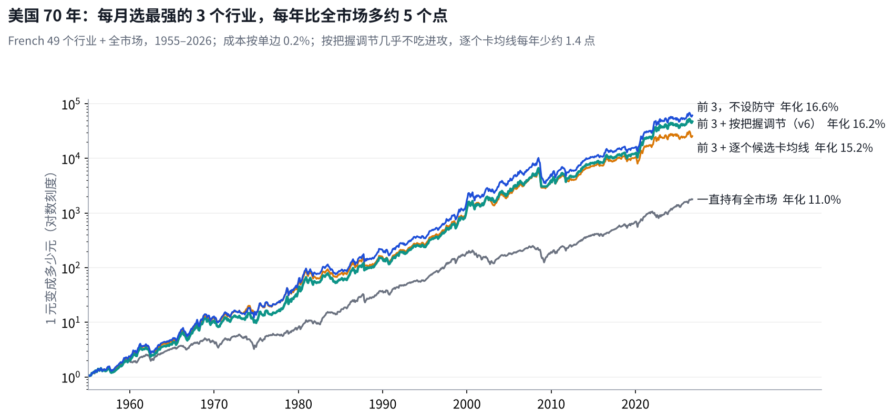
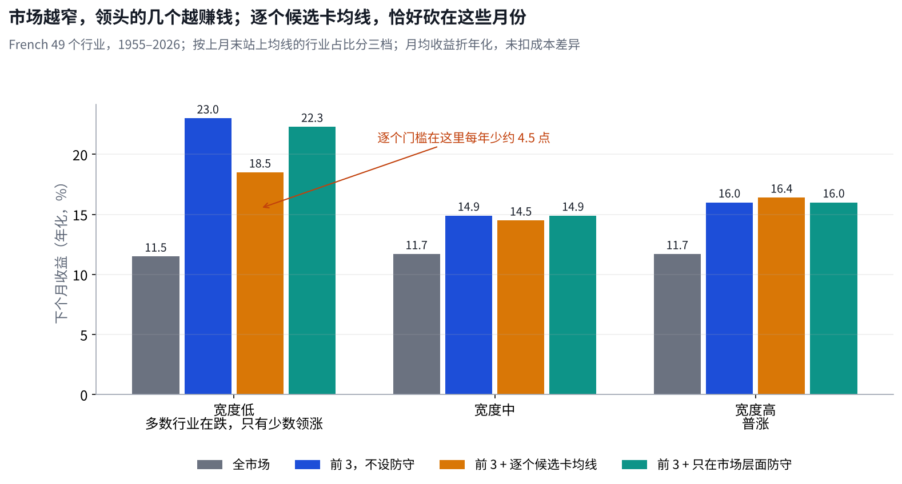

# v6 预演预测表：每个市场选最强的 3 个，紧张时按把握减仓；预计每年比基准多约 1.2 个点，100 万最差约剩 67 万

## Metadata

- Project: ETF_Rotation_Quant
- Document type: owner report（D38 预演第 6 项）
- Status: active（第 3.17 版：第 2 节补 A 股 t ≥ 2 为什么难（D38 第 50 行）；第 3.16 版：第 2 节补 A 股 4 种替代选法的检验（D38 第 49 行）；第 3.15 版：D40-11 美股候选池只追加 REIT；第 3.14 版：名词解释补“上个月涨幅”“Φ(t)”；第 3.13 版：A 股名额预测改为 +0.6（D40-10）；名词解释补 t、t ≥ 2、换手；第 2 节 A 股检验改成可见的表；第 3.12 版：第 2 节补 A 股一级行业回填段的检验（D38 第 48 行）；第 3.11 版：第六轮入库后复算设计期数字；候选去重已测通过（D38 第 46、47 行）；第 3.10 版：第 10 节按 D40-8、D40-9 更新；第 3.9 版：“把握 p 怎么算”改成三步算式 + 两个市场的逐步数字 + 换算曲线；第 2 节补回看速度与 A 股短记忆的检验（D38 第 42–44 行）；第 10 节更新 Grok 第六轮）
- Owner: L. Loric
- Maintainer: Orchestrator
- Date: 2026-11-19（Asia/Taipei）
- 依据：`operations/planning/2026-11-16-d38-project-diagnosis-and-preflight.md`（运行附表第 10–50 行，每一行都先登记、后运行）；`operations/planning/2026-11-19-d40-v6-structure.md`（D40）；结果在 `results/v6-preflight/`
- 数据：合成行情；美国 49 个行业 1926–2026（Kenneth French 公开数据）；港股恒生四个分类 1993–2015；项目池和行情库 ≤2015-12-31，A 股候选按官方发布日截断。2016 年以后只用美国行业数据和执行层的溢价数据，不读项目池收益
- 页面：Claude 页面“v6 预演预测表”；本文件是仓库镜像

---

**项目愿景**　在动态周期内，从多类资产里选出 Top N 强势 ETF 轮动持有，获得超额收益、稳定跑赢被动基准，同时把回撤控制住。

| 进度 | 结论 | 需要你 |
| --- | --- | --- |
| D38 预演第 10–50 行跑完；你定了美股 60%、每个市场选前 3、底线按中间情况判、溢价看偏离、三票等权（D40）。 | **进攻**是每个市场按过去一年的强弱选前 3；**防守**只在市场确认紧张时按把握减仓。预计每年比基准多约 **1.2** 个点（范围 −1.3 到 +2.4），100 万在六种合成行情的中间情况里最差剩约 **67** 万。 | 不用操作。在等 Grok 的沪深300 行业指数和 Reviewer 复核。 |

名词解释：基准、名额、12−1、上个月涨幅、确认紧张、t、t ≥ 2、把握 p、Φ(t)、换手、合成行情、中间情况、较差的十分之一、打折

| 名字 | 是什么 |
| --- | --- |
| **基准** | 沪深300 70% + 纳指100 15% + 标普500 15%，每月再平衡。所有“多或少几个点”都和它比。 |
| **名额** | 每个市场一个：A 股 40%、美股 60%。名额里的钱只在这个市场的候选之间分。 |
| **12−1** | 候选从 12 个月前到 1 个月前的涨幅，最近一个月不算。为什么不算最近一个月：最近一个月的涨跌常常是短期噪声，文献里用了几十年的默认值。例：2015 年 8 月底打分，用 2014 年 8 月底到 2015 年 7 月底这 11 个月的涨幅。 |
| **上个月涨幅** | 只看最近 1 个月的涨幅排名，涨得最多的 3 个入选，正好是 12−1 不算的那一段。例：2015 年 8 月底打分，只用 8 月这一个月的涨幅。它换得快，几乎每月换 2 只。 |
| **母指数** | A 股是沪深300，美股是标普500。母指数也是候选，规则自己决定拿母指数还是细分。 |
| **确认紧张** | 三票里至少两票成立：母指数跌破 10 个月均线；站上均线的候选占比处在历史低的三分之一；TRIN（成交额流向下跌候选的程度，10 日均值）处在历史高的三分之一。 |
| **t** | 平均超额离 0 有几个“噪声单位”。t = 平均 ÷ 波动 × √月数。为什么这样算：每个月的超额有正有负，平均值本身也会随运气晃，晃动幅度约等于波动 ÷ √月数，月数越多晃得越少。例：A 股一级行业前 3 每月平均多 0.44%，每月波动约 4.7%，119 个月，t = 0.44 ÷ 4.7 × √119 ≈ 1.0。 |
| **t ≥ 2** | 统计上的通用门槛，不是我们定的。如果真实超额是 0，光靠运气得到 t ≥ 2 的机会约 2%；t = 1 时约 16%，六次里有一次。为什么是 2：大约对应常用的 95% 置信；试过的办法越多，门槛应该越高，有研究建议用 3。例：美国 70 年 12−1 前 3 是 t 3.4，A 股是 t 1.0。 |
| **把握 p** | 把 t 换成 0 到 1 之间的数：p = Φ(t)，大致读成“这个优势不是运气”的可信程度。t = 0 时 0.5，t = 1 时 0.84，t = 2 时 0.98。用在防守上：t 按以往紧张月里领头者下个月的涨幅算，紧张时股票只拿 p 那么多。例：2015 年 8 月 A 股 p = 0.265，40 万只拿 10.6 万股票。 |
| **Φ(t)** | 一条钟形曲线（标准正态分布）在 t 左边的面积，从 0 到 1。p = Φ(t)。为什么用它：如果真实优势是 0，t 只是运气晃出来的，它就大致落在这条钟形曲线上；t 左边的面积，就是“光靠运气到不了这么高”的比例。例：t = −1 时 0.16，t = 0 时 0.5，t = 0.5 时 0.69，t = 1 时 0.84，t = 2 时 0.98，t = 3 时 0.999；Excel 里写 NORM.S.DIST(t, TRUE)。 |
| **换手** | 一年里买卖的总金额是名额的几倍。每月把 3 只换掉 1 只，等于卖三分之一、买三分之一，记 2/3。例：12−1 每年约 5 倍，平均一个半月换 1 只；上月涨幅每年约 15.6 倍，几乎每月换 2 只。每 1 倍按单边 0.2% 算成本，15.6 倍每年约 3.1 点。 |
| **合成行情** | 电脑造的六种行情，每种生成 200 种可能的未来；里面没有动量，挑选只是噪声，是对挑选最不利的情况。 |
| **中间情况** | 200 种未来按最低点排好，排在正中间的那个，代表这类行情的典型结果。 |
| **较差的十分之一** | 从最差往上数第 20 个，代表十次这种行情里运气差的那一次。 |
| **打折** | 从历史数据算出来的超额一律乘 0.5；再按我们能买的候选个数（约 14 个，对 49 个行业）乘 0.6；成本按单边 0.2% 上限。 |

## 0. 策略怎么执行：每月最后一个交易日走四步，下一个交易日调仓

> **100 万分成 A 股 40 万、美股 60 万，各自走四步；平时每边拿 3 只、各占三分之一，市场确认紧张时股票只拿“把握 p”那么多，其余买国债。**

1. **选人**：**决定买哪 3 只**。看：过去一年涨幅 · 不算最近 1 个月｜规则：从高到低排 · **取前 3** · 母指数也参加排名｜结果：3 只候选。例（2015 年 8 月 A 股）：军工 106% · 软件 100% · 公用 95% → 这 3 只入选。
2. **看市场**：**决定现在紧不紧张**。看：母指数均线 · 宽度 · TRIN｜规则：每项越过历史门槛 = 1 票 · **≥ 2 票 = 紧张**｜结果：紧张 / 不紧张。例（2015 年 8 月 A 股）：均线 ✓ · 宽度 ✓ · TRIN ✓ → 3 票，紧张。
3. **定仓位**：**决定股票买多少钱**。看：紧不紧张 · 把握 p｜规则：不紧张：每只 1/3 · **紧张：股票 × p** · 其余买国债｜结果：每只的金额。例（2015 年 8 月 A 股）：40 万 · p = 0.265 → 股票 10.6 万，国债 29.4 万。
4. **下单**：**决定买哪只基金**。看：同指数的几只基金 · 溢价比 60 天常态高几点｜规则：下一个交易日调仓 · **高 5 点以上换一只**｜结果：实际买入的基金。例（纳指科技，假设）：常态 9% · 今天 16% → 高 7 点，换另一只。

**把握 p 怎么算**：记下：以往每个紧张月，前 3 名下个月涨了多少（只记已知结果的月份） → 算 t：t = 平均 ÷ 波动 × √月数 → 换成 p：p = Φ(t)。t 越大越有把握：t = 0 时 p = 0.5，t = 1 时 0.84，t = 2 时 0.98；不足 12 个月时 p = 0.5。

| 2015 年 8 月 | ① 紧张月数 | ① 领头者下月平均 | ① 波动 | ② t | ③ 把握 p | 股票仓位 |
| --- | ---: | ---: | ---: | ---: | ---: | --- |
| A 股名额 | 37 | −1.02% | 9.89% | −0.63 | 0.265 | 40 万 × 0.265 = 10.6 万 |
| 美股名额 | 156 | +1.43% | 6.76% | +2.65 | 0.996 | 60 万 × 0.996 = 59.8 万 |

- **读这张图**：2015 年 8 月股灾后，A 股三票全中，以往紧张时 A 股领头者也跟着跌，把握只有 0.265，40 万里只拿 10.6 万股票；美股也算紧张，但美股领头者以往紧张时照样涨，把握 0.996，几乎满仓。
- **一条附加规则**：母指数跌破均线时，只选过去一年是涨的候选，选不满的空位也放国债。
- **去重已测通过**：2013 年 4 月 A 股前两名“300 医药”和“全指医药”是同一个行业；同一行业只留分数最高的一个后，改选 300 医药、创业板、全指公用。去重让单一行业占名额三分之二以上的月份从约两成降到 3%（D38 第 46 行）。

执行标准：每个数怎么算、从哪来

| 执行标准 | 怎么算 | 用在哪一步 | 数字从哪来 |
| --- | --- | --- | --- |
| 12−1 涨幅 | 上月末点位 ÷ 12 个月前月末点位 − 1；全收益口径，美股按人民币 | 打分、选人 | 文献默认值 |
| 10 个月均线 | 最近 10 个月末点位的平均（含本月末） | 母指数、国债是否跌破 | 文献默认值 |
| 宽度 | 站上自己均线的候选数 ÷ 有 10 个月数据的候选数 | 第二票 | 门槛 = 到当时为止全部月份的 1/3 分位 |
| TRIN（10 日均值） | 每天：（涨的候选数 ÷ 跌的候选数）÷（涨的成交额 ÷ 跌的成交额），取最近 10 天平均 | 第三票 | 门槛 = 到当时为止的 2/3 分位 |
| 确认紧张 | 三票里至少两票 | 定仓位 | 等权投票，事先写死 |
| 把握 p | 以往每个紧张月记下“当时前 3 名下个月的平均涨幅”；p = Φ(平均 ÷ 标准差 × √月数) | 定仓位 | 只用已知结果；不足 12 个月份时 p = 0.5 |
| 候选准入 | 指数官方发布日（或基金上市日）起满 12 个月 | 打分 | D38 第 39 行教训 |
| 溢价偏离 | 当日溢价 − 最近 60 个交易日溢价的中位数 | 买基金 | 执行层规则，不计入 3 个数字 |
| 成本 | 回测按单边 0.2% 计 | 全部 | 上限口径 |

- **把握 p 怎么读**：t = 平均 ÷ 标准差 × √月数，越大越有把握。t = 0 时 p = 0.5，t = 1 时 0.84，t = 2 时 0.98。
- **美股候选**：设计期回测用美国本土的行业 ETF 加纳指、道指、费城半导体、纳斯达克生物科技代替；v6 实盘用对应的 QDII，清单等 Grok 第六轮补齐后定。

两个月份的逐步计算（设计期真实数据）

| 示例：2015 年 8 月 31 日（A 股刚经历股灾） | A 股名额（40 万） | 美股名额（60 万） |
| --- | --- | --- |
| ① 打分前 3 | 中证军工 106%、全指软件 100%、全指公用 95% | 纳斯达克生物科技 37%、医疗 19%、可选消费 16% |
| ② 母指数和均线 | 沪深300 低于均线约 12%：只选分数为正的，前 3 都为正 | 标普500 低于均线约 0.7%：同左 |
| ② 三票 | 均线 ✓；宽度 0.00（门槛 0.35）✓；TRIN 1.25（门槛 1.20）✓：3 票 | 均线 ✓；宽度 0.43（门槛 0.62）✓；TRIN 1.25（门槛 1.92）✗：2 票 |
| ④ 把握 p | 0.265（之前 37 个紧张月，领头者表现差） | 0.996（含美国长历史 156 个紧张月） |
| ④ 股票仓位 | 40 万 × 0.265 = 10.6 万，每只 3.5 万 | 60 万 × 0.996 = 59.8 万，每只 19.9 万 |
| ④ 其余 | 29.4 万买 10 年国债（国债在均线上方） | 0.2 万买国债 |

| 示例：2013 年 4 月 26 日（平静月份） | A 股名额（40 万） | 美股名额（60 万） |
| --- | --- | --- |
| ① 打分前 3 | 沪深300医药卫生 37%、全指医药 34%、创业板 27% | 纳斯达克生物科技 27%、医疗 22%、金融 17% |
| ② 三票 | 母指数在均线上方；宽度 0.74；TRIN 历史不足 24 个月不投票：0 票 | 0 票 |
| ④ 仓位 | 每只 13.3 万，股票 40 万 | 每只 20 万，股票 60 万 |

工程用：示例的脚本和结果文件

- 脚本：`scripts/preflight/exec_example.py`
- 结果：`results/v6-preflight/exec-example.json`

## 1. 预测表：每年比基准多约 1.2 个点，美股挑选为主、A 股挑选为辅

> **美股名额挑选打折后每年约 +1.0；A 股名额约 +0.6；防守的平时保费约 −0.4；合计约 +1.2。**

明细表：每一项怎么来的

| 来源 | 中间值 | 范围 | 怎么算的 | 证据强度 |
| --- | ---: | --- | --- | --- |
| 美股名额挑选（前 3） | +1.0 | +0.3 到 +1.5 | 美国 70 年前 3 每年比全市场多 5.6，打五折，再按候选个数打六折，乘美股 60% | 强（t 3.4） |
| A 股名额挑选（前 3） | +0.6 | 0 到 +1.3 | A 股 10 个一级行业 2006–2015 前 3 每年比沪深300 多 5.3，同样打五折、打六折，乘 A 股 40% | 弱（t 1.0） |
| 防守的平时保费 | −0.4 | −1.6 到 −0.4 | 美国 70 年按把握调节对不设防守少 0.4；合成慢牛（最不利）少 1.6 | 中 |
| 美股 60% 的仓位差 | 0 | −3 到 +3 | 两地一样强时为 0；美股每年比 A 股强或弱 10 点，约 ±3 | 无法预测 |
| **合计（不含仓位差）** | **+1.2** | **−1.3 到 +2.4** | 100 万十年约多 24 万 | 弱到中 |

- **超额有两个来源**：美股名额挑选有 70 年证据（t 3.4），是主力；A 股名额 10 年证据（t 1.0），方向和美股一致，但六次里有一次可能是运气，所以范围下限写到 0。
- **A 股为什么从 0 改成 +0.6**：之前只用发布后的 2011–2015 年；10 个一级行业是按全市场机械分类，回填段能还原当时的市场，放开后有了 2006–2015 年 119 个月，两段都是每年约 +5 点（D38 第 48 行，D40-10）。
- **真正的回报在大跌时**：预期超额不大，主要换来的是回撤，100 万最差约剩 67 万，基准约 35–51 万。

## 2. 挑选有没有用：美国 70 年每月选最强的 3 个行业，每年比全市场多约 5 个点

> **前 3 名只有一半的月份跑赢平均，但跑赢时赢得多；只要抓到理论最大值的 5% 就够每年多 5 个点。**

明细表：分段、候选个数、港股、回看速度

| 检验 | 结果 | 结论 |
| --- | --- | --- |
| 前 3 扣成本后比平均，1927–1999 / 2000–2026 / 2016–2026 | +5.5 / +4.8 / +4.8 点，每段都赢 | 成立 |
| 每月跑赢平均的比例 | 46%–56% | 赢靠幅度，不靠次数 |
| 抓到理论最大值的几成 | 约 5% | 用不着 80% |
| 候选 10 / 15 / 25 / 43 个（2000–2026，前 3） | +1.0 / +1.7 / +2.4 / +2.9 点 | 候选越多越好 |
| 港股只有 4 个分类指数 | 所有挑选都跑输恒指 | 不成立：候选太少 |
| A 股按发布日校正，2011–2015 | 前 2 年化 5.2%，沪深300 5.9% | 输 |
| 回看速度（美国 1955–2026，前 3，比全市场） | 12−1 +5.6；6−1 +0.05；随市场状态换速度 +3.3 点 | 12−1 最好 |
| 12−1 在四种市场状态下（美国） | 牛 +5.8、回调 +8.5、熊 +11.7、反弹 +12.9 点 | 都成立 |
| A 股 2011–2015 换速度（52 个月，含主题，比沪深300） | 12−1 +5.5；6−1 −6.0；上月涨幅 +21.2 点（t 2.13） | 线索，待验证 |
| 候选去重（设计期整套，美股 22 个候选） | 不去重 12.6% / 最低剩 62.6 万；去重 12.5% / 69.7 万 | 去重列入 v6 |
| 不追加已有行业的变体（美股旧 14 个 + REIT，去重） | 13.3% / 最低剩 72.3 万 | 等你定 |

- **它预测的是延续，不是下个月**：过去一年强的，平均来说接下来还会再强一些；具体哪个月谁第一，预测不了。
- **整体排序的准确度会骗人**：美国行业的秩相关近十年只有 0.01，但前 3 名照样每年多 4.8 点。挑选层要量“前 N 比平均多多少”，不量整体排序（D38 第 20 行替换了尺子）。

| A 股一级行业：怎么选（扣成本后每年比沪深300 多几个点；最后一行只有 2012-08 起的 40 个月） | 2006–2011.7（回填段） | 2011.8–2015 | 全段 119 个月 | t | 每年换手 | 结论 |
| --- | ---: | ---: | ---: | ---: | ---: | --- |
| 12−1（12 个月前到 1 个月前，现规则） | +5.1 | +5.4 | +5.3 | 1.0 | 5 倍 | 采用 |
| 上个月涨幅（只看最近 1 个月） | +7.0 | +5.8 | +6.5 | 1.7 | 15.6 倍 | 不改 |
| 6−1（6 个月前到 1 个月前） | −1.5 | −4.6 | −2.9 | −0.6 | 7.2 倍 | 不改 |
| 12−1 ÷ 波动（风险调整） | +5.1 | +4.9 | +5.1 | 1.1 | 5.1 倍 | 与 12−1 几乎一样 |
| 12−1，成交额过热的不选 | — | +1.3（同期 12−1 +7.6） | — | 0.1 | 6.5 倍 | 不改 |

- **加候选要加“不同的押注”**：第六轮新加的 8 个美股候选里 6 个是已有行业的变体，不去重时最低剩从 71 万掉到 63 万。去重已列入 v6；按 D40-11 不追加变体，只加 REIT（13.3%、72.3 万，第 46、47 行）。
- **12−1 不改**：回看速度跟着市场状态变（牛熊用 12−1，回调、反弹改用快一些的信号），美国 70 年每年反而少 2.3 点；12−1 的超额在牛、回调、熊、反弹四种状态里都为正（D38 第 42 行）。
- **A 股试了 4 种替代，12−1 都没被推翻**：快、慢、去噪声、加刹车都不如 12−1，过拟合概率 0.83。根因不在算子：A 股行业之间的差异和美国一样大，但市场波动是美国的 2 倍多，按每年 5 点的超额要约 37 年才证得到 t ≥ 2（第 49、50 行）。

## 3. 防守放在哪：逐个候选卡均线会吃掉进攻，只在市场层面防守几乎不吃

> **市场越窄，领头的几个越赚钱（下个月年化 23%）；逐个卡均线正好在这些月份每年少约 4.5 点。**

明细表：四种防守放法（美国 70 年，前 3，单边 0.2%）

| 防守怎么放 | 年化 | 100 万最差剩 | 2016–2026 年化 | 结论 |
| --- | ---: | ---: | ---: | --- |
| 不设防守 | 16.6% | 34 万 | 17.5% | 收益最高、回撤最深 |
| 逐个候选卡均线 | 15.2% | 46 万 | 12.2% | 不采用：吃进攻 |
| 按票直接砍股票仓位 | 11.9% | 70 万 | 3.5% | 不采用：2022 年把能源领头者换成了国库券 |
| **按把握调节（v6）** | **16.2%** | **46 万** | **17.4%** | **采用** |
| 一直持有全市场 | 11.0% | 50 万 | 14.8% | 参照 |

- **根因**：市场信号预测的是母指数的风险，而组合拿的是领头者。紧张时领头者跟不跟着跌，因市场而异。
- **美国**：紧张时领头者平均仍在涨（年化 +15%，t = 2.5），把握接近 1，几乎不减仓。
- **A 股**：按发布日校正前后结论翻转，把握从 0.5 起学；2008 年那种崩盘里会很快降下来。

## 4. 市场信息怎么用：宽度、TRIN 预测的是风险，不是方向

> **宽度低时下个月大跌的概率是 18%，宽度高时 5%；TRIN 和宽度几乎不相关，是两个独立的“传感器”。**

| 指标 | 样本 | 下个月母指数跌超 5% 的概率 | 和宽度的相关 | 结论 |
| --- | --- | --- | --- | --- |
| 宽度（站上均线的候选占比） | 美国 49 行业 1927–2026 | 低档 18%，高档 5% | — | 成立 |
| TRIN 10 日均值 | A 股 2006–2015（临时） | 高档 40%，低档 13% | −0.17 | 成立 |
| TRIN 月度原值 | 美股 1999–2015 | 高档 19%，低档 5% | 0.05 | 成立 |
| 上涨日成交额占比 | 两地 | — | 0.66–0.82 | 和宽度重复，不采用 |
| 成交额热度 | A 股 | 方向不稳 | — | 待定 |

- **单独当开关会出错**：TRIN 当“一票否决”时，2008 年熊市中段的反弹月漏掉了防守，最差剩 53 万（D38 第 31 行），只说明这种用法不行。
- **三票合起来、按把握调节**：两票以上才算紧张；紧张时减多少，由这个市场过去的经验决定。

## 5. 六种合成行情：慢牛保费 1.6 个点，中间情况都守住 60 万

> **慢牛每年落后基准约 1.6 点，低于你定的 4 点上限；最低剩的中间情况 67–85 万，较差的十分之一在急跌（58.8）、震荡（59.9）略低于 60 万。**

明细表：新系统（前 3，美股 60%）与基准、上一版

| 行情 | 新系统最低剩：中间 / 较差十分之一 | 基准 | 上一版（增强基准） | 新系统每年比基准 | 结论 |
| --- | --- | --- | --- | ---: | --- |
| 慢牛 | 85.1 / 77.3 | 85.5 / 75.4 | 88.3 / 84.3 | −1.6 | 通过 |
| 震荡 | 73.5 / 59.9 | 70.9 / 53.8 | 79.2 / 69.1 | −0.1 | 通过 |
| 市场接力 | 79.6 / 69.4 | 78.6 / 64.3 | 84.2 / 77.0 | −1.3 | 通过 |
| 急跌（20 天 −30%） | 66.8 / 58.8 | 61.0 / 49.4 | 69.7 / 62.5 | +3.0 | 通过 |
| 慢熊（18 个月 −45%） | 69.8 / 60.8 | 51.2 / 35.7 | 68.8 / 58.0 | +15.8 | 通过 |
| V 型反转 | 70.7 / 61.1 | 69.0 / 58.1 | 76.0 / 67.9 | −14.8 | 通过 |

- **按中间情况判，六种都过**：和 D39 判 K2A 时的口径一致（你定：100 万跌到 58 万时不会卖）。
- **较差的十分之一写进疼痛表**：急跌是 20 天跌 30%，每月看一次的防守来不及，最低点取决于当时拿了多少股票。
- **V 型反转最贵**：紧张时减了仓，反弹时回来得晚，这一段每年落后约 15 点（短期年化）。

## 6. 设计期和美股 60%：A 股证据薄，钱多放在证据强的一边

> **按发布日校正后，2006–2011 年 A 股能选的候选只有 1–7 个；美股大跌时 A 股平均跌得更深（−23.6%）。**

| 方案（2006–2015，单边 0.2%） | 年化 | 100 万最差剩 | 2006–10 | 2011–15 | 结论 |
| --- | ---: | ---: | ---: | ---: | --- |
| 新系统，前 3，美股 60% | 13.0% | 71.2 万 | 13.3% | 12.8% | 采用 |
| 新系统，前 2，美股 60% | 15.9% | 68.9 万 | 18.6% | 13.2% | 不采用 |
| 基准 | 15.8% | 34.7 万 | 22.4% | 9.5% | 参照 |
| 上一版（增强基准） | 13.8% | 64.2 万 | 18.0% | 9.7% | 参照 |

| 你的判断（2005–2015，人民币，按季度） | 数据 | 结论 |
| --- | --- | --- |
| 美股好时，A 股不一定好 | 美股涨的季度里 A 股涨 64% | 成立 |
| A 股好时，美股基本都好 | A 股涨的季度里美股涨 75% | 成立 |
| 美股不好时，A 股几乎也不好 | 美股跌的季度里 A 股跌 62%；美股单季跌超 10% 的 3 次，A 股平均 −23.6% | 大跌时成立 |

- **设计期前 3 比前 2 少约 3 点，主要是数据不足**：2006–2010 年 A 股候选不够 3 个，空位放了国债；2011–2015 年两者几乎一样。
- **设计期不是裁判**：它包含 2006–07、2014–15 两次 A 股大牛市，美股 60% 在这种年代注定落后基准。
- **教训变成了检查**：设计评审第 8 问加了“每个候选只从官方发布日起参选，设计期也一样”。

## 7. 溢价规则：看比自己常态高多少，不看绝对水平

> **溢价比自己 60 天常态高 10 个点以上时，下个月平均回落 10 个点、七成回落超 5 个点；在常态附近只有 1%。**

| 溢价比自身常态 | 天数 | 下个月溢价平均变化 | 下个月跌超 5 个点的概率 | 结论 |
| --- | ---: | ---: | ---: | --- |
| 低 2 个点以上 | 2,997 | +1.5 | 2% | 能买 |
| 常态 ±2 个点 | 22,894 | +0.3 | 1% | 能买 |
| 高 2–5 个点 | 3,473 | −1.4 | 10% | 能买 |
| 高 5–10 个点 | 910 | −2.8 | 29% | 暂缓 |
| 高 10 个点以上 | 176 | −10.0 | 70% | 不买 |

- **怎么算**：每天算“场内价格 ÷ 净值 − 1”；取最近 60 个交易日的中位数当常态；今天减常态就是偏离。偏离超过 5 个点不买，已持有的不受影响。
- **纳指科技这类稀缺品种可以买**：常态溢价约 9%，全部交易日里下个月溢价跌超 5 个点的比例约 10%；但额度放开时可能一次性消失，所以单只设仓位上限。
- **最强的时候溢价也最高**：被挡住时先找跟踪同一指数、偏离小的基金；没有就给下一名候选或母指数。

## 8. 疼痛表：这些情况会发生，事先接受

> **最难受的是 A 股大牛市（每年少约 9 点）和 V 型反弹（短期每年落后约 15 点）；这是押“美股是锚”和“先求不输”的代价，不是规则出错。**

| 情形 | 会发生什么 | 量级 | 结论 |
| --- | --- | --- | --- |
| A 股大牛市（2006–07、2014–15 那种） | 基准 70% 在 A 股，我们只有 40% | **2006–2010 每年少约 9 点** | 要警惕 |
| V 型急跌急涨 | 紧张时减了仓，反弹时回来得晚 | **合成 V 型每年落后约 15 点（短期年化）** | 要警惕 |
| 突发急跌 | 每月看一次来不及 | **较差的十分之一约剩 58.8 万** | 已接受 |
| 挑选没有动量的年份 | 前 3 只是噪声，多付换手 | **每年少约 1.6 点** | 已接受 |
| 稀缺 QDII 溢价整体消失 | 额度放开时一次性损失 | **纳指科技常态溢价约 9%** | 已接受 |
| 试了很多种防守 | 设计期挑出来的最好结果有挑选偏差 | **已按打折处理，前向再对账** | 已接受 |

## 9. 已经定了什么：进攻、防守、美股比例、溢价都定了（D40）

> **进攻、防守、美股比例、溢价、合同边界都定了；底线 60 万和保费 4 点两条线继续有效。**

| 编号 | 决定 | 结论 |
| --- | --- | --- |
| D40-1 | 每个市场按 12−1 选前 N，母指数也是候选；候选从官方发布日起、满 12 个月才参选 | 采用 |
| D40-2 | 防守不再逐个卡均线：母指数跌破均线时入选者须过去一年是涨的；确认紧张时股票仓位 = 把握 p | 采用 |
| D40-3 | 把握 p = Φ(t)，只用已知结果；美股以美国长历史为起点，A 股从 0.5 起 | 采用 |
| D40-4 | 美股 60%、A 股 40%；港股不单设名额 | 采用 |
| D40-5 | 溢价看偏离：比自身 60 天常态高 5 个点以上不买；稀缺品种设单只上限 | 采用 |
| D40-6 | 替代 D39 的 K2A；D39 的底线 60 万、保费 4 点继续有效 | 采用 |
| D40-7 | 每个名额选前 3；合成行情的底线按中间情况判；三票等权写进合同边界（PR #315） | 采用 |
| D40-8 | Grok 第六轮按已有历史入库，不再追 5 条部分完成的指数 | 采用 |
| D40-9 | 取沪深300 十个行业指数，检验 A 股“记忆更短”（D38 第 45 行） | 采用 |
| D40-10 | A 股名额预测从“记 0”改为每年约 +0.6（D38 第 48 行） | 采用 |
| D40-11 | 美股候选池只追加 REIT；新候选须带来池子里没有的行业 | 采用 |

## 10. 接下来：补 A 股的两份数据，然后决定是否起草

> **A 股 4 种替代都没推翻 12−1；还差 2 份数据：沪深300 十个行业指数（第 45 行），一级行业价格指数的开盘价（第 49 行的盘中动量）。**

| 事项 | 谁 | 现在 | 状态 |
| --- | --- | --- | --- |
| 沪深300 十个行业指数，检验 A 股按上月涨幅选（D40-9，第 45 行） | Grok、Orchestrator | **仓库里还没找到数据** | 进行中 |
| 10 个全指一级行业价格指数的开高低收，补跑盘中动量（第 49 行 A3） | Grok、Orchestrator | **待派单** | 待做 |
| 复核 D38 第 49 行 | Reviewer | **等派单** | 待做 |
| A 股选法：6−1、风险调整、拥挤度刹车都不替换 12−1（第 49 行） | Orchestrator | **已测** | 已完成 |
| 美股候选池只追加 REIT（D40-11）；A 股名额 +0.6（D40-10） | 你 | **已定，已合入（PR #326、#327）** | 已完成 |
| 决定是否起草 v6 预注册；预注册里单列执行层规则（溢价偏离、单只上限） | 你 | **上面两份数据检验完、预测表没有大偏差之后** | 待定 |

上一版（2.4 版）的结论，已被 D40 替代

- **2.4 版的结构**：底仓 70/15/15 + K2A（只给 A 股腿买保险：跌破 10 个月均线换国债，按波动降仓）。每年约少赚 1.6–2 个点，100 万最差剩 68 万（真实 2010–2013）。
- **为什么被替代**：Owner 指出 90% 仓位固定在 3 个标的上偏离了愿景；之后的预演找到了 Top N 的长历史证据，并发现逐个卡均线会吃掉进攻（D38 第 20–38 行）。
- **仍然有效的部分**：D39 的两条线（底线 60 万、保费 4 点）；K2A 作为“增强基准”，是 v6 要比的参照之一。
- **全文**：[2.4 版](https://github.com/Entropy-Reduction-AI/ETF_Rotation_Quant/blob/7cb1cab/docs/owner/v6-preflight-forecast.md)。

