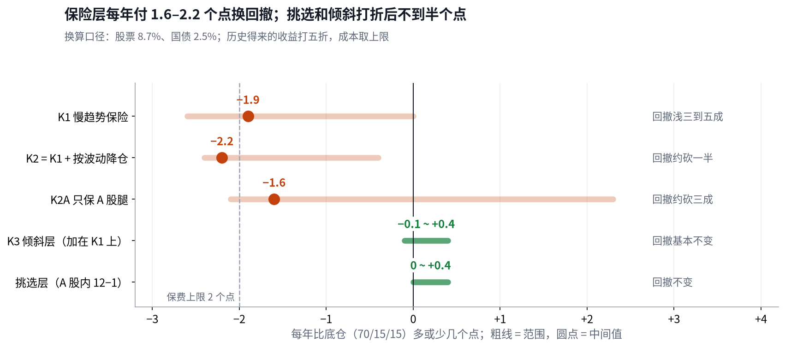
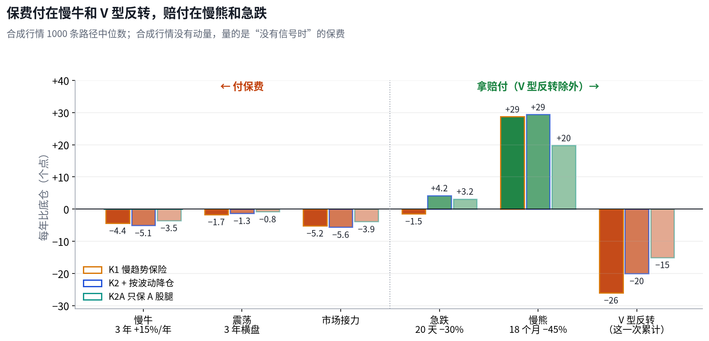
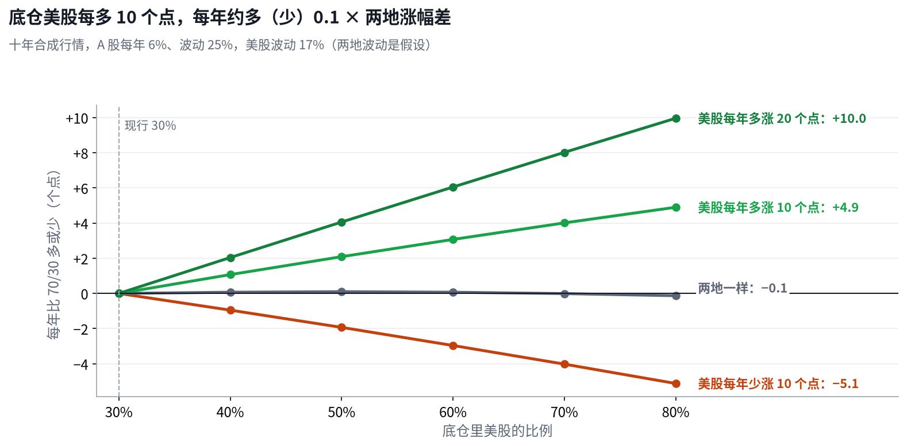

# v6 预演预测表：保险层定为 K2A（只保 A 股腿），每年约付 1.6–2 个点，100 万最差剩 68 万

## Metadata

- Project: ETF_Rotation_Quant
- Document type: owner report（D38 预演第 6 项）
- Status: active（第 2.3 版：Owner 定了回撤底线和保费上限，保险层定为 K2A（D39）；加真实历史压力测试）
- Owner: L. Loric
- Maintainer: Orchestrator
- Date: 2026-11-17（Asia/Taipei）
- 依据：`operations/planning/2026-11-16-d38-project-diagnosis-and-preflight.md`（登记第 3 版、不做线、运行附表 0–9）；`operations/planning/2026-11-17-d39-insurance-layer-k2a.md`（D39）；Reviewer 复算 `operations/reviews/2026-11-17-d38-preflight-review.md`（第 1 部分 PR #300、第 2 部分 PR #302，两次结论都是 approve_with_follow_up，跟进项均已查清）
- 数据：合成行情；长历史标普 1955–2003、恒生和日经 1987–2015；项目池 ≤2015-12-31。2016 年以后只引用已签收的数字，不读收益
- 页面：Claude 页面“v6 预演预测表”；本文件是仓库镜像

---

**项目愿景**　在动态周期内，从多类资产里选出 Top N 强势 ETF 轮动持有，获得超额收益、稳定跑赢被动基准，同时把回撤控制住。

| 进度 | 结论 | 需要你 |
| --- | --- | --- |
| D38 预演完成，Reviewer 两次复算都批准；你按自己的回撤底线和保费承受力定了保险层（D39）。 | 保险层用 **K2A**，只保 A 股腿：每年约少赚 **1.6–2** 个点；100 万在所有压力情景里最差剩 **68** 万，守住你的 60 万底线。 | 不用操作。下一件是底仓美股比例的原则，之后单独讨论。 |

名词解释：K0–K3、K2A、挑选层、合成行情、打五折、不做线

| 名字 | 是什么 |
| --- | --- |
| **K0 底仓** | 基准本身：沪深300 70% + 纳指100 15% + 标普500 15%，每月再平衡。所有“多或少几个点”都和它比。 |
| **K1 慢趋势保险** | 每条腿月末低于自己的 10 个月均线，就换成国债；回到均线上方换回（Faber 2007）。 |
| **K2 按波动降仓** | K1 再加一条：每条腿的仓位 = 长期波动 ÷ 近 20 日波动，最多 1；每周看一次，变化不到 10 个点不动。 |
| **K2A 只保 A 股腿** | K2 的规则只用在 A 股腿上，美股腿一直持有。 |
| **K3 倾斜层** | 在 K1 上，A 股和美股比 12 个月涨幅（跳过最近 1 个月），每月把 20 个点挪给强的一边。 |
| **挑选层** | 同一市场里按 12−1 涨幅排名挑 ETF。这一轮只测准确度，没跑组合。 |
| **合成行情** | 人工造的六种行情，噪声取真实指数的日收益重抽；里面没有动量，量的是“没有信号时”的保费。 |
| **打五折** | 从历史数据算出来的进出时点和挑选收益一律乘 0.5；成本按上限、不打折。 |
| **不做线** | 跑之前写下的及格线，达不到就不进 v6；看到结果后不改。 |

## 1. 预测表：保险层每年付 1.6–2.2 个点换回撤，挑选和倾斜打折后不到半个点

> **K2 每年约 −2.2、回撤约砍一半；K2A 约 −1.6、回撤约砍三成；倾斜和挑选打折后都在 0 到 +0.4 之间。**

| 层 | 仓位差 | 挑选 | 进出时点（打五折） | 成本 | 合计 | 回撤 | 把握 | 结论（按 D39） |
| --- | ---: | ---: | ---: | ---: | ---: | --- | --- | --- |
| **K1 慢趋势保险** | −2.2（−2.5 ~ −1.2） | 0 | +0.7（+0.3 ~ +1.7） | −0.4 | **−1.9**（−2.6 ~ 0.0） | 浅三到五成；V 型和短急跌无效 | 中 | **没过** 保费超 4 个点 |
| **K2 = K1 + 按波动降仓** | −2.5（−2.6 ~ −1.3） | 0 | +0.8（+0.7 ~ +1.4） | −0.5 | **−2.2**（−2.4 ~ −0.4） | 比 K1 再浅 2–9 个点；急跌也有效 | 中 | **没过** 保费超 4 个点 |
| **K2A 只保 A 股腿** | −1.7（−2.2 ~ −1.1） | 0 | +0.5（+0.5 ~ +3.8） | −0.4 | **−1.6**（−2.1 ~ +2.3） | 浅约三成；美股的回撤照单全收 | 中低 | **通过** 选定（D39） |
| **K3 倾斜层**（加在 K1 上） | 0 | 0 | 0 ~ +0.5 | −0.1 | **−0.1 ~ +0.4** | 基本不变 | 低 | **没过** 期望为正没证据 |
| **挑选层** A 股内 12−1，月度 | 0 | +0.2 ~ +0.6 | 0 | −0.2 | **0 ~ +0.4** | 不变 | 低 | **待定** 缺长历史 |
| 参照：底仓美股每多 10 个点 | — | — | — | 0 | **0.1 × 两地涨幅差** | 取决于两地波动 | 算术 | 不是策略层 |

换算口径：股票每年 8.7%（基准这十年的实际年化）、国债 2.5%。

- **“仓位差”是保费的主体**：K1、K2 平均只拿 60–66% 的股票，少拿的部分按“股票 − 国债”算。长历史里这一项看起来很小（标普 −0.4），是因为那几十年现金利率平均 5.5%；按现在的利率换算是 −2.2 到 −2.5。
- **进出时点在三个市场都是正的**：未打折是标普 +1.4、恒生 +0.6、日经 +3.4，来自躲开慢熊。
- **K2A 的范围很宽**：中间值用恒生（独立市场，作 A 股腿的代理）；上限 +3.8 来自沪深300 2006–2015 的回放（每年 +3.5、回撤 −72% → −40%），但那一段是用过上百次的设计期，只作一致性检查，不当证据。
- **挑选层的锚**：E2 新口径比同池等权每年 +1.1（设计期）、+0.4（检验段，已签收）；A 股行业 12−1 排名的月度准确度两段都是正的（第 4 节），打五折后约 +0.2 到 +0.6。

## 2. 每种行情：保费付在慢牛和 V 型反转，赔付在慢熊和急跌

> **慢牛里 K2 每年少赚 5.1；慢熊里多赚 29；V 型反转一次少 20 个点。合成行情没有动量，这些是“没有信号时”的保费。**

| 行情 | K1 每年 | K2 每年 | K2A 每年 | K3 每年 | 读法 |
| --- | ---: | ---: | ---: | ---: | --- |
| 慢牛 | **−4.4** | **−5.1** | **−3.5** | −4.8 | **保费最贵** |
| 急跌 | −1.5 | **+4.2** | +3.2 | −1.8 | **K2 最有用** |
| 慢熊 | **+29** | **+29** | +20 | +28 | **赔付最大** |
| V 型反转 | **−26** | −20 | −15 | −26 | **最怕的行情** |
| 震荡 | −1.7 | −1.3 | −0.8 | −2.3 | **小亏换回撤** |
| 市场接力 | −5.2 | −5.6 | −3.9 | **−4.0** | **倾斜层唯一有用** |

1000 条路径中位数；两个市场走同样的行情（接力除外）。慢牛 = 3 年 +15%/年；急跌 = 20 天 −30%；慢熊 = 18 个月 −45%；V 型反转 = 20 天 −30%、60 天收回，这一行是这一次事件累计少赚的点数；震荡 = 3 年横盘。急跌里 K1 在月末才离场，卖在底部；V 型反转里保险卖在底部、错过反弹。

明细表：每种行情的最大回撤（中位数）

| 行情 | K0 | K2 | K2A |
| --- | ---: | ---: | ---: |
| 慢牛 | −15% | −12% | −12% |
| 急跌 | −37% | −24% | −28% |
| 慢熊 | −48% | −11% | −22% |
| V 型反转 | −31% | −23% | −25% |
| 震荡 | −30% | −20% | −22% |
| 市场接力 | −21% | −16% | −16% |

- **成本已经不是问题**：五个结构每年双边换手 1.5–4.3 倍，成本 0.15–0.45 个点（v5.1 是 6.4）。
- **真实长历史回放**（一直持有 → K2）：标普 1956–2003 年化 +0.5、回撤 −49% → −24%；恒生 1988–2015 −1.0、−65% → −37%；日经 1988–2015 +2.9、−82% → −41%。
- **见底后回来得慢**：三个市场平均要 85–120 个交易日才回到半仓，这时离底部已涨 18–25%。

## 3. 底仓美股比例：每多 10 个点，每年约多（少）0.1 × 两地涨幅差

> **美股比 A 股每年多涨 10 个点时，80% 美股比 70/30 每年多 4.9；少涨 10 个点时少 5.1。美股强的十年里，K2A 比 K2 每年少付约 1.5 个点保费。**

| 美股比 A 股每年多涨 | K2 比底仓 | K2A 比底仓 | 读法 |
| ---: | ---: | ---: | --- |
| −10 个点 | **−1.1** | −1.9 | **K2 好** A 股强时，K2A 少保护了美股这一边 |
| 0 | −2.8 | **−1.9** | **K2A 好** |
| +10 个点 | −3.5 | **−2.0** | **K2A 好** 不在美股上付保费 |
| +20 个点 | −3.7 | **−2.0** | **K2A 好** |

十年合成行情，A 股每年 6%、波动 25%，美股波动 17%（两地波动是假设）。美股比例的回撤：美股多了回撤反而浅，是“美股波动更低、两地相关低”这个假设推出来的；美股弱 10 个点时，80% 的回撤已经比 70% 差。

## 4. 信号准确度：三层都弱，只有躲大熊的趋势是硬的

> **月度准确度（IC）最高 0.15，只出现在 2006–10 年；长历史里市场之间几乎为 0。**

| 信号 | 2006–10 | 2011–15 | 长历史 | 读法 |
| --- | ---: | ---: | ---: | --- |
| ① 自己的 10 个月均线（各容器中位） | **0.15** | −0.01 | 标普 0.04、恒生 −0.02、日经 0.06 | **价值在尾部** 平常没信息，躲大熊才有用 |
| ② 市场之间 12−1（A、港、美三地） | 0.13（t 1.4） | 0.08（t 0.8） | 0.005（t 0.1） | **弱** 长历史里没有 |
| ③ A 股内挑选 12−1 涨幅 | 0.05（t 0.8） | 0.05（t 0.9） | 缺 | **达到 0.03 的线** 两段都正 |
| ③ A 股内挑选 12−1 涨幅 ÷ 波动 | 0.10（t 1.8） | 0.06（t 1.0） | 缺 | **达到 0.03 的线** 同上 |

月度秩相关，0 = 没有信息。判定只看登记时定的 12−1；3、6 个月只作参照。

- **美股在 2011–15 年的均线信号是负的**：标普 −0.19、纳指 −0.24。稳定的牛市里，跌破均线往往是买点，这是 K2A 的出发点。
- **挑选层的长历史还没有**：外部数据（Kenneth French 美国行业组合）待取，见 D38 数据需求。

## 5. 过线对照：按你定的标准，只有 K2A 两条都过

> **你能扛到 60 万、能接受每年少赚 2–4 个点；K2A 最差剩 68 万、合成慢牛每年落后 3.5，是唯一两条都满足的保险。**

| 条件 | 结果 | 结论 |
| --- | --- | --- |
| 回撤底线：任何压力情景，100 万不跌破 60 万 | | |
| 不设保险（K0） | 35 万（真实 2008） | **没过** |
| K1 慢趋势保险 | 68 万（合成急跌） | **通过** |
| K2 按波动降仓 | 65 万（真实 2010–2013） | **通过** |
| K2A 只保 A 股腿 | 68 万（真实 2010–2013） | **通过** |
| 保费上限：合成慢牛每年落后 ≤ 4 | | |
| K1 慢趋势保险 | 4.4 | **没过** |
| K2 按波动降仓 | 5.1 | **没过** |
| K2A 只保 A 股腿 | 3.5 | **通过** |
| 成本 ≤ 1 | | |
| K1、K2、K2A | 0.27、0.39、0.28 | **通过** |
| K3 倾斜层和挑选层（不是保险，标准不变） | | |
| K3：打折后期望超额为正 | 0 ~ +0.4，长历史 IC 为 0 | **没过** 证据不够 |
| K3：最差行情每年落后 ≤ 2（比 K1） | −0.7（震荡） | **通过** |
| 挑选层：两段和长历史 IC 都为正、平均 ≥ 0.03 | 两段 0.05；长历史缺 | **待定** |

- **这两条是你定的**（D39-1、D39-2）：取代了 D38 里我代设的“回撤浅三分之一”和“保费 2 个点”。
- **看过结果之后改的线**：候选结构、参数、计算口径都没改，结果文件没有重算；两条标准以后所有版本共用，6 个月模拟盘按它们对账。
- **保费按合成慢牛算**：合成行情没有动量，3.5 是“没有信号时”的上限；按真实口径换算，K2A 约 1.6–2。

明细表：跑之前写下的原线（D38，已被 D39 取代）

| 条件 | 结果 | 结论 |
| --- | --- | --- |
| K1 慢趋势保险 | | |
| 慢牛每年落后 ≤ 2 | 4.4 | **没过** |
| 急跌和慢熊回撤浅 ≥ 三分之一 | 急跌只浅 13%；慢熊 76% | **没过** |
| 成本 ≤ 1 | 0.27 | **通过** |
| K2 按波动降仓 | | |
| 慢牛每年落后 ≤ 2 | 5.1 | **没过** |
| 急跌和慢熊回撤浅 ≥ 三分之一 | 急跌 35%；慢熊 80% | **通过** |
| 成本 ≤ 1 | 0.39 | **通过** |
| K2A 只保 A 股腿 | | |
| 慢牛每年落后 ≤ 2 | 3.5 | **没过** |
| 急跌和慢熊回撤浅 ≥ 三分之一 | 急跌只浅 24%；慢熊 55% | **没过** |
| 成本 ≤ 1 | 0.28 | **通过** |
| K3 倾斜层和挑选层 | | |
| K3：打折后期望超额为正 | 0 ~ +0.4，长历史 IC 为 0 | **没过** 证据不够 |
| K3：最差行情每年落后 ≤ 2（比 K1） | −0.7（震荡） | **通过** |
| 挑选层：两段和长历史 IC 都为正、平均 ≥ 0.03 | 两段 0.05；长历史缺 | **待定** |

## 6. 真实历史压力测试：不设保险会在 2008 年跌到 35 万

> **100 万在 2008 年：不设保险剩 35 万，K2A 剩 70 万，K2 剩 90 万；K2A、K2 最差的一次都在 2010–2013 年的长期震荡里。**

| 100 万最低剩多少 | 不设保险 | K2A 只保 A 股 | K2 全部保 | 读法 |
| --- | ---: | ---: | ---: | --- |
| 2008 年（2007-10 → 2008-10） | **35 万** | 70 万 | 90 万 | **保险最值钱** |
| 2015 年股灾 | 67 万 | 79 万 | 79 万 | **保险有用** |
| 2006–2015 最差的一次 | 35 万（2008） | **68 万**（2010–2013） | **65 万**（2010–2013） | **保险自身的风险** 震荡里来回打脸 |
| 2006–2015 年化 | 15.6% | 14.3% | 14.1% | **保费约 1.3–1.5** |

项目池真实数据：A 股腿 = 沪深300，美股腿 = 纳指100、标普500 各半（人民币口径），规则和第 1 节完全相同。这一段是用过上百次的设计期，只作压力测试，不用来选规则。

- **最难熬的不是大跌**：2010–2013 年 A 股反复震荡，保险被来回打脸，回撤慢慢磨到 −32%（K2A）、−36%（K2）。
- **合成行情比真实温和**：合成慢熊里不设保险剩 52 万，真实 2008 年剩 35 万。

## 7. 你的三个要求：① 能做到，② 做不到，③ 没有测

> **慢熊里回撤从 −48% 收到 −11%；但见底后要等离底涨了 18–25% 才回到半仓。**

| 要求 | 预演的答案 | 结论 |
| --- | --- | --- |
| ① 牛市见顶后撤到债券或现金 | 慢熊回撤从 −48% 到 −11%；急跌要靠按波动降仓（K2），月度均线来不及 | **做到** |
| ② 极端见底后快速回场、抓反转 | 离底 18–25% 才回到半仓；V 型里浮亏变实亏，一次约 −15 到 −26 个点 | **没达到** |
| ③ 震荡市波段做超额 | 原因见诊断第 4 节；保险层在震荡里每年小亏 1–2 个点，回撤浅约 8–10 个点 | **没有测** |

## 8. 已经定了：保险层用 K2A，代价是美股大跌不防、震荡里慢慢磨（D39）

> **你答“能扛到 60 万”“能接受每年少赚 2–4 个点”；按这两条，K2A 是唯一两条都满足的保险，十年约少赚 30 万（按 100 万本金）。**

| 你的回答 | 对应的标准 | 结果 |
| --- | --- | --- |
| 100 万最低能扛到 60 万 | 任何压力情景下不跌破 60 万（D39-1） | **不设保险没过**（2008 年 35 万） |
| 连续几年每年少赚 2–4 个点能接受 | 合成慢牛每年落后 ≤ 4（D39-2） | **K1、K2 没过**（4.4、5.1） |
| 两条都满足 | 保险层用 K2A（D39-3） | **K2A 通过** |

| K2A 的代价 | 什么时候发生 | 多大 |
| --- | --- | --- |
| **每年少赚** | 一直在付 | 约 1.6–2 个点；十年约 30 万 |
| **美股大跌不防** | 美股熊市（如 2008、2022） | 美股腿 30% 照单全收 |
| **长期震荡里慢慢磨** | A 股反复震荡（如 2010–2013） | 回撤磨到约 −32% |
| **V 型急跌会亏** | 跌得快、涨得也快 | 一次约 15 个点 |

- **为什么是 K2A 而不是 K2**：K2 的保费 5.1 超过你能接受的 4；而且真实历史里 K2A 最差的一次（68 万）反而比 K2（65 万）好。
- **还没定的两件**：底仓美股比例的原则，以及要不要设挑选层（等外部长历史数据）。这两件有结论之前，不起草 v6 预注册（D39-5）。

## 9. 复算：Reviewer 两次都批准，三处差异都已查清，数字不变

> **长历史 9 项、信号准确度 7 项、K2A 合成行情 3 种逐位一致；差异来自随机数顺序和预热口径。**

| 差异 | 原因 | 处理 | 结论 |
| --- | --- | --- | --- |
| 第 1 部分：V 型里 K1、K2 年化差 1.2–1.6 个点 | 原脚本六种行情共用一个随机数流 | 改成每种行情从同一种子开始，逐位一致；判定不变 | **已修** |
| 第 2 部分：沪深300 回放 K2 每年 +3.46 对 +4.46 | Reviewer 没有预热，2006 年 K2 不降仓 | 按它的起点重跑，逐位一致；本表保留预热口径 | **已查清** |
| 第 2 部分：敏感度八格低 0.25–0.4 | 登记没写死预热年参数 | 两个结构一起平移，结论不变 | **已查清** |

- **V 型差异怎么查清的**：Reviewer 每种行情从同一个种子重新开始；把本表脚本改成同样口径后，两边逐位一致（K1 −31.84、K2 −25.03）。
- **抽样波动有多大**：换 5 个种子，V 型年化在 ±1 个点内波动，折成这一次的累计损失不到 1 个点。全部重跑后，其他数字最多变 0.5 个点。
- **沪深300 差异怎么查清的**：Reviewer 从 2006-01-06 读起，K2 要攒满 252 天才能算长期波动，所以整个 2006 年没降过仓；本表用 2005 年预热，和长历史回放同口径。按 Reviewer 的起点重跑本表脚本，得到 +4.46。
- **敏感度差异怎么查清的**：本表预热年用两地 8%、波动 20%；Reviewer 用和后面十年相同的参数。
- **沪深300 差异顺带看到的**：2006 年沪深300 涨了一倍多，K2 那年平均只拿 92% 的仓位，就少赚约 10 个点，摊到十年每年约 1 个点。这正是红队第 4 条“牛市里按波动降仓的代价”。

红队：假设 v6 上线后失败了，最可能的五个原因

| # | 失败原因 | 每年损失 | 预测表覆盖 |
| ---: | --- | ---: | --- |
| 1 | V 型急反，月末离场后反弹才回来 | 一次 −15 ~ −26 个点 | **是** 第 2、7 节 |
| 2 | 长牛里连续付保费 | 4–5 | **是** 第 2、5 节合成慢牛 |
| 3 | 美股腿的均线信号为负 | 2–3（美股腿） | **是** 新增 K2A |
| 4 | 牛市里按波动降仓，回补慢 | 1.5–2 | **部分** 沪深300 2006 年的例子 |
| 5 | 保费上限定得比真实口径紧，把 K2 挡在外面 | 机会成本 | **是** 第 5、8 节；上限已由你定为 4 |

## 10. 接下来：先定美股比例的原则，再看挑选层，然后才决定起草 v6

> **保险层已定；还差美股比例的原则和挑选层两件，都有结论后才决定是否起草 v6 预注册。**

| 事项 | 现状 | 影响 | 结论 |
| --- | --- | --- | --- |
| 底仓美股比例的原则 | 敏感度已算（第 3 节），原则还没讨论 | 分量最大：每 10 个点 ≈ 每年 0.1 × 两地涨幅差 | **待讨论** |
| 挑选层的长历史 | 外部行业数据（Kenneth French）待取 | 决定 v6 要不要设挑选层 | **待取数** |
| 压力测试复算 | 第 6 节的数字还没经 Reviewer 复算 | 支撑 D39 | **排队** |
| 红队第 4 条：牛市里按波动降仓的代价 | 有沪深300 2006 年一个例子，没单列 | K2A 的保费可能偏低 | **部分覆盖** |
| 全市场池子的清点 | 16 个“市场”里 13 个只有一只基金，合计平均占 15% 仓位（D37 已签收） | v6 若用全市场池，要先改“市场”的定义 | **已清点** |

数据来源

- **登记和运行**：D38 登记第 3 版、附表第 0–9 行（`operations/planning/2026-11-16-d38-project-diagnosis-and-preflight.md`）；决定 D39（`operations/planning/2026-11-17-d39-insurance-layer-k2a.md`）。
- **结果**：`results/v6-preflight/` 的 behavior、cost、events、sensitivity、plateau、longhist、longhist-bears、decomp-longhist、csi300、stress、ic、ic-ma10、census、census-listing-heat。
- **脚本**：`scripts/preflight/`（sim、longhist、csi300、stress、decomp、ic、census、charts）。
- **复算**：`operations/reviews/2026-11-17-d38-preflight-review.md`，脚本在 `operations/reviews/diag/d38/`。
- **上市时的热度**：2015 年以前上市的 7 个主题，上市前 12 个月的涨幅在当天全池里的分位中位数是 0.71，样本太少，不下结论。
- **溢价控制**：已经接入核心配置和 v5.1 的执行链，看板上“未接入”一条过时。

