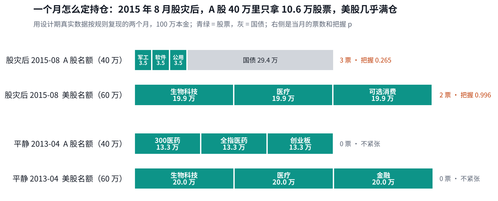
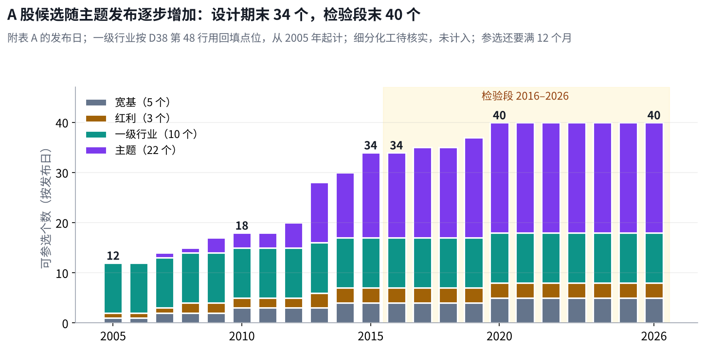
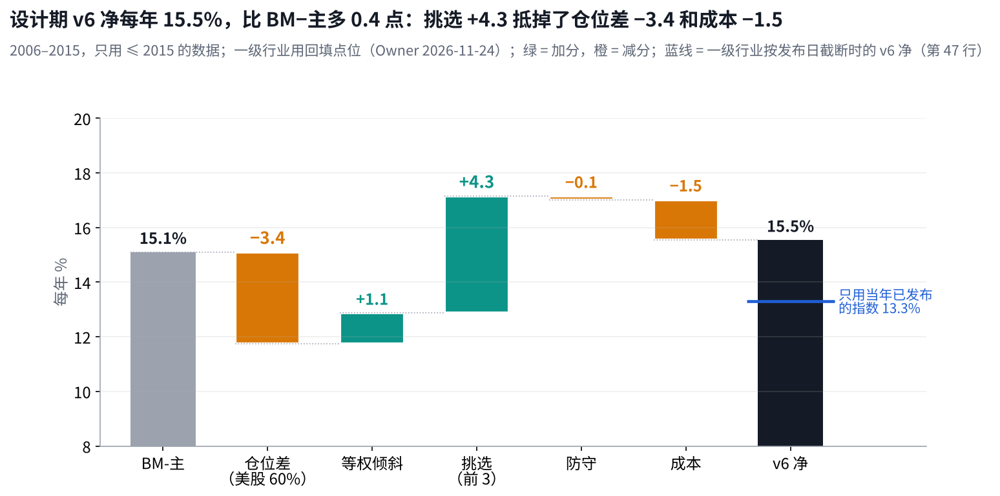
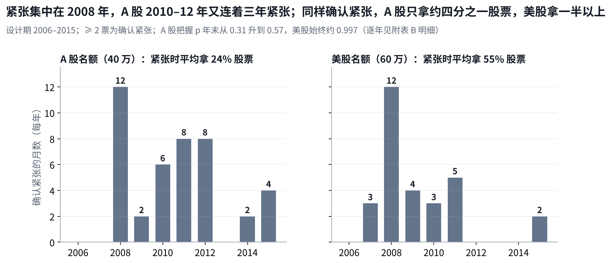

# 多资产轮动 · 预注册 v6（市场内 Top 3 + 按把握调节的防守）· 第 2.4 版（待冻结）· 2026-11-25

## Metadata

- Project: ETF_Rotation_Quant · Owner: L. Loric · 起草：Orchestrator（Claude）
- 状态：**第 2.4 版，Owner 2026-11-25 批准冻结**（D42-9）：Reviewer R1b 对本版签收、Manager 以合并提交合入 main 后，由 Cloud Agent 在该合并提交上打 `milestone/v6-prereg-freeze`；之后本文不再改动。2.4 版闭合 R1b 对 D42 增量的两项：§4 第 8 条写明欧洲、日本以前的接触（Owner 书面确认），§5.2 写死 A1、A2、现行配置的执行口径和账本（D42-8），§7 别的市场在选定前只做数据普查；不改判据 ①–④；2.3 版写入 D42（`operations/planning/2026-11-24-d42-v6-prereg-final-items.md`）：现行配置作为对照、豁免 D27-5 的 6 个月“不差于”门槛（D42-4），上线前别的市场检验（D42-5），A1、A2 写回对照（D42-6），报告四张图（D42-7），不改判据 ①–④；2.2 版写入附表 A、B（§9.2 第 2、3 条完成），写入 Owner 2026-11-24 的三项确认（一级行业保留回填点位、半导体材料设备从 2023-07-27 起参选、细分化工不参选）和 DJIA、DWRTF 检验段补数（#359、#361），疼痛表“换手和成本”补附表 B 的重估；页面改为每节一个按内容选的视觉、条款原文进折叠（模式库第 3 版），不改任何规则；2.1 版写入 D38 第 45、56 行的结果（§4 第 7 条、§8、§9.2 第 4、5 条），不改任何规则；第 2 版：闭合 Reviewer R1（`operations/reviews/2026-11-23-v6-prereg-draft-r1.md`）的 MF-1、MF-2 和 SF-2 至 SF-8；写入 Owner 2026-11-23 对 §9.2 第 6 条三项的确认（D40-14）；送 R1b。冻结前不运行任何 v6 规则在 2016-01-01 以后的项目池收益上。冻结顺序见 §9。
- 尝试登记：本项目**第 4 次正式尝试**（第 1 次 V1 横截面轮动、第 2 次 v2 A 股择时、第 3 次 v3 → v5.1 多资产强势轮动，均已按“不成立”关闭，D36）。
- 依据：D27（封板后的新想法记作 v6）、D36（v6 方向）、D38（先算后做；预演运行附表第 10–55 行）、D39（底线与保费上限）、D40-1 至 D40-14、D42-1 至 D42-9；《v6 预演预测表》第 3.22 版（`docs/owner/v6-preflight-forecast.md`）；设计评审第 2.1 版（`docs/reference/strategy-design-review.md`）。
- 版式：页面按《Owner 页面讲故事模式库》（`docs/reference/owner-page-story-patterns.md`）第 3 版重排：每节一个按内容选的视觉（`<!-- 组件：… -->` 下的小数据表），条款原文进折叠；条款文字不变。
- 本文不沿用 v3–v5.1 的条款；凡没写到的，以本文为准、按 AGENTS.md 的研究纪律处理。

---

**项目愿景**　在动态周期内，从多类资产里选出 Top N 强势 ETF 轮动持有，获得超额收益、稳定跑赢被动基准，同时把回撤控制住。

| 进度 | 结论 | 需要你 |
| --- | --- | --- |
| 第 2.4 版：冻结前待办全部完成；你已批准冻结；Reviewer R1b 签收、合入 main 后打冻结标签。 | 100 万分成 A 股 40 万、美股 60 万两个名额。每月各选最强 3 只等分；只在确认紧张时按把握 p 减仓。超额主要靠美股挑选，v6 的主要价值是控制回撤。 | 现在不用操作。冻结后、看任何结果之前，请你看完数据普查，在欧洲和日本里选定别的市场检验用哪个（§7，D42-9）。 |

## §1 策略定义：每个名额每月选最强的 3 只，只在确认紧张时按把握减仓

<!-- 问：v6 每个月末具体怎么决定买什么、买多少？｜短：怎么做｜状态：已定 -->

> **美股 15 个候选、A 股约 40 个候选；每月末走四步，下一个交易日成交；从数据里定的数字正好 3 个。**

1. **选人**：**决定买哪 3 只**。看：过去一年涨幅 · 不算最近 1 个月｜规则：从高到低排 · 同行业只留一个 · **取前 3**｜结果：3 只候选。例（2015 年 8 月 A 股）：军工 106% · 软件 100% · 公用 95% → 这 3 只入选。
2. **看市场**：**决定现在紧不紧张**。看：母指数均线 · 宽度 · TRIN｜规则：每项越过门槛 = 1 票 · **≥ 2 票 = 紧张**｜结果：紧张 / 不紧张。例（2015 年 8 月 A 股）：均线 ✓ · 宽度 ✓ · TRIN ✓ → 3 票，紧张。
3. **定仓位**：**决定股票买多少钱**。看：紧不紧张 · 把握 p｜规则：不紧张：每只 1/3 · **紧张：股票 × p** · 其余放国债｜结果：每只的金额。例（2015 年 8 月 A 股）：40 万 · p = 0.235 → 股票 9.4 万，国债 30.6 万。
4. **下单**：**决定买哪只基金**。看：同指数的几只基金 · 溢价比 60 天常态高几点｜规则：下一个交易日成交 · **高 5 点以上换一只**｜结果：实际买入的基金。例（纳指科技，假设）：常态 9% · 今天 16% → 高 7 点，换另一只。

- **读这张图**：A 股领头者以往紧张时也跟着跌，把握只有 0.235；美股领头者照样涨，把握 0.997（预测表 3.22 版，已去重）。

1.1 候选池：美股 15 个、A 股约 40 个，各自从发布日起参选

| 名额 | 母指数 | 候选 | 依据 |
| --- | --- | --- | --- |
| 美股（60%） | 标普500（SPX） | SPX、纳指100（NDX）、道指（DJIA）、费城半导体（SOX）、纳斯达克生物科技（NBI）、9 个行业 SPDR（XLK、XLV、XLE、XLY、XLP、XLF、XLI、XLB、XLU）、REIT（DWRTF），共 15 个 | D40-11：原 14 个 + REIT；新候选须带来池子里没有的行业 |
| A 股（40%） | 沪深300 | 沪深300、中证500、中证1000、创业板指、科创50、中证红利、10 个中证全指一级行业、已接入的 A 股主题指数（清单见附表 A） | D40-1；D38 第 39、48 行 |

<!-- 页面：定义 -->

- **准入**：每个候选从官方发布日（或基金上市日）起参选，满 12 个月才有分数（D38 第 39 行）。10 个中证全指一级行业按 D38 第 48 行允许用 2011-08-02 之前的回填点位（Owner 2026-11-24 确认：机械分类的行业回填偏差小）；主题指数一律从发布日起；例外见附表 A。
- **母指数也是候选**：规则自己决定拿母指数还是细分。
- **去重**：每个候选事先标好行业标签（美股按 GICS，A 股按中证一级，红利类单列“红利”；宽基、母指数不标），同一标签只留分数最高的一个，空位由下一名递补（D38 第 46 行）。标签表 `config/v6-preflight/sector-tags.toml` 冻结前补齐检验段全部候选（§9 待办 1）。
- **港股不单设名额**：只有 4 个分类指数，挑选失效（D38 第 38 行，D40-4）。

1.2 每月四步（条款原文：每月最后一个交易日算，下一个交易日成交）

| 步 | 决定什么 | 规则 |
| --- | --- | --- |
| ① 选人 | 买哪 3 只 | 按 12−1 涨幅（上月末点位 ÷ 12 个月前月末点位 − 1）从高到低排，去重后取前 3。母指数跌破自己的 10 个月均线时，只选 12−1 为正的候选，选不满的空位放国债 |
| ② 看市场 | 紧不紧张 | 三票：母指数跌破 10 个月均线；宽度（站上自己 10 个月均线的候选占比）不高于它到当时为止全部月份的 1/3 分位；TRIN（每日：涨的候选数 ÷ 跌的候选数，再除以涨的成交额 ÷ 跌的成交额；取 10 日均值）不低于到当时为止的 2/3 分位。分位至少要 24 个月历史，不足时该票记 0。**≥ 2 票 = 确认紧张** |
| ③ 定仓位 | 股票买多少 | 不紧张：3 只各 1/3。确认紧张：股票总仓位 = 把握 p，3 只等分；其余放国债，国债也跌破 10 个月均线时放现金 |
| ④ 下单 | 买哪只基金 | 见 §2 执行层 |

<!-- 页面：定义 -->

- **把握 p**（D40-3）：p = Φ(t)，t = 以往每个紧张月“前 3 名下个月的平均绝对收益”的平均 ÷ 标准差 × √月数，只用当时已经知道结果的月份；少于 12 个紧张月时 p = 0.5。美股名额以美国 49 行业长历史（French，1999 年以前的紧张月）为起点；A 股名额从 0.5 起。Φ 是标准正态分布函数。
- **领头者**（把握 p 用）：去重后按 12−1 排名的前 3，不做“12−1 须为正”的过滤；只在确认紧张的月份记录，三只下月收益都已知时才记入。与设计期数字的来源 `scripts/preflight/topn_dedupe.py` 一致（R1 SC-2）。
- **TRIN 的成交额**：美股 = 9 个行业 SPDR（收盘 × 成交量）；A 股 = 有成交额的候选指数，按发布日截断（与 D38 第 39 行相同）。
- **国债与现金**：与预演脚本相同（`scripts/preflight/topn_system.py` 的 `cgb-10y` 与 `cash`）；两个名额的防守资产相同。
- **名额之间不挪钱**：美股名额的钱只在美股候选、国债、现金之间分，A 股同理。每月末两个名额按 60/40 再平衡，调拨的金额按单边 0.2% 计成本。设计期数字（`topn_dedupe.py`，含去重）用每日固定 60/40 加权近似，与按月再平衡的差异在附表 B 报告（R1 SC-3、SC-4）。

1.3 A 股名额的两条规则（D40-13）：12−1 定过不过，连续性版是挑战者

| | 主规则：12−1 | 挑战者：连续性版 |
| --- | --- | --- |
| 怎么选 | 第 ① 步原样 | 先按 12−1 去重排名，取前一半（向上取整）；其中按信息离散度 ID 取最低的 3 个，同分按 12−1 高者优先 |
| ID | — | ID = sign(12−1 涨幅) ×（窗口内下跌日占比 − 上涨日占比），窗口与 12−1 相同（12 个月前月末之后到上月末）；有效交易日不足 200 天的候选不参选。公式照抄 Da、Gurun、Warachka（2014，RFS） |
| 其余三步 | 相同 | 相同；紧张时的把握 p 用连续性版自己的领头者计算 |
| 地位 | v6 过不过以它为准 | 同一套判据单独报告；满足 §5.3 才在前向模拟盘换上 |

美股名额只用 12−1。第 55 行的 `a_decompose.py` 只有挑选层、不去重、不加防守，不能当连续性版的完整实现（R1 SC-5）。

<!-- 组件：计数｜九个常数里，看过数据后定的只有 3 个 -->

| 类别 | 个数 | 含义 |
| --- | --- | --- |
| 看过数据后定 | 3 | 选几只、美股比例、确认票数 |
| 文献默认值 | 2 | 回看期 12−1、均线 10 个月 |
| 跑前写死的约定 | 4 | 门槛、平滑等 |

1.4 九个数字的来历（D38-2）

| 数字 | 取值 | 怎么来的 | 计不计 |
| --- | --- | --- | --- |
| 每个名额选几只 | 3 | D40-7：设计期与合成行情比较前 2 / 前 3，Owner 取舍 | 计 1 |
| 美股比例 | 60% | D40-4：Owner 判断 + D38 第 39 行（美股跌时 A 股多半也跌）；**定的时候已知 2016–2025 年美股强于 A 股**，见 §4 第 5 条 | 计 2 |
| 确认紧张的票数 | ≥ 2 | D38 第 34 行：看过第 33 行（按票线性减仓）结果后改为“确认后才减仓” | 计 3 |
| 回看期 | 12−1 | Jegadeesh、Titman（1993）及此后文献的默认值 | 文献 |
| 均线 | 10 个月 | Faber（2007）的默认值 | 文献 |
| 宽度、TRIN 门槛 | 1/3、2/3 分位 | D38 第 33 行跑前写死，三等分的约定，没有搜索过别的值 | 约定，Reviewer 核 |
| TRIN 平滑 | 10 日均值 | 业内常用平滑（D38 第 32 行登记） | 约定，Reviewer 核 |
| 最少历史 | 分位 24 个月；把握 12 个紧张月 | 统计上够算的最低要求，没有搜索过 | 约定 |
| 连续性版 | 前一半、200 天 | D38 第 55 行跑前写死 | 约定 |

复杂度预算（设计评审第 5 节）只计上表标“计”的 3 行；标“文献”“约定”的是跑前写死、没有对历史搜索过的结构常数，不计入（R1 同意此划分，J-2）。

- **复杂度正好用满**：标“计”的只有选几只、美股比例、确认票数三个；回看期、均线来自文献，门槛和平滑是跑前写死的约定。
- **美股 60% 是知道美股强之后定的**：所以 §5 用同仓位基准判，仓位差单独报告（§4 第 5 条）。

<!-- 接力：规则只说买哪个指数；实盘买的是场内基金，溢价会直接吃掉收益，下一节讲买哪只基金、什么时候不买 -->

---

## §2 执行层规则：溢价比常态高 5 个点不买，常年溢价品种不另设上限（不计入 3 个数字）

<!-- 问：选中的指数，实盘买哪只基金、溢价太高怎么办？｜短：怎么买｜状态：已定 -->

> **只用场内基金；溢价偏离超 5 个点换同指数另一只；常年溢价品种和其他品种一样，每只最多占名额的 1/3。**

<!-- 组件：退路｜买哪只基金：溢价太高就一路往下退 -->

| 步 | 说明 | 条件 |
| --- | --- | --- |
| 同指数选溢价偏离最小的 | 只用场内基金，信号日的下一个交易日收盘价成交 |  |
| 换同指数另一只 | 偏离最小的那只 | 溢价比常态高 5 点以上 |
| 给下一名候选 | 按 12−1 排名递补 | 都不行 |
| 给母指数 | 标普500 或沪深300 | 再不行 |

执行四步（条款读法）：成交、挑基金、溢价冲高、仓位上限

1. **成交**：信号日的下一个交易日收盘价成交，**只用场内基金**。
2. **挑基金**：同一指数多只基金时，**选溢价偏离最小的**。
3. **溢价冲高**：**高 5 点以上换一只**；都不行时给下一名候选，再不行给母指数。
4. **仓位上限**：已持有的不受影响；常年溢价品种不另设上限，**每只最多占名额的 1/3**。

执行规则明细（条款原文）

| 规则 | 取值 | 来历 |
| --- | --- | --- |
| 成交 | 信号日的下一个交易日收盘价成交 | 与预演一致 |
| 载体 | 只用场内基金（ETF、LOF）；同一指数多只基金时，选溢价偏离最小的 | D35；D40-5 |
| 溢价偏离 | 当日溢价比自身过去 60 个交易日溢价中位数高 5 个点以上不买，换同指数偏离最小的一只；都不行时给下一名候选，再不行给母指数；已持有的不受影响 | D40-5；D38 第 30 行 |
| 常年溢价品种的单只上限 | **不另设上限**：和其他品种一样，每只最多占名额的 1/3（美股 20 万） | Owner 2026-11-23（D40-14）。代价：按纳指科技常态溢价约 9% 估，额度放开时一次性损失约 1.8 万，约为组合的 1.8%，写进疼痛表 |
| 成本 | 单边 0.2%（上限口径），按换手计 | 预测表打折规则 |

- **这些规则不计入 3 个数字**：执行层单列，来历都写在表里（D38-2 的边界）。

- **不设单只上限的代价**：按纳指科技常态溢价约 9% 估，额度放开时一次性损失约 1.8 万，约为组合的 1.8%，已写进 §6 疼痛表。

<!-- 接力：规则和执行都定了；下一节看这套东西事先估计能多赚多少、在坏行情里守不守得住 60 万 -->

---

## §3 设计评审：预计每年比基准多约 1.2 个点，六种合成行情的中间情况都守住 60 万

<!-- 问：动手检验之前，事先估计 v6 能多赚多少、坏行情里守不守得住？｜短：预期多少｜状态：已定 -->

> **预测表、合成行情、跑前八问、事前画像、红队都按设计评审第 2.1 版写；全部判据通过的机会约三成。**

### 3.1 预测表（《v6 预演预测表》第 3.22 版，原样进入；冻结后不改）

明细表：每一项的中间值、范围和证据强度；三条口径说明

| 来源 | 中间值 | 范围 | 证据强度 |
| --- | ---: | --- | --- |
| 美股名额挑选（前 3） | +1.0 | +0.3 到 +1.5 | 强（美国 70 年 t 3.4） |
| A 股名额（前 3） | +0.6 | 0 到 +1.3 | 弱（t 1.0，挑选部分 t 0.2） |
| 防守的平时保费 | −0.4 | −1.6 到 −0.4 | 中 |
| 美股 60% 的仓位差 | 0 | −3 到 +3 | 无法预测 |
| **合计（不含仓位差）** | **+1.2** | **−1.3 到 +2.4** | 弱到中 |

单位：每年比基准多几个百分点。来自历史数据的超额已打五折，再按候选个数打六折；成本按单边 0.2%。

<!-- 页面：定义 -->

- **低于哪条线不做**：（设计评审第 1 节，R1 SF-2）预测合计的中间值低于 0，或 D39 两条线（合成行情中间情况最低剩 60 万、合成慢牛每年落后不超过 4 点）任一不满足，就不起草。当前合计 +1.2，两条线都满足（§3.2）。
- **设计期年化的口径**：（2.2 版补）预测表各项不直接取设计期年化。按本预注册的口径（一级行业用回填点位），设计期 v6 净每年 15.5%；只用当年已发布的指数是 13.3%（第 47 行）；差别在 2006–10 年 A 股挑选，见附表 B。预测表冻结不改。
- **A 股一项的对账口径**：（D40-12）预测值 +0.6 不变；事后按两块分别核对——挑选（12−1 比“等权持有全部候选”，约 +0.1，范围 −0.5 到 +0.5）、等权倾斜（等权持有全部候选比沪深300，约 +0.5，范围 −1.0 到 +1.0，主要是少配金融、偏中小盘）。

### 3.2 合成行情（D38 第 40、41 行，前 3、美股 60%，200 条路径，没有动量）

- **读这两张图**：预测合计 +1.2 在“低于 0 不做”的线之上；六种合成行情的中间情况都守住 60 万，慢牛保费 1.6 点低于 4 点上限。

六种行情的明细表

| 行情 | 100 万最低剩：中间 / 较差十分之一 | 基准 | 每年比基准 | 判 |
| --- | --- | --- | ---: | --- |
| 慢牛 | 85.1 / 77.3 | 85.5 / 75.4 | −1.6 | 过（保费上限 4 点） |
| 震荡 | 73.5 / 59.9 | 70.9 / 53.8 | −0.1 | 过 |
| 市场接力 | 79.6 / 69.4 | 78.6 / 64.3 | −1.3 | 过 |
| 急跌（20 天 −30%） | 66.8 / 58.8 | 61.0 / 49.4 | +3.0 | 过（按中间情况，D40-7） |
| 慢熊（18 个月 −45%） | 69.8 / 60.8 | 51.2 / 35.7 | +15.8 | 过 |
| V 型反转 | 70.7 / 61.1 | 69.0 / 58.1 | −14.8 | 过 |

3.3 跑前八问：钱跟着强弱走，挑选在市场内部，防守只在市场层面

| 问 | 回答 |
| --- | --- |
| 1. 钱是否跟着强弱走 | 是。名额内前 3 等分，弱的拿不到钱；紧张时减的是整个名额的股票仓位，不会把钱给弱品种 |
| 2. 挑选发生在哪一层 | 市场内部。美国 49 行业平均两两相关 0.61，挑选有效（70 年 +5.7，t 3.15）；A 股行业相关 0.81、市场波动是截面差异的 2.3 倍，挑选平均约为 0（D38 第 50、51、53 行） |
| 3. 防守怎么进来 | 只在市场层面、只在 ≥ 2 票时进来；不逐个候选卡均线（逐个门槛每年吃进攻约 4.5 点，D38 第 25、26 行）。减多少由把握 p 决定：美股紧张时领头者以往照样涨，p 接近 1；A 股以往跟着跌，p 低 |
| 4. 每个开关触发几次 | 设计期信号层面：确认紧张的月份、各候选入选次数、去重触发次数，冻结前按年数一遍写进附表 B（§9 待办 3）；已写入：A 股紧张 42 个月、美股 29 个月 |
| 5. 同结构去掉信号还剩多少 | 对照写死在 §5.2：同结构等权、同结构随机、不设防守，与 v6 同次跑出。预演里：A 股名额 +5.3 中等权倾斜占 +4.6、挑选 +0.7（第 51 行）；美股挑选 +5.7、等权倾斜 +0.7 |
| 6. 收益从哪里来 | 冻结前按“仓位差 / 挑选 / 防守 / 成本”拆设计期收益，分 2006–10、2011–15 两段写进附表 B（§9 待办 3）；已写入：2006–15 挑选 +4.3、仓位差 −3.4、成本 −1.5 |
| 7. 触发次数值多少钱 | 预演：设计期整套每年换手约 5.5 倍（第 47 行），A 股名额 12−1 约 5 倍（第 49 行），按单边 0.2% 每年约 1.0–1.1 点；冻结前按检验段的规则文字重估 |
| 8. 检验时的池子和基准还是同一个吗 | 检验段 A 股候选随主题陆续发布而增加，美股 15 个不变；冻结前按年数一遍可参选候选（§9 待办 3）。基准按 AGENTS.md 不变；另加同仓位基准（§5.1），把“美股 60%”的仓位差单独拆出 |

3.4 事前画像：平静时满仓，A 股股灾大部分换国债，A 股大牛市明显落后

| 行情 | 规则会怎么动 | 例（设计期真实月份） |
| --- | --- | --- |
| 平静上涨 | 两个名额满仓各拿 3 只 | 2013-04：A 股去重后 300 医药、创业板、全指公用各 13.3 万；美股生物科技、金融、必需消费各 20 万（医疗与生物科技同属医疗保健，让位） |
| A 股股灾 | A 股三票全中，把握低，大部分换国债；美股照常 | 2015-08：A 股 p = 0.235，股票 9.4 万、国债 30.6 万；美股 p = 0.997，生物科技、可选消费、纳指100 几乎满仓（`exec-example.json`，已按去重重算，R1 MF-2） |
| 美股熊市、领头者逆势 | 美股紧张但 p 高，几乎不减；领头者（如能源）照常持有 | 美国 2022 年：前 3 领头者能源 +48.6%（D38 第 35 行） |
| A 股大牛市 | 照常满仓，但 A 股只占 40%，明显落后基准（基准 70% 在 A 股） | 2006–07、2014–15 |
| V 型急跌急涨 | 紧张时减了仓，反弹时回来得晚 | 合成 V 型每年落后约 15 点（短期年化） |

**事前预判**（写在 Owner 批准检验之前）：第 ① 条底线大概率过（约八成）；第 ② 条保费（只量防守成本）约八成五；第 ③ 条对增强基准约六成；第 ④ 条对同仓位基准不低于 0 约五成。合起来全部通过的机会约三成。连续性版换上的机会约两成。这是事先的判断，不影响规则。

<!-- 组件：风险｜红队：最可能让 v6 失败的五个原因，按严重程度排 -->

| 排名 | 原因 | 会怎样 | 在哪里盯 |
| --- | --- | --- | --- |
| 1 | 超额只有一个来源 | A 股挑选平均约为 0，美股挑选一旦在检验段失灵，判据 ④ 就过不了 | 判据 ④；同结构等权 |
| 2 | 能买到的抓不到能排名的 | 美股领头者常是溢价高的 QDII，可交易池少抓一截 | 可交易池报告；疼痛表 |
| 3 | A 股把握 p 学错 | 2016 年后紧张月领头者的表现若和 2015 年前不同，p 会滞后 | 附表 B 的 p 轨迹 |
| 4 | V 型急跌急涨 | 紧张时减了仓，反弹时回来得晚 | 疼痛表；判据 ② |
| 5 | 候选池变了 | 检验段 A 股候选增加到四十个左右，去重和挑选的行为可能和设计期不同 | 逐年可参选个数；S3–S5 |

3.5 红队：最可能让 v6 失败的五个原因（R1 SF-3）

| # | 原因 | 会怎样 | 在哪里盯 |
| --- | --- | --- | --- |
| 1 | **超额只有一个来源** | A 股挑选平均约为 0（沪深300 行业、申万一级上 12−1 甚至为负，§4 第 7 条），超额几乎全靠美股挑选；美股挑选一旦在检验段失灵，判据 ④ 就过不了 | 判据 ④；对照“同结构等权” |
| 2 | **能买到的抓不到能排名的** | 美股领头者常是溢价高的 QDII，换成同指数其他基金或下一名后，可交易池少抓一截 | 可交易池报告；疼痛表“稀缺 QDII” |
| 3 | **A 股把握 p 学错** | A 股从 0.5 起学，2016 年后紧张月领头者的表现若和 2015 年前不同，p 会滞后 | 疼痛表“V 型急跌急涨”；附表 B 的 p 轨迹 |
| 4 | **V 型急跌急涨** | 紧张时减了仓，反弹时回来得晚 | 疼痛表；判据 ② 只量防守成本 |
| 5 | **候选池变了** | 检验段 A 股候选随主题发布增加到四十个左右，同一行业的主题变多，去重和挑选的行为可能和设计期不同 | 附表 B 逐年可参选个数；稳健性 S3–S5 |

- **全部判据通过的机会约三成**：事前预判见 §5 的图。

<!-- 接力：这些预期是在已经看过不少结果之后定的；下一节把看过什么摊开，说清楚哪些会让检验对 v6 偏心 -->

---

## §4 已经看过的信息：检验段不干净，美股 60% 是在知道美股强之后定的

<!-- 问：冻结之前我们已经看过哪些结果，会不会让检验对 v6 偏心？｜短：看过什么｜状态：已定 -->

> **检验段 2016–2026 只能作“已污染检验段”用一次（D9-1）；A 股选人已试约 12 种，v6 不再加新变体。**

<!-- 组件：分拣 -->

| 组 | 组结论 | # | 条目 |
| --- | --- | --- | --- |
| 会让检验偏向 v6 | 美股强已经知道 → 用同仓位基准判，仓位差单独报告 | 2 | 美国 49 行业 2016–2026 的前 3 超额 |
| 会让检验偏向 v6 | 美股强已经知道 → 用同仓位基准判，仓位差单独报告 | 5 | 常识性的市场历史：2016–2025 美股大幅跑赢 A 股 |
| 只当参照 | 都不拿来判 v6 过不过 | 1 | 项目池 ≤ 2015 的全部预演结果 |
| 只当参照 | 都不拿来判 v6 过不过 | 3 | QDII 溢价 2016 年以后的分布 |
| 只当参照 | 都不拿来判 v6 过不过 | 4 | v2、v3–v5.1 的一次性检验结果 |
| 反过来锁住规则 | 不再加新变体，规则不改 | 6 | A 股选人已试约 12 种 |
| 反过来锁住规则 | 不再加新变体，规则不改 | 7 | 冻结前新增三项检验，12−1 都没挑出东西 |
| 别的市场只算半干净 | 大盘见过、行业层没看过 → 称“别的市场检验”，不称样本外 | 8 | 欧洲、日本以前只接触过大盘层 |

八条原文：看过什么、对检验的影响、结论

| # | 看过什么 | 对检验的影响 | 结论 |
| --- | --- | --- | --- |
| 1 | **项目池 ≤ 2015 的全部预演结果**：D38 运行附表第 10–55 行，含设计期整套（现规则：美股旧 14 个 + REIT、去重，年化 13.3%、最低剩 72.3 万，第 47 行）、A 股 12−1 与 11 种替代选法、连续性版与隔夜版（第 55 行） | 设计期只作一致性检查 | 只作一致性检查 |
| 2 | **美国 49 行业 2016–2026**：第 20、24、25、42 行看过前 3 在 2016–2026 的超额（约 +4.8 到 +5.2 点/年）和四种市场状态 | 美股挑选的检验段不干净，只作一致性检查 | 只作一致性检查 |
| 3 | **QDII 溢价 2016 年以后的分布**（第 28、30 行）：只看溢价、没有和任何信号对齐 | 属执行成本数据 | 属执行成本 |
| 4 | **v2、v3–v5.1 在 2016-01 → 2026-09 的一次性检验结果**：A 股趋势择时、E2 新口径、A1、A2 等，以及当时看到的基准构成（六成收益来自美股） | 知道检验段的大致样貌 | 知道大致样貌 |
| 5 | **常识性的市场历史**：2016–2025 年美股大幅跑赢 A 股；A 股有 2018 年熊市、2019–2021 年结构牛（新能源、白酒、医药）、2021 年后的教育与互联网监管冲击、2024 年 2 月微盘股踩踏与 9 月政策反弹 | **美股 60% 是在知道这些的情况下定的**，检验段对 v6 的仓位天然有利；本文用同仓位基准（§5.1）判，仓位差单独报告，不让它替挑选和防守记功 | 用同仓位基准判 |
| 6 | **A 股选人的试验次数约 12 种**：12−1、上月涨幅、6−1、风险调整、拥挤度刹车、选 5 个、快速出场、结构市才挑选、速度随状态、挑选把握 q、连续性版、隔夜版 | 按第 55 行的停止规则，v6 不再加新变体 | 不再加新变体 |
| 7 | **冻结前新增的三项检验**（2026-11-23，D38 第 45、56 行，都只用 ≤ 2015）：沪深300 十个行业——上月涨幅新段每年 −3.6、全段 t 0.08，12−1 前 3 对沪深300 −3.3；隔夜版（全指一级开盘价）对等权 t 0.57；申万一级（**可能回填，只作参考**）——12−1 前 3 对等权每年 −5.9（t −1.56），在随机选 3 个里排第 5.6 百分位；连续性版比 12−1 每年 +6.5（t 1.73），但对等权只 +0.6 | 上月涨幅不进 v6，隔夜版关闭；三个新池子里 12−1 都没挑出东西，按 40% 名额折算到组合，全指一级（对等权 +1.0）约 +0.4，在预测表 A 股挑选的范围（−0.5 到 +0.5）内，申万（−5.9）约 −2.4，低于下限（只作参考）；加重红队第 1 条；连续性版比 12−1 好的方向在申万上重现 | 12−1 没挑出东西，规则不改 |
| 8 | **欧洲、日本以前的接触**（D42-5 写定之前；Owner 2026-11-25 书面确认本人没看过两地行业层的走势或回测，D42-9）：日经225 价格指数 1988–2015 用在 v5.1 长历史复核和 D38 预演长历史回放（大盘层的 K0–K2 防守）；EWJ、VGK、FEZ、EWG、EWU、EWQ 是 v5.1 别的市场池 G 的容器（2003-07 → 2026-09，跑的是 v5.1、E2 式、A1）；东证指数、DAX 的 QDII 在 A 股项目池里，D37 为拼接取过 DAX 日线（1999 起）和东证资料页。STOXX 600 超级行业、TOPIX-17 行业的数据从未下载，也没有在欧洲、日本数据上跑过任何 v6 规则 | 两地大盘走势都见过，日本的大盘均线防守 1988–2015 已看过，欧洲没有；行业层两地都没看过 | 称“别的市场检验”，不称样本外 |

<!-- 接力：检验段只能用一次，已知的偏向在美股仓位上；所以下一节的判据不跟 BM-主比，而跟同仓位基准比，四条全部满足才算通过 -->

---

## §5 一次性检验：和同仓位基准比，四条判据全部满足才通过

<!-- 问：检验段跑一次，什么结果算过、什么算不过？｜短：怎么判｜状态：已定 -->

> **检验段 2016-01 → 2026-09；判据是回撤不超过 40%、防守保费不超过 4 点、风险收益比赢增强基准、对同仓位基准不落后。**

<!-- 组件：闸门 -->

| 编号 | 名称 | 门槛 | 事先机会 |
| --- | --- | --- | --- |
| ① 底线 | 最大回撤 | ≤ 40% | 80% |
| ② 保费 | 防守的平时成本 | ≤ 4 点 | 85% |
| ③ 增强基准 | 年化 ÷ 回撤 | 高于 K2A | 60% |
| ④ 同仓位基准 | 年化之差 | ≥ 0 | 50% |
| 合计 | 四条全部满足 | 通过 | 30% |

<!-- 组件：构成 -->

| 名称 | 成分 | 用途 |
| --- | --- | --- |
| BM-主 | 沪深300 70｜纳指100 15｜标普500 15 | 并列列出，不判过不过 |
| BM-同仓位 | 沪深300 40｜纳指100 30｜标普500 30 | 判据 ④；拆出美股 60% 的仓位差 |
| 增强基准 K2A | A 股 50｜美股 50 | 判据 ③（D39，美股 50%） |

5.1 区间、池子、基准：指数池主判，BM-同仓位把美股 60% 的仓位差拆出去

- **检验段**：2016-01-01 → 2026-09-30（已污染段，按 D9-1 只用一次，不称样本外）。
- **池子**：指数池（候选指数，人民币，口径同预演）为主判；可交易池（场内基金，含 §2 执行层）只报告。每条序列的价格 / 全收益口径冻结前写进附表 A（§9 待办 2）。

| 基准 | 构成 | 用途 |
| --- | --- | --- |
| **BM-主** | 70% 沪深300 全收益 + 15% 纳指100 全收益 + 15% 标普500 全收益，人民币，每月第一个交易日再平衡 | AGENTS.md 规定的并列基准，逐年列出 |
| **BM-同仓位** | 40% 沪深300 全收益 + 30% 纳指100 + 30% 标普500，同口径 | 判据 ④；v6 的仓位差 = BM-同仓位 − BM-主，挑选、防守、成本的合计 = v6 − BM-同仓位 |
| **增强基准** | K2A（D39，美股 50%） | 判据 ③ |

5.2 对照（与 v6 同次跑出，写死）：等权、随机、不设防守、A 股拆分、现行配置、A1、A2

| 对照 | 写法 | 回答什么 |
| --- | --- | --- |
| 同结构等权 | 四步不变，第 ① 步改为每个名额按行业标签等权持有全部可参选候选 | 挑选值多少（设计评审第 5 问） |
| 同结构随机 | 四步不变，第 ① 步改为去重后随机取 3 只（同样受准入限制），1000 次，种子 20261122 | 规则在随机里排第几百分位、每月跑赢随机中位数的比例 |
| 不设防守 | 第 ② ③ 步去掉，永远满仓前 3 | 防守值多少、保费多少 |
| A 股名额拆分 | A 股名额单独：12−1 比同名额等权（挑选）、等权比沪深300（等权倾斜） | D40-12 的对账口径 |
| 现行配置 | `config/portfolio.toml`（D5、D7）全部字段，用 `src/portfolio` 现有代码跑，不另写简化版：A 股 70%（16 个容器等权）、海外 30%（纳指100、标普500 各半），阀门关闭（D7），月末出信号、下一交易日收盘成交，单边成本 0.05%。回测走 `replicate.py` 的 `daily_book`（D5 签收的复现口径，用容器指数）；7.5% 偏离带、溢价上限 10%、主备基金、净值滞后 2 天、一手 100 份要用基金行情和净值，只在模拟盘按 `target.py` 执行，回测报告写明这几项缺席（D42-8） | 和在跑的策略逐项比：赢在哪、输在哪（D27-5、D42-4）；只报告 |
| A1 | 原样继承 v4 §7.4 附表 A 和该节执行段落（D42-8）：每个月末（每个自然月最后一个上交所交易日），标普500 全收益过去 12 个月收益高于现金，就在标普500 全收益和沪深300 全收益里拿过去 12 个月收益更高的一个全仓，否则全仓 10 年国债财富指数；下一个上交所交易日收盘成交；数据不足时、成本、收盘时点、汇率、现金都同 v4；U-指数口径 | 同行（D42-6）；只报告 |
| A2 | 同上原样继承（D42-8）：沪深300 全收益、标普500 全收益、恒生、10 年国债财富指数、黄金 Au99.99 各 1/5；每个月末，这一份的月末收盘**严格高于**过去 10 个月末收盘的简单平均才持有，等于或低于就这一份拿现金；不足 10 个月末收盘的那一份拿现金；U-指数口径 | 同行（D42-6）；只报告 |

- **A1、A2 用已签收的账本，不重跑**（D42-8，同 v5 §7.4 的做法）：设计期引用 v4 账本 U-指数行（`results/v4/r5/design/A1/index/`、`A2/index/`，summary 记的 net_sha256 为 3c371162…、cf3091d5…）；检验段引用 v5 一次性检验已签收的 U-指数净值（`results/v5/oneshot/index/A1/`、`A2/`，2016-01-04 → 2026-09-30，net_sha256 为 c9c883c5…、713d9816…）；不计试验。v6 报告区间若超出这两份账本，用产生它们的冻结代码原样续跑，重叠区间逐日一致才用，不一致就停下报告。
- **报告怎么呈现**（D42-7）：体检报告和一次性检验报告按四个问题出四张图：过不过（闸门格）、钱从哪来（瀑布图）、和别人比（年化 × 最大回撤散点：v6、连续性版、A1、A2、K2A、现行配置、BM-主、BM-同仓位）、预测准不准（预测范围横条 + 实际点）；逐年明细放折叠。

5.3 判据条款原文（主规则口径；全部满足为通过）与事先机会图

- **读这张图**：单条判据事先估计约五到八成五能过，最难的是 ④ 对同仓位基准（约五成）；四条都要过，合起来约三成。

| 编号 | 门槛 | 判据 | 来历 |
| --- | --- | --- | --- |
| ① 底线 | 回撤 ≤ 40% | 指数池净值从任何高点算的最大回撤不超过 −40%（100 万最低不跌破 60 万；按 D39-1 括号里的定义，比“从 100 万起最低剩 60 万”更严） | D39-1 |
| ② 保费 | ≤ 4 点 | 取 BM-主全年收益为正的自然年（首尾不满一年的不计）；逐年算“对照‘不设防守’的年收益 − v6 年收益”，取算术平均，不超过 4 点 | D39-2；Owner 2026-11-23 定：只量防守这份保险的成本（D40-14） |
| ③ 不输增强基准 | 高于 K2A | 同一窗口、同一口径（指数池、人民币、扣成本）：v6 的年化 ÷ 最大回撤的绝对值，高于 K2A 的同一比值 | D38 第 18 行“赢过增强基准”；Owner 2026-11-23 定（D40-14） |
| ④ 对同仓位基准 | ≥ 0 | 同一窗口、同一口径：v6 年化 − BM-同仓位年化 ≥ 0 | 愿景“稳定跑赢被动基准”；Owner 2026-11-23 定（D40-14）；预测范围 −1.3 到 +2.4 只用于事后对账 |

- **结果怎么用**：通过 → 进入 6 个月前向模拟盘（D27），小资金起步需 Owner 另批；不通过 → 如实记录、关闭，新想法另起版本并注明第几次尝试。
- **连续性版换上的条件**（D40-13）：连续性版整套也满足 ①–④，且检验段 A 股名额里连续性版比 12−1 的月度差均值为正；两者计 2 次试验。要往预测表里给 A 股挑选“报钱”，需该月度差的 t ≥ 2.24（两次比较的 Bonferroni 调整，单侧 0.025 ÷ 2）。

<!-- 组件：载体｜结果怎么用 -->

| 类型 | 候选 |
| --- | --- |
| 通过 | 进入 6 个月前向模拟盘（D27）、小资金起步需 Owner 另批 |
| 不通过 | 如实记录并关闭、新想法另起版本并注明第几次尝试 |

计算口径与事后对账

- **计算口径**（判据 ①–④ 通用）：年化用 `src/report/metrics.py` 的 `cagr`，最大回撤用 `max_drawdown`，年度收益用自然年首尾净值之比；v6、对照、基准都在同一窗口、同一口径下算。
- **事后对账**（D38-6，不判通过与否）：预测表逐项（美股挑选、A 股挑选与等权倾斜、防守保费、仓位差、成本）和实际对照；超出范围的，先查原因再做下一版。

5.4 稳健性（只报告，不改判）：8 项，对某一项很敏感的结论降一级

| 编号 | 改动 |
| --- | --- |
| S1 | 成本加倍（单边 0.4%） |
| S2 | 信号日延后 1 个交易日 |
| S3–S5 | 去掉检验段贡献最大的 1、2、3 个候选 |
| S6 | 美股 50%、A 股 50% |
| S7 | 每个名额选前 2 |
| S8 | 紧张门槛改为“3 票全中” |

对某一项很敏感的，结论降一级。

<!-- 接力：过了也不等于没有代价；下一节把事先认下的代价和警戒线列出来，免得到时候把正常代价当成失败 -->

---

## §6 疼痛表：A 股大牛市每年少约 9 点、V 型反弹落后约 15 点，事先接受

<!-- 问：哪些难受是正常代价，越过哪条线才说明策略坏了？｜短：先认代价｜状态：已定 -->

> **8 种情形各有一条警戒线：落在“事先认下的代价”里是正常代价；越过“超出就要查”的线，说明策略性格变了，先查原因（冻结后不改）。**

<!-- 组件：代价 -->

| 组 | 情形 | 会发生什么 | 代价 | 代价说明 | 警戒线 |
| --- | --- | --- | --- | --- | --- |
| 仓位结构 | A 股大牛市 | 基准 70% 在 A 股，我们只有 40% | 每年少约 9 点 | 2006–2010 设计期 | 单年落后 BM-主超过 20 点 |
| 防守 | V 型急跌急涨 | 紧张时减了仓，反弹时回来得晚 | 每年落后约 15 点 | 合成 V 型，短期年化 | 见底后 3 个月股票仓位仍低于一半 |
| 防守 | 突发急跌 | 每月看一次来不及 | 约剩 58.8 万 | 较差的十分之一 | 低于 55 万 |
| 挑选 | 挑选没有动量的年份 | 前 3 只是噪声，多付换手 | 每年少约 1.6 点 | 合成慢牛 | 连续 3 年挑选部分（对同结构等权）为负 |
| 挑选 | A 股挑选分阶段 | 结构市里 12−1 有效，轮动和崩盘时反噬 | 两段各约 ±16 万 | 2011–13 每年 +16.9、2014–15 每年 −21.1（40 万本金） | 单年 A 股挑选部分低于 −25 点 |
| 挑选 | 试了很多种防守和选法 | 设计期挑出来的最好结果有挑选偏差 | 已按打折处理 | 超额打五折，再按候选个数打六折 | 检验段明显低于预测下限 |
| 执行 | 稀缺 QDII 溢价消失 | 额度放开时一次性损失 | 约 1.8 万 | 常态溢价约 9%、单只 20 万 | 单次损失超过组合的 3% |
| 执行 | 换手和成本 | 两个名额每月换人 | 每年约 1.0–1.5 点 | 预演 1.0–1.1，附表 B 重估约 1.5 | 每年成本超过 2 点 |

八种情形原文：会发生什么、事先认下的代价、超出就要查

| 情形 | 会发生什么 | 事先认下的代价 | 超出就要查 |
| --- | --- | --- | --- |
| A 股大牛市 | 基准 70% 在 A 股，我们只有 40% | **2006–2010 每年少约 9 点**（设计期） | 单年落后 BM-主超过 20 点 |
| V 型急跌急涨 | 紧张时减了仓，反弹时回来得晚 | **合成 V 型每年落后约 15 点**（短期年化） | 见底后 3 个月股票仓位仍低于一半 |
| 突发急跌 | 每月看一次来不及 | **较差的十分之一约剩 58.8 万** | 低于 55 万 |
| 挑选没有动量的年份 | 前 3 只是噪声，多付换手 | **每年少约 1.6 点** | 连续 3 年挑选部分（对同结构等权）为负 |
| A 股挑选分阶段 | 结构市里 12−1 有效，轮动和崩盘时反噬 | **两段各约 ±16 万**：2011–13 每年 +16.9、2014–15 每年 −21.1（40 万本金，只看挑选层） | 单年 A 股挑选部分低于 −25 点 |
| 稀缺 QDII 溢价消失 | 额度放开时一次性损失 | **约 1.8 万**（常态溢价约 9%、单只 20 万，D40-14 不另设上限） | 单次损失超过组合的 3% |
| 试了很多种防守和选法 | 设计期挑出来的最好结果有挑选偏差 | **已按打折处理** | 检验段明显低于预测下限，先查是否偏差所致 |
| 换手和成本 | 两个名额每月换人 | **每年约 1.0–1.1 点**（附表 B 按设计期换手重估约 1.5 点，2.2 版补） | 每年成本超过 2 点 |

- **最大的两笔代价都来自结构**：A 股只占 40%，大牛市每年少约 9 点；紧张时减仓，V 型反弹每年落后约 15 点。
- **红字是警戒线**：越过它说明策略性格变了，先查原因，冻结后不改规则。

<!-- 接力：代价认下了；下一节说检验通过以后怎么上线：先模拟盘，另外三种规则只在旁边记录 -->

---

## §7 前向模拟盘与影子跟踪：通过后至少 6 个月模拟盘，另外 3 种规则只记录不交易

<!-- 问：检验通过以后，怎么从纸面走到真钱？｜短：通过以后｜状态：已定 -->

> **影子跟踪的定义冻结后不改；模拟盘跌破 60 万，或 6 个月对同仓位基准累计落后超过 6 点，就暂停报告你。**

<!-- 组件：路线 -->

| 步 | 谁 | 状态 |
| --- | --- | --- |
| 一次性检验通过 | Owner 批准跑 | 之后 |
| 模拟盘至少 6 个月 | 每月对账预测表和疼痛表 | 之后 |
| 别的市场检验 | 一个没看过的市场，只报告 | 之后 |
| 小资金上线 | Owner 看着和现行配置的比较拍板 | 你批准 |

<!-- 组件：载体 -->

| 类型 | 候选 |
| --- | --- |
| 影子（只记录） | 结构市才挑选、12−1 与连续性版各一半、连续性版 |
| 对照（只报告） | 现行配置 |
| 暂停线 | 跌破 60 万、6 个月对同仓位基准累计落后 6 点 |

四步（条款读法）：检验、模拟盘、影子、暂停

1. **检验**：一次性检验**通过后才进入模拟盘**。
2. **模拟盘**：按冻结规则每月出持仓，**至少 6 个月**；每月对账预测表各项和疼痛表。
3. **影子**：结构市才挑选、12−1 与连续性版各拿一半、连续性版，**只记录，不交易**。
4. **暂停**：跌破 60 万，或连续 6 个月对同仓位基准累计落后超过 6 点，**暂停并报告**。

上线：模拟盘之后，小资金起步需 Owner 另批（§5.3“结果怎么用”）；Owner 看着 v6 和现行配置在模拟盘、检验段、设计期的逐项比较拍板，不设“6 个月不差于现行配置”的门槛（D42-4）。

模拟盘、三个影子和暂停线（条款原文）

| 项目 | 规则 | 用途 |
| --- | --- | --- |
| **前向模拟盘** | 一次性检验通过后，按冻结规则每月出持仓，至少 6 个月（D27）；每月对账预测表各项和疼痛表 | 上线前的干净证据 |
| **影子：结构市才挑选**（D38 第 54 行 B2） | A 股名额候选里站上 10 个月均线的比例处在到当时为止最低三分之一时用 12−1 前 3，否则按标签等权持有全部候选 | 只记录，不交易 |
| **影子：12−1 与连续性版各拿一半** | A 股名额一半资金按 12−1 选 3 只，一半按连续性版选 3 只；两边选中同一只的占双份 | 只记录，不交易 |
| **影子：连续性版** | 一次性检验后若未换上，继续按 §1.3 记录 | 只记录，不交易 |
| **暂停** | 任一时点跌破 60 万底线，或连续 6 个月对同仓位基准累计落后超过 6 点 | 暂停并报告 Owner |
| **对照：现行配置**（D42-4） | 模拟盘每月同次记录现行配置（`config/portfolio.toml`）的持仓与净值 | 只报告；上线时 Owner 看逐项比较拍板 |
| **别的市场检验**（D42-5） | 一次性检验通过后、上线前，把一个名额的规则原样搬到一个没看过的市场，用该市场能取到的全部历史跑一次；市场在冻结后、看任何结果之前由 Owner 选定（候选：欧洲 STOXX 600 超级行业，母指数 STOXX 600；日本 TOPIX-17 行业，母指数 TOPIX）；选定前只允许做数据普查（起止日期、口径、缺口、有没有场内基金），不算任何收益或信号，普查结果和选择一起登记（D42-9）。没有行业成交额时 TRIN 一票缺席，只用均线、宽度两票，两票都中才算紧张；把握 p 从 0.5 起。计 1 次试验 | 挑选（前 3 对同结构等权）为正且防守保费不超过 4 点，记为“支持”；否则结论降一级，上线前需 Owner 另批 |

<!-- 接力：上线前要过的关都在这里；下一节说任何结论都必须先声明的数据陷阱 -->

---

## §8 数据陷阱声明：结论必须声明四项陷阱，加上美股代理、实盘载体和申万回溯的差异

<!-- 问：哪些数据问题会让结论看起来比实际好？｜短：数据陷阱｜状态：已定 -->

> **主题指数回填、指数与 ETF 的差异、腾讯减法 qfq、份额折算假跳空，4 项每次报告都要写。**

<!-- 组件：计数｜六项陷阱：四项必须声明，另加两项；只有回填会改变候选名单 -->

| 类别 | 个数 | 含义 |
| --- | --- | --- |
| 必须声明，并改变候选名单 | 1 | 主题指数回填 |
| 必须声明 | 3 | 指数与 ETF、qfq、份额折算 |
| 另加声明 | 2 | 美股代理、申万回溯 |

<!-- 框：✓ -->

| 数据陷阱 | 类别 | 改变候选名单 | 怎么处理 |
| --- | :---: | :---: | --- |
| 主题指数回填 | 必须 | ✓ | 主题从发布日起；一级行业允许回填 |
| 指数与 ETF 的差异 | 必须 |  | 指数池主判，可交易池只报告 |
| 腾讯减法 qfq | 必须 |  | 按数据原则的口径 |
| 份额折算假跳空 | 必须 |  | 按数据原则处理 |
| 美股代理与 QDII | 另加 |  | 清单见附表 A |
| 申万一级的历史点位 | 另加 |  | 只作 §4 的参考检验 |

六项陷阱原文：会怎样、怎么处理

| 陷阱 | 会怎样 | 怎么处理 |
| --- | --- | --- |
| **主题指数回填** | 中证行业价格指数 2011-08 发布，之前是回溯 | 主题指数从发布日起参选；10 个一级行业按 D38 第 48 行允许回填（Owner 2026-11-24 确认） |
| **指数与 ETF 的差异** | 费用、跟踪误差、溢价 | 指数池主判，可交易池只报告 |
| **腾讯减法 qfq** | 前复权用减法，长期收益失真 | 按 `docs/manual/data-principles.md` 的口径 |
| **份额折算假跳空** | 折算日价格跳变 | 按 `docs/manual/data-principles.md` 处理 |
| **美股代理与 QDII** | 设计期用美国本土行业 ETF 与指数代替，实盘用对应 QDII | 两者之间有溢价和跟踪误差；清单见附表 A |
| **申万一级的历史点位** | 2021-12-13 之前的点位可能按 2021 版成分回溯，官方没有写明（Grok、Reviewer 都记“未找到”） | 只作 §4 的参考检验，不改主规则、不给 A 股挑选报钱（Owner 2026-11-23）；官方缺的 8 个交易日都在 2016 年以后，不补 |

<!-- 接力：陷阱都声明了；最后一节看冻结前的事是不是都做完了 -->

---

## §9 运行纪律与冻结前待办：冻结前的 8 件待办全部完成，你已批准冻结，等 R1b 签收后打标签

<!-- 问：冻结前还差什么，冻结后按什么顺序走？｜短：冻结前｜状态：已定 -->

> **8 件待办全部完成（附表 A、B 与 D42 于 2026-11-24、25 写入）；Owner 2026-11-25 批准冻结；行业标签在看任何检验段收益之前已补齐；冻结后不改任何规则（程序错误除外）。**

<!-- 组件：路线 -->

| 步 | 谁 | 状态 |
| --- | --- | --- |
| 看初稿 | Owner | 已完成 |
| R1 | Reviewer | 已完成 |
| 冻结前 8 件待办 | Orchestrator、Grok | 已完成 |
| 你批准冻结 | Owner | 已完成 |
| R1b 签收后打标签 | Reviewer 等 | 现在 |
| 实现与复算 | Dev、Reviewer | 之后 |
| 一次性检验 | Owner | 你批准 |
| 模拟盘 | 全体 | 之后 |

9.1 顺序：看初稿 → R1 → 冻结 → 实现与复算 → 一致性检查 → 一次性检验 → 模拟盘

1. **Owner 看初稿**：已确认 §9.2 第 6 条三项（D40-14）。
2. **Reviewer R1**：逐条核对设计评审、§1.4 计数、§4 已看信息；Orchestrator 闭合后 Reviewer R1b（当前所在步骤，见页首“进度”）。
3. **冻结**：Owner 2026-11-25 已批准（D42-9）；R1b 对第 2.4 版签收、Manager 以合并提交合入 main 后，由 Cloud Agent 在该合并提交上打 `milestone/v6-prereg-freeze`。
4. **实现与复算**：Dev 在 `src/v6/`、`config/v6/` 实现；Reviewer 独立实现复算设计期整套和两个月份示例（逐位一致），并复现 §3.2 合成行情。
5. **设计期一致性检查**：只报告。
6. **一次性检验**：Owner 批准后跑一次，出报告并对账。
7. **前向模拟盘**：见 §7。

**目录**：`src/v6/`、`config/v6/`、`results/v6/`，账本 `results/v6/trial-ledger.csv`。冻结后不改任何规则（程序错误除外）。

9.2 冻结前待办：8 件全部完成

| # | 事项 | 谁 | 状态 | 说明 |
| --- | --- | --- | --- | --- |
| 1 | 行业标签补齐检验段全部 A 股候选 | Orchestrator | 已完成 | **已完成（2026-11-23，看收益之前）**：新能源汽车、光伏 → 工业；创新药 → 医药卫生；通信设备、半导体材料设备、消费电子 → 信息技术；教育 → 可选消费；细分化工 → 原材料；科创50 不标（宽基）。见 `config/v6-preflight/sector-tags.toml`，Reviewer 核 |
| 2 | 附表 A：每条候选序列的代码、来源、价格 / 全收益口径、发布日、实盘载体 | Orchestrator、Dev | 已完成 | **已完成（2026-11-24）**：美股 QDII 清单按 Grok 第六轮入库结果定；细分化工（数据状态 frozen）是否参选在此核实（R1 J-3）：不参选；DJIA、DWRTF 检验段补数（#359） |
| 3 | 附表 B：设计期信号画像（紧张月份、入选次数、去重次数、可参选个数逐年、A 股 p 轨迹）与收益拆分（仓位差 / 挑选 / 防守 / 成本，两段；60/40 按月再平衡与每日固定的差异） | Orchestrator | 已完成 | **已完成（2026-11-24）**：设计评审第 4、6、8 问，只用 ≤ 2015（R1 SF-1）；v6 净每年 15.5%，比 BM-主多 0.4 点 |
| 4 | 沪深300 十个行业（第 45 行） | Grok、Orchestrator | 已完成 | **已完成（2026-11-23，D38 第 45 行）**：上月涨幅不满足判据，不进 v6；结果写进 §4 第 7 条 |
| 5 | 申万一级（含开盘价、成交额） | Grok、Orchestrator | 已完成 | **已完成（2026-11-23，D38 第 56 行）**：先登记再检验 12−1、连续性版、隔夜版；可能回填，只作参考，结果写进 §4 第 7 条，不改主规则；隔夜版在全指一级上正式判据不过，关闭 |
| 6 | Owner 确认：单只上限、判据 ② 的算法、判据 ③ ④ 的门槛 | Owner | 已完成 | **已完成（2026-11-23，D40-14）**：不另设单只上限；② 只量防守成本；③ 比年化 ÷ 最大回撤；④ 不低于 0 |
| 7 | Owner 确认：D27-5 两项怎么写进预注册；补回 A1、A2 | Owner | 已完成 | **已完成（2026-11-24，D42-4 至 D42-7）**：现行配置作为对照、豁免 6 个月“不差于”门槛；上线前别的市场检验；A1、A2 写回 §5.2；报告四张图 |
| 8 | R1b 对 D42 增量的两项：别的市场写定前的接触；A1、A2、现行配置的执行口径 | Owner、Orchestrator | 已完成 | **已完成（2026-11-25，D42-8、D42-9）**：§4 第 8 条照实写明、Owner 书面确认；§5.2 写死口径并引用已签收账本 |

<!-- 接力：规则部分到此为止；最后两张附表是冻结要带走的底稿：候选清单和设计期画像 -->

---

## 附表 A：候选清单——美股 15 个、A 股 40 个，各自从参选起点算；5 个美股、7 个一级行业没有场内基金

<!-- 问：每个候选用的是哪条序列、从哪天起能选、实盘买哪只基金？｜短：候选清单｜状态：已定 -->

> **美股 15 个固定；A 股 8 个宽基与红利 + 10 个一级行业 + 22 个主题（细分化工不参选），到检验段末 40 个；指数池主判，买不到的候选按 §2 退路处理。**

<!-- 组件：载体｜美股名额 15 个（SPX 为母指数），按实盘能不能买到同一指数的基金分 -->

| 类型 | 候选 |
| --- | --- |
| 同一指数 | SPX、NDX、DJIA、SOX、NBI、XLY、DWRTF |
| 相近指数 | XLK、XLV、XLE |
| 无场内基金 | XLP、XLF、XLI、XLB、XLU |

美股 15 个明细：口径、库内起止、实盘载体

| 候选 | 行业标签 | 序列（口径） | 库内起止 | 实盘载体（上市日） | 载体与候选 |
| --- | --- | --- | --- | --- | --- |
| SPX（母） | — | 价格，美元按人民币中间价换算 | 2000-01-03 → 2026-09-30 | 513500（2014-01-15）；161125（2016-12-14）；159612（2022-05-20） | 同一指数 |
| NDX | — | 同上 | 2000-01-03 → 2026-09-30 | 513100（2013-05-15）；159941（2015-07-13）；513300（2020-11-05） | 同一指数 |
| DJIA | — | 同上 | 1990-04-25 → 2026-09-30（2024-02 起由 #359 补入） | 513400（2024-02-02） | 同一指数 |
| SOX | 信息技术 | 同上 | 2000-01-03 → 2026-09-30 | 501225（2023-04-14） | 同一指数 |
| NBI | 医疗保健 | 同上 | 2006-05-10 → 2026-09-30 | 513290（2022-08-29） | 同一指数 |
| XLY | 可选消费 | 同上 | 1998-12-22 → 2026-09-30 | 159529（2024-02-02） | 同一指数 |
| DWRTF | 房地产 | 同上 | 1998-12-31 → 2026-09-30（2017-11 起由 #359 补入） | 160140（2017-11-24） | 同一指数 |
| XLK | 信息技术 | 同上 | 1998-12-22 → 2026-09-30 | 161128（2016-12-27） | 相近指数 |
| XLV | 医疗保健 | 同上 | 1998-12-22 → 2026-09-30 | 161126（2016-12-14） | 相近指数 |
| XLE | 能源 | 同上 | 1998-12-22 → 2026-09-30 | 163208（2015-02-17） | 相近指数 |
| XLP | 必需消费 | 同上 | 1998-12-22 → 2026-09-30 | — | 无场内基金 |
| XLF | 金融 | 同上 | 1998-12-22 → 2026-09-30 | — | 无场内基金 |
| XLI | 工业 | 同上 | 1998-12-22 → 2026-09-30 | — | 无场内基金 |
| XLB | 材料 | 同上 | 1998-12-22 → 2026-09-30 | — | 无场内基金 |
| XLU | 公用事业 | 同上 | 1998-12-22 → 2026-09-30 | — | 无场内基金 |

<!-- 组件：载体｜A 股名额 40 个参选（另有细分化工不参选），按组分 -->

| 类型 | 候选 |
| --- | --- |
| 宽基 | 沪深300、中证500、中证1000、创业板指、科创50 |
| 红利 | 中证红利、上证红利、红利低波动 |
| 一级行业 | 能源、原材料、工业、可选消费、主要消费、医药卫生、金融地产、信息技术、通信服务、公用事业 |
| 主题 | 300医药、主要消费、农业、酒、创新药、半导体材料设备、全指半导体、全指软件、通信设备、人工智能、消费电子、有色金属、煤炭、钢铁、银行、证券公司、房地产、军工、机器人、新能源汽车、光伏、教育 |
| 其中无场内基金 | 通信服务、能源、医药卫生、工业、信息技术、主要消费、公用事业 |

A 股按组：候选和发布日

| A 股名额 | 候选（发布日） |
| --- | --- |
| 宽基 | 沪深300（母，2005-04-08）、中证500（2007-01-15）、中证1000（2014-10-17）、创业板指（2010-06-01）、科创50（2020-07-23） |
| 红利 | 中证红利（2008-05-26）、上证红利（2005-01-04）、中证红利低波动（2013-12-19） |
| 中证全指一级行业 | 能源、原材料、工业、可选消费、主要消费、医药卫生、金融地产、信息技术、通信服务、公用事业（2011-08-02 发布，允许用回填点位，Owner 2026-11-24 确认） |
| 主题：医药消费 | 300 医药卫生（2007-07-02）、主要消费（2009-07-03）、农业（2009-10-28）、酒（2014-12-10）、创新药产业（2019-04-22） |
| 主题：科技 | 半导体材料设备（官网字段 2012-12-21，从 2023-07-27 起参选）、全指半导体、全指软件、全指通信设备（均 2013-07-15）、人工智能（2015-07-31）、消费电子（2020-06-12） |
| 主题：周期 | 有色金属（2012-05-09）、煤炭（2015-02-13）、钢铁（2015-03-31）；细分化工（数据状态 frozen，不参选，Owner 2026-11-24） |
| 主题：金融地产 | 银行、全指证券公司、全指房地产（均 2013-07-15） |
| 主题：制造与其他 | 军工（2013-12-26）、机器人（2015-02-10）、新能源汽车（2017-07-19）、光伏产业（2019-04-22）、全球中国教育（2020-04-21） |

A 股 41 条序列明细（含不参选的细分化工）：代码、口径、参选起点、实盘载体

| 候选 | 行业标签 | 序列（口径） | 参选起点 | 库内起 | 实盘载体 | 备注 |
| --- | --- | --- | --- | --- | --- | --- |
| 沪深300（母） | — | H00300（全收益） | 2005-04-08 | 2005-01-01 | 510300 | — |
| 中证500 | — | H00905（全收益） | 2007-01-15 | 2005-01-01 | 510500 | — |
| 中证1000 | — | H00852（全收益） | 2014-10-17 | 2005-01-01 | 512100 | — |
| 创业板指 | — | 399006（价格） | 2010-06-01 | 2010-06-02 | 159915（2011-12-09） | — |
| 科创50 | — | 000688（价格） | 2020-07-23 | 2019-12-31 | 588000 | — |
| 中证红利 | 红利 | H00922（全收益） | 2008-05-26 | 2005-01-01 | 515180 | 执行清单里的 510880 跟踪上证红利，归上证红利 |
| 上证红利 | 红利 | 000015（价格） | 2005-01-04 | 2005-01-04 | 510880 | — |
| 红利低波动 | 红利 | H30269（价格） | 2013-12-19 | 2006-01-04 | 512890；515100 | — |
| 全指通信服务 | 通信服务 | H00994（全收益） | 2005 年起（回填） | 2005-01-01 | 无场内基金 | 2011-08-02 发布；回填点位（D38 第 48 行，Owner 2026-11-24） |
| 全指可选消费 | 可选消费 | H00989（全收益） | 2005 年起（回填） | 2005-01-01 | 159936（2014-06-25） | 2011-08-02 发布；回填点位（D38 第 48 行，Owner 2026-11-24） |
| 全指能源 | 能源 | H00986（全收益） | 2005 年起（回填） | 2005-01-01 | 无场内基金 | 2011-08-02 发布；回填点位（D38 第 48 行，Owner 2026-11-24） |
| 全指金融地产 | 金融地产 | H00992（全收益） | 2005 年起（回填） | 2005-01-01 | 159940（2015-04-17） | 2011-08-02 发布；回填点位（D38 第 48 行，Owner 2026-11-24） |
| 全指医药卫生 | 医药卫生 | H00991（全收益） | 2005 年起（回填） | 2005-01-01 | 无场内基金 | 2011-08-02 发布；回填点位（D38 第 48 行，Owner 2026-11-24） |
| 全指工业 | 工业 | H00988（全收益） | 2005 年起（回填） | 2005-01-01 | 无场内基金 | 2011-08-02 发布；回填点位（D38 第 48 行，Owner 2026-11-24） |
| 全指信息技术 | 信息技术 | H00993（全收益） | 2005 年起（回填） | 2005-01-01 | 无场内基金 | 2011-08-02 发布；回填点位（D38 第 48 行，Owner 2026-11-24） |
| 全指原材料 | 原材料 | H00987（全收益） | 2005 年起（回填） | 2005-01-01 | 159944（2015-07-06） | 2011-08-02 发布；回填点位（D38 第 48 行，Owner 2026-11-24） |
| 全指主要消费 | 主要消费 | H00990（全收益） | 2005 年起（回填） | 2005-01-01 | 无场内基金 | 2011-08-02 发布；回填点位（D38 第 48 行，Owner 2026-11-24） |
| 全指公用事业 | 公用事业 | H00995（全收益） | 2005 年起（回填） | 2005-01-01 | 无场内基金 | 2011-08-02 发布；回填点位（D38 第 48 行，Owner 2026-11-24） |
| 沪深300医药卫生 | 医药卫生 | 000913（价格） | 2007-07-02 | 2005-01-01 | 512010；159938；512170 | — |
| 主要消费 | 主要消费 | 000932（价格） | 2009-07-03 | 2005-01-01 | 159928；510630 | — |
| 农业 | 主要消费 | 000949（价格） | 2009-10-28 | 2005-01-01 | 159825；159827 | — |
| 酒 | 主要消费 | 399987（价格） | 2014-12-10 | 2009-01-05 | 512690 | — |
| 创新药产业 | 医药卫生 | 931152（价格） | 2019-04-22 | 2014-12-31 | 159992；515120 | — |
| 半导体材料设备主题 | 信息技术 | 931743（价格） | 2023-07-27 | 2018-12-28 | 159516；159327；159558 | 官网字段发布日 2012-12-21 早于基日 2018-12-28，公告未找到；从首只基金上市日起 |
| 全指半导体产品与设备 | 信息技术 | H30184（价格） | 2013-07-15 | 2005-01-01 | 512480；159813 | — |
| 全指软件 | 信息技术 | H30202（价格） | 2013-07-15 | 2005-01-01 | 515230；159852 | — |
| 全指通信设备 | 信息技术 | 931160（价格） | 2013-07-15 | 2018-12-28 | 515880；159695 | 库内 2018-12-28 是基点，下一点 2019-02-22 |
| 人工智能主题 | 信息技术 | 930713（价格） | 2015-07-31 | 2012-07-02 | 159819；515070；159381 | — |
| 消费电子主题 | 信息技术 | 931494（价格） | 2020-06-12 | 2012-12-31 | 159732；561600 | — |
| 有色金属 | 原材料 | 000819（价格） | 2012-05-09 | 2005-01-01 | 512400；159881 | — |
| 煤炭 | 能源 | 399998（价格） | 2015-02-13 | 2009-01-05 | 515220 | — |
| 钢铁 | 原材料 | 930606（价格） | 2015-03-31 | 2015-03-31 | 515210 | — |
| 细分化工产业主题 | 原材料 | H30187（价格） | 不参选 | 2005-01-01 | 159870；516020 | 拼接未完成，没有第二个来源核对（Owner 2026-11-24） |
| 银行 | 金融地产 | 399986（价格） | 2013-07-15 | 2005-01-01 | 512800；515020；159887 | — |
| 全指证券公司 | 金融地产 | 399975（价格） | 2013-07-15 | 2007-07-02 | 512880；512000；159841 | — |
| 全指房地产 | 金融地产 | 931775（价格） | 2013-07-15 | 2005-01-01 | 512200；159707 | — |
| 军工 | 工业 | 399967（价格） | 2013-12-26 | 2005-01-01 | 512660；512810 | — |
| 机器人 | 工业 | H30590（价格） | 2015-02-10 | 2011-01-04 | 562500；159770 | — |
| 新能源汽车 | 工业 | 930997（价格） | 2017-07-19 | 2015-01-05 | 515030；159806；515700 | — |
| 光伏产业 | 工业 | 931151（价格） | 2019-04-22 | 2012-12-31 | 515790；159857 | — |
| 全球中国教育主题人民币指数 | 可选消费 | 931456（基金单位净值） | 2020-04-21 | 2020-04-21 | 513360（2021-06-17） | 序列为基金单位净值 |

八条口径说明：回填、补数、931743、细分化工、中证红利基金、没有场内基金的候选、长假间隔

<!-- 页面：定义 -->

- **口径**：美股候选都是价格指数，美元按人民币中间价换算。A 股宽基、中证红利和 10 个一级行业用全收益；主题指数用价格指数；教育主题用基金单位净值。
- **一级行业的回填点位**：10 个中证全指一级行业 2011-08-02 之前用中证的回填点位参选。它们按全市场机械分类，不管哪个行业涨跌都会存在，回填偏差小；第 48 行里 12−1 前 3 在回填段和发布后两段的超额相近（+5.1、+5.4）。主题指数是因为涨过才被编出来的，一律从发布日起（D38 第 48 行，Owner 2026-11-24）。
- **DJIA、DWRTF 检验段补数**：库内原来只到 2024-02-01、2017-11-22。两家出版方逐日对照（DJIA：FRED 对 CNBC；DWRTF：CNBC 对 TradingView），最大相对差 0.04%；2024-12-25 是休市伪交易日，剔除；DWRTF 2023-04-06 只有一家有、2019-08-12 两家差 0.12 点，取值并标记，都在月中，不影响月末信号（#359，Orchestrator 裁定 2026-11-24）。
- **半导体材料设备（931743）**：官网字段写发布日期 2012-12-21，早于基日 2018-12-28，正式公告没有找到（#359）；从首只基金 159516 上市日 2023-07-27 起参选（Owner 2026-11-24）。
- **细分化工（H30187）**：拼接没有完成，没有第二个来源核对，不参选（Owner 2026-11-24）。原材料标签下还有有色金属、钢铁和全指原材料。
- **中证红利的实盘基金**：执行清单里的 510880 跟踪的是上证红利，归上证红利；中证红利只用 515180。
- **没有场内基金的候选**：XLP、XLF、XLI、XLB、XLU 和 7 个一级行业（通信服务、能源、医药卫生、工业、信息技术、主要消费、公用事业）入选时按 §2 退路，先给下一名候选，再给母指数。指数池主判不受影响，可交易池会少抓一截（红队第 2 条）。
- **长假间隔**：检验段每条序列最长间隔 11 天，都是春节和国庆；通信设备（931160）库内 2018-12-28 是基点，下一点 2019-02-22，满 12 个月才有分数，不受影响。

<!-- 接力：候选和口径定了；最后一张附表只用 2015 年以前的数据，看这套规则在设计期实际怎么动、收益从哪里来 -->

---

## 附表 B：设计期画像——v6 净每年 15.5%，比 BM-主多 0.4 点；挑选 +4.3 抵掉了仓位差和成本

<!-- 问：只看 2015 年以前，这套规则实际怎么动、收益从哪里来？｜短：设计期画像｜状态：已定 -->

> **2006–2015 只用 ≤ 2015 的数据：v6 净每年 15.5%（只用当年已发布的指数 13.3%）；紧张集中在 2008 年，A 股紧张时平均只拿 24% 股票。**

| 每年比 BM-主多几个点 | 2006–10 | 2011–15 | 2006–15 |
| --- | ---: | ---: | ---: |
| 仓位差（BM-同仓位 − BM-主） | −9.33 | +2.25 | −3.36 |
| 等权倾斜（同结构等权、不设防守 − BM-同仓位） | +1.78 | +0.49 | +1.13 |
| 挑选（前 3、不设防守 − 同结构等权） | +5.03 | +3.54 | +4.28 |
| 防守（v6 毛 − 前 3、不设防守） | +0.65 | −0.88 | −0.13 |
| 成本（单边 0.2%） | −1.46 | −1.49 | −1.48 |
| **合计（v6 净 − BM-主）** | **−3.33** | **+3.91** | **+0.44** |

- **2006–10 年的挑选 +5.0（全段 +4.3）不能当检验段的预期**：这一段 A 股挑选靠的是回填段的一级行业；申万一级上 12−1 前 3 对等权每年 −5.9（§4 第 7 条），A 股挑选的证据一正一反。预测表仍按 A 股挑选 +0.6（范围 0 到 +1.3）对账。

另外三条读法：两种口径差约 2 点、60/40 再平衡的差异、换手

<!-- 页面：定义 -->

- **两种口径差约 2 点**：一级行业按发布日截断时（第 47 行），2006–10 年 A 股只有 2–7 个可选，v6 净每年 13.3%；按本预注册的回填口径是 15.5%。检验段两种口径的名单完全相同，判据不受影响。预测表 3.22 版冻结不改，它的各项不直接取设计期年化。
- **60/40 按月再平衡与每日固定的差异**：按月再平衡每年少 0.26 点（2006–10 +0.03，2011–15 −0.53），设计期数字用每日固定近似，误差在这个量级（R1 SC-3、SC-4）。
- **换手**：A 股名额每年 6.6 倍，美股名额 5.9 倍；按单边 0.2% 每年约 1.5 点成本，高于预演估的 1.0–1.1 点，仍在疼痛表“每年成本超过 2 点”的警戒线以内。

八条净值序列的年化（2006–10、2011–15、2006–15）

<!-- 页面：参考 -->

| 序列 | 2006–10 | 2011–15 | 2006–15 |
| --- | ---: | ---: | ---: |
| BM-主（70/15/15） | 21.81 | 8.76 | 15.10 |
| BM-同仓位（40/30/30） | 12.48 | 11.01 | 11.74 |
| 同结构等权、不设防守 | 14.26 | 11.50 | 12.87 |
| 前 3、不设防守 | 19.29 | 15.04 | 17.15 |
| v6 毛（不计成本） | 19.94 | 14.16 | 17.02 |
| v6 净（单边 0.2%，每日固定 60/40） | 18.48 | 12.67 | 15.54 |
| v6 净（每月再平衡 60/40） | 18.51 | 12.14 | 15.28 |
| 参照：一级行业按发布日截断（第 47 行口径） | 13.87 | 12.74 | 13.30 |

单位：每年 %。只用 ≤ 2015 的数据，口径与预演相同（美股为人民币价格指数）。

逐年信号明细：紧张月数、去重次数、可参选个数、年末把握 p、平均股票仓位

<!-- 页面：参考 -->

| 年 | A 紧张月 | A 去重改名单月 | A 可参选（年末） | A 把握 p（年末） | A 平均股票仓位 | 美 紧张月 | 美 去重改名单月 | 美 把握 p（年末） | 美 平均股票仓位 |
| --- | ---: | ---: | ---: | ---: | ---: | ---: | ---: | ---: | ---: |
| 2006 | 0 | 0 | 12 | 0.500 | 1.00 | 0 | 0 | 1.000 | 1.00 |
| 2007 | 0 | 0 | 12 | 0.500 | 1.00 | 3 | 0 | 1.000 | 1.00 |
| 2008 | 12 | 2 | 14 | 0.500 | 0.25 | 12 | 2 | 0.997 | 0.31 |
| 2009 | 2 | 6 | 15 | 0.311 | 0.83 | 4 | 10 | 0.995 | 0.58 |
| 2010 | 6 | 8 | 17 | 0.439 | 0.66 | 3 | 0 | 0.996 | 1.00 |
| 2011 | 8 | 7 | 18 | 0.341 | 0.52 | 5 | 0 | 0.996 | 0.94 |
| 2012 | 8 | 8 | 18 | 0.439 | 0.26 | 0 | 2 | 0.997 | 1.00 |
| 2013 | 0 | 5 | 19 | 0.439 | 1.00 | 0 | 6 | 0.997 | 1.00 |
| 2014 | 2 | 5 | 25 | 0.503 | 0.91 | 0 | 3 | 0.997 | 1.00 |
| 2015 | 4 | 2 | 27 | 0.572 | 0.82 | 2 | 7 | 0.997 | 1.00 |

美股名额每年可参选 14–15 个（NBI 2006-05 起）。

| 名额 | 入选月数最多的候选 | 从未入选 |
| --- | --- | --- |
| A 股 | 全指主要消费 35、全指金融地产 31、全指信息技术 28、全指能源 26、全指通信服务 23、全指可选消费 20、创业板指 20、全指原材料 17、全指医药卫生 15、全指公用事业 13、中证500 12、全指软件 12、沪深300医药卫生 10、全指工业 7、全指证券公司 7 | 人工智能主题、农业、有色金属、机器人、煤炭、红利低波动、酒、钢铁、银行 |
| 美股 | NBI 56、XLY 39、NDX 39、DWRTF 33、XLE 29、SOX 29、XLB 23、XLF 17、XLU 15、XLI 13、XLK 10、XLP 10、DJIA 1、XLV 1 | 无 |

紧张月份明细在 `results/v6-preflight/v6-appendix-b.json`（A 股 42 个月、美股 29 个月）。

复算

- **附表 A**：`python -I scripts/preflight/v6_appendix_a.py`，只读行情库的日期与行数，不读收益；输出 `results/v6-preflight/v6-appendix-a.csv`。
- **附表 B**：`python -I scripts/preflight/v6_appendix_b.py`，只用 ≤ 2015 的数据；输出 `results/v6-preflight/v6-appendix-b.json`。图：`python -I scripts/preflight/charts_appendix_b.py docs/assets/v6-prereg`。

<!-- 接力：设计期的规则行为和收益来源都写清了；冻结前的待办全部完成，回到页首看主线；你已批准冻结，Reviewer R1b 签收、合入 main 后打冻结标签 -->
