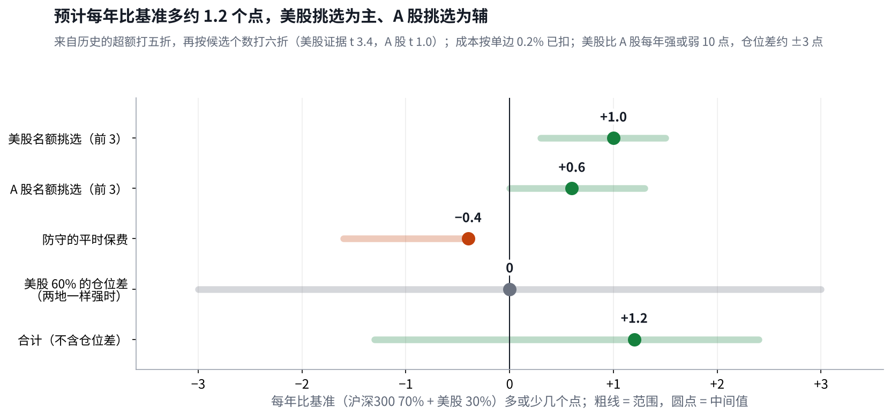
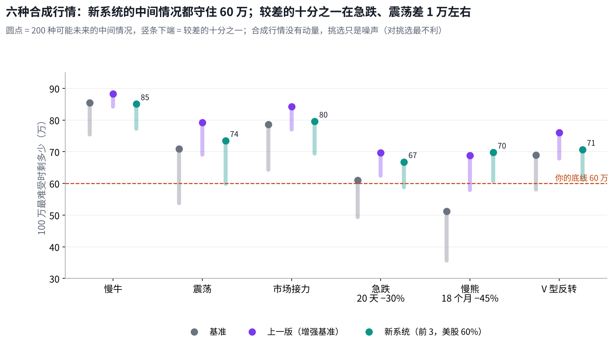
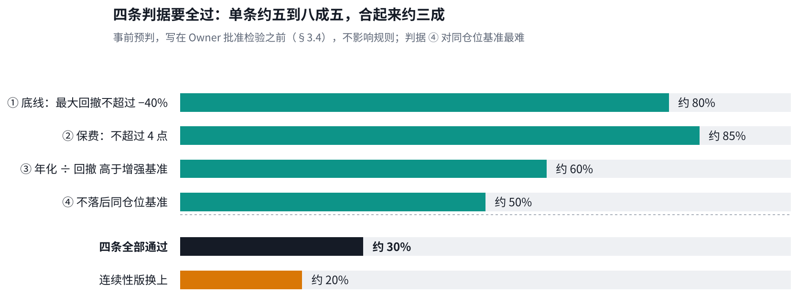

# 多资产轮动 · 预注册 v6（市场内 Top 3 + 按把握调节的防守）· 初稿第 2.1 版 · 2026-11-23

## Metadata

- Project: ETF_Rotation_Quant · Owner: L. Loric · 起草：Orchestrator（Claude）
- 状态：**初稿第 2.1 版，未冻结**：2.1 版写入 D38 第 45、56 行的结果（§4 第 7 条、§8、§9.2 第 4、5 条），不改任何规则；第 2 版：闭合 Reviewer R1（`operations/reviews/2026-11-23-v6-prereg-draft-r1.md`）的 MF-1、MF-2 和 SF-2 至 SF-8；写入 Owner 2026-11-23 对 §9.2 第 6 条三项的确认（D40-14）；送 R1b。冻结前不运行任何 v6 规则在 2016-01-01 以后的项目池收益上。冻结顺序见 §9。
- 尝试登记：本项目**第 4 次正式尝试**（第 1 次 V1 横截面轮动、第 2 次 v2 A 股择时、第 3 次 v3 → v5.1 多资产强势轮动，均已按“不成立”关闭，D36）。
- 依据：D27（封板后的新想法记作 v6）、D36（v6 方向）、D38（先算后做；预演运行附表第 10–55 行）、D39（底线与保费上限）、D40-1 至 D40-14；《v6 预演预测表》第 3.22 版（`docs/owner/v6-preflight-forecast.md`）；设计评审第 2.1 版（`docs/reference/strategy-design-review.md`）。
- 版式：页面按《Owner 页面讲故事模式库》（`docs/reference/owner-page-story-patterns.md`）重排：每节加证据视觉，细节进折叠，表格加结论列；条款文字不变。
- 本文不沿用 v3–v5.1 的条款；凡没写到的，以本文为准、按 AGENTS.md 的研究纪律处理。

---

**项目愿景**　在动态周期内，从多类资产里选出 Top N 强势 ETF 轮动持有，获得超额收益、稳定跑赢被动基准，同时把回撤控制住。

| 进度 | 结论 | 需要你 |
| --- | --- | --- |
| 初稿第 2.1 版：R1 的两条必须改已闭合，你确认的三项已写入（D40-14）；三份 Grok 数据的检验已写进 §4，规则不变；待 Reviewer R1b。 | 100 万分成 A 股 40 万、美股 60 万两个名额。每个名额每月末按过去一年（不算最近一个月）的涨幅选最强的 3 只等分持有；只在市场确认紧张时，按“这个市场以往紧张时领头者表现如何”算出的把握 p 减仓，其余放国债。超额主要来自美股挑选（70 年证据），v6 的主要价值是控制回撤。 | 不用操作。冻结前剩附表 A、B（§9.2）。 |

## §1 策略定义：每个名额每月选最强的 3 只，只在确认紧张时按把握减仓

> **美股 15 个候选、A 股约 40 个候选；每月末走四步，下一个交易日成交；从数据里定的数字正好 3 个。**

下面四步是条款的读法，规则以折叠里的“1.2 每月四步（条款原文）”为准。

1. **选人**：**决定买哪 3 只**。看：过去一年涨幅 · 不算最近 1 个月｜规则：从高到低排 · 同行业只留一个 · **取前 3**｜结果：3 只候选。例（2015 年 8 月 A 股）：军工 106% · 软件 100% · 公用 95% → 这 3 只入选。
2. **看市场**：**决定现在紧不紧张**。看：母指数均线 · 宽度 · TRIN｜规则：每项越过门槛 = 1 票 · **≥ 2 票 = 紧张**｜结果：紧张 / 不紧张。例（2015 年 8 月 A 股）：均线 ✓ · 宽度 ✓ · TRIN ✓ → 3 票，紧张。
3. **定仓位**：**决定股票买多少钱**。看：紧不紧张 · 把握 p｜规则：不紧张：每只 1/3 · **紧张：股票 × p** · 其余放国债｜结果：每只的金额。例（2015 年 8 月 A 股）：40 万 · p = 0.235 → 股票 9.4 万，国债 30.6 万。
4. **下单**：**决定买哪只基金**。看：同指数的几只基金 · 溢价比 60 天常态高几点｜规则：下一个交易日成交 · **高 5 点以上换一只**｜结果：实际买入的基金。例（纳指科技，假设）：常态 9% · 今天 16% → 高 7 点，换另一只。

- **读这张图**：2015 年 8 月股灾后，A 股领头者以往紧张时也跟着跌，把握 0.235，40 万只拿 9.4 万股票；美股领头者照样涨，把握 0.997，几乎满仓（预测表 3.22 版，已去重）。

1.1 候选池：美股 15 个、A 股约 40 个，各自从发布日起参选

| 名额 | 母指数 | 候选 | 依据 |
| --- | --- | --- | --- |
| 美股（60%） | 标普500（SPX） | SPX、纳指100（NDX）、道指（DJIA）、费城半导体（SOX）、纳斯达克生物科技（NBI）、9 个行业 SPDR（XLK、XLV、XLE、XLY、XLP、XLF、XLI、XLB、XLU）、REIT（DWRTF），共 15 个 | D40-11：原 14 个 + REIT；新候选须带来池子里没有的行业 |
| A 股（40%） | 沪深300 | 沪深300、中证500、中证1000、创业板指、科创50、中证红利、10 个中证全指一级行业、已接入的 A 股主题指数（清单见附表 A） | D40-1；D38 第 39、48 行 |

- **准入**：每个候选从官方发布日（或基金上市日）起参选，满 12 个月才有分数（D38 第 39 行）。10 个中证全指一级行业按 D38 第 48 行允许用 2011-08-02 之前的回填点位；主题指数一律从发布日起。
- **母指数也是候选**：规则自己决定拿母指数还是细分。
- **去重**：每个候选事先标好行业标签（美股按 GICS，A 股按中证一级，红利类单列“红利”；宽基、母指数不标），同一标签只留分数最高的一个，空位由下一名递补（D38 第 46 行）。标签表 `config/v6-preflight/sector-tags.toml` 冻结前补齐检验段全部候选（§9 待办 1）。
- **港股不单设名额**：只有 4 个分类指数，挑选失效（D38 第 38 行，D40-4）。

1.2 每月四步（条款原文；每月最后一个交易日算，下一个交易日成交）

| 步 | 决定什么 | 规则 |
| --- | --- | --- |
| ① 选人 | 买哪 3 只 | 按 12−1 涨幅（上月末点位 ÷ 12 个月前月末点位 − 1）从高到低排，去重后取前 3。母指数跌破自己的 10 个月均线时，只选 12−1 为正的候选，选不满的空位放国债 |
| ② 看市场 | 紧不紧张 | 三票：母指数跌破 10 个月均线；宽度（站上自己 10 个月均线的候选占比）不高于它到当时为止全部月份的 1/3 分位；TRIN（每日：涨的候选数 ÷ 跌的候选数，再除以涨的成交额 ÷ 跌的成交额；取 10 日均值）不低于到当时为止的 2/3 分位。分位至少要 24 个月历史，不足时该票记 0。**≥ 2 票 = 确认紧张** |
| ③ 定仓位 | 股票买多少 | 不紧张：3 只各 1/3。确认紧张：股票总仓位 = 把握 p，3 只等分；其余放国债，国债也跌破 10 个月均线时放现金 |
| ④ 下单 | 买哪只基金 | 见 §2 执行层 |

- **把握 p**（D40-3）：p = Φ(t)，t = 以往每个紧张月“前 3 名下个月的平均绝对收益”的平均 ÷ 标准差 × √月数，只用当时已经知道结果的月份；少于 12 个紧张月时 p = 0.5。美股名额以美国 49 行业长历史（French，1999 年以前的紧张月）为起点；A 股名额从 0.5 起。Φ 是标准正态分布函数。
- **领头者**（把握 p 用）：去重后按 12−1 排名的前 3，不做“12−1 须为正”的过滤；只在确认紧张的月份记录，三只下月收益都已知时才记入。与设计期数字的来源 `scripts/preflight/topn_dedupe.py` 一致（R1 SC-2）。
- **TRIN 的成交额**：美股 = 9 个行业 SPDR（收盘 × 成交量）；A 股 = 有成交额的候选指数，按发布日截断（与 D38 第 39 行相同）。
- **国债与现金**：与预演脚本相同（`scripts/preflight/topn_system.py` 的 `cgb-10y` 与 `cash`）；两个名额的防守资产相同。
- **名额之间不挪钱**：美股名额的钱只在美股候选、国债、现金之间分，A 股同理。每月末两个名额按 60/40 再平衡，调拨的金额按单边 0.2% 计成本。设计期数字（`topn_dedupe.py`，含去重）用每日固定 60/40 加权近似，与按月再平衡的差异在附表 B 报告（R1 SC-3、SC-4）。

1.3 A 股名额的两条规则（D40-13）：12−1 定过不过，连续性版是挑战者

| | 主规则：12−1 | 挑战者：连续性版 |
| --- | --- | --- |
| 怎么选 | 第 ① 步原样 | 先按 12−1 去重排名，取前一半（向上取整）；其中按信息离散度 ID 取最低的 3 个，同分按 12−1 高者优先 |
| ID | — | ID = sign(12−1 涨幅) ×（窗口内下跌日占比 − 上涨日占比），窗口与 12−1 相同（12 个月前月末之后到上月末）；有效交易日不足 200 天的候选不参选。公式照抄 Da、Gurun、Warachka（2014，RFS） |
| 其余三步 | 相同 | 相同；紧张时的把握 p 用连续性版自己的领头者计算 |
| 地位 | v6 过不过以它为准 | 同一套判据单独报告；满足 §5.3 才在前向模拟盘换上 |

美股名额只用 12−1。第 55 行的 `a_decompose.py` 只有挑选层、不去重、不加防守，不能当连续性版的完整实现（R1 SC-5）。

### 1.4 从数据里定的数字（不超过 3 个，D38-2）

| 数字 | 取值 | 怎么来的 | 计不计 |
| --- | --- | --- | --- |
| 每个名额选几只 | 3 | D40-7：设计期与合成行情比较前 2 / 前 3，Owner 取舍 | 计 1 |
| 美股比例 | 60% | D40-4：Owner 判断 + D38 第 39 行（美股跌时 A 股多半也跌）；**定的时候已知 2016–2025 年美股强于 A 股**，见 §4 第 5 条 | 计 2 |
| 确认紧张的票数 | ≥ 2 | D38 第 34 行：看过第 33 行（按票线性减仓）结果后改为“确认后才减仓” | 计 3 |
| 回看期 | 12−1 | Jegadeesh、Titman（1993）及此后文献的默认值 | 文献 |
| 均线 | 10 个月 | Faber（2007）的默认值 | 文献 |
| 宽度、TRIN 门槛 | 1/3、2/3 分位 | D38 第 33 行跑前写死，三等分的约定，没有搜索过别的值 | 约定，Reviewer 核 |
| TRIN 平滑 | 10 日均值 | 业内常用平滑（D38 第 32 行登记） | 约定，Reviewer 核 |
| 最少历史 | 分位 24 个月；把握 12 个紧张月 | 统计上够算的最低要求，没有搜索过 | 约定 |
| 连续性版 | 前一半、200 天 | D38 第 55 行跑前写死 | 约定 |

复杂度预算（设计评审第 5 节）只计上表标“计”的 3 行；标“文献”“约定”的是跑前写死、没有对历史搜索过的结构常数，不计入（R1 同意此划分，J-2）。

- **复杂度正好用满**：标“计”的只有选几只、美股比例、确认票数三个；回看期、均线来自文献，门槛和平滑是跑前写死的约定。
- **美股 60% 是知道美股强之后定的**：所以 §5 用同仓位基准判，仓位差单独报告（§4 第 5 条）。

---

## §2 执行层规则：溢价比常态高 5 个点不买，常年溢价品种不另设上限（不计入 3 个数字）

> **只用场内基金；溢价偏离超 5 个点换同指数另一只；常年溢价品种和其他品种一样，每只最多占名额的 1/3。**

1. **成交**：信号日的下一个交易日收盘价成交，**只用场内基金**。
2. **挑基金**：同一指数多只基金时，**选溢价偏离最小的**。
3. **溢价冲高**：**高 5 点以上换一只**；都不行时给下一名候选，再不行给母指数。
4. **仓位上限**：已持有的不受影响；常年溢价品种不另设上限，**每只最多占名额的 1/3**。

| 规则 | 取值 | 来历 |
| --- | --- | --- |
| 成交 | 信号日的下一个交易日收盘价成交 | 与预演一致 |
| 载体 | 只用场内基金（ETF、LOF）；同一指数多只基金时，选溢价偏离最小的 | D35；D40-5 |
| 溢价偏离 | 当日溢价比自身过去 60 个交易日溢价中位数高 5 个点以上不买，换同指数偏离最小的一只；都不行时给下一名候选，再不行给母指数；已持有的不受影响 | D40-5；D38 第 30 行 |
| 常年溢价品种的单只上限 | **不另设上限**：和其他品种一样，每只最多占名额的 1/3（美股 20 万） | Owner 2026-11-23（D40-14）。代价：按纳指科技常态溢价约 9% 估，额度放开时一次性损失约 1.8 万，约为组合的 1.8%，写进疼痛表 |
| 成本 | 单边 0.2%（上限口径），按换手计 | 预测表打折规则 |

- **不设单只上限的代价**：按纳指科技常态溢价约 9% 估，额度放开时一次性损失约 1.8 万，约为组合的 1.8%，已写进 §6 疼痛表。
- **这些规则不计入 3 个数字**：执行层单列，来历都写在表里（D38-2 的边界）。

---

## §3 设计评审：预计每年比基准多约 1.2 个点，六种合成行情的中间情况都守住 60 万

> **预测表、合成行情、跑前八问、事前画像、红队都按设计评审第 2.1 版写；全部判据通过的机会约三成。**

### 3.1 预测表（《v6 预演预测表》第 3.22 版，原样进入；冻结后不改）

| 来源 | 中间值 | 范围 | 证据强度 |
| --- | ---: | --- | --- |
| 美股名额挑选（前 3） | +1.0 | +0.3 到 +1.5 | 强（美国 70 年 t 3.4） |
| A 股名额（前 3） | +0.6 | 0 到 +1.3 | 弱（t 1.0，挑选部分 t 0.2） |
| 防守的平时保费 | −0.4 | −1.6 到 −0.4 | 中 |
| 美股 60% 的仓位差 | 0 | −3 到 +3 | 无法预测 |
| **合计（不含仓位差）** | **+1.2** | **−1.3 到 +2.4** | 弱到中 |

单位：每年比基准多几个百分点。来自历史数据的超额已打五折，再按候选个数打六折；成本按单边 0.2%。

**低于哪条线不做**（设计评审第 1 节，R1 SF-2）：预测合计的中间值低于 0，或 D39 两条线（合成行情中间情况最低剩 60 万、合成慢牛每年落后不超过 4 点）任一不满足，就不起草。当前合计 +1.2，两条线都满足（§3.2）。

**A 股一项的对账口径（D40-12）**：预测值 +0.6 不变；事后按两块分别核对——挑选（12−1 比“等权持有全部候选”，约 +0.1，范围 −0.5 到 +0.5）、等权倾斜（等权持有全部候选比沪深300，约 +0.5，范围 −1.0 到 +1.0，主要是少配金融、偏中小盘）。

### 3.2 合成行情（D38 第 40、41 行，前 3、美股 60%，200 条路径，没有动量）

六种行情的明细表

| 行情 | 100 万最低剩：中间 / 较差十分之一 | 基准 | 每年比基准 | 判 |
| --- | --- | --- | ---: | --- |
| 慢牛 | 85.1 / 77.3 | 85.5 / 75.4 | −1.6 | 过（保费上限 4 点） |
| 震荡 | 73.5 / 59.9 | 70.9 / 53.8 | −0.1 | 过 |
| 市场接力 | 79.6 / 69.4 | 78.6 / 64.3 | −1.3 | 过 |
| 急跌（20 天 −30%） | 66.8 / 58.8 | 61.0 / 49.4 | +3.0 | 过（按中间情况，D40-7） |
| 慢熊（18 个月 −45%） | 69.8 / 60.8 | 51.2 / 35.7 | +15.8 | 过 |
| V 型反转 | 70.7 / 61.1 | 69.0 / 58.1 | −14.8 | 过 |

3.3 跑前八问：钱跟着强弱走，挑选在市场内部，防守只在市场层面

| 问 | 回答 |
| --- | --- |
| 1. 钱是否跟着强弱走 | 是。名额内前 3 等分，弱的拿不到钱；紧张时减的是整个名额的股票仓位，不会把钱给弱品种 |
| 2. 挑选发生在哪一层 | 市场内部。美国 49 行业平均两两相关 0.61，挑选有效（70 年 +5.7，t 3.15）；A 股行业相关 0.81、市场波动是截面差异的 2.3 倍，挑选平均约为 0（D38 第 50、51、53 行） |
| 3. 防守怎么进来 | 只在市场层面、只在 ≥ 2 票时进来；不逐个候选卡均线（逐个门槛每年吃进攻约 4.5 点，D38 第 25、26 行）。减多少由把握 p 决定：美股紧张时领头者以往照样涨，p 接近 1；A 股以往跟着跌，p 低 |
| 4. 每个开关触发几次 | 设计期信号层面：确认紧张的月份、各候选入选次数、去重触发次数，冻结前按年数一遍写进附表 B（§9 待办 3） |
| 5. 同结构去掉信号还剩多少 | 对照写死在 §5.2：同结构等权、同结构随机、不设防守，与 v6 同次跑出。预演里：A 股名额 +5.3 中等权倾斜占 +4.6、挑选 +0.7（第 51 行）；美股挑选 +5.7、等权倾斜 +0.7 |
| 6. 收益从哪里来 | 冻结前按“仓位差 / 挑选 / 防守 / 成本”拆设计期收益，分 2006–10、2011–15 两段写进附表 B（§9 待办 3） |
| 7. 触发次数值多少钱 | 预演：设计期整套每年换手约 5.5 倍（第 47 行），A 股名额 12−1 约 5 倍（第 49 行），按单边 0.2% 每年约 1.0–1.1 点；冻结前按检验段的规则文字重估 |
| 8. 检验时的池子和基准还是同一个吗 | 检验段 A 股候选随主题陆续发布而增加，美股 15 个不变；冻结前按年数一遍可参选候选（§9 待办 3）。基准按 AGENTS.md 不变；另加同仓位基准（§5.1），把“美股 60%”的仓位差单独拆出 |

3.4 事前画像：平静时满仓，A 股股灾大部分换国债，A 股大牛市明显落后

| 行情 | 规则会怎么动 | 例（设计期真实月份） |
| --- | --- | --- |
| 平静上涨 | 两个名额满仓各拿 3 只 | 2013-04：A 股去重后 300 医药、创业板、全指公用各 13.3 万；美股生物科技、金融、必需消费各 20 万（医疗与生物科技同属医疗保健，让位） |
| A 股股灾 | A 股三票全中，把握低，大部分换国债；美股照常 | 2015-08：A 股 p = 0.235，股票 9.4 万、国债 30.6 万；美股 p = 0.997，生物科技、可选消费、纳指100 几乎满仓（`exec-example.json`，已按去重重算，R1 MF-2） |
| 美股熊市、领头者逆势 | 美股紧张但 p 高，几乎不减；领头者（如能源）照常持有 | 美国 2022 年：前 3 领头者能源 +48.6%（D38 第 35 行） |
| A 股大牛市 | 照常满仓，但 A 股只占 40%，明显落后基准（基准 70% 在 A 股） | 2006–07、2014–15 |
| V 型急跌急涨 | 紧张时减了仓，反弹时回来得晚 | 合成 V 型每年落后约 15 点（短期年化） |

**事前预判**（写在 Owner 批准检验之前）：第 ① 条底线大概率过（约八成）；第 ② 条保费（只量防守成本）约八成五；第 ③ 条对增强基准约六成；第 ④ 条对同仓位基准不低于 0 约五成。合起来全部通过的机会约三成。连续性版换上的机会约两成。这是事先的判断，不影响规则。

3.5 红队：最可能让 v6 失败的五个原因（R1 SF-3）

| # | 原因 | 会怎样 | 在哪里盯 |
| --- | --- | --- | --- |
| 1 | **超额只有一个来源** | A 股挑选平均约为 0（沪深300 行业、申万一级上 12−1 甚至为负，§4 第 7 条），超额几乎全靠美股挑选；美股挑选一旦在检验段失灵，判据 ④ 就过不了 | 判据 ④；对照“同结构等权” |
| 2 | **能买到的抓不到能排名的** | 美股领头者常是溢价高的 QDII，换成同指数其他基金或下一名后，可交易池少抓一截 | 可交易池报告；疼痛表“稀缺 QDII” |
| 3 | **A 股把握 p 学错** | A 股从 0.5 起学，2016 年后紧张月领头者的表现若和 2015 年前不同，p 会滞后 | 疼痛表“V 型急跌急涨”；附表 B 的 p 轨迹 |
| 4 | **V 型急跌急涨** | 紧张时减了仓，反弹时回来得晚 | 疼痛表；判据 ② 只量防守成本 |
| 5 | **候选池变了** | 检验段 A 股候选随主题发布增加到四十个左右，同一行业的主题变多，去重和挑选的行为可能和设计期不同 | 附表 B 逐年可参选个数；稳健性 S3–S5 |

- **读这两张图**：预测合计 +1.2 在“低于 0 不做”的线之上；六种合成行情的中间情况都守住 60 万，慢牛保费 1.6 点低于 4 点上限。
- **最大的风险是超额只有一个来源**：A 股挑选平均约为 0，超额几乎全靠美股挑选（红队第 1 条）。
- **全部判据通过的机会约三成**：事前预判见 §5 的图。

---

## §4 已经看过的信息：检验段不干净，美股 60% 是在知道美股强之后定的

> **检验段 2016–2026 只能作“已污染检验段”用一次（D9-1）；A 股选人已试约 12 种，v6 不再加新变体。**

<!-- 页面：卡片 -->

| # | 看过什么 | 对检验的影响 | 结论 |
| --- | --- | --- | --- |
| 1 | **项目池 ≤ 2015 的全部预演结果**：D38 运行附表第 10–55 行，含设计期整套（现规则：美股旧 14 个 + REIT、去重，年化 13.3%、最低剩 72.3 万，第 47 行）、A 股 12−1 与 11 种替代选法、连续性版与隔夜版（第 55 行） | 设计期只作一致性检查 | 只作一致性检查 |
| 2 | **美国 49 行业 2016–2026**：第 20、24、25、42 行看过前 3 在 2016–2026 的超额（约 +4.8 到 +5.2 点/年）和四种市场状态 | 美股挑选的检验段不干净，只作一致性检查 | 只作一致性检查 |
| 3 | **QDII 溢价 2016 年以后的分布**（第 28、30 行）：只看溢价、没有和任何信号对齐 | 属执行成本数据 | 属执行成本 |
| 4 | **v2、v3–v5.1 在 2016-01 → 2026-09 的一次性检验结果**：A 股趋势择时、E2 新口径、A1、A2 等，以及当时看到的基准构成（六成收益来自美股） | 知道检验段的大致样貌 | 知道大致样貌 |
| 5 | **常识性的市场历史**：2016–2025 年美股大幅跑赢 A 股；A 股有 2018 年熊市、2019–2021 年结构牛（新能源、白酒、医药）、2021 年后的教育与互联网监管冲击、2024 年 2 月微盘股踩踏与 9 月政策反弹 | **美股 60% 是在知道这些的情况下定的**，检验段对 v6 的仓位天然有利；本文用同仓位基准（§5.1）判，仓位差单独报告，不让它替挑选和防守记功 | 用同仓位基准判 |
| 6 | **A 股选人的试验次数约 12 种**：12−1、上月涨幅、6−1、风险调整、拥挤度刹车、选 5 个、快速出场、结构市才挑选、速度随状态、挑选把握 q、连续性版、隔夜版 | 按第 55 行的停止规则，v6 不再加新变体 | 不再加新变体 |
| 7 | **冻结前新增的三项检验**（2026-11-23，D38 第 45、56 行，都只用 ≤ 2015）：沪深300 十个行业——上月涨幅新段每年 −3.6、全段 t 0.08，12−1 前 3 对沪深300 −3.3；隔夜版（全指一级开盘价）对等权 t 0.57；申万一级（**可能回填，只作参考**）——12−1 前 3 对等权每年 −5.9（t −1.56），在随机选 3 个里排第 5.6 百分位；连续性版比 12−1 每年 +6.5（t 1.73），但对等权只 +0.6 | 上月涨幅不进 v6，隔夜版关闭；三个新池子里 12−1 都没挑出东西，按 40% 名额折算到组合，全指一级（对等权 +1.0）约 +0.4，在预测表 A 股挑选的范围（−0.5 到 +0.5）内，申万（−5.9）约 −2.4，低于下限（只作参考）；加重红队第 1 条；连续性版比 12−1 好的方向在申万上重现 | 12−1 没挑出东西，规则不改 |

---

## §5 一次性检验：和同仓位基准比，四条判据全部满足才通过

> **检验段 2016-01 → 2026-09；判据是回撤不超过 40%、防守保费不超过 4 点、风险收益比赢增强基准、对同仓位基准不落后。**

5.1 区间、池子、基准：指数池主判，BM-同仓位把美股 60% 的仓位差拆出去

- **检验段**：2016-01-01 → 2026-09-30（已污染段，按 D9-1 只用一次，不称样本外）。
- **池子**：指数池（候选指数，人民币，口径同预演）为主判；可交易池（场内基金，含 §2 执行层）只报告。每条序列的价格 / 全收益口径冻结前写进附表 A（§9 待办 2）。

| 基准 | 构成 | 用途 |
| --- | --- | --- |
| **BM-主** | 70% 沪深300 全收益 + 15% 纳指100 全收益 + 15% 标普500 全收益，人民币，每月第一个交易日再平衡 | AGENTS.md 规定的并列基准，逐年列出 |
| **BM-同仓位** | 40% 沪深300 全收益 + 30% 纳指100 + 30% 标普500，同口径 | 判据 ④；v6 的仓位差 = BM-同仓位 − BM-主，挑选、防守、成本的合计 = v6 − BM-同仓位 |
| **增强基准** | K2A（D39，美股 50%） | 判据 ③ |

5.2 对照（与 v6 同次跑出，写死）：等权、随机、不设防守、A 股拆分

| 对照 | 写法 | 回答什么 |
| --- | --- | --- |
| 同结构等权 | 四步不变，第 ① 步改为每个名额按行业标签等权持有全部可参选候选 | 挑选值多少（设计评审第 5 问） |
| 同结构随机 | 四步不变，第 ① 步改为去重后随机取 3 只（同样受准入限制），1000 次，种子 20261122 | 规则在随机里排第几百分位、每月跑赢随机中位数的比例 |
| 不设防守 | 第 ② ③ 步去掉，永远满仓前 3 | 防守值多少、保费多少 |
| A 股名额拆分 | A 股名额单独：12−1 比同名额等权（挑选）、等权比沪深300（等权倾斜） | D40-12 的对账口径 |

### 5.3 判据（主规则口径；全部满足为通过）

<!-- 页面：卡片 -->

| 编号 | 门槛 | 判据 | 来历 |
| --- | --- | --- | --- |
| ① 底线 | 回撤 ≤ 40% | 指数池净值从任何高点算的最大回撤不超过 −40%（100 万最低不跌破 60 万；按 D39-1 括号里的定义，比“从 100 万起最低剩 60 万”更严） | D39-1 |
| ② 保费 | ≤ 4 点 | 取 BM-主全年收益为正的自然年（首尾不满一年的不计）；逐年算“对照‘不设防守’的年收益 − v6 年收益”，取算术平均，不超过 4 点 | D39-2；Owner 2026-11-23 定：只量防守这份保险的成本（D40-14） |
| ③ 不输增强基准 | 高于 K2A | 同一窗口、同一口径（指数池、人民币、扣成本）：v6 的年化 ÷ 最大回撤的绝对值，高于 K2A 的同一比值 | D38 第 18 行“赢过增强基准”；Owner 2026-11-23 定（D40-14） |
| ④ 对同仓位基准 | ≥ 0 | 同一窗口、同一口径：v6 年化 − BM-同仓位年化 ≥ 0 | 愿景“稳定跑赢被动基准”；Owner 2026-11-23 定（D40-14）；预测范围 −1.3 到 +2.4 只用于事后对账 |

- **读这张图**：单条判据事先估计约五到八成五能过，最难的是 ④ 对同仓位基准（约五成）；四条都要过，合起来约三成。
- **连续性版换上的条件**（D40-13）：连续性版整套也满足 ①–④，且检验段 A 股名额里连续性版比 12−1 的月度差均值为正；两者计 2 次试验。要往预测表里给 A 股挑选“报钱”，需该月度差的 t ≥ 2.24（两次比较的 Bonferroni 调整，单侧 0.025 ÷ 2）。
- **结果怎么用**：通过 → 进入 6 个月前向模拟盘（D27），小资金起步需 Owner 另批；不通过 → 如实记录、关闭，新想法另起版本并注明第几次尝试。

计算口径与事后对账

- **计算口径**（判据 ①–④ 通用）：年化用 `src/report/metrics.py` 的 `cagr`，最大回撤用 `max_drawdown`，年度收益用自然年首尾净值之比；v6、对照、基准都在同一窗口、同一口径下算。
- **事后对账**（D38-6，不判通过与否）：预测表逐项（美股挑选、A 股挑选与等权倾斜、防守保费、仓位差、成本）和实际对照；超出范围的，先查原因再做下一版。

5.4 稳健性（只报告，不改判）：8 项，对某一项很敏感的结论降一级

| 编号 | 改动 |
| --- | --- |
| S1 | 成本加倍（单边 0.4%） |
| S2 | 信号日延后 1 个交易日 |
| S3–S5 | 去掉检验段贡献最大的 1、2、3 个候选 |
| S6 | 美股 50%、A 股 50% |
| S7 | 每个名额选前 2 |
| S8 | 紧张门槛改为“3 票全中” |

对某一项很敏感的，结论降一级。

---

## §6 疼痛表：A 股大牛市每年少约 9 点、V 型反弹落后约 15 点，事先接受

> **8 种情形各有一条警戒线：落在“事先认下的代价”里是正常代价；越过“超出就要查”的线，说明策略性格变了，先查原因（冻结后不改）。**

| 情形 | 会发生什么 | 事先认下的代价 | 超出就要查 |
| --- | --- | --- | --- |
| A 股大牛市 | 基准 70% 在 A 股，我们只有 40% | **2006–2010 每年少约 9 点**（设计期） | 单年落后 BM-主超过 20 点 |
| V 型急跌急涨 | 紧张时减了仓，反弹时回来得晚 | **合成 V 型每年落后约 15 点**（短期年化） | 见底后 3 个月股票仓位仍低于一半 |
| 突发急跌 | 每月看一次来不及 | **较差的十分之一约剩 58.8 万** | 低于 55 万 |
| 挑选没有动量的年份 | 前 3 只是噪声，多付换手 | **每年少约 1.6 点** | 连续 3 年挑选部分（对同结构等权）为负 |
| A 股挑选分阶段 | 结构市里 12−1 有效，轮动和崩盘时反噬 | **两段各约 ±16 万**：2011–13 每年 +16.9、2014–15 每年 −21.1（40 万本金，只看挑选层） | 单年 A 股挑选部分低于 −25 点 |
| 稀缺 QDII 溢价消失 | 额度放开时一次性损失 | **约 1.8 万**（常态溢价约 9%、单只 20 万，D40-14 不另设上限） | 单次损失超过组合的 3% |
| 试了很多种防守和选法 | 设计期挑出来的最好结果有挑选偏差 | **已按打折处理** | 检验段明显低于预测下限，先查是否偏差所致 |
| 换手和成本 | 两个名额每月换人 | **每年约 1.0–1.1 点** | 每年成本超过 2 点 |

- **最大的两笔代价都来自结构**：A 股只占 40%，大牛市每年少约 9 点；紧张时减仓，V 型反弹每年落后约 15 点。
- **每张卡底部的红线是警戒线**：越过它说明策略性格变了，先查原因，冻结后不改规则。

---

## §7 前向模拟盘与影子跟踪：通过后至少 6 个月模拟盘，另外 3 种规则只记录不交易

> **影子跟踪的定义冻结后不改；模拟盘跌破 60 万，或 6 个月对同仓位基准累计落后超过 6 点，就暂停报告你。**

1. **检验**：一次性检验**通过后才进入模拟盘**。
2. **模拟盘**：按冻结规则每月出持仓，**至少 6 个月**；每月对账预测表各项和疼痛表。
3. **影子**：结构市才挑选、12−1 与连续性版各拿一半、连续性版，**只记录，不交易**。
4. **暂停**：跌破 60 万，或连续 6 个月对同仓位基准累计落后超过 6 点，**暂停并报告**。

<!-- 页面：卡片 -->

| 项目 | 规则 | 用途 |
| --- | --- | --- |
| **前向模拟盘** | 一次性检验通过后，按冻结规则每月出持仓，至少 6 个月（D27）；每月对账预测表各项和疼痛表 | 上线前的干净证据 |
| **影子：结构市才挑选**（D38 第 54 行 B2） | A 股名额候选里站上 10 个月均线的比例处在到当时为止最低三分之一时用 12−1 前 3，否则按标签等权持有全部候选 | 只记录，不交易 |
| **影子：12−1 与连续性版各拿一半** | A 股名额一半资金按 12−1 选 3 只，一半按连续性版选 3 只；两边选中同一只的占双份 | 只记录，不交易 |
| **影子：连续性版** | 一次性检验后若未换上，继续按 §1.3 记录 | 只记录，不交易 |
| **暂停** | 任一时点跌破 60 万底线，或连续 6 个月对同仓位基准累计落后超过 6 点 | 暂停并报告 Owner |

---

## §8 数据陷阱声明：结论必须声明四项陷阱，加上美股代理、实盘载体和申万回溯的差异

> **主题指数回填、指数与 ETF 的差异、腾讯减法 qfq、份额折算假跳空，4 项每次报告都要写。**

| 陷阱 | 会怎样 | 怎么处理 |
| --- | --- | --- |
| **主题指数回填** | 中证行业价格指数 2011-08 发布，之前是回溯 | 主题指数从发布日起参选；10 个一级行业按 D38 第 48 行允许回填 |
| **指数与 ETF 的差异** | 费用、跟踪误差、溢价 | 指数池主判，可交易池只报告 |
| **腾讯减法 qfq** | 前复权用减法，长期收益失真 | 按 `docs/manual/data-principles.md` 的口径 |
| **份额折算假跳空** | 折算日价格跳变 | 按 `docs/manual/data-principles.md` 处理 |
| **美股代理与 QDII** | 设计期用美国本土行业 ETF 与指数代替，实盘用对应 QDII | 两者之间有溢价和跟踪误差；清单见附表 A |
| **申万一级的历史点位** | 2021-12-13 之前的点位可能按 2021 版成分回溯，官方没有写明（Grok、Reviewer 都记“未找到”） | 只作 §4 的参考检验，不改主规则、不给 A 股挑选报钱（Owner 2026-11-23）；官方缺的 8 个交易日都在 2016 年以后，不补 |

---

## §9 运行纪律与冻结前待办：冻结前还剩 2 件事，都不需要你操作

> **6 件待办已完成 4 件，剩附表 A、B；行业标签必须在看任何检验段收益之前补齐；冻结后不改任何规则（程序错误除外）。**

9.1 顺序：看初稿 → R1 → 冻结 → 实现与复算 → 一致性检查 → 一次性检验 → 模拟盘

1. **Owner 看初稿**：已确认 §9.2 第 6 条三项（D40-14）。
2. **Reviewer R1**：逐条核对设计评审、§1.4 计数、§4 已看信息；Orchestrator 闭合后 Reviewer R1b。
3. **冻结**：`milestone/v6-prereg-freeze`，由 Cloud Agent 按 Owner 指令打。
4. **实现与复算**：Dev 在 `src/v6/`、`config/v6/` 实现；Reviewer 独立实现复算设计期整套和两个月份示例（逐位一致），并复现 §3.2 合成行情。
5. **设计期一致性检查**：只报告。
6. **一次性检验**：Owner 批准后跑一次，出报告并对账。
7. **前向模拟盘**：见 §7。

**目录**：`src/v6/`、`config/v6/`、`results/v6/`，账本 `results/v6/trial-ledger.csv`。冻结后不改任何规则（程序错误除外）。

### 9.2 冻结前待办

<!-- 页面：卡片 -->

| # | 事项 | 谁 | 状态 | 说明 |
| --- | --- | --- | --- | --- |
| 1 | 行业标签补齐检验段全部 A 股候选 | Orchestrator | 已完成 | **已完成（2026-11-23，看收益之前）**：新能源汽车、光伏 → 工业；创新药 → 医药卫生；通信设备、半导体材料设备、消费电子 → 信息技术；教育 → 可选消费；细分化工 → 原材料；科创50 不标（宽基）。见 `config/v6-preflight/sector-tags.toml`，Reviewer 核 |
| 2 | 附表 A：每条候选序列的代码、来源、价格 / 全收益口径、发布日、实盘载体 | Orchestrator、Dev | 待做 | 美股 QDII 清单按 Grok 第六轮入库结果定；细分化工（数据状态 frozen）是否参选在此核实（R1 J-3） |
| 3 | 附表 B：设计期信号画像（紧张月份、入选次数、去重次数、可参选个数逐年、A 股 p 轨迹）与收益拆分（仓位差 / 挑选 / 防守 / 成本，两段；60/40 按月再平衡与每日固定的差异） | Orchestrator | 待做 | 设计评审第 4、6、8 问，只用 ≤ 2015；R1b 前仍是开放项（R1 SF-1） |
| 4 | 沪深300 十个行业（第 45 行） | Grok、Orchestrator | 已完成 | **已完成（2026-11-23，D38 第 45 行）**：上月涨幅不满足判据，不进 v6；结果写进 §4 第 7 条 |
| 5 | 申万一级（含开盘价、成交额） | Grok、Orchestrator | 已完成 | **已完成（2026-11-23，D38 第 56 行）**：先登记再检验 12−1、连续性版、隔夜版；可能回填，只作参考，结果写进 §4 第 7 条，不改主规则；隔夜版在全指一级上正式判据不过，关闭 |
| 6 | Owner 确认：单只上限、判据 ② 的算法、判据 ③ ④ 的门槛 | Owner | 已完成 | **已完成（2026-11-23，D40-14）**：不另设单只上限；② 只量防守成本；③ 比年化 ÷ 最大回撤；④ 不低于 0 |

---

## 附表 A：候选清单——美股 15 个固定，A 股随主题发布逐步增加（初稿，冻结前补口径）

> **美股 15 个候选；A 股 8 个宽基与红利 + 10 个一级行业 + 22 个主题，各自从发布日起参选。**

**美股名额（15 个）**：SPX（母）、NDX、DJIA、SOX、NBI、XLK、XLV、XLE、XLY、XLP、XLF、XLI、XLB、XLU、DWRTF。

<!-- 页面：卡片 -->

| A 股名额 | 候选（发布日） |
| --- | --- |
| 宽基 | 沪深300（母，2005-04-08）、中证500（2007-01-15）、中证1000（2014-10-17）、创业板指（2010-06-01）、科创50（2020-07-23） |
| 红利 | 中证红利（2008-05-26）、上证红利（2005-01-04）、中证红利低波动（2013-12-19） |
| 中证全指一级行业 | 能源、原材料、工业、可选消费、主要消费、医药卫生、金融地产、信息技术、通信服务、公用事业（2011-08-02 发布，允许用回填点位） |
| 主题：医药消费 | 300 医药卫生（2007-07-02）、主要消费（2009-07-03）、农业（2009-10-28）、酒（2014-12-10）、创新药产业（2019-04-22） |
| 主题：科技 | 半导体材料设备（2012-12-21）、全指半导体、全指软件、全指通信设备（均 2013-07-15）、人工智能（2015-07-31）、消费电子（2020-06-12） |
| 主题：周期 | 有色金属（2012-05-09）、煤炭（2015-02-13）、钢铁（2015-03-31）；细分化工（数据状态 frozen，冻结前核实是否参选） |
| 主题：金融地产 | 银行、全指证券公司、全指房地产（均 2013-07-15） |
| 主题：制造与其他 | 军工（2013-12-26）、机器人（2015-02-10）、新能源汽车（2017-07-19）、光伏产业（2019-04-22）、全球中国教育（2020-04-21） |
