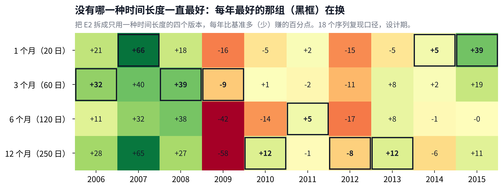

# v4 研究备忘：动态周期、真实可投资市场与检验方式

## Metadata

- Project: ETF_Rotation_Quant
- Document type: research
- Status: active（第 2 版；待 Owner 第 7 节的 2 个新选择）
- Owner: L. Loric
- Maintainer: Orchestrator
- Date: 2026-10-27
- 数据段：≤ 2015-12-31，没有计算 2016 年以后的组合收益
- 记录：`operations/work_logs/2026-10-27-orchestrator-v4-research-diagnostics.md`、`operations/work_logs/2026-10-27-orchestrator-market-state-and-pool.md`；决定：D11、D12

---

**项目愿景**　在动态周期内，从多类资产里选出 Top N 强势 ETF 轮动持有，获得超额收益、稳定跑赢被动基准，同时把回撤控制住。

| 现状 | 最重要的发现 | 需要你 |
| --- | --- | --- |
| v3.1（即 E2）进入代码冻结，作为基线留档。一次性检验**不跑**。下一步做 v4 研究。 | E2 的超额主要来自**熊市防守**：涨的月份只拿到基准涨幅的 **86%**，跌的月份只跟跌 **52%**。普通牛市里和基准打平，反弹里输得最多。它还没有做到“顺应市场”。 | 上一版的 4 个选择已定。这一版新增 **2 个选择**（第 7 节）：美股行业数据用什么、“顺应市场”怎么判。 |

## 1. 涨跌停和停牌：买不进、卖不出怎么算

卖出同样会受影响：2015 年股灾时，**13%** 的离场卖单碰上了收盘跌停。

#### 【已定：选 A（D12-1）】收盘涨停、收盘跌停、临时停牌的那天，回测还按收盘价成交吗

发生了什么

回测假设每笔交易都按当天收盘价成交。但 ETF 也有涨跌停（多数 ±10%，跟踪创业板、科创板的 ETF 是 ±20%），封板时实际买不进或卖不出。QDII 溢价太高时，交易所会临时停牌，比如你提到的今年纳指 ETF 停牌一天、全球芯片 LOF 停牌到 10:30。

你说卖出不受影响，但数据显示也会受影响。设计期 23 只有行情的 ETF 收盘涨停 **48** 次、跌停 **52** 次，集中在 2015 年 4–9 月。可交易池的 173 次离场信号里，有 **22** 次的计划卖出日该 ETF 收盘跌停，例如 2015-08-24 沪深300、中证500、创业板、红利 ETF 同日跌停。

影响有多大

设计期的主结论都用指数池，指数没有涨跌停，所以这些天被当成正常成交，**回测偏乐观**，而且偏在最要紧的时候（急跌时离场）。2016 年以后有 2016 年初熔断、2024 年 9 月底的急涨等，影响只会更明显。

停牌那天通常没有价格，已按你上一轮的选择处理：等下一个有效价再卖。买入方向，溢价控制本来就会挡住高溢价买入。

**A　收盘涨停的买单、收盘跌停的卖单、停牌，一律当作“当天成交不了”，顺延到下一个能成交的交易日**建议

和上一轮“休市等下一个有效价”是同一条规则，回测更接近真实账户。指数池也按对应 ETF 的涨跌停来判断。

**B　维持现状，按收盘价成交**

简单，但急涨急跌时回测比实际好看。

## 2. 换一种检验方式：任意时点买入，都要比基准好

每个月都当作一个买入点：E2 跑赢基准的起点约占 **63%**，跑赢纳指100 的只有 **32–45%**。

- **你的担心是对的**：十年年化 25% 对 15%，是从 2006 年 1 月这一个起点算的。换到任何一个月买入，持有 1–5 年，跑赢基准的起点都只有 **62–64%**。
- **对沪深300 很强，对美股不强**：持有 5 年，**93%** 的起点跑赢沪深300；对标普500 是 **50%**，对纳指100 只有 **32%**。

- **起点决定结果**：2006–07 年买入大幅领先；2008 年底以后买入，对基准有输有赢，对纳指100 几乎一直落后。
- **巴菲特那句话在这里也要看起点**：按人民币算，设计期里一直拿着标普500 年化只有 **5.1%**（2008 年大跌加上人民币升值），拿纳指100 是 **9.6%**，拿沪深300 是 **17.0%**。所以要比的不是某一条曲线，而是**所有起点的分布**。

**建议**　v4 把“任意起点”作为主要的检验方式：报告持有 1/3/5 年时，跑赢基准和各单一指数的起点占比、中位差、最差的一次，并单独标出策略在哪些起点会输（即策略的边界）。现行判据 ① 已经有 3 年和 5 年的版本，v4 加上单一指数对照，再把“最差的一次”写进判据。

## 3. 市场状态：是顺应了市场，还是被市场选中

牛市里人人都是股神。策略要有竞争力，得在各种市场里都站得住，而不是只被某一段行情选中。

### 3.1 先看一个基金经理常用的指标：涨的时候跟多少、跌的时候跟多少

涨的月份

基准上涨的月份，E2 平均只拿到基准涨幅的 **86%**。

跌的月份

基准下跌的月份，E2 平均只跟跌 **52%**。

这说明什么

超额来自**少跌**，不是来自**多涨**。这是一个防守型策略的特征，和“选出最强、跟上市场”的愿景还有距离。

### 3.2 按四种市场状态拆开：钱在哪里赚、在哪里亏

熊市 **+95**、回调 **+30**、牛市 **+1**、反弹 **−57**（百分点）。

怎么分：看沪深300 过去 12 个月和这个月的涨跌。大势向上、这个月也涨 = 牛市；大势向上、这个月在跌 = 回调；大势向下、这个月也跌 = 熊市；大势向下、这个月在涨 = 反弹（就是 Goulding 等人论文里的四种状态）。超额再拆成两部分：**拿现金带来的**（因为没满仓而多赚或少赚的），和**选标的带来的**（满仓的那部分选得好不好）。

| 状态 | 月数 | 跑赢月份 | 拿现金 | 选标的 | 合计 | 读法 |
| --- | --- | --- | --- | --- | --- | --- |
| **牛市** | 53 | 55% | −26 | +26 | +1 | 选标的其实有效，但没满仓的拖累把它抵消了 |
| **回调** | 21 | 71% | +21 | +9 | +30 | 及时离场在起作用 |
| **熊市** | 27 | 85% | +45 | +49 | +95 | 拿现金加上换到国债、黄金、美股，两头都赚 |
| **反弹** | 19 | 16% | −24 | −33 | −57 | 回场慢，还拿着熊市里的“赢家”，两头都亏 |

- **你的判断方向是对的，细节更具体**：E2 并不是“靠牛市赚钱”，在 53 个牛市月里它和基准几乎打平。它靠的是熊市少亏，以及 2006–07 年那一次行业分化很大的牛市：那两年“选标的”分别贡献 **+19** 和 **+25** 个百分点；到了 2014–15 年的牛市，选标的只有 **−4** 和 **+1**。
- **所以“被市场选中”有两层**：一是起点（第 2 节），二是行情的类型。它赢在下跌和行业分化大的年份，输在反弹，普通上涨时没有优势。
- **“顺应市场”在数据上的意思**：四种状态都不输。尤其牛市里选标的的收益不能被现金拖累吃掉，反弹里不能两头都亏。

### 3.3 v4 按状态要补的地方

| 状态 | E2 现在 | v4 的目标 | 对应的候选（第 4、5 节） |
| --- | --- | --- | --- |
| **牛市** | 选标的 +26，被现金 −26 抵消 | 超额为正：空位尽快补上，选择面更宽 | D3 空位当天补；D4 海外行业池 |
| **反弹** | −57，跑赢月份只有 16% | 不再两头都亏 | D1 转折点换挡 |
| **震荡与回调** | 回调 +30，横盘年份快信号吃亏 | 保持防守，减少来回打脸 | D2 按市场状态分配速度 |
| **熊市** | +95 | 别丢掉：任何改动都不能明显削弱这一块 | 所有候选都要报告这一格 |

这些是写进预注册的**预测**：每个候选事先说明它该改善哪种状态、不该伤害哪种状态，跑完再对照。数字是 E2 正式版，按日超额相加，所以是近似拆分；记录见 operations/work\_logs/2026-10-27-orchestrator-market-state-and-pool.md。

## 4. 动态周期：交易系统的核心

现在的“周期”其实是固定的：同时看 1、3、6、12 个月，平均分钱。真正动态的只有 10% 离场。

### 4.1 策略里有三个“周期”

1

**看多长**

回看期。现在固定为 20、60、120、250 日四组，各管 1/4，不随市场变化。

2

**多久调一次**

调仓频率。现在固定为每周、每月两种，离场后的空位要等到下个调仓日才补上。

3

**什么时候走**

离场。单只从高点跌 10% 就卖，每天检查，这是唯一跟着市场动的部分。

### 4.2 证据：没有一种时间长度一直最好

大起大落和反转的年份，快的赢；横盘震荡的年份，慢的赢。

- **快的赢在急变**：2009 年见底反弹，1 个月、3 个月两组比 6 个月、12 个月两组平均多赚 **37** 个百分点；2015 年多 **24** 个。
- **慢的赢在震荡**：2010–2013 年横盘，快的反复被打脸，慢的更稳。
- **“上个月谁好就用谁”没用**：月度快慢优势的方向，下个月接着成立的只有 **51–58%**，接近抛硬币。所以要靠**市场状态**来切换，不能靠最近表现。

### 4.3 能借鉴什么

| 来源 | 说了什么 | 对我们有什么用 |
| --- | --- | --- |
| **Goulding、Harvey、Mazzoleni（2023）** 《动量的转折点》 | 用快、慢两种动量把市场分成牛市、回调、熊市、反弹四种状态。快慢方向相反的时候就是转折点；把快慢两种混合起来，比单用一种好。 | 直接对应 2009 年：慢的说“还在熊市”，快的说“已经反弹”。按状态切换速度，是本备忘的主线（D1、D2）。 |
| **Daniel、Moskowitz（2016）** 《动量崩溃》 | 动量在熊市之后的急速反弹里最容易大亏，因为它还拿着熊市里的“赢家”。 | 解释了 2009 年正式版买国债、黄金的现象；回场规则要专门处理反弹期。 |
| **Moskowitz、Ooi、Pedersen（2012）** 《时间序列动量》 | 每个资产跟自己的过去比，跑赢就持有，跑输就离开。 | 就是我们“先过门槛：跑赢现金才入选”那一步，已在用。 |
| **Kaufman 的“趋势效率”** | 一段时间的净涨跌 ÷ 每天涨跌绝对值之和。接近 1 是单边，接近 0 是来回震荡。自适应均线就是按它调速度。 | 可以作为判断“单边还是震荡”的状态变量，只有 1 个参数（D2）。 |
| **Qullamaggie**（交易员笔记） | 按 1、3、6 个月涨幅分别排名，只要最强的前 1–2%。 | 就是我们的“多种时间长度”。他用纳指 10/20 日线决定做不做，这一条的 A 股版本已经检验失败，不能重做。 |
| **Martin Luk**（交易员笔记） | “环境比形态重要”：大盘刚从大跌里出来时先少拿，走稳后多拿；按自己最近的战绩调整出手。 | 支持“按市场状态调速度”，不支持“按最近表现挑速度”（4.2 已证明无效）。 |
| **Alpha101**（Kakushadze 2016） | 101 个个股量价公式，平均持有 **0.6–6.4 天**，多数是短期反转。 | 周期对不上（我们持有数周到数月），截面太窄（几十只 ETF），而且项目禁止多因子合成。最多借一个“放量确认”或“刚暴涨先不追”作为单一过滤，不建议整套搬。 |

### 4.4 v4 候选：每个只改一处

D1转折点换挡

改的是：**快慢方向相反时**，用哪组信号决定入选

E2四组各看各的，慢的两组在反弹初期只能拿现金

D1某只标的快的转正、慢的还负（反弹期），慢的两组也可以买它；快的转负、慢的还正（回调期），慢的两组也暂不新买它

是 C1 的推广，两个方向都处理。参数 0 个。

D2按市场状态分配速度

改的是：**四组之间的资金分配**

E2四组固定各 1/4

D2市场单边（趋势效率高）时快的两组多拿，震荡时慢的两组多拿

对应 4.2 和 3.2 的发现。参数 1 个（看多长时间的趋势效率），事先定死。

D3空位当天补

改的是：**离场后空出来的位置**什么时候补

E2等到下一个周/月调仓日

D3离场后的下一个交易日，就按当天排名补进下一名合格的标的

回场慢的第二个来源。参数 0 个；换手会增加，按正式成本算。

D4海外行业池

改的是：**美股能选什么**（见第 5 节）

E2美股只有纳指100、标普500 两个宽基

D4加入美股全部 GICS 行业，按固定分类整组纳入，不挑

让策略能跟上“时代风格”。参数 0 个；需要先取数。

不建议的方向：“按最近表现挑速度”（4.2 证明无效）；整套 Alpha101 或多因子合成（项目纪律禁止）；A 股大盘均线择时（已关闭）。

### 4.5 怎么检验，才不会自己骗自己

1. **先写死再跑**：v4 预注册写明 D1–D4 的规则和参数，新增自由度合计不超过 4 个。
2. **只用设计期**：2006–2015 年，前后两段（2006–10、2011–15）都要成立。
3. **按第 2 节的方式判**：任意起点跑赢基准的占比、最差的一次、对单一指数的胜率。
4. **组合也要过滤**：在写死的候选里用滚动前推来选，并报告回测过拟合概率。
5. **全部计数**：每个候选都计入尝试次数；2016 年以后仍然只跑一次。

## 5. 重建真实可投资市场：设计期可以带知识，不能带数据

那个年代境内只有 2 只美股宽基 ETF，这是事实；但那时的投资者可以直接去美国买行业 ETF。所以要还原的是“当时能买到什么”，而不是“当时境内上市了什么”。

### 5.1 这和我们已经做过的改进是同一件事

v3指数要到发布日之后才能选，2011 年以前每年只有 4–6 个可选，没能反映当时的 A 股市场

E1用官方回溯的行业指数补全 A 股：可选从 4–6 个变成 17 个，跑赢了基准

v4 · D4同样的道理用到美股：当年境内只有 2 只美股宽基，用行业指数还原当时真实可买的美股市场

这也回答了你之前的问题：跑不赢基准，原因不是没有做空工具，而是池子没有反映真实的市场。

### 5.2 证据：池子的构成，等于给每个市场设了仓位上限

- **上限从哪来**：设计期里 A 股有 14 个可选，美股只有 2 个。每次选前 N 名，美股最多占 2 个名额：N = 3 时最多 67%，N = 5 时 40%，N = 8 时 25%，六组平均最多约 **44%**。
- **上限真的在起作用**：2010–2013 年，有 **19–48%** 的调仓决策里，纳指和标普已经排在第 1、2 名，美股名额用完，第 3 名起只能选别的。那几年 E2 的美股仓位只有 12–24%。
- **这也解释了第 2 节**：2009 年以后买入，E2 大多跑不赢纳指100。

### 5.3 还原规则：五条

1

**市场范围**

当时的投资者能用合理方式买到的市场：A 股、港股、美股。

2

**同样的粒度**

每个市场按同一套行业分类拆分。A 股用中证一级 10 个行业，美股用当时的 GICS 10 个行业，港股用恒生行业指数。这样池子的构成就不会替某个市场设上限。

3

**整组纳入**

按分类整组放进来，不挑后来表现好的行业，也不按“后来有没有 ETF”去挑。

4

**时点正确，成本如实**

行业分类用当时的版本（房地产 2016 年、通信服务 2018 年才独立）。跨境的换汇、佣金、分红预扣税都按当时计入。

第 5 条：**可交易池同步扩充**。2006–2015 年境内没有对应的 QDII，可交易池就用美国本土的行业 ETF 来代表“直接去美股买”；2016 年以后境内有了的，优先用境内 QDII，并照常计算溢价。

### 5.4 “带知识、不带数据”的边界

**可以用的知识**

- 当时市场上真实存在的东西：美国 9 只行业 ETF 1998 年 12 月就已上市；GICS 行业分类 1999 年发布，标普把历史回推到 1989 年。
- 不依赖具体收益数字的机制：跨境交易怎么做、成本有哪些、分类怎么定。

**不能用的数据**

- 因为知道后来科技、AI、芯片涨得好，就单独加进这些行业或主题。
- 按“后来哪些主题有了 ETF”来挑指数。基金公司往往在主题最热时才发行。
- 用 2016 年以后的表现来调参数。

按这条边界，美股的科技行业会作为 GICS 的一个行业**自然出现在池子里**，它能不能被选中，交给排名决定。这样，你观察到的时代风格就有机会被策略抓住，又不是事后挑出来的。

### 5.5 要写进预注册的预测

- 美股强的年份，美股仓位应该能超过 44% 的旧上限。
- 任意起点对纳指100 的胜率应该高于现在的 **32–45%**。
- 牛市里“选标的”的贡献应该更大。风险是行业更细，来回切换也可能更多，所以回调和震荡状态也要单独报告。

这一节的数据：美股名额用满的比例是 18 个序列复现口径；美股仓位来自 E2 正式版。美股行业数据目前不在数据库里，需要先取数（见第 7 节选择 5）。

## 6. 路线

现在v3.1（E2）代码冻结，作为基线留档；bot 团队同时清理分支和标签

v4 准备取美股、港股行业数据（第 5 节）；回测加入涨跌停与停牌；做好任意起点和四种市场状态的检验工具

v4 预注册写死 D1–D4、每个候选该改善和不该伤害的状态（3.3 节）、判据和计数，交你批准

设计期检验只用 2006–2015，按任意起点和四种状态出体检报告

之后你再决定是否跑 2016–2026 的一次性检验

## 7. 你的决定

上一版的 4 个选择都已按建议定下（D12）。这一版新增 2 个。

已定　选择 1：涨跌停、停牌一律当作当天成交不了，顺延（第 1 节）

已定　选择 2：以任意起点为主要检验方式（第 2 节）

已定　选择 3：D1–D4 四个方向都做，每个只改一处（第 4、5 节）

已定　选择 4：4 个分解诊断计入，诊断计数 35

选择 5美股行业数据用什么（第 5 节）

A　以美国本土的行业 ETF 为主（1998 年 12 月起有 9 只），标普500 行业指数作核对 建议

这正是你说的“直接去美股买对应的行业 ETF”，价格是真实成交价，费率真实。代价是 ETF 有管理费，并且要按当时的规则扣分红预扣税。

B　以标普500 行业全收益指数为主

历史更长、更干净，但它是指数，不是能直接买的东西，需要另外假设交易成本。

两种都需要 bot 团队先取数并登记来源。港股行业指数同样先核实官方历史的起始日期。

选择 6“顺应市场”写不写进判据（第 3 节）

A　写进去：牛市、回调、熊市、反弹四种状态的超额分别报告，牛市和反弹的超额都不能为负 建议

直接对应你说的“不能只被行情选中”。按这一条，现在的 E2 在反弹（−57）上不及格，所以 v4 的候选必须真的改善它。

B　只报告，不作为判据

更宽松，但“顺应市场”就只停留在描述上。

#### 数据口径与来源

- E2 任意起点检验用正式引擎结果（PR #44 的 P1），基准与单一指数为人民币全收益。只用 2006-01 至 2015-12。
- 四种时间长度的分解用 18 个序列复现口径（不含黄金），登记为诊断 #32–#35。
- 涨跌停统计来自数据库中 23 只 ETF 的日行情（≤2015）；可交易池离场记录来自 P6。
- 市场状态：按沪深300 全收益指数（2005 年起）的 12 个月与 1 个月涨跌划分；超额按日相加后汇总，拆成“现金比例 ×（现金收益 − 基准）”和其余部分，是近似拆分。
- 美股名额用满的比例：18 个序列复现口径，月末、四个回看期分别统计。美国行业 ETF 的上市时间与 GICS 的历史，见 State Street 与标普道琼斯指数公司的公开资料。
- 记录：operations/work\_logs/2026-10-27-orchestrator-v4-research-diagnostics.md、operations/work\_logs/2026-10-27-orchestrator-market-state-and-pool.md；决定记录：operations/planning/2026-10-27-d11-owner-decisions.md、operations/planning/2026-10-27-d12-owner-decisions.md。
- 文献：Goulding, Harvey & Mazzoleni (2023), Momentum turning points, Journal of Financial Economics；Daniel & Moskowitz (2016), Momentum crashes, JFE；Moskowitz, Ooi & Pedersen (2012), Time series momentum, JFE；Kakushadze (2016), 101 Formulaic Alphas, arXiv:1601.00991。
